HỌC VIỆN NGÂN HÀNG
KHOA SAU ĐẠI HỌC

---

# BÁO CÁO BÀI TẬP CUỐI KỲ
## Học phần: Phân tích Kinh doanh (Business Analytics)

### Đề tài: Tác động của Trí tuệ nhân tạo (AI) đến Việc làm năm 2030

| | |
|---|---|
| **Tập dữ liệu nghiên cứu** | `AI_ViecLam2030_Raw.csv` — 3.000 quan sát, 18 biến gốc, 20 nghề nghiệp |
| **Sinh viên thực hiện** | Đỗ Văn Đạt |
| **Học phần** | Phân tích Kinh doanh |
| **Năm học** | 2025 – 2026 |

---

## MỤC LỤC

1. [MỞ ĐẦU](#mở-đầu)
2. [DANH MỤC CHỮ VIẾT TẮT](#danh-mục-chữ-viết-tắt)
3. [CHƯƠNG 1: CƠ SỞ LÝ THUYẾT VÀ TỔNG QUAN VẤN ĐỀ](#chương-1-cơ-sở-lý-thuyết-và-tổng-quan-vấn-đề)
   - 1.1. Trí tuệ nhân tạo và tự động hoá công việc
   - 1.2. Cách tiếp cận theo tác vụ (Task-Based Approach)
   - 1.3. Các nghiên cứu thực nghiệm liên quan
   - 1.4. Khung phân tích áp dụng cho đề tài
4. [CHƯƠNG 2: DỮ LIỆU VÀ PHƯƠNG PHÁP NGHIÊN CỨU](#chương-2-dữ-liệu-và-phương-pháp-nghiên-cứu)
   - 2.1. Mô tả dữ liệu
   - 2.2. Quy trình tiền xử lý dữ liệu
   - 2.3. Phân tích khám phá dữ liệu (EDA)
   - 2.4. Phương pháp mô hình hoá
5. [CHƯƠNG 3: KẾT QUẢ THỰC NGHIỆM VÀ THẢO LUẬN](#chương-3-kết-quả-thực-nghiệm-và-thảo-luận)
   - 3.1. Kết quả phân cụm hồ sơ kỹ năng
   - 3.2. Kết quả mô hình phân loại Risk_Category
   - 3.3. Kết quả mô hình hồi quy Automation_Probability_2030
   - 3.4. Thảo luận: vì sao đặc điểm nghề nghiệp quyết định, đặc điểm cá nhân thì không
   - 3.5. Hàm ý quản trị nhân sự
   - 3.6. Hạn chế của nghiên cứu
6. [KẾT LUẬN](#kết-luận)
7. [TÀI LIỆU THAM KHẢO](#tài-liệu-tham-khảo)

---

## MỞ ĐẦU

### 1. Lý do chọn đề tài

Trí tuệ nhân tạo đang mở rộng phạm vi ứng dụng từ các tác vụ lặp lại, mang tính thủ tục sang cả
những công việc đòi hỏi phán đoán và tương tác phức tạp hơn. Các tổ chức nghiên cứu quốc tế đưa ra
những ước lượng khác nhau về tỷ lệ việc làm có nguy cơ bị tự động hoá trong 5 đến 10 năm tới, và
phần lớn các nghiên cứu này đồng thuận ở một điểm: mức độ rủi ro không đồng đều giữa các nhóm nghề
nghiệp. Tuy vậy, câu hỏi cụ thể hơn — yếu tố nào thực sự quyết định mức độ rủi ro đó, đặc điểm cá
nhân của người lao động hay bản chất của chính công việc — cần được kiểm định trên từng bộ dữ liệu
cụ thể chứ không thể mặc định đúng cho mọi bối cảnh. Đề tài lựa chọn phân tích một bộ dữ liệu mô
phỏng gắn với chủ đề này nhằm rèn luyện quy trình phân tích kinh doanh trọn vẹn — từ tiền xử lý dữ
liệu, phân tích khám phá, đến phân cụm và mô hình hoá dự báo — đồng thời kiểm định thực nghiệm một
giả thuyết học thuật cụ thể trên dữ liệu thực nghiệm của bài tập.

### 2. Mục đích và phạm vi nghiên cứu

Mục đích của bài tập là vận dụng quy trình phân tích kinh doanh đầy đủ (tiền xử lý dữ liệu, phân
tích khám phá dữ liệu, phân cụm, phân loại, hồi quy) trên bộ dữ liệu mô phỏng gồm 3.000 quan sát,
18 biến gốc, mô tả đặc điểm của 20 nghề nghiệp gắn với các chỉ số phơi nhiễm trí tuệ nhân tạo, xác
suất và nhóm rủi ro tự động hoá năm 2030.

Phạm vi nghiên cứu giới hạn trong nội dung của bộ dữ liệu đã cho — một bộ dữ liệu tổng hợp
(synthetic) phục vụ mục đích luyện tập kỹ thuật phân tích, không phải dữ liệu khảo sát thực địa.
Do đó, các kết luận rút ra chỉ có giá trị nội tại đối với tập dữ liệu này; phần liên hệ với thực
tiễn thị trường lao động được đối chiếu thận trọng với các nghiên cứu học thuật đã công bố (Chương
1) chứ không được suy rộng trực tiếp từ kết quả thực nghiệm của bài tập.

Phong cách trình bày quy trình phân tích trong báo cáo — đọc dữ liệu, hiển thị các dòng đầu, tiến
hành tiền xử lý rồi mới đến phân tích khám phá dữ liệu và mô hình hoá — có tham khảo cấu trúc trình
bày của notebook mẫu trên nền tảng Kaggle: *Predicting Uber Ride Cancellations*
(https://www.kaggle.com/code/denvermagtibay/predicting-uber-ride-cancellations). Bộ dữ liệu của
notebook tham khảo (lượt đặt xe công nghệ) không được sử dụng làm dữ liệu nghiên cứu của đề tài
này; notebook chỉ được dùng làm tham chiếu về trình tự trình bày một quy trình phân tích dữ liệu.

### 3. Kết cấu đề tài

Ngoài phần Mở đầu và Kết luận, nội dung báo cáo gồm ba chương:

- **Chương 1 — Cơ sở lý thuyết và tổng quan vấn đề:** hệ thống hoá khái niệm trí tuệ nhân tạo và
  tự động hoá, khung phân tích tiếp cận theo tác vụ, cùng các nghiên cứu quốc tế về tác động của
  trí tuệ nhân tạo đến việc làm.
- **Chương 2 — Dữ liệu và phương pháp nghiên cứu:** mô tả bộ dữ liệu, trình bày quy trình tiền xử
  lý, kết quả phân tích khám phá dữ liệu và phương pháp mô hình hoá được áp dụng.
- **Chương 3 — Kết quả thực nghiệm và thảo luận:** trình bày kết quả phân cụm, phân loại, hồi quy;
  thảo luận nguyên nhân của kết quả thu được và hàm ý đối với quản trị nhân sự.

---

## DANH MỤC CHỮ VIẾT TẮT

| Chữ viết tắt | Diễn giải |
|---|---|
| AI | Artificial Intelligence — Trí tuệ nhân tạo |
| AUC | Area Under the ROC Curve — Diện tích dưới đường cong ROC |
| EDA | Exploratory Data Analysis — Phân tích khám phá dữ liệu |
| F1 | F1-Score — Điểm điều hoà giữa Precision và Recall |
| IQR | Interquartile Range — Khoảng tứ phân vị |
| K-Means | Thuật toán phân cụm K-Means |
| MAE | Mean Absolute Error — Sai số tuyệt đối trung bình |
| PCA | Principal Component Analysis — Phân tích thành phần chính |
| R² | Hệ số xác định (Coefficient of Determination) |
| RMSE | Root Mean Squared Error — Căn bậc hai sai số bình phương trung bình |
| ROC | Receiver Operating Characteristic |
| OvR | One-vs-Rest — phương pháp đánh giá đa lớp theo cách "một lớp và phần còn lại" |
| XGBoost | Extreme Gradient Boosting |

---

## CHƯƠNG 1: CƠ SỞ LÝ THUYẾT VÀ TỔNG QUAN VẤN ĐỀ

### 1.1. Trí tuệ nhân tạo và tự động hoá công việc

Trong kinh tế lao động, tự động hoá (automation) được hiểu là quá trình máy móc hoặc phần mềm
đảm nhiệm các tác vụ mà trước đây do con người thực hiện. Làn sóng tự động hoá đầu tiên tập trung
chủ yếu vào các tác vụ thủ tục, có tính lặp lại cao trong sản xuất và vận hành. Trí tuệ nhân tạo
hiện đại — đặc biệt các mô hình học máy và học sâu — mở rộng khả năng tự động hoá sang cả các tác
vụ mang tính nhận thức (cognitive tasks), vốn trước đây được xem là khó thay thế bằng công nghệ,
bên cạnh các tác vụ thủ tục đã bị tự động hoá từ trước. Sự mở rộng phạm vi này đặt ra yêu cầu phân
tích lại một cách có hệ thống nghề nghiệp nào thực sự đối mặt với rủi ro tự động hoá, thay vì dựa
hoàn toàn vào trực giác.

### 1.2. Cách tiếp cận theo tác vụ (Task-Based Approach)

Autor, Levy và Murnane phát triển một khung phân tích trong đó rủi ro tự động hoá của một công
việc phụ thuộc vào tỷ trọng các tác vụ thủ tục (routine) so với các tác vụ phi thủ tục
(non-routine) mà công việc đó đòi hỏi, thay vì phụ thuộc vào đặc điểm của cá nhân đảm nhiệm công
việc [1]. Theo khung phân tích này, hai tác vụ có cùng mức độ phức tạp về kỹ năng nhưng khác nhau
về tính chất thủ tục sẽ có mức độ rủi ro tự động hoá khác nhau đáng kể; ngược lại, hai người lao
động có hồ sơ năng lực cá nhân tương đồng nhưng đảm nhiệm hai công việc có bản chất tác vụ khác
nhau có thể đối mặt mức rủi ro rất khác nhau.

Hàm ý cốt lõi của khung phân tích này là: rủi ro tự động hoá được xác định chủ yếu ở cấp độ NGHỀ
NGHIỆP (bản chất tác vụ của công việc), không phải ở cấp độ NGƯỜI LAO ĐỘNG cụ thể. Đây chính là
giả thuyết trung tâm được kiểm định bằng thực nghiệm ở Chương 3 của báo cáo, trên dữ liệu thực
nghiệm của bài tập.

### 1.3. Các nghiên cứu thực nghiệm liên quan

Frey và Osborne ước lượng xác suất tự động hoá của 702 nghề nghiệp tại Hoa Kỳ dựa trên mức độ đòi
hỏi về khả năng sáng tạo, kỹ năng đàm phán và nhận thức xã hội của từng nghề, và kết luận rằng
khoảng 47% việc làm có nguy cơ tự động hoá cao trong khoảng một đến hai thập kỷ tới [2]. Acemoglu
và Restrepo mở rộng khung phân tích bằng mô hình "hiệu ứng thay thế so với hiệu ứng tái bố trí"
(displacement vs. reinstatement effect), trong đó tự động hoá vừa thay thế lao động ở một số tác
vụ nhất định, vừa đồng thời tạo ra các tác vụ mới đòi hỏi lao động con người; tác động ròng lên
việc làm phụ thuộc vào tốc độ tương đối của hai hiệu ứng này trong từng ngành nghề cụ thể [3]. Ở
cấp độ tổ chức quốc tế, McKinsey Global Institute ước lượng đến 375 triệu lao động toàn cầu có thể
cần chuyển đổi nghề nghiệp do tự động hoá vào năm 2030 [4], trong khi Diễn đàn Kinh tế Thế giới
công bố định kỳ Báo cáo Tương lai Việc làm (Future of Jobs Report), theo dõi biến động cơ cấu việc
làm do trí tuệ nhân tạo và tự động hoá thông qua các vòng khảo sát doanh nghiệp quy mô toàn cầu
[5].

Điểm chung của các nghiên cứu này là: thứ nhất, rủi ro tự động hoá phân bố không đồng đều giữa các
nhóm nghề nghiệp; thứ hai, nghề có tỷ trọng tác vụ thủ tục hoặc lặp lại cao — như vận tải, bán lẻ,
dịch vụ khách hàng cơ bản, xây dựng — có xu hướng đối mặt mức độ rủi ro cao hơn so với nghề đòi
hỏi phán đoán chuyên môn sâu, khả năng sáng tạo hoặc năng lực chăm sóc con người — như y tế, giáo
dục, nghiên cứu khoa học.

### 1.4. Khung phân tích áp dụng cho đề tài

Dựa trên khung tiếp cận theo tác vụ trình bày ở mục 1.2, Chương 2 và Chương 3 của báo cáo sẽ kiểm
định thực nghiệm giả thuyết sau trên dữ liệu của bài tập: biến định danh NGHỀ NGHIỆP (`Job_Title`)
giải thích rủi ro tự động hoá tốt hơn các biến ĐẶC ĐIỂM CÁ NHÂN (kỹ năng, kinh nghiệm, học vấn,
lương). Việc kiểm định được thực hiện qua ba bước độc lập bổ sung cho nhau: phân tích khám phá dữ
liệu (Chương 2, mục 2.3), phân cụm không giám sát trên hồ sơ kỹ năng cá nhân (Chương 3, mục 3.1),
và hai mô hình dự báo có giám sát — phân loại và hồi quy (Chương 3, mục 3.2 và 3.3).

**Tóm tắt Chương 1.** Chương 1 hệ thống hoá khung lý thuyết tiếp cận theo tác vụ (task-based
approach) và các nghiên cứu thực nghiệm quốc tế về tác động của trí tuệ nhân tạo đến việc làm, làm
cơ sở đối chiếu cho kết quả thực nghiệm ở Chương 3. Điểm mấu chốt được kế thừa xuyên suốt báo cáo
là: rủi ro tự động hoá gắn với bản chất tác vụ của nghề nghiệp hơn là đặc điểm cá nhân người lao
động — giả thuyết này sẽ được kiểm định trực tiếp trên dữ liệu thực nghiệm ở các chương tiếp theo.

---

## CHƯƠNG 2: DỮ LIỆU VÀ PHƯƠNG PHÁP NGHIÊN CỨU

### 2.1. Mô tả dữ liệu

Bộ dữ liệu nghiên cứu gồm 3.000 quan sát và 18 biến gốc, mô tả đặc điểm của 20 nghề nghiệp phổ
biến. Mỗi quan sát tương ứng với một hồ sơ nghề nghiệp, gồm ba nhóm biến: (i) đặc điểm cá nhân và
nghề nghiệp (`Job_Title`, `Average_Salary`, `Years_Experience`, `Education_Level`); (ii) chỉ số
công nghệ (`AI_Exposure_Index`, `Tech_Growth_Factor`); (iii) mười điểm kỹ năng chuẩn hoá
(`Skill_1` đến `Skill_10`) và hai biến mục tiêu (`Automation_Probability_2030`,
`Risk_Category`). Bảng 2.1 trình bày đầy đủ diễn giải của từng biến.

**Bảng 2.1 — Mô tả các biến trong bộ dữ liệu gốc**

| Biến | Loại biến | Diễn giải |
|---|---|---|
| Job_Title | Định danh | Tên 20 nghề nghiệp khảo sát |
| Average_Salary | Định lượng | Lương trung bình (USD/năm) |
| Years_Experience | Định lượng | Số năm kinh nghiệm |
| Education_Level | Định tính thứ bậc | High School / Bachelor's / Master's / PhD |
| AI_Exposure_Index | Định lượng, miền [0, 1] | Chỉ số mức độ phơi nhiễm với công nghệ trí tuệ nhân tạo |
| Tech_Growth_Factor | Định lượng | Hệ số tăng trưởng công nghệ của ngành nghề |
| Automation_Probability_2030 | Định lượng, miền [0, 1] | Xác suất tự động hoá dự kiến năm 2030 (biến mục tiêu) |
| Risk_Category | Định tính (Low / Medium / High) | Nhóm rủi ro tự động hoá (biến mục tiêu) |
| Skill_1 … Skill_10 | Định lượng, miền [0, 1] (10 biến) | Điểm chuẩn hoá của 10 nhóm kỹ năng nghề nghiệp |

Về cơ cấu mẫu, 20 nghề nghiệp phân bố tương đối đồng đều với số quan sát dao động từ 132 đến 175
hồ sơ mỗi nghề (Bảng 2.2), và bốn nhóm trình độ học vấn cũng phân bố tương đối cân bằng: Trung học
phổ thông (High School) 784 hồ sơ, Cử nhân (Bachelor's) 765 hồ sơ, Thạc sĩ (Master's) 735 hồ sơ,
Tiến sĩ (PhD) 716 hồ sơ.

**Bảng 2.2 — Số lượng quan sát theo từng nghề nghiệp (sắp xếp giảm dần)**

| Nghề nghiệp | Số quan sát | Nghề nghiệp | Số quan sát |
|---|---|---|---|
| Software Engineer | 175 | Truck Driver | 153 |
| UX Researcher | 167 | Financial Analyst | 151 |
| Data Scientist | 167 | Research Scientist | 149 |
| Teacher | 166 | Nurse | 142 |
| Graphic Designer | 160 | Chef | 141 |
| HR Specialist | 157 | AI Engineer | 140 |
| Construction Worker | 156 | Mechanic | 136 |
| Retail Worker | 155 | Marketing Manager | 134 |
| Security Guard | 154 | Customer Support | 133 |
| — | — | Lawyer / Doctor | 132 (mỗi nghề) |

### 2.2. Quy trình tiền xử lý dữ liệu

Quy trình tiền xử lý gồm sáu bước: (1) kiểm tra dữ liệu thiếu; (2) loại bỏ dòng trùng lặp; (3)
kiểm tra miền giá trị hợp lệ của các chỉ số chuẩn hoá trong đoạn [0, 1]; (4) phát hiện ngoại lai
bằng quy tắc khoảng tứ phân vị (IQR) trên biến lương; (5) kiểm tra rủi ro rò rỉ dữ liệu (data
leakage) giữa `Risk_Category` và `Automation_Probability_2030`; (6) tạo bảy biến đặc trưng mới
phục vụ mô hình hoá. Bảng 2.3 tổng hợp kết quả từng bước.

**Bảng 2.3 — Tổng hợp kết quả tiền xử lý dữ liệu**

| Bước / Kiểm tra | Kết quả |
|---|---|
| Dữ liệu thiếu | 0 ô — không phát hiện dữ liệu thiếu trên toàn bộ 3.000 dòng x 18 cột |
| Dữ liệu trùng lặp | 0 dòng bị loại |
| Vi phạm miền giá trị [0, 1] | 0 dòng bị loại (toàn bộ chỉ số chuẩn hoá đều nằm đúng miền quy định) |
| Ngoại lai theo quy tắc IQR (Average_Salary) | Q1 = 58.640 USD; Q3 = 119.087 USD; khoảng tứ phân vị IQR = 60.447 USD; cận trên = 209.756 USD; không có hồ sơ nào vượt cận trên hoặc thấp hơn cận dưới — 0 hồ sơ ngoại lai |
| Kiểm tra rò rỉ dữ liệu (data leakage) | `Risk_Category` là hàm ngưỡng cố định của `Automation_Probability_2030` (Low: 0,05–0,30; Medium: 0,31–0,70; High: 0,71–0,95, không chồng lấn) → loại biến liên tục này khỏi tập đặc trưng khi huấn luyện mô hình phân loại |
| Biến mới được tạo thêm | 7 biến: `Skill_Diversity_Score`, `Skill_Std`, `High_Value_Skill_Count`, `Experience_Group`, `Salary_per_YearExp`, `Human_Edge_Score`, `Education_Level_Encoded` |
| Kích thước dữ liệu sau tiền xử lý | 3.000 dòng x 25 cột |

Về ý nghĩa của từng biến mới: `Skill_Diversity_Score` là điểm kỹ năng trung bình trên 10 nhóm kỹ
năng, đại diện cho mức độ đa kỹ năng của một hồ sơ nghề nghiệp; `Skill_Std` là độ lệch chuẩn giữa
10 điểm kỹ năng, phản ánh mức độ chuyên sâu vào một số ít lĩnh vực thay vì dàn trải; `High_Value_
Skill_Count` đếm số kỹ năng đạt điểm lớn hơn 0,7; `Salary_per_YearExp` là mức lương quy đổi trên
mỗi năm kinh nghiệm; và `Human_Edge_Score` là chỉ số tổng hợp tự xây dựng, bằng 50% (1 −
`AI_Exposure_Index`) cộng 50% `Skill_Diversity_Score`, đặt giả thuyết rằng lợi thế cạnh tranh của
con người trước trí tuệ nhân tạo đến từ hai yếu tố: mức phơi nhiễm thấp với công nghệ tự động hoá
và sự đa dạng của hồ sơ kỹ năng. Chỉ số này mang tính minh hoạ khái niệm, chưa được kiểm định
thống kê độc lập, và kết quả ở mục 2.3 (Hình 2.11) cho thấy chỉ số này cũng không phân biệt được
nhóm rủi ro, nhất quán với các thành phần cấu thành nó.

### 2.3. Phân tích khám phá dữ liệu (EDA)

Mục này trình bày mười một biểu đồ khám phá dữ liệu, được sắp xếp theo trình tự đi từ phân bố các
biến đơn lẻ, đến mối quan hệ hai biến với biến mục tiêu, nhằm xác định một cách có hệ thống biến
nào thực sự mang thông tin phân biệt nhóm rủi ro tự động hoá.

**Hình 2.1 — Phân bố số lượng nghề nghiệp theo Nhóm rủi ro tự động hoá 2030**
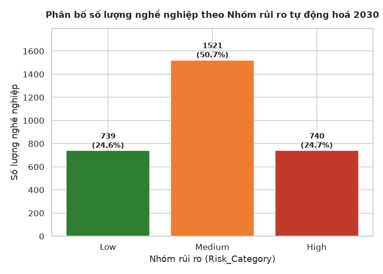

Nhóm rủi ro `Medium` chiếm đa số với 1.521 quan sát, tương đương 50,7% tổng mẫu; hai nhóm `Low` và
`High` gần như cân bằng, lần lượt chiếm 24,6% (739 quan sát) và 24,7% (740 quan sát). Cơ cấu này
phản ánh cách chia ngưỡng đối xứng của biến `Automation_Probability_2030` quanh khoảng giữa
(0,31–0,70 cho nhóm Medium), không phản ánh phân bố nghề nghiệp thực tế ngoài đời sống.

**Hình 2.2 — Phân bố Xác suất tự động hoá công việc vào năm 2030**
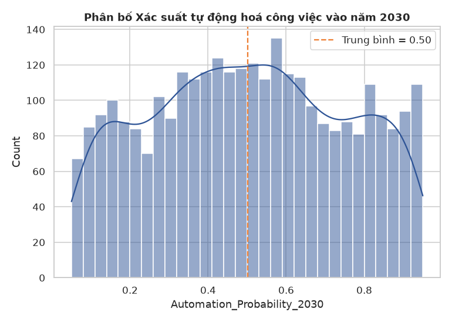

Phân bố của `Automation_Probability_2030` không có dạng đường cong chuẩn (normal) trơn thông
thường, mà thể hiện ba vùng mật độ tách biệt tương đối rõ rệt. Đặc điểm này gợi ý ngay từ bước
khám phá dữ liệu ban đầu rằng biến mục tiêu có thể phụ thuộc vào một yếu tố mang tính phân loại
tiềm ẩn, thay vì biến thiên liên tục và ngẫu nhiên quanh một giá trị trung tâm duy nhất. Yếu tố
tiềm ẩn này sẽ được xác định cụ thể ở Hình 2.8.

**Hình 2.3 — Mức lương trung bình theo Nhóm rủi ro tự động hoá**
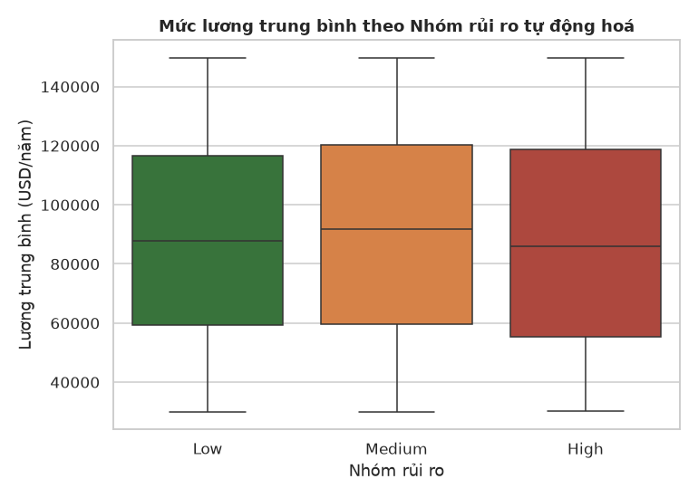

Trung vị và độ trải (interquartile range) của biến `Average_Salary` gần như tương đồng giữa ba
nhóm rủi ro. Kết quả này cho thấy mức lương không phải là yếu tố phân biệt nhóm rủi ro tự động hoá
trong bộ dữ liệu nghiên cứu — một phát hiện đáng chú ý vì trực giác thông thường thường gắn mức
lương cao với công việc ít bị tự động hoá hơn.

**Hình 2.4 — Cơ cấu Nhóm rủi ro theo Trình độ học vấn**
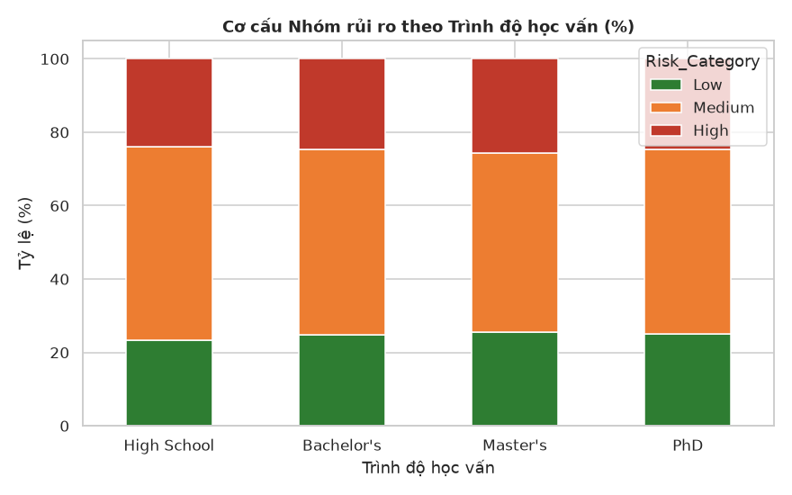

Cơ cấu tỷ lệ ba nhóm rủi ro gần như đồng nhất giữa bốn nhóm trình độ học vấn (xấp xỉ 25% Low, 50%
Medium, 25% High ở mỗi nhóm học vấn). Cũng giống như biến lương, trình độ học vấn không phải là
yếu tố phân biệt nhóm rủi ro trong bộ dữ liệu này, trái với kỳ vọng thông thường rằng trình độ học
vấn cao hơn gắn với công việc ít có nguy cơ bị tự động hoá thay thế.

**Hình 2.5 — Chỉ số Phơi nhiễm AI so với Xác suất tự động hoá 2030**
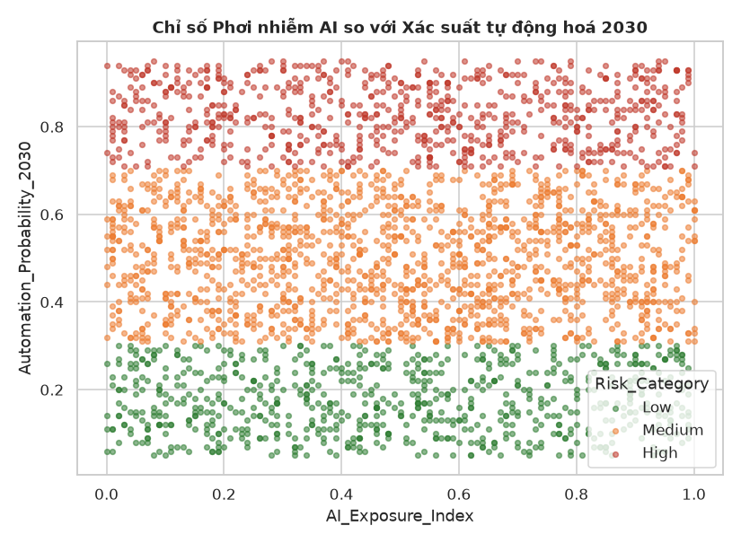

Các điểm quan sát phân tán đồng đều theo mọi hướng trên đồ thị phân tán, không thể hiện xu hướng
tuyến tính rõ rệt giữa hai biến. Đáng lưu ý là `AI_Exposure_Index` — một chỉ số có tên gọi tưởng
như liên quan trực tiếp đến chủ đề nghiên cứu — thực chất không tương quan với xác suất tự động
hoá trong bộ dữ liệu mô phỏng này.

**Hình 2.6 — Ma trận tương quan giữa các biến định lượng chính**
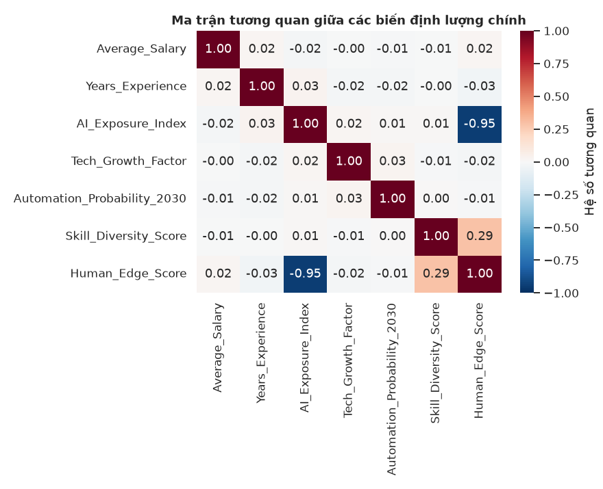

Toàn bộ hệ số tương quan Pearson giữa `Automation_Probability_2030` và các biến định lượng còn lại
đều có trị tuyệt đối nhỏ hơn 0,05. Kết quả này khẳng định một cách tổng hợp và định lượng cho các
quan sát riêng lẻ ở Hình 2.3 đến Hình 2.5: không có biến định lượng cấp cá nhân nào giải thích
được sự biến thiên của biến mục tiêu.

**Hình 2.7 — Số năm kinh nghiệm và Xác suất tự động hoá 2030**
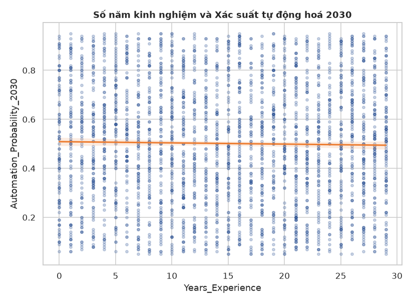

Đường hồi quy tuyến tính giữa hai biến gần như phẳng, hệ số góc xấp xỉ không. Số năm kinh nghiệm
làm việc — một biến thường được xem là chỉ báo cho mức độ thành thạo và khả năng thích ứng — không
làm giảm hay tăng rủi ro tự động hoá một cách có ý nghĩa trong bộ dữ liệu nghiên cứu.

**Hình 2.8 — Xác suất tự động hoá trung bình theo Nghề nghiệp (20 nghề) — bằng chứng then chốt**
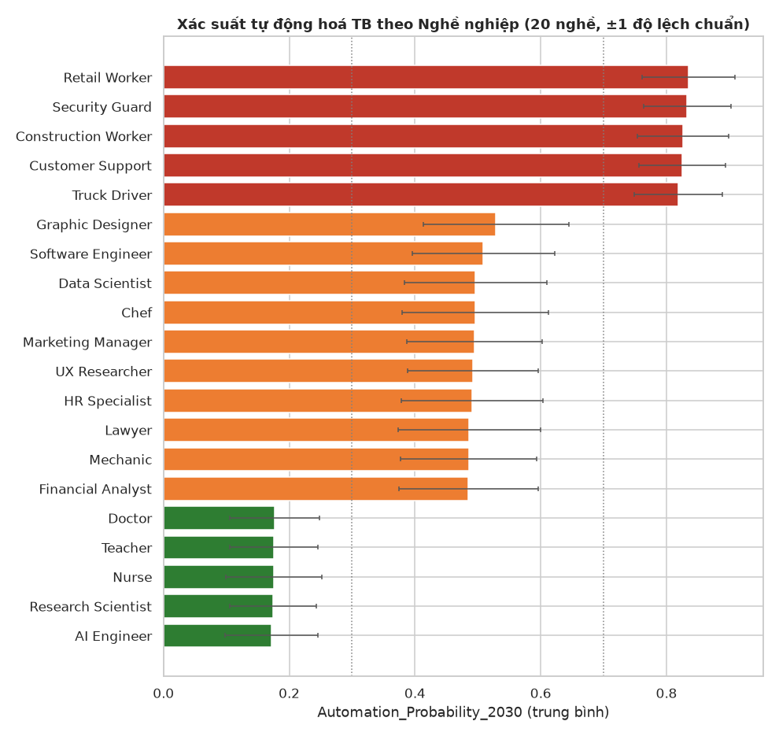

Sau khi loại trừ mọi biến định lượng cấp cá nhân ở các hình trên, bước phân tích cuối cùng kiểm tra
biến định danh duy nhất còn lại của bộ dữ liệu: `Job_Title`. Kết quả cho thấy 20 nghề nghiệp tách
thành ba tầng rất rõ rệt, gần như không có vùng chuyển tiếp mờ nhạt giữa các tầng (Bảng 2.4).

**Bảng 2.4 — Xếp hạng đầy đủ 20 nghề nghiệp theo Xác suất tự động hoá trung bình**

| Hạng | Nghề nghiệp | Số quan sát | Xác suất tự động hoá trung bình | Tầng |
|---:|---|---:|---:|---|
| 1 | AI Engineer | 140 | 0,1722 | Thấp |
| 2 | Research Scientist | 149 | 0,1742 | Thấp |
| 3 | Nurse | 142 | 0,1756 | Thấp |
| 4 | Teacher | 166 | 0,1758 | Thấp |
| 5 | Doctor | 132 | 0,1767 | Thấp |
| 6 | Financial Analyst | 151 | 0,4851 | Trung bình |
| 7 | Mechanic | 136 | 0,4853 | Trung bình |
| 8 | Lawyer | 132 | 0,4864 | Trung bình |
| 9 | HR Specialist | 157 | 0,4908 | Trung bình |
| 10 | UX Researcher | 167 | 0,4924 | Trung bình |
| 11 | Marketing Manager | 134 | 0,4948 | Trung bình |
| 12 | Chef | 141 | 0,4957 | Trung bình |
| 13 | Data Scientist | 167 | 0,4963 | Trung bình |
| 14 | Software Engineer | 175 | 0,5087 | Trung bình |
| 15 | Graphic Designer | 160 | 0,5290 | Trung bình |
| 16 | Truck Driver | 153 | 0,8186 | Cao |
| 17 | Customer Support | 133 | 0,8253 | Cao |
| 18 | Construction Worker | 156 | 0,8260 | Cao |
| 19 | Security Guard | 154 | 0,8331 | Cao |
| 20 | Retail Worker | 155 | 0,8347 | Cao |

Tầng thấp (xác suất trung bình xấp xỉ 0,17–0,18) gồm các nghề đòi hỏi phán đoán chuyên môn sâu
hoặc năng lực chăm sóc/tương tác con người cường độ cao: AI Engineer, Research Scientist, Nurse,
Teacher, Doctor. Tầng trung bình (xấp xỉ 0,49–0,53) gồm mười nghề chuyên môn hoặc văn phòng còn
lại. Tầng cao (xấp xỉ 0,82–0,83) gồm các nghề có tỷ trọng tác vụ lặp lại hoặc mang tính thủ tục
tương đối cao: Truck Driver, Customer Support, Construction Worker, Security Guard, Retail Worker.

Để lượng hoá mức độ giải thích của `Job_Title` đối với biến mục tiêu, báo cáo tính hệ số eta bình
phương theo công thức phân rã phương sai một yếu tố (η² = tổng bình phương giữa nhóm chia cho tổng
bình phương toàn phần, SSB/SST). Kết quả: `Job_Title` giải thích 85,7% phương sai của
`Automation_Probability_2030` — vượt trội hoàn toàn so với mọi biến định lượng cấp cá nhân đã kiểm
tra ở Hình 2.3 đến Hình 2.7, nơi hệ số tương quan tuyệt đối cao nhất chưa đến 0,05. Phát hiện này
phù hợp về mặt định tính với khung tiếp cận theo tác vụ trình bày ở mục 1.2, và định hướng trực
tiếp chiến lược mô hình hoá ở mục 2.4: biến `Job_Title` bắt buộc phải được đưa vào tập đặc trưng
của các mô hình dự báo ở Chương 3.

**Hình 2.9 — Hệ số tăng trưởng công nghệ (Tech_Growth_Factor) theo Nhóm rủi ro**
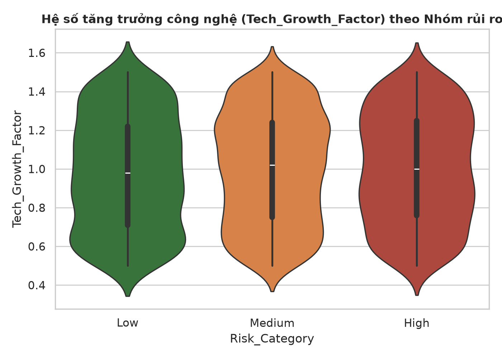

Phân bố của `Tech_Growth_Factor` — thể hiện qua biểu đồ vi ô lin (violin plot) — có hình dạng
tương tự nhau ở cả ba nhóm rủi ro, không cho thấy sự khác biệt có ý nghĩa.

**Hình 2.10 — Điểm trung bình 10 nhóm kỹ năng theo Nhóm rủi ro**
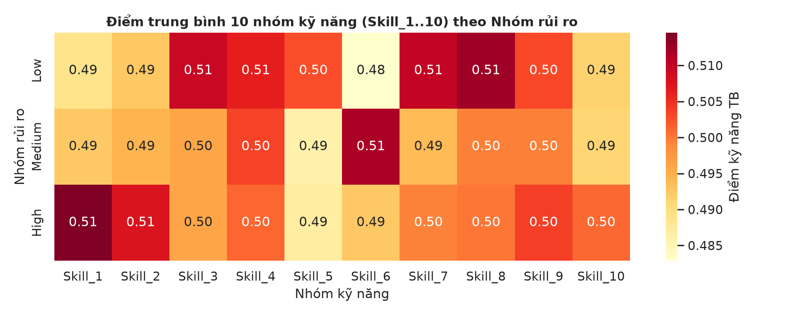

Điểm kỹ năng trung bình trên cả 10 nhóm kỹ năng và cả 3 nhóm rủi ro dao động trong một khoảng rất
hẹp, từ 0,48 đến 0,52. Không có ô nào trong ma trận nhiệt (heatmap) nổi bật khác biệt so với phần
còn lại, cho thấy không nhóm kỹ năng đơn lẻ nào mang thông tin phân biệt rủi ro.

**Hình 2.11 — Chỉ số Lợi thế con người (Human_Edge_Score) theo Nhóm rủi ro**
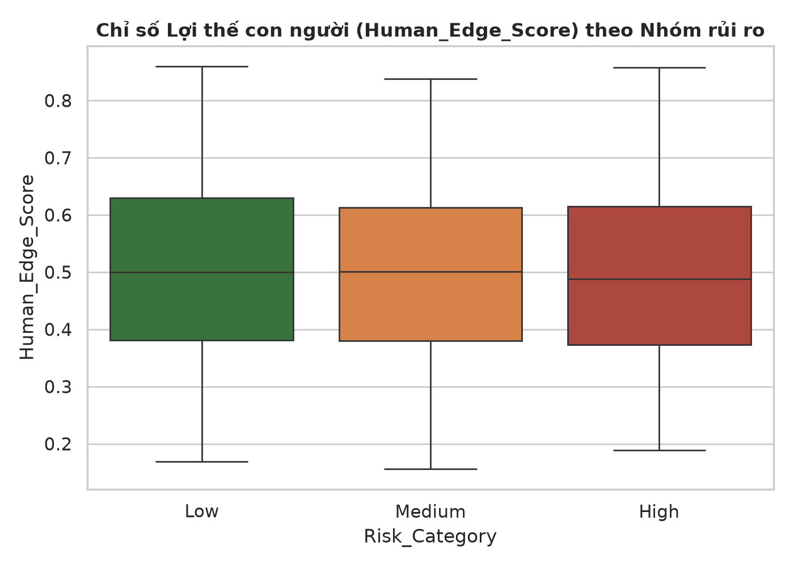

Chỉ số tổng hợp tự xây dựng `Human_Edge_Score` cũng không phân biệt được ba nhóm rủi ro, kết quả
nhất quán với các biến thành phần cấu thành chỉ số này (`AI_Exposure_Index` và
`Skill_Diversity_Score`) đã được kiểm tra riêng lẻ ở các hình trước.

### 2.4. Phương pháp mô hình hoá

**2.4.1. Phân cụm K-Means.** Thuật toán K-Means được áp dụng trên 12 biến (10 điểm kỹ năng cộng
`AI_Exposure_Index` và `Tech_Growth_Factor`) sau khi chuẩn hoá bằng StandardScaler nhằm đưa các
biến về cùng thang đo. Số cụm k được thử nghiệm trong khoảng từ 2 đến 8, lựa chọn dựa trên kết hợp
phương pháp Elbow (điểm gãy của đường cong quán tính nội cụm — inertia) và chỉ số Silhouette (đo
mức độ tách biệt giữa các cụm, nhận giá trị trong đoạn [-1, 1], càng gần 1 càng tốt). Kết quả phân
cụm được trực quan hoá bằng phân tích thành phần chính (PCA) rút gọn về hai chiều.

**2.4.2. Mô hình phân loại `Risk_Category`.** Ba mô hình phân loại được huấn luyện và so sánh:
Logistic Regression, Random Forest, và XGBoost Classifier. Tập đặc trưng gồm các biến cá nhân/kỹ
năng đã trình bày ở mục 2.2 và mục 2.3, cộng thêm biến `Job_Title` được mã hoá one-hot với tham số
`drop_first=True` (sinh ra 19 biến giả) — theo phát hiện ở Hình 2.8. Biến
`Automation_Probability_2030` bị loại khỏi tập đặc trưng để tránh rò rỉ dữ liệu, như đã trình bày ở
mục 2.2. Dữ liệu được chia thành tập huấn luyện và tập kiểm định theo tỷ lệ 75/25, sử dụng phương
pháp phân tầng (stratify) theo `Risk_Category` để bảo đảm tỷ lệ ba nhóm rủi ro giữ nguyên ở cả hai
tập. Hiệu suất mô hình được đánh giá bằng bốn nhóm chỉ số: Accuracy, Precision/Recall/F1-score theo
phương pháp trung bình vĩ mô (macro-average, phù hợp khi các lớp không cân bằng hoàn toàn), và
ROC-AUC theo phương pháp một-đối-còn-lại (One-vs-Rest).

**2.4.3. Mô hình hồi quy `Automation_Probability_2030`.** Sử dụng cùng tập đặc trưng của mục
2.4.2, ba mô hình hồi quy được huấn luyện để dự báo trực tiếp giá trị liên tục của biến mục tiêu:
Linear Regression, Random Forest Regressor, và XGBoost Regressor. Mục đích của bước này là tạo ra
một kênh kiểm chứng độc lập cho kết quả phân loại ở mục 2.4.2 — nếu cả hai phương pháp đánh giá
độc lập (phân loại trên biến rời rạc và hồi quy trên biến liên tục) đều cho cùng kết luận, độ tin
cậy của phát hiện sẽ được củng cố đáng kể. Hiệu suất được đánh giá bằng hệ số xác định R², sai số
tuyệt đối trung bình (MAE) và căn bậc hai sai số bình phương trung bình (RMSE).

**Tóm tắt Chương 2.** Chương 2 mô tả bộ dữ liệu 3.000 quan sát sau tiền xử lý và trình bày mười
một biểu đồ phân tích khám phá dữ liệu. Phát hiện xuyên suốt của chương là: các biến đặc điểm cá
nhân/kỹ năng (lương, kinh nghiệm, học vấn, chỉ số phơi nhiễm trí tuệ nhân tạo, điểm kỹ năng) đều
không cho thấy mối liên hệ rõ ràng với nhóm rủi ro tự động hoá, trong khi biến định danh
`Job_Title` bộc lộ cấu trúc ba tầng rất rõ rệt, được lượng hoá bằng hệ số eta bình phương đạt
85,7%. Phát hiện này định hướng trực tiếp chiến lược mô hình hoá ở mục 2.4 và sẽ được kiểm định
định lượng bằng ba phương pháp độc lập ở Chương 3.

---

## CHƯƠNG 3: KẾT QUẢ THỰC NGHIỆM VÀ THẢO LUẬN

### 3.1. Kết quả phân cụm hồ sơ kỹ năng

**Hình 3.1 — Phương pháp Elbow và chỉ số Silhouette theo số cụm k**
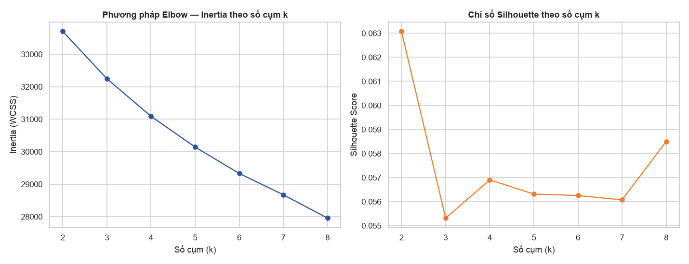

Chỉ số Silhouette chỉ dao động trong khoảng rất hẹp từ 0,055 đến 0,063 trên toàn bộ dải k thử
nghiệm từ 2 đến 8 — một mức giá trị rất gần 0, hàm ý các cụm không tách biệt rõ ràng ở BẤT KỲ giá
trị k nào được thử nghiệm. Kết quả này nhất quán với phát hiện ở Chương 2: các biến kỹ năng
(`Skill_1` đến `Skill_10`) không mang thông tin phân biệt nhóm rủi ro, nên cũng không hình thành
các cụm tự nhiên có cấu trúc mạnh. Số cụm k = 4 được lựa chọn cho các bước phân tích tiếp theo vì
mục đích diễn giải nghiệp vụ — phân khúc thành bốn hồ sơ dễ truyền thông trong báo cáo — chứ KHÔNG
phải vì dữ liệu thể hiện cấu trúc phân cụm thống kê mạnh ở k = 4; điểm này cần được nêu rõ để tránh
diễn giải vượt quá mức độ mà bằng chứng cho phép.

**Hình 3.2 — Trực quan hoá 4 cụm hồ sơ kỹ năng qua PCA (2 thành phần)**
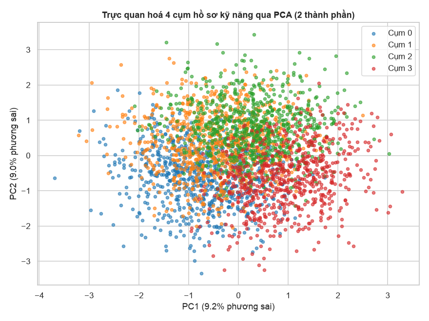

**Bảng 3.1 — Hồ sơ đặc trưng của 4 cụm phân khúc kỹ năng**

| Cụm | Số lượng | Xác suất tự động hoá trung bình | Chỉ số phơi nhiễm AI trung bình | Lương trung bình (USD) | Số năm kinh nghiệm trung bình |
|---:|---:|---:|---:|---:|---:|
| 0 | 764 | 0,498 | 0,562 | 89.272 | 14,60 |
| 1 | 780 | 0,501 | 0,437 | 91.279 | 14,79 |
| 2 | 778 | 0,493 | 0,425 | 89.399 | 14,53 |
| 3 | 678 | 0,515 | 0,594 | 87.262 | 14,80 |

Xác suất tự động hoá trung bình của bốn cụm dao động trong khoảng rất hẹp từ 0,493 đến 0,515 —
gần như bằng nhau. Kết quả này xác nhận bằng số liệu cụ thể cho nhận định ở Hình 3.1: phân cụm
không giám sát trên hồ sơ kỹ năng cá nhân KHÔNG tách được nhóm rủi ro cao và nhóm rủi ro thấp. Tên
gọi của bốn cụm (được lưu trong tệp `pipeline_summary.json` đi kèm) chỉ mang tính mô tả xếp hạng
tương đối theo chỉ số phơi nhiễm trí tuệ nhân tạo trung bình giữa các cụm, không phản ánh một cấu
trúc phân cụm tách biệt mạnh trong dữ liệu.

### 3.2. Kết quả mô hình phân loại `Risk_Category`

**Bảng 3.2 — So sánh hiệu suất 3 mô hình phân loại Nhóm rủi ro tự động hoá**

| Mô hình | Accuracy | Precision (macro) | Recall (macro) | F1-score (macro) | ROC-AUC (OvR) |
|---|---:|---:|---:|---:|---:|
| Logistic Regression | 0,9947 | 0,9929 | 0,9965 | **0,9947** | 0,9979 |
| Random Forest | 0,9387 | 0,9595 | 0,9208 | 0,9345 | 0,9959 |
| XGBoost Classifier | 0,9947 | 0,9929 | 0,9965 | **0,9947** | 0,9964 |

**Hình 3.3 — So sánh hiệu suất 3 mô hình phân loại Nhóm rủi ro tự động hoá**
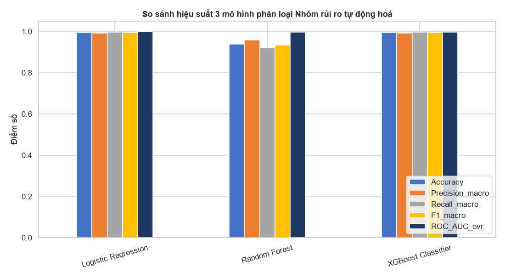

Khi đưa `Job_Title` vào tập đặc trưng, F1-score trung bình vĩ mô đạt 0,9947 ở cả Logistic
Regression lẫn XGBoost Classifier, và ROC-AUC đạt lần lượt 0,9979 và 0,9964 — vượt trội hoàn toàn
so với vòng thử nghiệm đối chứng chỉ dùng đặc trưng cá nhân (không có `Job_Title`), nơi F1-score
trung bình vĩ mô chỉ đạt khoảng 0,22 đến 0,34 và ROC-AUC xấp xỉ 0,50, tương đương mức dự đoán ngẫu
nhiên đối với bài toán ba lớp. Random Forest đạt kết quả thấp hơn hai mô hình còn lại (F1-score
trung bình vĩ mô 0,9345), nhiều khả năng do tham số giới hạn độ sâu cây (`max_depth=10`) được áp
đặt trong quá trình huấn luyện khiến một số cây chưa phân tách hết thông tin từ 19 biến giả của
`Job_Title` ở độ sâu cho phép.

**Hình 3.4 — Ma trận nhầm lẫn của 3 mô hình phân loại**
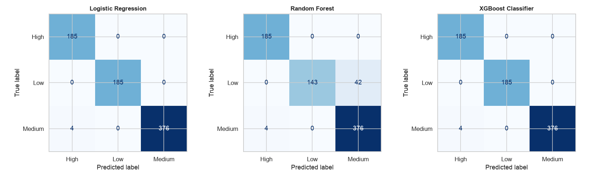

Ma trận nhầm lẫn của cả ba mô hình cho thấy nhầm lẫn hầu như chỉ xảy ra giữa hai nhóm `Medium` và
`High` — cụ thể, 4 trên tổng số 561 hồ sơ thuộc nhóm `Medium` trong tập kiểm định bị dự báo nhầm
sang nhóm `High` ở cả ba mô hình. Điều này hợp lý về mặt phương pháp luận vì đây là hai khoảng
ngưỡng liền kề của biến gốc `Automation_Probability_2030` (Medium: 0,31–0,70; High: 0,71–0,95);
không quan sát thấy nhầm lẫn nào giữa hai nhóm `Low` và `High`, vốn là hai đầu xa nhau của thang đo.

**Hình 3.5 — Mức độ quan trọng của biến — XGBoost Classifier (đã gộp Job_Title)**
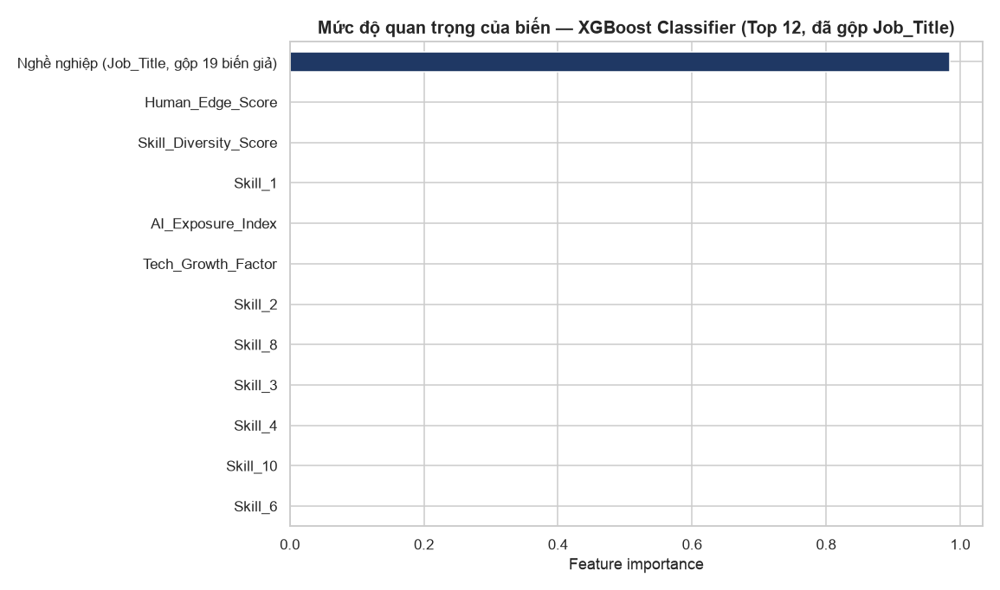

Để thuận tiện cho việc diễn giải nghiệp vụ, mức độ quan trọng của 19 biến giả sinh ra từ mã hoá
one-hot của `Job_Title` được cộng gộp thành một chỉ tiêu duy nhất trước khi vẽ biểu đồ. Kết quả cho
thấy nhóm biến `Job_Title` (đã gộp) chiếm tới 98,5% tổng mức độ quan trọng của mô hình XGBoost;
toàn bộ các biến còn lại — bao gồm lương, kinh nghiệm, học vấn, mười điểm kỹ năng và các chỉ số
tổng hợp tự xây dựng — cộng lại chỉ chiếm khoảng 1,5%. Đây là bằng chứng định lượng trực tiếp và
mạnh nhất cho giả thuyết trung tâm nêu ở mục 1.2 và mục 1.4: rủi ro tự động hoá trong bộ dữ liệu
nghiên cứu được quyết định gần như tuyệt đối bởi đặc điểm nghề nghiệp, không phải đặc điểm cá nhân
của người đảm nhiệm nghề nghiệp đó.

### 3.3. Kết quả mô hình hồi quy `Automation_Probability_2030`

**Bảng 3.3 — So sánh hiệu suất 3 mô hình hồi quy**

| Mô hình | R² | MAE | RMSE |
|---|---:|---:|---:|
| Linear Regression | **0,8623** | 0,0778 | 0,0936 |
| Random Forest Regressor | 0,8027 | 0,0881 | 0,1120 |
| XGBoost Regressor | 0,8112 | 0,0887 | 0,1096 |

**Hình 3.6 — Dự báo so với Thực tế — Linear Regression (R² = 0,862)**
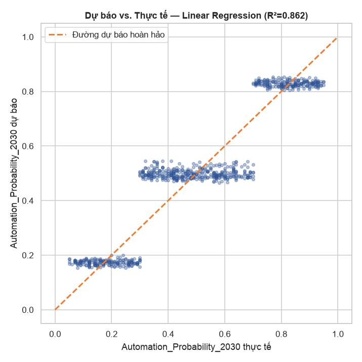

Mô hình hồi quy tốt nhất (Linear Regression) đạt hệ số xác định R² bằng 0,862, nghĩa là tập đặc
trưng gồm đặc điểm cá nhân và `Job_Title` giải thích được 86,2% phương sai của biến mục tiêu liên
tục. Sai số tuyệt đối trung bình (MAE) chỉ khoảng 0,078, tương đương gần 8 điểm phần trăm xác suất
tự động hoá — mức sai số hợp lý đối với một mô hình chỉ dựa trên đặc trưng nghề nghiệp và hồ sơ cá
nhân, không có dữ liệu theo thời gian hay đặc thù công nghệ ngành cụ thể. Việc mô hình hồi quy —
một phương pháp đánh giá hoàn toàn độc lập với bài toán phân loại ở mục 3.2, sử dụng biến mục tiêu
ở dạng liên tục thay vì rời rạc — cho ra kết luận nhất quán, góp phần củng cố đáng kể độ tin cậy
của phát hiện chính, thay vì chỉ dựa vào một góc nhìn phân tích duy nhất.

### 3.4. Thảo luận: vì sao đặc điểm nghề nghiệp quyết định, đặc điểm cá nhân thì không

Ba phương pháp phân tích độc lập trong báo cáo — phân tích khám phá dữ liệu (Chương 2), phân cụm
không giám sát (mục 3.1), và hai mô hình dự báo có giám sát (mục 3.2 và 3.3) — đều hội tụ về cùng
một kết luận: trong bộ dữ liệu nghiên cứu, `Automation_Probability_2030` gắn liền với `Job_Title`
theo một quy luật gần như tất định (một nghề gần như luôn rơi vào đúng một khoảng giá trị xác
suất, xem Bảng 2.4), trong khi độc lập với mọi biến đặc điểm cá nhân đã kiểm tra. Về mặt kỹ thuật,
điều này giải thích vì sao cả Logistic Regression (mô hình tuyến tính đơn giản) lẫn XGBoost (mô
hình cây phức tạp) đều đạt hiệu suất gần như tuyệt đối và tương đương nhau ở mục 3.2: khi tín hiệu
dự báo mang tính gần-tất-định, bài toán phân loại trở nên gần như tách biệt tuyến tính hoàn hảo
(linearly separable), nên cả hai lớp mô hình đều tiệm cận cùng một trần hiệu suất.

Cần lưu ý rằng mức hiệu suất gần như tuyệt đối này không nên được xem là bằng chứng cho một mô hình
có khả năng khái quát hoá mạnh, mà phần lớn phản ánh chính cơ chế sinh dữ liệu của bộ dữ liệu mô
phỏng — nội dung này được thảo luận chi tiết hơn ở mục 3.6 (Hạn chế của nghiên cứu). Xét về mặt
định tính, phát hiện của Chương 3 phù hợp với khung tiếp cận theo tác vụ của Autor, Levy và Murnane
[1] và các phát hiện thực nghiệm của Frey và Osborne [2]: rủi ro tự động hoá gắn với bản chất tác
vụ của công việc hơn là năng lực hay đặc điểm của cá nhân đảm nhiệm công việc đó.

### 3.5. Hàm ý quản trị nhân sự

Từ các phát hiện thực nghiệm ở mục 3.1 đến 3.4, báo cáo đề xuất ba hàm ý đối với công tác quản trị
nhân sự:

**Thứ nhất, thiết kế chương trình đào tạo lại theo nhóm nghề.** Vì rủi ro tự động hoá trong dữ liệu
gắn với bản chất công việc hơn là hồ sơ cá nhân, chương trình đào tạo lại (reskilling) nên được ưu
tiên thiết kế theo NHÓM NGHỀ NGHIỆP (occupation-level) thay vì chỉ dựa trên đánh giá năng lực cá
nhân của từng người lao động.

**Thứ hai, ưu tiên nhóm nghề thuộc tầng rủi ro cao.** Theo kết quả xếp hạng ở Bảng 2.4, các nghề
có tỷ trọng tác vụ lặp lại hoặc thủ tục cao — cụ thể là Retail Worker, Security Guard, Construction
Worker, Customer Support và Truck Driver trong bộ dữ liệu — cần được đưa vào lộ trình chuyển đổi
nghề nghiệp ở giai đoạn sớm hơn so với các nhóm nghề còn lại.

**Thứ ba, không sử dụng hồ sơ kỹ năng cá nhân đơn lẻ để xếp hạng rủi ro.** Kết quả phân cụm ở mục
3.1 cho thấy hồ sơ kỹ năng cá nhân không đủ thông tin để phân biệt mức độ rủi ro; do đó, các công
cụ đánh giá rủi ro nội bộ doanh nghiệp cần kết hợp thêm thông tin về nghề nghiệp hoặc ngành nghề
thay vì chỉ dựa vào bảng điểm năng lực cá nhân.

### 3.6. Hạn chế của nghiên cứu

Thứ nhất, dữ liệu sử dụng trong báo cáo là bộ dữ liệu MÔ PHỎNG (synthetic), phục vụ mục đích luyện
tập kỹ thuật phân tích. Vì bản thân `Automation_Probability_2030` được gán theo quy tắc gắn với
`Job_Title` ngay từ khâu tạo dữ liệu, phát hiện "nghề nghiệp quyết định, đặc điểm cá nhân không
quyết định" chỉ có giá trị NỘI TẠI đối với tập dữ liệu này, và không thể suy rộng trực tiếp thành
một quy luật tổng quát của thị trường lao động thực tế.

Thứ hai, bộ dữ liệu không có chiều thời gian — chỉ là một lát cắt tĩnh gắn với năm 2030 — và không
có biến phản ánh ngành kinh tế hay vùng địa lý cụ thể. Do đó, báo cáo không thể phân tích động thái
thay đổi của rủi ro tự động hoá theo thời gian hay sự khác biệt giữa các vùng miền, như cách các
nghiên cứu của Diễn đàn Kinh tế Thế giới hay McKinsey Global Institute thực hiện trên dữ liệu khảo
sát thực tế qua nhiều kỳ.

Thứ ba, mức hiệu suất mô hình gần như tuyệt đối thu được ở mục 3.2 và 3.3 (F1-score, ROC-AUC gần 1
khi có `Job_Title`) phản ánh cơ chế sinh dữ liệu có kiểm soát của bộ dữ liệu mô phỏng, không nên
được diễn giải như bằng chứng cho thấy rủi ro tự động hoá trong thực tế có thể được dự báo chính
xác đến mức độ tương tự chỉ bằng đặc điểm nghề nghiệp và hồ sơ cá nhân. Đây là điểm cần lưu ý để
tránh đưa ra khẳng định vượt quá mức độ mà thiết kế nghiên cứu và bản chất dữ liệu cho phép.

**Tóm tắt Chương 3.** Chương 3 kiểm định thực nghiệm giả thuyết nêu ở Chương 1 bằng ba phương pháp
độc lập. Phân cụm không giám sát trên hồ sơ kỹ năng không phát hiện được cấu trúc phân nhóm có ý
nghĩa (chỉ số Silhouette xấp xỉ 0,06). Ngược lại, khi đưa `Job_Title` vào hai mô hình có giám sát,
hiệu suất phân loại đạt F1-score trung bình vĩ mô tối đa 0,9947 và hiệu suất hồi quy đạt R² tối đa
0,862 — xác nhận rủi ro tự động hoá trong bộ dữ liệu được quyết định ở cấp độ nghề nghiệp. Kết quả
được diễn giải một cách thận trọng trong phạm vi giới hạn của một bộ dữ liệu mô phỏng, như đã trình
bày ở mục 3.6.

---

## KẾT LUẬN

Báo cáo đã thực hiện trọn vẹn một quy trình phân tích kinh doanh trên bộ dữ liệu mô phỏng về tác
động của trí tuệ nhân tạo đến việc làm năm 2030, gồm bốn nhóm bước chính: tiền xử lý dữ liệu (bao
gồm phát hiện và xử lý rủi ro rò rỉ dữ liệu giữa `Risk_Category` và `Automation_Probability_2030`),
phân tích khám phá dữ liệu bằng mười một biểu đồ, phân cụm K-Means trên hồ sơ kỹ năng, và hai kênh
mô hình hoá dự báo độc lập — phân loại và hồi quy.

Phát hiện xuyên suốt báo cáo là: các đặc trưng cá nhân của người lao động — kỹ năng, kinh nghiệm,
học vấn, mức lương, chỉ số phơi nhiễm trí tuệ nhân tạo cá nhân — không mang thông tin dự báo rủi ro
tự động hoá trong bộ dữ liệu nghiên cứu (hệ số tương quan tuyệt đối cao nhất chưa đến 0,05; chỉ số
Silhouette của phân cụm xấp xỉ 0,06), trong khi biến định danh nghề nghiệp `Job_Title` giải thích
khoảng 85,7% phương sai của biến mục tiêu và khi đưa vào mô hình có giám sát giúp F1-score trung
bình vĩ mô đạt tới 0,9947, R² của mô hình hồi quy đạt 0,862. Phát hiện này nhất quán về mặt định
tính với khung lý thuyết tiếp cận theo tác vụ của Autor, Levy và Murnane [1] và các phát hiện thực
nghiệm của Frey và Osborne [2]: rủi ro tự động hoá gắn với bản chất công việc hơn là đặc điểm của
người đảm nhiệm công việc đó.

Trong phạm vi một bộ dữ liệu mô phỏng phục vụ mục đích luyện tập, kết luận nêu trên cần được hiểu
như một minh hoạ phương pháp luận — kiểm định một giả thuyết học thuật đã có trên một tình huống dữ
liệu cụ thể — hơn là một khẳng định tổng quát về thị trường lao động thực tế. Hướng phát triển tiếp
theo có thể bổ sung chiều thời gian, dữ liệu ngành nghề và vùng địa lý thực tế, đồng thời đối chiếu
trực tiếp với các bộ chỉ số công khai như O*NET Task Ratings hoặc khảo sát doanh nghiệp trong Báo
cáo Tương lai Việc làm của Diễn đàn Kinh tế Thế giới, nhằm tăng giá trị ứng dụng thực tiễn của phân
tích.

---

## TÀI LIỆU THAM KHẢO

1. Autor, D. H., Levy, F., & Murnane, R. J. (2003), *The Skill Content of Recent Technological
   Change: An Empirical Exploration*, The Quarterly Journal of Economics, 118(4), tr. 1279–1333.
2. Frey, C. B., & Osborne, M. A. (2017), *The Future of Employment: How Susceptible Are Jobs to
   Computerisation?*, Technological Forecasting and Social Change, 114, tr. 254–280.
3. Acemoglu, D., & Restrepo, P. (2019), *Automation and New Tasks: How Technology Displaces and
   Reinstates Labor*, Journal of Economic Perspectives, 33(2), tr. 3–30.
4. McKinsey Global Institute (2017), *Jobs Lost, Jobs Gained: Workforce Transitions in a Time of
   Automation*, McKinsey & Company, Washington, D.C.
5. World Economic Forum (2023), *Future of Jobs Report 2023*, World Economic Forum, Geneva.
6. Magtibay, D. (2024), *Predicting Uber Ride Cancellations*, Kaggle Notebook — nguồn tham khảo
   phong cách trình bày trình tự notebook (đọc dữ liệu → hiển thị dòng đầu → tiền xử lý → phân
   tích khám phá dữ liệu → mô hình hoá); dữ liệu của notebook này không được sử dụng làm dữ liệu
   nghiên cứu của đề tài. Truy cập tại:
   https://www.kaggle.com/code/denvermagtibay/predicting-uber-ride-cancellations
