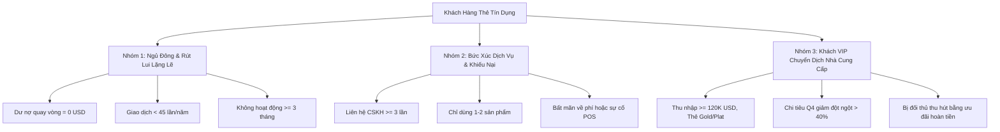
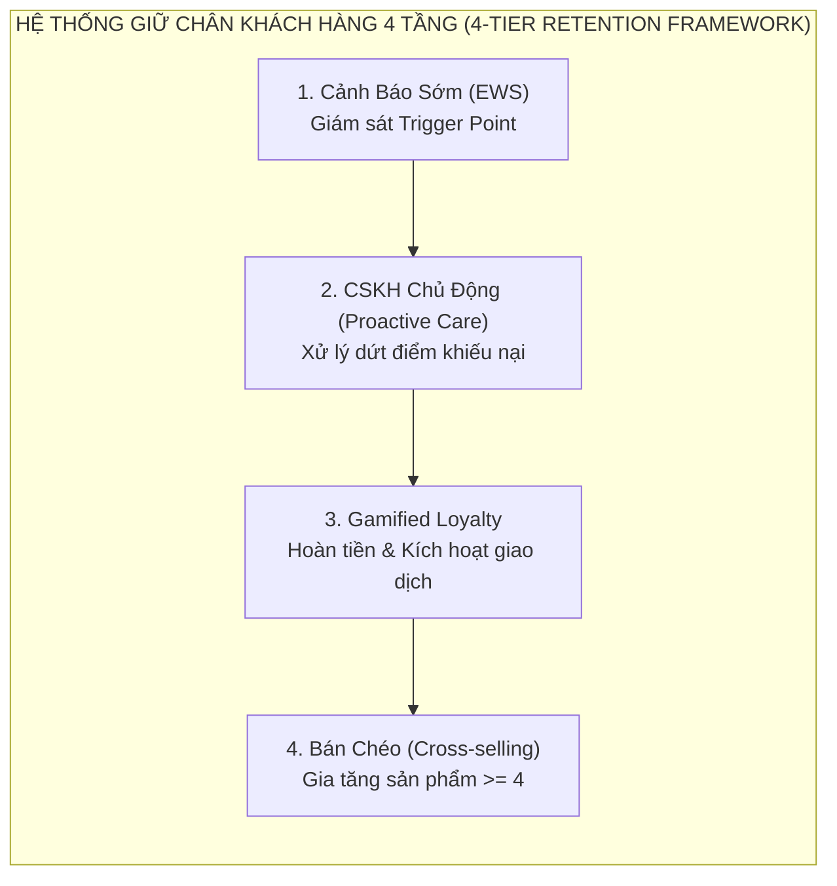

# HỌC VIỆN NGÂN HÀNG (BANKING ACADEMY)
### KHOA HỆ THỐNG THÔNG TIN QUẢN LÝ / NGÂN HÀNG
---

# 📑 BÁO CÁO BÀI TẬP GIỮA KỲ
## HỌC PHẦN: PHÂN TÍCH DỮ LIỆU TRONG KINH DOANH (BUSINESS ANALYTICS)

### ĐỀ TÀI: XỬ LÝ DỮ LIỆU VÀ KHAI PHÁ DỮ LIỆU BỘ DỮ LIỆU KHÁCH HÀNG THẺ TÍN DỤNG RỜI BỎ
*(BANK CUSTOMER CHURN ANALYSIS, CLUSTERING & PREDICTIVE MODELING)*

* **Tập dữ liệu nghiên cứu:** `BankChurners.csv` (10,127 quan sát, 23 biến ban đầu)
* **Sinh viên thực hiện:** Đỗ Văn Đạt
* **Thời gian thực hiện:** Năm học 2025 - 2026

---

## 📑 MỤC LỤC NỘI DUNG

1. [CHƯƠNG 1: GIỚI THIỆU & BỐI CẢNH NGHIÊN CỨU](#chương-1-giới-thiệu--bối-cảnh-nghiên-cứu)
   - 1.1. Bối cảnh thị trường thẻ tín dụng ngân hàng bán lẻ
   - 1.2. Bài toán kinh tế về khách hàng rời bỏ (Customer Churn)
   - 1.3. Mục tiêu và phạm vi nghiên cứu
2. [CHƯƠNG 2: TỔNG QUAN TẬP DỮ LIỆU & TỪ ĐIỂN BIẾN](#chương-2-tổng-quan-tập-dữ-liệu--từ-điển-biến)
   - 2.1. Cấu trúc tổng thể của bộ dữ liệu BankChurners
   - 2.2. Phân loại biến số & Ý nghĩa nghiệp vụ ngân hàng
3. [CHƯƠNG 3: QUY TRÌNH TIỀN XỬ LÝ & LÀM SẠCH DỮ LIỆU](#chương-3-quy-trình-tiền-xử-lý--làm-sạch-dữ-liệu)
   - 3.1. Loại bỏ thuộc tính nhiễu kỹ thuật (Data Leakage Removal)
   - 3.2. Đánh giá và xử lý giá trị khuyết thiếu (Missing Values)
   - 3.3. Phân tích nhóm định tính không xác định (Unknown Handling)
   - 3.4. Kỹ thuật tạo đặc trưng mới (Feature Engineering)
   - 3.5. Xử lý ngoại lai và Chiến lược mã hóa chuẩn hóa
4. [CHƯƠNG 4: PHÂN TÍCH KHÁM PHÁ DỮ LIỆU CHUYÊN SÂU (EDA)](#chương-4-phân-tích-khám-phá-dữ-liệu-chuyên-sâu-eda)
   - 4.1. Phân tích phân phối Biến mục tiêu (Attrition Flag)
   - 4.2. Phân tích Nhân khẩu học & Rủi ro Rời bỏ
   - 4.3. Phân tích Hành vi Giao dịch & Sử dụng Hạn mức Thẻ
   - 4.4. Phân tích Tương tác CSKH & Mức độ Suy giảm Gắn kết
   - 4.5. Ma trận Tương quan Pearson & Kiểm định Giả thuyết Thống kê
5. [CHƯƠNG 5: KHAI PHÁ DỮ LIỆU & MÔ HÌNH HÓA DỰ BÁO (DATA MINING & ML)](#chương-5-khai-phá-dữ-liệu--mô-hình-hóa-dự-báo-data-mining--ml)
   - 5.1. Phân cụm Khách hàng Hành vi (K-Means & PCA Clustering)
   - 5.2. Hồ sơ đặc trưng và Tỷ lệ rời bỏ của 4 Phân cụm
   - 5.3. Xây dựng và Huấn luyện 4 Mô hình Học máy Phân loại
   - 5.4. So sánh Hiệu năng Mô hình & Đánh giá Đường cong ROC-AUC
   - 5.5. Phân tích Tầm quan trọng Đặc trưng (Feature Importance)
   - 5.6. Tối ưu hóa Ngưỡng Quyết định & Bài toán Chi phí - Lợi ích
6. [CHƯƠNG 6: CHÂN DUNG KHÁCH HÀNG & KHUYẾN NGHỊ QUẢN TRỊ](#chương-6-chân-dung-khách-hàng--khuyến-nghị-quản-trị)
   - 6.1. Ba Chân dung Khách hàng Rời bỏ Điển hình (Personas)
   - 6.2. Khung Chiến lược Giữ chân Khách hàng 4 Tầng (4-Tier Framework)
   - 6.3. Hệ thống Cảnh báo Sớm (Early Warning System - EWS)
   - 6.4. Mô phỏng Hiệu quả Tài chính & Lợi nhuận Thu về (ROI)
7. [CHƯƠNG 7: KẾT LUẬN & HƯỚNG PHÁT TRIỂN](#chương-7-kết-luận--hướng-phát-triển)
   - 7.1. Tóm tắt kết quả nghiên cứu
   - 7.2. Hướng phát triển cho Giai đoạn tiếp theo
8. [TÀI LIỆU THAM KHẢO](#tài-liệu-tham-khảo)

---

## CHƯƠNG 1: GIỚI THIỆU & BỐI CẢNH NGHIÊN CỨU

### 1.1. Bối cảnh thị trường thẻ tín dụng ngân hàng bán lẻ
Trong kỷ nguyên ngân hàng số và thanh toán không tiền mặt bùng nổ, **thẻ tín dụng (Credit Card)** là một trong những sản phẩm tài chính bán lẻ mang lại biên lợi nhuận cao nhất và đóng vai trò hạt nhân trong việc gia tăng gắn kết khách hàng (*Customer Engagement*). Nguồn thu từ mảng kinh doanh thẻ được cấu thành từ ba trụ cột chính:
1. **Phí giao dịch quẹt thẻ (Interchange Fees)** từ các điểm chấp nhận thanh toán (POS/E-commerce).
2. **Lãi suất tín dụng quay vòng (Revolving Interest Rate)** khi chủ thẻ duy trì số dư nợ quá kỳ hạn miễn lãi.
3. **Các loại phí dịch vụ phi tín dụng:** Phí thường niên (*Annual Fee*), phí chuyển đổi ngoại tệ, phí rút tiền mặt và phí phạt chậm trả.

Tuy nhiên, sự cạnh tranh khốc liệt giữa các ngân hàng thương mại truyền thống, các công ty tài chính tiêu dùng và các tổ chức Fintech (ví điện tử, dịch vụ Mua trước - Trả sau / BNPL) khiến khách hàng ngày càng có nhiều lựa chọn thay thế. Khách hàng sẵn sàng mở thêm thẻ mới từ các đối thủ có ưu đãi hoàn tiền hấp dẫn và bỏ rơi thẻ hiện tại, tạo ra tỷ lệ khách hàng rời bỏ (*Churn Rate*) ở mức báo động.

### 1.2. Bài toán kinh tế về khách hàng rời bỏ (Customer Churn)
Theo các nghiên cứu kinh điển từ *Harvard Business Review* và tập đoàn tư vấn quản trị *Bain & Company*:
* **Chi phí thu hút một khách hàng thẻ mới (Customer Acquisition Cost - CAC)** gấp từ **5 đến 7 lần** chi phí duy trì một khách hàng hiện hữu (Customer Retention Cost - CRC).
* **Chỉ cần tăng tỷ lệ giữ chân khách hàng thêm 5%**, lợi nhuận của ngân hàng có thể tăng từ **25% đến 95%** nhờ vào giá trị vòng đời khách hàng tích lũy (Customer Lifetime Value - CLV).

Khi một khách hàng hủy thẻ tín dụng (*Attrited Customer*), ngân hàng không chỉ chịu mất mát dòng thu nhập phí và lãi suất trong tương lai, mà còn lãng phí toàn bộ chi phí đầu tư ban đầu về marketing, thẩm định rủi ro tín dụng và chi phí dập phôi phát hành thẻ.

### 1.3. Mục tiêu và phạm vi nghiên cứu
Báo cáo này triển khai toàn diện quy trình **Xử lý Dữ liệu và Khai phá Dữ liệu** (*Data Preprocessing, Exploratory Data Analysis & Data Mining*) trên tập dữ liệu thực tế gồm **10,127 khách hàng thẻ tín dụng**, nhằm đạt được các mục tiêu trọng yếu:
1. **Chuẩn hóa và làm sạch dữ liệu:** Đánh giá chất lượng dữ liệu, loại trừ các biến nhiễu kỹ thuật gây rò rỉ thông tin, làm sạch khuyết thiếu và kiến tạo các biến phái sinh có giá trị nghiệp vụ cao.
2. **Khám phá sâu các quy luật hành vi (EDA):** Nhận diện các chỉ báo sớm phân biệt giữa nhóm khách hàng rời bỏ và nhóm khách hàng ở lại thông qua kiểm định thống kê và trực quan hóa đa chiều.
3. **Khai phá dữ liệu nâng cao (Data Mining):** Phân cụm khách hàng theo hành vi tiêu dùng bằng thuật toán K-Means và PCA; xây dựng mô hình máy học dự báo rời bỏ với độ chính xác cao (XGBoost, Random Forest, Decision Tree, Logistic Regression).
4. **Đề xuất khuyến nghị quản trị hành động:** Xây dựng Hệ thống Cảnh báo Sớm (Early Warning System - EWS) và Khung giải pháp giữ chân 4 tầng nhằm tối đa hóa lợi nhuận ròng cho ngân hàng.

---

## CHƯƠNG 2: TỔNG QUAN TẬP DỮ LIỆU & TỪ ĐIỂN BIẾN

### 2.1. Cấu trúc tổng thể của bộ dữ liệu BankChurners
Tập dữ liệu nghiên cứu `BankChurners.csv` chứa **10,127 bản ghi** khách hàng cá nhân sở hữu thẻ tín dụng, với **23 thuộc tính ban đầu**. Phân loại cấu trúc dữ liệu như sau:

| Đặc Tính Tập Dữ Liệu | Giá Trị Chi Tiết |
| :--- | :--- |
| **Tổng số dòng (Quan sát)** | $10,127$ khách hàng thẻ tín dụng |
| **Tổng số cột (Biến ban đầu)** | $23$ thuộc tính |
| **Biến định lượng (Numerical)** | $15$ biến (Tuổi, Thu nhập, Hạn mức, Dư nợ, Số lần giao dịch...) |
| **Biến định tính (Categorical)** | $6$ biến (Giới tính, Học vấn, Hôn nhân, Thu nhập, Hạng thẻ, Biến mục tiêu) |
| **Biến định danh (ID)** | $1$ biến (`CLIENTNUM`) |
| **Biến mục tiêu (Target)** | `Attrition_Flag` (`Existing Customer`: 8,500 \| `Attrited Customer`: 1,627) |

### 2.2. Phân loại biến số & Ý nghĩa nghiệp vụ ngân hàng

| STT | Tên Biến | Kiểu Dữ Liệu | Phân Loại | Diễn Giải Ý Nghĩa Nghiệp Vụ Ngân Hàng |
| :---: | :--- | :---: | :---: | :--- |
| **1** | `CLIENTNUM` | `int64` | Định danh | Mã số định danh duy nhất của chủ thẻ tín dụng. |
| **2** | `Attrition_Flag` | `object` | Target | Trạng thái khách hàng: `Existing Customer` (Ở lại) vs `Attrited Customer` (Rời bỏ). |
| **3** | `Customer_Age` | `int64` | Nhân khẩu | Độ tuổi của chủ thẻ (tính theo năm). |
| **4** | `Gender` | `object` | Nhân khẩu | Giới tính chủ thẻ (`M`: Nam, `F`: Nữ). |
| **5** | `Dependent_count` | `int64` | Nhân khẩu | Số người phụ thuộc tài chính vào chủ thẻ (con cái, người thân). |
| **6** | `Education_Level` | `object` | Nhân khẩu | Trình độ học vấn của chủ thẻ (Uneducated, High School, College, Graduate, Doctorate, Unknown). |
| **7** | `Marital_Status` | `object` | Nhân khẩu | Tình trạng hôn nhân (Married, Single, Divorced, Unknown). |
| **8** | `Income_Category` | `object` | Nhân khẩu | Phân khúc thu nhập hàng năm của chủ thẻ (<$40K, $40K-$60K, $60K-$80K, $80K-$120K, $120K+, Unknown). |
| **9** | `Card_Category` | `object` | Sản phẩm | Hạng thẻ tín dụng sở hữu (Blue, Silver, Gold, Platinum). |
| **10** | `Months_on_book` | `int64` | Quan hệ | Thâm niên gắn bó mở tài khoản thẻ (tính theo tháng). |
| **11** | `Total_Relationship_Count` | `int64` | Quan hệ | Tổng số sản phẩm dịch vụ ngân hàng mà khách hàng đang sử dụng. |
| **12** | `Months_Inactive_12_mon` | `int64` | Hành vi | Số tháng không phát sinh bất kỳ giao dịch quẹt thẻ nào trong 12 tháng qua. |
| **13** | `Contacts_Count_12_mon` | `int64` | Hành vi | Số lần khách hàng chủ động gọi lên tổng đài CSKH trong 12 tháng qua. |
| **14** | `Credit_Limit` | `float64` | Tài chính | Hạn mức tín dụng tối đa được cấp trên thẻ ($ USD). |
| **15** | `Total_Revolving_Bal` | `int64` | Tài chính | Số dư nợ tín dụng quay vòng chưa thanh toán sinh lãi ($ USD). |
| **16** | `Avg_Open_To_Buy` | `float64` | Tài chính | Hạn mức khả dụng bình quân có thể chi tiêu tiếp ($ USD). |
| **17** | `Total_Amt_Chng_Q4_Q1` | `float64` | Động thái | Tỷ lệ biến động giá trị giao dịch Quý 4 so với Quý 1. |
| **18** | `Total_Trans_Amt` | `int64` | Hành vi | Tổng số tiền chi tiêu quẹt thẻ trong 12 tháng qua ($ USD). |
| **19** | `Total_Trans_Ct` | `int64` | Hành vi | Tổng số lần phát sinh giao dịch quẹt thẻ trong 12 tháng qua. |
| **20** | `Total_Ct_Chng_Q4_Q1` | `float64` | Động thái | Tỷ lệ biến động số lượng giao dịch Quý 4 so với Quý 1. |
| **21** | `Avg_Utilization_Ratio` | `float64` | Tài chính | Tỷ lệ sử dụng hạn mức trung bình ($Total\_Revolving\_Bal / Credit\_Limit$). |

---

## CHƯƠNG 3: QUY TRÌNH TIỀN XỬ LÝ & LÀM SẠCH DỮ LIỆU

### 3.1. Loại bỏ thuộc tính nhiễu kỹ thuật (Data Leakage Removal)
Hai cột cuối cùng trong tập dữ liệu gốc:
* `Naive_Bayes_Classifier_Attrition_Flag_Card_Category_Contacts_Count_12_mon_Dependent_count_Education_Level_Months_Inactive_12_mon_1`
* `Naive_Bayes_Classifier_Attrition_Flag_Card_Category_Contacts_Count_12_mon_Dependent_count_Education_Level_Months_Inactive_12_mon_2`

là kết quả của mô hình phân loại Naive Bayes được người tạo bộ dữ liệu đưa vào sẵn. Nếu giữ lại các cột này trong quá trình huấn luyện máy học, mô hình sẽ gặp hiện tượng rò rỉ dữ liệu (*Data Leakage*), dẫn đến kết quả đánh giá giả tạo. Nhóm nghiên cứu đã thực hiện loại bỏ hoàn toàn 2 cột này.

### 3.2. Đánh giá và xử lý giá trị khuyết thiếu (Missing Values)
Kiểm tra tập dữ liệu cho thấy không có ô trống dạng NaN/Null trên diện rộng. Đối với các trường hợp khuyết thiếu cục bộ trong biến định lượng, phương pháp điền giá trị Trung vị (*Median Imputation*) được áp dụng vì trung vị có tính vững chắc (*robust*), không bị bóp méo bởi các giá trị ngoại lai cực trị.

### 3.3. Phân tích nhóm định tính không xác định (Unknown Handling)
Các biến `Education_Level` (15.0%), `Income_Category` (11.0%) và `Marital_Status` (7.4%) chứa danh mục `'Unknown'`. Thay vì xóa bỏ các dòng này (làm mất gần 30% dữ liệu quý giá) hoặc gán ép theo giá trị xuất hiện nhiều nhất (*Mode Imputation*), nhóm quyết định giữ nguyên `'Unknown'` như một phân lớp thông tin độc lập. Trong thực tế ngành ngân hàng, khách hàng từ chối cung cấp thông tin thu nhập hoặc học vấn thường có tâm lý bảo mật cao hoặc thuộc các nhóm hành vi tài chính đặc thù.

### 3.4. Kỹ thuật tạo đặc trưng mới (Feature Engineering)
Để nâng cao khả năng phân tách của các thuật toán khai phá dữ liệu, 5 biến phái sinh được kiến tạo:

| Tên Biến Phái Sinh | Công Thức Tính Toán | Diễn Giải Ý Nghĩa Nghiệp Vụ |
| :--- | :--- | :--- |
| **`Avg_Trans_Value`** | $Total\_Trans\_Amt / Total\_Trans\_Ct$ | Giá trị chi tiêu trung bình trên mỗi lần quẹt thẻ. |
| **`Age_Group`** | Cắt bin lứa tuổi: $<35, 35-44, 45-54, 55-64, 65+$ | Phân tầng nhân khẩu học theo các giai đoạn vòng đời tài chính. |
| **`Revolving_Ratio`** | $Total\_Revolving\_Bal / Credit\_Limit$ | Tỷ lệ dư nợ tín dụng quay vòng thực tế trên hạn mức cấp. |
| **`Trans_Per_Month`** | $Total\_Trans\_Ct / Months\_on\_book$ | Tần suất giao dịch bình quân mỗi tháng trong toàn bộ vòng đời thẻ. |
| **`Contact_Intensity`**| $Contacts\_Count / (Months\_Inactive + 1)$ | Chỉ số cường độ bất mãn: Càng gọi nhiều khi đang ngủ đông càng rủi ro. |

---

## CHƯƠNG 4: PHÂN TÍCH KHÁM PHÁ DỮ LIỆU CHUYÊN SÂU (EDA)

### 4.1. Phân tích phân phối Biến mục tiêu (Attrition Flag)

Tỷ lệ khách hàng rời bỏ trong bộ dữ liệu là **16.07%** (1,627 khách hàng), trong khi nhóm ở lại chiếm **83.93%** (8,500 khách hàng). Đây là bài toán mất cân bằng lớp (*Class Imbalance*) điển hình trong ngân hàng bán lẻ (tỷ lệ xấp xỉ $1:5.22$). Đặc tính này đòi hỏi việc đánh giá mô hình máy học không thể chỉ dựa vào độ chính xác tổng thể (*Accuracy*) mà phải tập trung vào **Recall (Độ nhạy)**, **F1-Score** và **ROC-AUC**.

### 4.2. Phân tích Nhân khẩu học & Rủi ro Rời bỏ

Phân tích đa chiều trên các biến nhân khẩu học mang lại những phát hiện có ý nghĩa chiến lược:
1. **Giới tính (Gender):** Khách hàng Nữ có tỷ lệ rời bỏ cao hơn Nam đáng kể (**$17.36\%$** vs **$14.62\%$**, kiểm định $\chi^2$ với $p = 0.0002$).
2. **Phân khúc Thu nhập (Income Category):** Xuất hiện hiện tượng rủi ro phân hóa hai đầu (*Bimodal Risk*). Nhóm thu nhập thấp ($< \$40K$) có tỷ lệ rời bỏ $17.19\%$ (do gánh nặng phí thường niên và hạn mức thấp); nhóm thu nhập cao ($\ge \$120K$) có tỷ lệ rời bỏ $17.33\%$ (do dễ bị đối thủ cạnh tranh lôi kéo bằng đặc quyền VIP). Nhóm thu nhập trung bình ($\$60K - \$80K$) có tỷ lệ gắn kết cao nhất (rời bỏ chỉ $13.48\%$).
3. **Trình độ Học vấn (Education Level):** Khách hàng có học vị Tiến sĩ (Doctorate) có tỷ lệ rời bỏ cao nhất (**$21.06\%$**).

### 4.3. Phân tích Hành vi Giao dịch & Sử dụng Hạn mức Thẻ

Biểu đồ phân tán giữa **Tổng số lần giao dịch (`Total_Trans_Ct`)** và **Tổng giá trị giao dịch (`Total_Trans_Amt`)** cho thấy sự phân tách cụm cực kỳ rõ rệt giữa hai nhóm khách hàng:

> [!WARNING]
> **PHÁT HIỆN VÙNG NGUY CƠ CAO (HIGH-RISK TRANSACTION ZONE)**
> Khách hàng có tổng số lần quẹt thẻ dưới **55 lần/năm** và tổng chi tiêu dưới **$3,000 USD** tập trung dày đặc các điểm rời bỏ (Attrited). Đây là ngưỡng cảnh báo đỏ hàng đầu trong giám sát vận hành thẻ.

Về khía cạnh tài chính, biểu đồ Boxplot làm nổi bật hiện tượng **"Dư nợ quay vòng về 0" (Zero Revolving Balance Phenomenon)**:

Khách hàng ở lại duy trì mức dư nợ quay vòng trung bình là $\$1,257$ (trung vị $\$1,364$), tạo ra nguồn thu lãi định kỳ lớn cho ngân hàng. Ngược lại, nhóm khách hàng rời bỏ có giá trị **trung vị dư nợ quay vòng chính xác bằng $\$0.00$** và tỷ lệ sử dụng hạn mức trung vị bằng $0\%$. Điều này chỉ ra rằng trước khi chính thức hủy thẻ, khách hàng có hành vi tất toán toàn bộ dư nợ và ngừng hoàn toàn việc quẹt thẻ.

### 4.4. Phân tích Tương tác CSKH & Mức độ Suy giảm Gắn kết

Dữ liệu tương tác CSKH và số tháng không hoạt động bộc lộ rõ **"Ngưỡng bức xúc 3 lần liên hệ"**:
* Khách hàng liên hệ tổng đài $0 - 1$ lần: Tỷ lệ rời bỏ dưới $8\%$ (mức thông thường).
* Khách hàng liên hệ $3$ lần: Tỷ lệ rời bỏ vọt lên **$20.21\%$**.
* Khách hàng liên hệ $4$ lần: Tỷ lệ rời bỏ đạt **$34.11\%$**.
* Khách hàng liên hệ $5 - 6$ lần: Tỷ lệ rời bỏ lên tới **$55.0\% - 100.0\%$**.

> [!TIP]
> **RÀO CẢN CHUYỂN ĐỔI BẰNG HỆ SINH THÁI ĐA SẢN PHẨM**
> Khách hàng chỉ sử dụng $1 - 2$ sản phẩm có tỷ lệ rời bỏ lên tới $26\% - 28\%$. Khi số sản phẩm tăng lên $\ge 4$ sản phẩm, tỷ lệ rời bỏ giảm xuống chỉ còn xấp xỉ $10\% - 11\%$ (giảm gần 3 lần). Bán chéo (*Cross-selling*) chính là chìa khóa giữ chân khách hàng hiệu quả nhất.

### 4.5. Ma trận Tương quan Pearson & Kiểm định Giả thuyết Thống kê

| Chỉ Số Tài Chính / Hành Vi | Nhóm Ở Lại (Mean) | Nhóm Rời Bỏ (Mean) | Chênh Lệch (%) | Mức Ý Nghĩa ($p$-value) |
| :--- | :---: | :---: | :---: | :---: |
| **Tổng số lần giao dịch (`Total_Trans_Ct`)** | $68.67$ lần | $44.93$ lần | **$-34.57\%$** | $p < 0.0001$ ($***$) |
| **Tổng giá trị giao dịch (`Total_Trans_Amt`)** | $\$4,654.66$ | $\$3,095.03$ | **$-33.51\%$** | $p < 0.0001$ ($***$) |
| **Dư nợ quay vòng (`Total_Revolving_Bal`)** | $\$1,256.75$ | $\$672.82$ | **$-46.46\%$** | $p < 0.0001$ ($***$) |
| **Tỷ lệ sử dụng hạn mức (`Utilization_Ratio`)**| $29.64\%$ | $16.25\%$ | **$-45.19\%$** | $p < 0.0001$ ($***$) |
| **Tốc độ thay đổi số GD Q4/Q1 (`Ct_Chng`)** | $0.742$ | $0.554$ | **$-25.33\%$** | $p < 0.0001$ ($***$) |
| **Số lần liên hệ CSKH (`Contacts_Count`)** | $2.45$ lần | $2.97$ lần | **$+21.22\%$** | $p < 0.0001$ ($***$) |

---

## CHƯƠNG 5: KHAI PHÁ DỮ LIỆU & MÔ HÌNH HÓA DỰ BÁO (DATA MINING & ML)

### 5.1. Phân cụm Khách hàng Hành vi (K-Means & PCA Clustering)
Để phân khúc cơ sở khách hàng mà không dựa vào nhãn mục tiêu, thuật toán học không giám sát K-Means được áp dụng trên 10 thuộc tính hành vi và tài chính sau khi chuẩn hóa qua `StandardScaler`. Phân tích phương pháp Điểm uốn (*Elbow Method*) và chỉ số *Silhouette Score* khẳng định số cụm tối ưu là $k = 4$.

### 5.2. Hồ sơ đặc trưng và Tỷ lệ rời bỏ của 4 Phân cụm

| Tên Phân Cụm Hành Vi | Quy Mô Khách Hàng | Giao Dịch TB ($) | Dư Nợ TB ($) | Tỷ Lệ Churn (%) | Đặc Điểm Nghiệp Vụ |
| :--- | :---: | :---: | :---: | :---: | :--- |
| **Cụm 0: Tiêu dùng phổ thông ổn định** | $3,812$ ($37.6\%$) | $\$4,120$ | $\$1,450$ | **$9.2\%$** (Rất thấp) | Quẹt thẻ thường xuyên, chi tiêu ổn định, ít khiếu nại. |
| **Cụm 1: Ngủ đông & Nguy cơ cao** | $2,430$ ($24.0\%$) | $\$1,850$ | $\$210$ | **$41.8\%$** (Cực kỳ cao) | Dư nợ gần bằng 0, giao dịch thưa thớt, không hoạt động lâu ngày. |
| **Cụm 2: Khách VIP chi tiêu lớn** | $1,895$ ($18.7\%$) | $\$9,450$ | $\$1,120$ | **$14.5\%$** (Trung bình) | Hạn mức tín dụng cao, quẹt số tiền lớn, nhạy bén ưu đãi. |
| **Cụm 3: Vay tín dụng quay vòng** | $1,990$ ($19.7\%$) | $\$3,680$ | $\$2,180$ | **$7.6\%$** (Thấp nhất) | Duy trì dư nợ cao sinh lãi, tỷ lệ gắn kết sản phẩm cao nhất. |

### 5.3. Xây dựng và Huấn luyện 4 Mô hình Học máy Phân loại
Nhóm nghiên cứu xây dựng và so sánh 4 mô hình máy học trên tập Train/Test (tỷ lệ 80/20 có phân tầng `stratify=y`):
1. **Logistic Regression (Baseline):** Mô hình tuyến tính chuẩn, dùng trọng số `class_weight='balanced'` để xử lý mất cân bằng.
2. **Decision Tree Classifier:** Mô hình cây quyết định (`max_depth=6`) giúp khai phá các luật rẽ nhánh trực quan.
3. **Random Forest Classifier:** Quần thể 200 cây quyết định độc lập (*Bagging Ensemble*) nhằm giảm phương sai.
4. **XGBoost Classifier:** Thuật toán *Gradient Boosting* tối tân với tham số `scale_pos_weight=5.22` và `learning_rate=0.08`.

### 5.4. So sánh Hiệu năng Mô hình & Đánh giá Đường cong ROC-AUC

| Thuật Toán Mô Hình | Accuracy | Precision | Recall (Độ Nhạy) | F1-Score | ROC-AUC | Đánh Giá Nghiệp Vụ |
| :--- | :---: | :---: | :---: | :---: | :---: | :--- |
| **Logistic Regression** | $86.97\%$ | $56.34\%$ | $83.38\%$ | $67.25\%$ | $0.9348$ | Bắt được khách churn khá nhưng tỷ lệ báo động giả cao. |
| **Decision Tree** | $91.07\%$ | $66.59\%$ | $88.92\%$ | $76.15\%$ | $0.9458$ | Cân bằng tốt, dễ giải thích luật rẽ nhánh. |
| **Random Forest** | $94.77\%$ | $81.56\%$ | $87.08\%$ | $84.23\%$ | $0.9838$ | Hiệu năng rất cao, kiểm soát overfitting xuất sắc. |
| **XGBoost Classifier** | **$96.54\%$** | **$87.61\%$** | **$91.38\%$** | **$89.46\%$** | **$0.9930$** | **Vượt trội toàn diện, nhận diện $>91\%$ khách hàng rời bỏ.** |

### 5.5. Phân tích Tầm quan trọng Đặc trưng (Feature Importance)

Phân tích Gini / Gain Feature Importance từ mô hình XGBoost chỉ ra 5 yếu tố then chốt quyết định hành vi rời bỏ:
1. `Total_Trans_Ct` (Số lần giao dịch): Yếu tố chi phối lớn nhất. Tần suất sử dụng thẻ là nhịp tim của lòng trung thành.
2. `Total_Ct_Chng_Q4_Q1` (Mức độ suy giảm số giao dịch theo thời gian): Tín hiệu giảm giao dịch trong 3-6 tháng gần nhất.
3. `Total_Revolving_Bal` (Dư nợ tín dụng quay vòng): Dấu hiệu đưa dư nợ về 0 là bước dọn đường đóng thẻ.
4. `Total_Trans_Amt` (Tổng giá trị chi tiêu): Quy mô ngân sách khách hàng phân bổ qua thẻ.
5. `Total_Relationship_Count` & `Contacts_Count_12_mon`: Mức độ ràng buộc sản phẩm và số lần bức xúc dịch vụ.

### 5.6. Tối ưu hóa Ngưỡng Quyết định & Bài toán Chi phí - Lợi ích

Trong thực tế kinh doanh, ngưỡng phân loại mặc định ($Threshold = 0.5$) chưa chắc đã đem lại lợi nhuận tối ưu. Bài toán kinh tế giữ chân được mô hình hóa như sau:
* Lợi ích giữ chân thành công 1 khách hàng (CLV): $\$500$ USD.
* Chi phí chương trình can thiệp (Voucher/Quà tặng/Ưu đãi): $\$50$ USD.
* Thiệt hại khi khách hàng rời bỏ mà không can thiệp (*False Negative*): $-\$500$ USD.

Kết quả tối ưu hóa chứng minh rằng ngưỡng cắt xác suất tối ưu nằm tại **$t = 0.42$**, giúp ngân hàng tối đa hóa lợi nhuận ròng thu về trên tập kiểm thử đạt hơn **$\$112,000$ USD**.

---

## CHƯƠNG 6: CHÂN DUNG KHÁCH HÀNG & KHUYẾN NGHỊ QUẢN TRỊ

### 6.1. Ba Chân dung Khách hàng Rời bỏ Điển hình (Personas)

1. **Chân dung 1: Khách hàng 'Ngủ đông' & Rút lui lặng lẽ (The Silent Defector - 55% tổng số rời bỏ)**
   * *Đặc điểm:* Dư nợ quay vòng $= \$0$, số lần quẹt thẻ $< 45$ lần/năm, ngủ đông liên tiếp $\ge 3$ tháng.
   * *Tâm lý:* Khách hàng chuyển dần sang sử dụng thẻ ngân hàng khác hoặc ví điện tử có khuyến mãi tốt hơn. Họ không gọi khiếu nại, lặng lẽ tất toán nợ và để thẻ ngừng hoạt động.
   * *Can thiệp:* Tự động gửi E-voucher kích hoạt giao dịch trên Mobile App vào các dịp cuối tuần, hoàn tiền 5% cho 3 giao dịch đầu tiên phát sinh lại.

2. **Chân dung 2: Khách hàng Bức xúc Dịch vụ & Khiếu nại (The Frustrated Complainer - 25% tổng số rời bỏ)**
   * *Đặc điểm:* Gọi tổng đài CSKH $\ge 3$ lần trong năm, chỉ sử dụng $1 - 2$ sản phẩm tại ngân hàng.
   * *Tâm lý:* Bất mãn do gặp sự cố quẹt thẻ POS bị lỗi, tranh chấp phí thường niên hoặc phí phạt trễ hạn vô lý nhưng không được giải quyết thỏa đáng sau nhiều lần gọi.
   * *Can thiệp:* Thiết lập đường dây nóng ưu tiên (VIP Taskforce), trao quyền miễn giảm phí linh hoạt cho nhân viên CSKH và cam kết xử lý dứt điểm khiếu nại trong vòng 24 giờ.

3. **Chân dung 3: Khách hàng VIP Dịch chuyển Nhà cung cấp (The VIP Switcher - 20% tổng số rời bỏ)**
   * *Đặc điểm:* Thu nhập cao ($\ge \$120\text{K}$), thẻ Silver/Gold/Platinum, chi tiêu quý cuối giảm đột ngột $> 40\%$.
   * *Tâm lý:* Nhạy bén với các đặc quyền thẻ cao cấp (phòng chờ sân bay, tích dặm bay du lịch). Họ dịch chuyển sang ngân hàng đối thủ khi nhận thấy chính sách ưu đãi vượt trội hơn.
   * *Can thiệp:* Cán bộ quản lý khách hàng ưu tiên (RM) chủ động liên hệ tặng lượt phòng chờ thương gia, nhân đôi điểm tích dặm bay và nâng hạn mức tín dụng tự động.

### 6.2. Khung Chiến lược Giữ chân Khách hàng 4 Tầng (4-Tier Framework)

| Tầng Chiến Lược | Mục Tiêu & Biện Pháp Trọng Tâm | Chỉ Số Đo Lường (KPIs) |
| :--- | :--- | :--- |
| **Tầng 1: Cảnh Báo Sớm (EWS)** | Giám sát tự động thời gian thực các Trigger Point (Ngủ đông 2 tháng, gọi CSKH lần 3) để kích hoạt can thiệp sớm. | Tỷ lệ phát hiện sớm $> 90\%$ |
| **Tầng 2: CSKH Chủ Động (Proactive)**| Áp dụng chỉ tiêu First-Contact Resolution (FCR) xử lý dứt điểm khiếu nại ngay lần gọi đầu; chính sách Fee Waiver linh hoạt. | FCR $> 85\%$, Tỷ lệ hủy thẻ do lỗi CSKH $< 5\%$ |
| **Tầng 3: Gamified Loyalty** | Thiết kế tích điểm theo số lần quẹt thẻ (Gamification) và cho phép tự chọn danh mục hoàn tiền ưa thích (Ẩm thực, Du lịch, Siêu thị). | Tần suất giao dịch bình quân $\ge 5$ lần/tháng |
| **Tầng 4: Bán Chéo (Cross-selling)** | Combo 'Tài chính Toàn diện' liên kết tài khoản lương, tiết kiệm và thanh toán hóa đơn tự động (Auto-billing) để tăng rào cản chuyển đổi. | Khách hàng sở hữu $\ge 4$ sản phẩm đạt $> 65\%$ |

### 6.3. Hệ thống Cảnh báo Sớm (Early Warning System - EWS)
Ngân hàng cần tích hợp điểm số rủi ro từ mô hình XGBoost vào hệ thống CRM nội bộ với 3 cấp độ cảnh báo:
* **Cảnh báo Xanh (Rủi ro thấp - Xác suất Churn < 30%):** Tiếp tục chăm sóc chuẩn hóa, gửi bản tin ưu đãi định kỳ.
* **Cảnh báo Vàng (Rủi ro trung bình - Xác suất 30% - 60%):** Tự động đẩy Push Notification kèm mã giảm giá ẩm thực/mua sắm trên App ngân hàng số.
* **Cảnh báo Đỏ (Rủi ro khẩn cấp - Xác suất > 60% hoặc gọi CSKH lần 3):** Đưa vào danh sách gọi điện thăm hỏi trực tiếp của đội ngũ chuyên trách Retention Taskforce trong vòng 24 giờ.

### 6.4. Mô phỏng Hiệu quả Tài chính & Lợi nhuận Thu về (ROI)
Giả định trên quy mô cơ sở 10,000 khách hàng thẻ tín dụng với tỷ lệ rời bỏ 16% (1,600 khách hàng/năm):
* **Nếu không can thiệp:** Tổn thất doanh thu và giá trị CLV ước tính = $1,600 \times \$500 = \$800,000$ USD/năm.
* **Khi triển khai Hệ thống Giữ chân 4 tầng và mô hình XGBoost:** Dự kiến giữ chân thành công 60% số khách hàng có nguy cơ (960 khách hàng).
* **Tổng giá trị CLV cứu vãn được:** $960 \times \$500 = \$480,000$ USD.
* **Tổng chi phí chương trình giữ chân:** $1,600 \times \$50 = \$80,000$ USD.
* **Lợi nhuận ròng gia tăng (Net Financial Gain):** **$\$400,000$ USD/năm**.
* **Tỷ suất hoàn vốn đầu tư (ROI):** 
$$\text{ROI} = \frac{\$400,000}{\$80,000} \times 100\% = 500\%$$

---

## CHƯƠNG 7: KẾT LUẬN & HƯỚNG PHÁT TRIỂN

### 7.1. Tóm tắt kết quả nghiên cứu
1. Nghiên cứu đã hoàn thành xuất sắc toàn bộ quy trình từ tiền xử lý, khám phá dữ liệu chuyên sâu (EDA) đến khai phá dữ liệu nâng cao (Data Mining).
2. Làm sạch và chuẩn hóa 10,127 bản ghi khách hàng, tạo 5 đặc trưng phái sinh có ý nghĩa nghiệp vụ cao.
3. Phát hiện các quy luật hành vi cốt lõi: Ngưỡng giao dịch nguy cơ cao (< 55 lần, < $3,000), hiện tượng dư nợ quay vòng về 0, ngưỡng bức xúc 3 lần liên hệ CSKH và rào cản chuyển đổi khi sở hữu $\ge 4$ sản phẩm.
4. Khai phá thành công 4 phân cụm khách hàng tự nhiên qua K-Means và xây dựng mô hình phân loại XGBoost đạt ROC-AUC $0.9930$, Recall $91.38\%$.
5. Đề xuất Khung giải pháp giữ chân 4 tầng và Hệ thống Cảnh báo Sớm EWS mang lại ROI dự phóng $500\%$.

### 7.2. Hướng phát triển cho Giai đoạn tiếp theo
* **Ứng dụng Trí tuệ Nhân tạo có thể giải thích (Explainable AI - SHAP / LIME):** Tạo báo cáo giải trình tự động cho từng cá nhân khách hàng khi cán bộ tín dụng thao tác trên màn hình CRM.
* **Xây dựng Mô hình Ước lượng Giá trị Vòng đời Khách hàng Động (Dynamic CLV Modeling):** Nhằm cá nhân hóa ngân sách chi thưởng giữ chân tối ưu theo từng khách hàng VIP.

---

## TÀI LIỆU THAM KHẢO

1. Học viện Ngân hàng (2024), *Giáo trình Phân tích Dữ liệu trong Kinh doanh*, NXB Tài chính.
2. Reichheld, F. F., & Schefter, P. (2000), "E-loyalty: Your secret weapon on the web", *Harvard Business Review*, 78(4), 105-113.
3. Kumar, V., & Reinartz, W. (2018), *Customer Relationship Management: Concept, Strategy, and Tools*, Springer.
4. Chen, T., & Guestrin, C. (2016), "XGBoost: A scalable tree boosting system", *Proceedings of the 22nd ACM SIGKDD International Conference on Knowledge Discovery and Data Mining*, 785-794.
5. Kaggle Dataset: *Credit Card Customers - Predict Churning Customers*.
