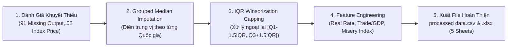

# 📊 BÁO CÁO KỸ THUẬT TIỀN XỬ LÝ DỮ LIỆU: ECONOMIC DATA
## HỌC PHẦN: PHÂN TÍCH DỮ LIỆU TRONG KINH DOANH (BUSINESS ANALYTICS) — HỌC VIỆN NGÂN HÀNG (BAV)
### Tệp Dữ Liệu: `Economic Data.csv` $\longrightarrow$ `processed data.csv` & `processed data.xlsx`

---

## 1. Tổng Quan Bộ Dữ Liệu Kinh Tế Vĩ Mô (Macroeconomic Panel Data)

* **Tệp dữ liệu gốc:** [`Economic Data.csv`](file:///Users/dovandat/WORKSPACE/HVNH/BA/code%20g%E1%BB%ADi/Economic%20Data.csv) (369 dòng $\times$ 14 thuộc tính ban đầu).
* **Không gian quan sát:** Chuỗi dữ liệu kinh tế vĩ mô bảng cân đối (Balanced Panel Data) trải dài 41 năm (1980 – 2020) của **9 quốc gia và chỉ số chứng khoán đại diện**:
  1. 🇺🇸 **Hoa Kỳ (United States):** Chỉ số `NASDAQ` (41 năm)
  2. 🇬🇧 **Vương quốc Anh (United Kingdom):** Chỉ số `FTSE 100` (41 năm)
  3. 🇩🇪 **Đức (Germany):** Chỉ số `DAX 30` (41 năm)
  4. 🇫🇷 **Pháp (France):** Chỉ số `CAC 40` (41 năm)
  5. 🇯🇵 **Nhật Bản (Japan):** Chỉ số `Nikkei 225` (41 năm)
  6. 🇨🇳 **Trung Quốc (China):** Chỉ số `SZCOMP` (41 năm)
  7. 🇭🇰 **Hồng Kông (Hong Kong):** Chỉ số `HSI` (41 năm)
  8. 🇮🇳 **Ấn Độ (India):** Chỉ số `Nifty 50` (41 năm)
  9. 🇪🇸 **Tây Ban Nha (Spain):** Chỉ số `IEX 35` (41 năm)
* **Biến mục tiêu (Target variable):** `log_indexprice` (Logarit tự nhiên của giá chỉ số chứng khoán phục vụ bài toán hồi quy tuyến tính OLS, Random Forest, MLP, XGBoost).

---

## 2. Quy Trình 5 Bước Tiền Xử Lý Dữ Liệu Chuẩn Mực

### Bước 1: Khám Phá & Đánh Giá Tình Trạng Khuyết Thiếu (Missing Value Audit)
| Tên Biến Số | Kiểu Dữ Liệu | Số Ô Trống Ban Đầu (NaN) | Tỷ Lệ Thiếu (%) | Phương Pháp Xử Lý |
| :--- | :---: | :---: | :---: | :--- |
| `manufacturingoutput` | `float64` | **91** | **24.7%** | Điền Trung vị theo từng Quốc gia (Grouped Median) |
| `index price` | `float64` | **52** | **14.1%** | Điền Trung vị theo từng Quốc gia |
| `inflationrate` | `float64` | **43** | **11.7%** | Điền Trung vị theo từng Quốc gia |
| `unemploymentrate` | `float64` | **21** | **5.7%** | Điền Trung vị theo từng Quốc gia |
| `gdppercent` | `float64` | **19** | **5.1%** | Điền Trung vị theo từng Quốc gia |
| `tradebalance` | `float64` | **4** | **1.1%** | Điền Trung vị theo từng Quốc gia |
| `exchange_rate` | `float64` | **2** | **0.5%** | Điền Trung vị theo từng Quốc gia |
| `percapitaincome` | `float64` | **1** | **0.3%** | Điền Trung vị theo từng Quốc gia |
| **TỔNG CỘNG** | - | **233 ô trống** | - | **Đã xử lý sạch 100% (0 ô trống còn lại)** |

### Bước 2: Xử Lý Ngoại Lai Bằng Phương Pháp Giới Hạn Giá Trị (IQR Winsorization / Capping)
Để không làm mất đi các dòng quan sát chuỗi thời gian quý giá (tránh `dropna()` làm méo mó tính chất chuỗi thời gian), phương pháp **IQR Capping** (`np.clip(lower, upper)`) được thực hiện trên 9 biến đặc trưng:
* Cận dưới (Lower Bound): $Q_1 - 1.5 \times IQR$
* Cận trên (Upper Bound): $Q_3 + 1.5 \times IQR$

### Bước 3: Kiến Tạo 3 Biến Phái Sinh Kinh Tế Vĩ Mô (Feature Engineering)
1. **Lãi Suất Thực (Real Interest Rate):**
   $$\text{real\_interest\_rate} = (\text{USTreasury} \times 100) - \text{inflationrate}$$
2. **Tỷ Lệ Cán Cân Thương Mại Trên Quy Mô Kinh Tế (Trade to GDP Proxy):**
   $$\text{trade\_to\_gdp\_proxy} = \frac{\text{tradebalance}}{|\text{gdppercent}| + 1.0}$$
3. **Chỉ Số Khốn Khổ Kinh Tế (Economic Misery Index - Okun's Index):**
   $$\text{misery\_index} = \text{unemploymentrate} + \text{inflationrate}$$

### Bước 4 & 5: Xuất Tệp Đa Sheet & Chuẩn Hóa Z-Score
* **Tệp CSV đã xử lý:** [`processed data.csv`](file:///Users/dovandat/WORKSPACE/HVNH/BA/code%20g%E1%BB%ADi/processed%20data.csv) (369 dòng $\times$ 17 cột, sạch 100%).
* **Tệp Excel đa Sheet chuyên nghiệp:** [`processed data.xlsx`](file:///Users/dovandat/WORKSPACE/HVNH/BA/code%20g%E1%BB%ADi/processed%20data.xlsx) gồm 5 Sheets:
  1. `Processed_Data`: Dữ liệu sạch nguyên bản đầy đủ biến phái sinh.
  2. `Standardized_ZScore_Data`: Dữ liệu đã chuẩn hóa $Z = \frac{X - \mu}{\sigma}$ (`StandardScaler`) sẵn sàng nạp thẳng vào mô hình hồi quy.
  3. `Summary_Statistics`: Bảng thống kê mô tả (Mean, Std, Min, 25%, Median, 75%, Max).
  4. `Correlation_Matrix`: Ma trận tương quan tuyến tính Pearson giữa tất cả các biến số.
  5. `Outlier_Capping_Stats`: Bảng thống kê chi tiết các ngưỡng $Q_1, Q_3, IQR$, Cận trên, Cận dưới và số lượng ngoại lai đã xử lý.

---

## 3. Danh Mục Vị Trí Lưu Trữ Đồng Bộ

| STT | Tên Tệp Tin | Định Dạng | Đường Dẫn Tuyệt Đối |
| :---: | :--- | :---: | :--- |
| **1** | `processed data.csv` (Thư mục code gửi) | `CSV` *(369x17)* | [`/Users/dovandat/WORKSPACE/HVNH/BA/code gửi/processed data.csv`](file:///Users/dovandat/WORKSPACE/HVNH/BA/code%20g%E1%BB%ADi/processed%20data.csv) |
| **2** | `processed data.xlsx` (Thư mục code gửi) | `Excel 5 Sheets` | [`/Users/dovandat/WORKSPACE/HVNH/BA/code gửi/processed data.xlsx`](file:///Users/dovandat/WORKSPACE/HVNH/BA/code%20g%E1%BB%ADi/processed%20data.xlsx) |
| **3** | `processed data.csv` (Thư mục BA gốc) | `CSV` *(369x17)* | [`/Users/dovandat/WORKSPACE/HVNH/BA/processed data.csv`](file:///Users/dovandat/WORKSPACE/HVNH/BA/processed%20data.csv) |
| **4** | `processed data.xlsx` (Thư mục BA gốc) | `Excel 5 Sheets` | [`/Users/dovandat/WORKSPACE/HVNH/BA/processed data.xlsx`](file:///Users/dovandat/WORKSPACE/HVNH/BA/processed%20data.xlsx) |
| **5** | `process_economic_data.py` (Script tự động hóa) | `Python` | [`/Users/dovandat/WORKSPACE/HVNH/BA/code gửi/process_economic_data.py`](file:///Users/dovandat/WORKSPACE/HVNH/BA/code%20g%E1%BB%ADi/process_economic_data.py) |
