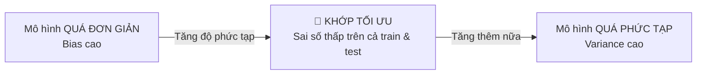

# 🎯 Bias–Variance, Overfitting/Underfitting & Nghệ Thuật Chọn Mô Hình

> **Nguồn:** Giáo trình "Mô hình học máy" — Học viện Ngân hàng (model.pdf, Part 2)

---

## 1. ⚖️ Hai loại sai số nền tảng

### 1.1. Bias (Độ chệch)
- Sai số do mô hình **quá đơn giản hóa** vấn đề → không nắm được quan hệ phức tạp trong dữ liệu.
- Biểu hiện: dự đoán sai trên **cả** tập huấn luyện lẫn tập kiểm tra.
- *Ví dụ:* hồi quy tuyến tính áp lên dữ liệu phi tuyến — bias cao vì không bắt được độ phức tạp.

### 1.2. Variance (Phương sai)
- Đo **độ nhạy cảm** của mô hình với thay đổi nhỏ trong dữ liệu huấn luyện.
- Variance cao = học quá chi tiết dữ liệu train, **kể cả nhiễu** → tốt trên train, kém trên test.
- *Ví dụ:* cây quyết định quá sâu "ghi nhớ" từng điểm dữ liệu thay vì học quy luật tổng quát.

---

## 2. 🔍 Ba trạng thái khớp của mô hình

| Trạng thái | Biểu hiện | Nguyên nhân phổ biến | Cách chữa |
| :--- | :--- | :--- | :--- |
| **Underfitting** (Dưới khớp) | ❌ Sai cao cả trên train lẫn test | Mô hình quá đơn giản; thiếu đặc trưng; huấn luyện chưa đủ | Tăng độ phức tạp, thêm đặc trưng, train lâu hơn |
| **Overfitting** (Quá khớp) | ✅ Train rất tốt — ❌ Test kém | Mô hình quá phức tạp (nhiều lớp/tham số); quá ít dữ liệu; không regularization | Thêm dữ liệu, giảm độ phức tạp, **regularization**, dừng sớm |
| **Optimal Fitting** (Khớp vừa đủ) | ✅ Sai thấp trên CẢ train và test; tổng quát hoá tốt | — | Cross-validation • độ phức tạp phù hợp • regularization • đủ dữ liệu |

> 💡 **Khác biệt căn bản so với thống kê mô tả:** mục tiêu ML **không phải** khớp thật tốt dữ liệu đã có, mà là **dự đoán tốt dữ liệu chưa từng thấy** (generalization).

*Ví dụ underfitting:* dự đoán điểm sinh viên chỉ dựa vào số lần đến lớp, bỏ qua thời gian tự học, điểm bài tập…

---

## 3. 🧭 Chọn mô hình nào? (Bảng định hướng theo tình huống)

| Tình huống | Hướng lựa chọn |
| :--- | :--- |
| Dữ liệu bảng, cần giải thích rõ ràng | Hồi quy tuyến tính / logistic, cây quyết định |
| Dữ liệu bảng, ưu tiên độ chính xác | Rừng ngẫu nhiên, gradient boosting |
| Ảnh, âm thanh, video | Mạng nơ-ron sâu (CNN) |
| Văn bản, ngôn ngữ tự nhiên | Transformer, mô hình ngôn ngữ lớn |
| Không có nhãn, muốn tìm nhóm | k-means & các thuật toán phân cụm |
| Quá nhiều biến tương quan | PCA hoặc phương pháp giảm chiều |
| Dữ liệu rất ít | Mô hình đơn giản + kiểm định chéo + tìm thêm dữ liệu |

> ⛔ **Nguyên tắc làm việc bất di bất dịch:** luôn bắt đầu bằng **mô hình đơn giản nhất làm mốc so sánh (baseline)**, rồi mới thử mô hình phức tạp hơn — chỉ giữ mô hình phức tạp nếu nó tốt hơn **đáng kể**.

---

## 4. 🌗 Ba nhóm thuật toán học máy

### 4.1. Học có giám sát (Supervised Learning)
Dùng biến đầu vào để **dự đoán / phân loại đầu ra** dựa trên **dữ liệu có nhãn**.
→ Hồi quy tuyến tính/logistic, Decision Tree, Random Forest, XGBoost… *(chi tiết xem ghi chú riêng)*

### 4.2. Học không giám sát (Unsupervised Learning)
Chỉ có biến đầu vào, **không có nhãn**:

| Kỹ thuật | Nội dung cốt lõi | Ứng dụng | ⚠️ Cái giá phải trả |
| :--- | :--- | :--- | :--- |
| **Phân cụm k-means** | Chia dữ liệu thành k cụm sao cho quan sát cùng cụm gần nhau nhất | Phân khúc khách hàng, nhóm chi nhánh hành vi tương tự, nén ảnh | Không có "đáp án đúng" — đánh giá bằng chỉ số nội tại + **ý nghĩa nghiệp vụ** của cụm |
| **Giảm chiều PCA** | Tìm ít chiều mới (tổ hợp tuyến tính biến gốc), giữ phần lớn thông tin | Trực quan hoá, nén dữ liệu, xử lý đa cộng tuyến | Chiều mới **không còn ý nghĩa kinh tế trực tiếp** ("thành phần chính thứ nhất" khó giải thích cho khách hàng) |

*(Xem chi tiết phân loại dữ liệu có/không nhãn: `Phan_Loai_Du_Lieu_Va_Feature_Engineering.md`)*

### 4.3. Học củng cố (Reinforcement Learning)
Một **tác nhân (agent)** học cách ra quyết định bằng cách **tương tác với môi trường** để tối ưu hóa **phần thưởng (reward)** — nổi bật trong game và robot.

---

## 5. 🏦 Kết nối với case study môn học
Bài toán churn thẻ tín dụng (BankChurners) trong `BT_Giua_Ky_BankChurners/` vận dụng trọn vẹn chuỗi tri thức này:
1. Dữ liệu bảng có nhãn (`TARGET` = rời bỏ/không) → **học có giám sát, phân lớp nhị phân**;
2. Lớp hiếm (~16% churn) → chia dữ liệu phải **stratified split**;
3. So sánh nhiều mô hình → baseline đơn giản trước, boosting sau;
4. Lớp mất cân bằng → không nhìn Accuracy một mình, dùng **Precision/Recall/F1/AUC** (xem `Mo_Hinh_Hoi_Quy_Logistic_Regression.md` §4).
