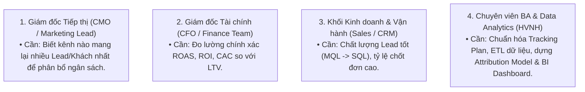
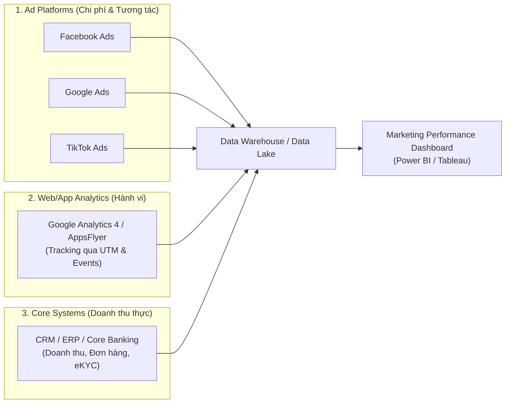
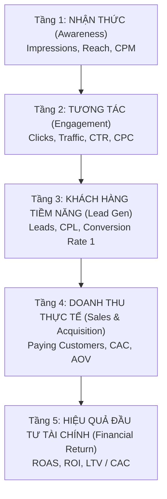
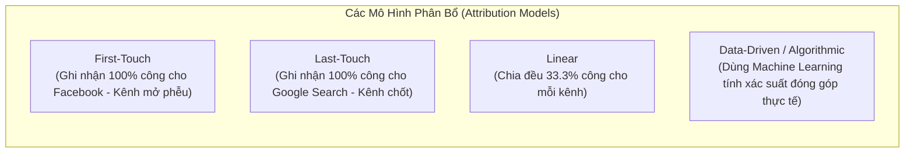
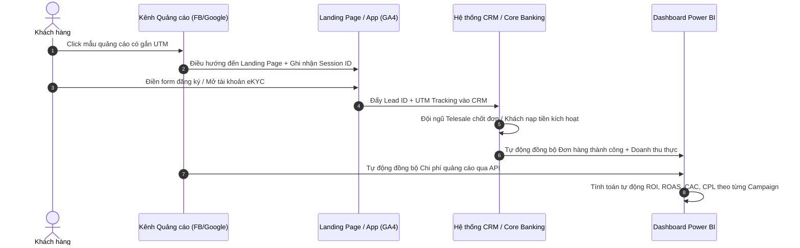

# 📈 Case Study: Đánh Giá Hiệu Quả Chiến Dịch Marketing Online (Digital Marketing Performance Analysis)

---

## 1. 📌 Bối cảnh & Bài toán kinh doanh (Business Context)
Một doanh nghiệp (Ngân hàng số, Thương mại điện tử, Bán lẻ, EdTech...) vừa chi một khoản ngân sách lớn cho **Chiến dịch Marketing Online đa kênh** (Facebook Ads, Google Ads, TikTok Ads, Email Marketing, Affiliate/KOL).

- **"Nỗi đau" của Ban Giám Đốc (Pain Points)**:
  - *"Tôi biết 50% ngân sách marketing của mình bị lãng phí, nhưng khổ nỗi tôi không biết là 50% nào."* (John Wanamaker).
  - Số liệu rời rạc: Báo cáo của Facebook báo 1.000 chuyển đổi, Google báo 800 chuyển đổi, nhưng CRM của phòng Kinh doanh chỉ ghi nhận thực tế có 1.200 đơn hàng thành công $\rightarrow$ **Dữ liệu bị trùng lặp và xung đột (Over-attribution)**.
  - Phòng Marketing báo cáo chỉ số rất đẹp (triệu lượt xem, hàng vạn click), nhưng Giám đốc Tài chính (CFO) phản ánh: **Doanh thu không tăng và không rõ có thu hồi được vốn (ROI) hay không**.
- **Mục tiêu của Dự án Phân tích**:
  - Xây dựng hệ thống đo lường hiệu quả đa kênh xuyên suốt từ khâu Tiếp cận $\rightarrow$ Chuyển đổi $\rightarrow$ Doanh thu thực tế.
  - Xác định chính xác kênh nào, tệp khách hàng nào, nội dung quảng cáo (Creative/Landing Page) nào mang lại **Khách hàng sinh lời cao nhất**.
  - Tối ưu hóa phân bổ ngân sách (Budget Allocation) cho các chiến dịch tiếp theo.

---

## 2. 👥 Phân tích các bên liên quan (Stakeholder Analysis & RACI)



| Tác vụ / Giai đoạn | CMO / MKT | CFO / Kế toán | Sales / CRM | BA / Data Team |
| :--- | :---: | :---: | :---: | :---: |
| **Xác định mục tiêu & Ngân sách chiến dịch** | **A / R** | **C** | **I** | **C** |
| **Thiết kế Tracking Plan (UTM, Pixel, API)** | **C** | **I** | **I** | **A / R** |
| **Đối soát Dữ liệu Chi phí & Doanh thu thực** | **C** | **A** | **C** | **R** |
| **Xây dựng Dashboard Báo cáo Hiệu quả** | **C** | **I** | **I** | **A / R** |
| **Đánh giá ROI & Quyết định Tái phân bổ ngân sách** | **A / R** | **C** | **C** | **C** |

*(Ghi chú: **R** = Responsible, **A** = Accountable, **C** = Consulted, **I** = Informed).*

---

## 3. 🗄️ Kiến trúc Dữ liệu & Nguồn thu thập (Data Architecture & Tracking)

Để có bức tranh trung thực, BA phải đặc tả luồng tích hợp dữ liệu từ **3 lớp hệ thống**:



### Quy tắc Tracking chuẩn hóa bằng UTM Parameters:
Mọi đường link quảng cáo đều phải được gắn chuẩn tracking để phân loại nguồn:
```text
https://nganhang.vn/mo-the-tin-dung?utm_source=facebook&utm_medium=cpc&utm_campaign=mo-the-he-2026&utm_content=video-review-uudai
```
- `utm_source`: Kênh quảng cáo (facebook, google, tiktok, email).
- `utm_medium`: Hình thức (cpc, display, affiliate, organic).
- `utm_campaign`: Tên chiến dịch cụ thể.
- `utm_content`: Mẫu quảng cáo (video, hình ảnh, bài viết) dùng để chạy A/B Testing.

---

## 4. 📊 Phễu chuyển đổi & Bộ chỉ số đo lường hiệu quả (Full-Funnel Metrics)

BA xây dựng khung đánh giá theo **5 tầng phễu (Marketing & Sales Funnel)**:



### Bảng công thức tính các chỉ số cốt lõi:

| Tầng phễu | Chỉ số (KPIs) | Công thức tính | Ý nghĩa nghiệp vụ |
| :--- | :--- | :--- | :--- |
| **1. Nhận thức** | **CPM** (Cost Per Mille) | $\frac{\text{Chi phí MKT}}{\text{Lượt hiển thị}} \times 1.000$ | Chi phí để mẫu quảng cáo tiếp cận được 1.000 lượt xem. |
| **2. Tương tác** | **CTR** (Click-Through Rate)<br>**CPC** (Cost Per Click) | $\text{CTR} = \frac{\text{Số Click}}{\text{Lượt hiển thị}} \times 100\%$<br>$\text{CPC} = \frac{\text{Chi phí MKT}}{\text{Số Click}}$ | Đo lường mức độ hấp dẫn của thông điệp/hình ảnh quảng cáo. |
| **3. Khách tiềm năng** | **CPL** (Cost Per Lead)<br>**CVR1** (Trang đích) | $\text{CPL} = \frac{\text{Chi phí MKT}}{\text{Số Lead thu được}}$<br>$\text{CVR1} = \frac{\text{Số Lead}}{\text{Số Lượt truy cập Landing Page}} \times 100\%$ | Đánh giá chất lượng của Trang đích (Landing Page) và sự quan tâm của khách hàng. |
| **4. Chốt đơn** | **CAC** (Customer Acquisition Cost) | $\text{CAC} = \frac{\text{Tổng chi phí Marketing}}{\text{Số Khách hàng Mới mua thực tế}}$ | **Chi phí để có 1 khách hàng trả tiền thực sự**. |
| **5. Tài chính** | **ROAS** (Return on Ad Spend)<br>**ROI** (Return on Investment) | $\text{ROAS} = \frac{\text{Doanh thu mang lại từ Ads}}{\text{Chi phí Ads}}$<br>$\text{ROI} = \frac{\text{Lợi nhuận gộp - Chi phí Ads}}{\text{Chi phí Ads}} \times 100\%$ | • $\text{ROAS} > 1$: Doanh thu lớn hơn tiền quảng cáo.<br>• $\text{ROI} > 0$: Chiến dịch thực sự sinh lời sau khi trừ giá vốn. |
| **5. Dài hạn** | **Tỷ lệ LTV / CAC** | $\frac{\text{LTV (Giá trị vòng đời khách hàng)}}{\text{CAC}}$ | **Chuẩn mực tài chính**: Tỷ lệ lý tưởng là $\ge 3:1$ (1 đồng bỏ ra kiếm khách thu về 3 đồng giá trị dài hạn). |

---

## 5. 🧠 Phương pháp Phân bổ Chuyển đổi (Attribution Modeling)

Để giải quyết bài toán tranh chấp công lao giữa các kênh:
*Khách hàng thấy quảng cáo Facebook $\rightarrow$ Đọc bài review trên TikTok $\rightarrow$ 3 ngày sau tìm kiếm từ khóa trên Google Search $\rightarrow$ Mua hàng.*



- **BA khuyến nghị**: Sử dụng **Data-Driven Attribution (DDA)** hoặc **Time-Decay** trên Google Analytics 4 để có góc nhìn công bằng nhất, tránh việc cắt ngân sách các kênh nhận diện ban đầu (Facebook/TikTok) chỉ vì kênh Google Search chốt đơn cuối cùng.

---

## 6. 👨‍💼 Đặc tả Yêu cầu Nghiệp vụ từ Chuyên viên BA (HVNH Standard)

### 6.1. Quy trình Nghiệp vụ Mục tiêu (To-Be Process BPMN)


### 6.2. User Story & Acceptance Criteria cho Báo cáo Marketing BI
```text
User Story:
As a Giám đốc Tiếp thị (CMO),
I want to xem báo cáo phân tích hiệu quả chiến dịch theo từng kênh (Channel) và từng mẫu quảng cáo (Creative),
So that tôi có thể biết chính xác kênh nào có chỉ số ROAS cao nhất để ra quyết định phân bổ lại ngân sách kịp thời.

Acceptance Criteria (Gherkin format):
Scenario: Tính toán và hiển thị tự động chỉ số ROAS & CAC
  Given Hệ thống đã đồng bộ đủ dữ liệu Chi phí từ Ad Accounts và Doanh thu từ CRM
  When Người dùng chọn Bộ lọc thời gian "Chiến dịch Mùa Hè 2026" và Kênh "Facebook Ads"
  Then Hệ thống phải hiển thị:
    - Tổng chi phí quảng cáo (VND)
    - Số lượng Lead & Số lượng Đơn hàng thành công
    - Chỉ số CAC = Tổng chi phí / Số đơn hàng thành công
    - Chỉ số ROAS = Tổng doanh thu / Tổng chi phí quảng cáo
  And Các kênh có ROAS < 1.0 phải được highlight cảnh báo màu Đỏ.
```

---
*Tài liệu được tổng hợp cho học phần Phân tích Nghiệp vụ (Business Analysis) - Học viện Ngân hàng.*
