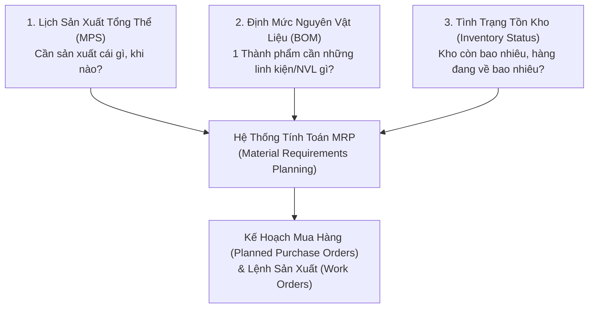
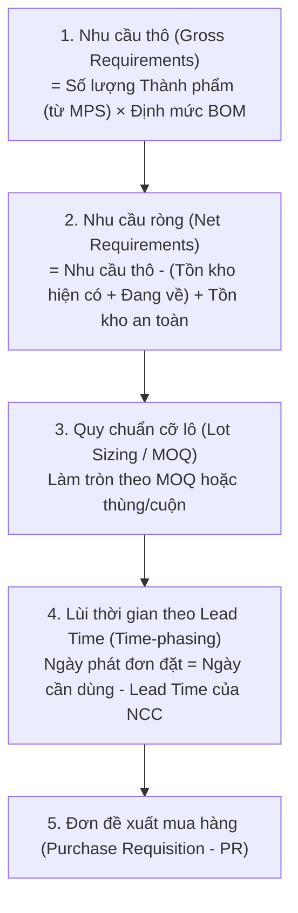
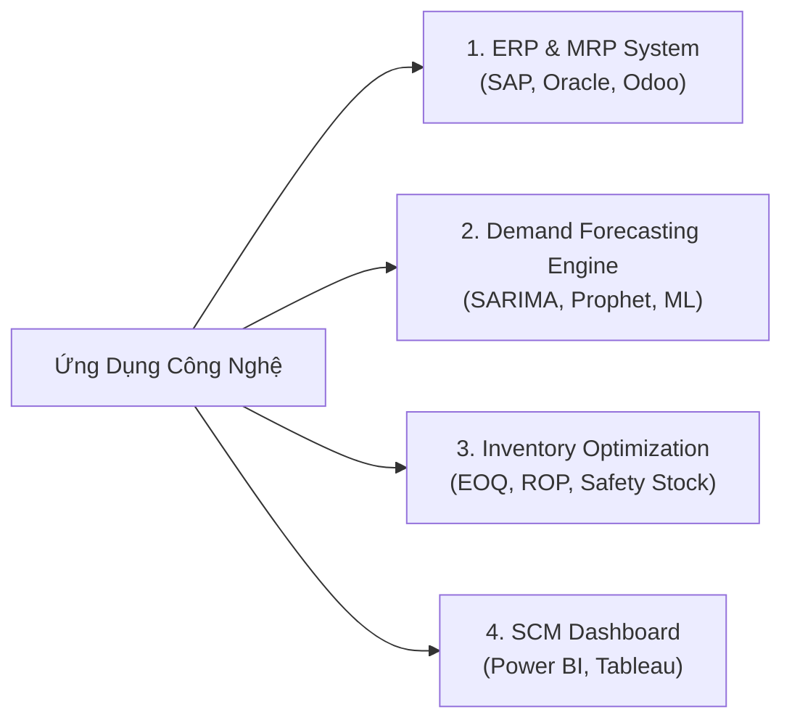

# 🏭 Case Study: Dự Báo Nhu Cầu & Lập Kế Hoạch Mua Nguyên Vật Liệu (MRP) Trong Doanh Nghiệp Sản Xuất

---

## 1. 📌 Bối cảnh & Bài toán nghiệp vụ (Business Context)
Trong các doanh nghiệp sản xuất (May mặc, Giày da, Điện tử, Thực phẩm chế biến, Cơ khí, Dược phẩm...), chi phí mua sắm nguyên vật liệu (NVL) thường chiếm **$50\% - 70\%$** giá thành sản phẩm.

- **Vấn đề & Thách thức**:
  - **Thiếu NVL (Stock-out / Material Shortage)**: Dây chuyền sản xuất phải dừng máy chờ NVL $\rightarrow$ Công nhân nhàn rỗi, trễ hạn giao hàng cho khách (bị phạt hợp đồng SLA, mất uy tín).
  - **Thừa NVL (Over-stocking)**: Tồn kho quá nhiều $\rightarrow$ Đọng vốn lưu động, tốn diện tích kho, rủi ro hỏng hóc/ẩm mốc/hết hạn sử dụng (đặc biệt là ngành thực phẩm, dược phẩm).
  - **Hiệu ứng roi da (Bullwhip Effect)**: Biến động nhỏ từ nhu cầu thị trường tiêu dùng bị khuếch đại dần qua chuỗi cung ứng khiến nhà máy dự báo sai lệch trầm trọng.
- **Mục tiêu của Ban Quản lý Chuỗi cung ứng & Nhà máy**:
  - Tính toán chính xác: **Cần mua NVL gì? Số lượng bao nhiêu? Mua vào thời điểm nào?**
  - Đảm bảo quy tắc **"3 Đúng"**: Đúng loại - Đúng số lượng - Đúng thời điểm (JIT - Just In Time), tối ưu hóa vốn lưu động và đảm bảo sản xuất liên tục.

---

## 2. 🧩 3 Trụ cột dữ liệu cốt lõi để Hoạch định NVL

Để lập kế hoạch mua NVL, hệ thống thông tin bắt buộc phải kết hợp **3 nguồn dữ liệu nền tảng**:

| Nguồn dữ liệu | Chi tiết thông tin | Ý nghĩa nghiệp vụ |
| :--- | :--- | :--- |
| **1. Lịch sản xuất tổng thể (MPS - Master Production Schedule)** | Số lượng từng mã thành phẩm cần sản xuất theo từng ngày/tuần/tháng | Được lập dựa trên: **(Đơn đặt hàng đã chốt từ khách hàng + Dự báo nhu cầu tiêu thụ - Nhu cầu dự trữ thành phẩm)**. |
| **2. Định mức NVL (BOM - Bill of Materials)** | Danh sách toàn bộ NVL, linh kiện, phụ liệu cấu thành nên 1 đơn vị thành phẩm (kèm tỷ lệ hao hụt - *Scrap rate*) | Ví dụ: 1 chiếc Áo sơ mi $= 1.5\text{m}$ Vải $+ 8$ Cúc áo $+ 200\text{m}$ Chỉ may $+ 1$ Mác áo (Hao hụt $3\%$). |
| **3. Dữ liệu Tồn kho & Nhà cung cấp (Inventory & SCM)** | • Tồn kho thực tế (On-hand stock) • Hàng đang trên đường về (In-transit / On-order) • Tồn kho an toàn (Safety stock) • Thời gian giao hàng của NCC (**Lead time**) • Số lượng đặt tối thiểu (**MOQ - Minimum Order Quantity**) | Quyết định **thời điểm phải phát lệnh mua** để hàng về kịp trước ngày máy bắt đầu chạy. |

---

## 3. ⚙️ Quy trình tính toán MRP (Logic cốt lõi của bài toán)

Quy trình tính toán từ **Nhu cầu thô** sang **Nhu cầu mua thực tế**:

### 💡 Ví dụ tính toán minh họa:
* Nhà máy cần sản xuất **$1.000$ chiếc Xe đạp** vào **Tuần 4**.
* BOM: $1$ xe đạp cần $2$ Bánh xe $\implies$ Nhu cầu thô = $2.000$ bánh xe.
* Tồn kho hiện có = $500$ bánh; Hàng đang về = $300$ bánh; Tồn kho an toàn quy định = $200$ bánh.
* $\implies$ **Nhu cầu ròng cần mua** $= 2.000 - (500 + 300) + 200 = 1.400$ bánh xe.
* Nhà cung cấp yêu cầu thời gian giao hàng (**Lead time**) là **$2$ tuần**.
* $\implies$ **Hệ thống tự động phát lệnh đặt hàng vào Tuần 2** để hàng kịp cập cảng/vào kho vào đầu Tuần 4.

---

## 4. 💻 Các ứng dụng công nghệ & Mô hình phân tích áp dụng

### 4.1. Hệ thống ERP & Phân hệ Hoạch định (MRP / ERP Systems)
- **Các giải pháp phổ biến**: **SAP S/4HANA (Module PP & MM)**, **Oracle Cloud SCM**, **Microsoft Dynamics 365 Supply Chain**, **Odoo Manufacturing**.
- **Vai trò**: Tự động hóa toàn bộ luồng từ Forecast $\rightarrow$ MPS $\rightarrow$ MRP $\rightarrow$ Tạo Purchase Order (PO) gửi sang Nhà cung cấp.

### 4.2. Mô hình Dự báo Nhu cầu Thành phẩm (Predictive Analytics)
- **Phương pháp**:
  - Dữ liệu có tính chu kỳ/mùa vụ cao: **SARIMA**, **Facebook Prophet**, **Holt-Winters**.
  - Dữ liệu đa biến phức tạp (kèm chương trình khuyến mãi, giá bán, chỉ số kinh tế): **XGBoost**, **LightGBM**, **Random Forest**.

### 4.3. Mô hình Tối ưu hóa Tồn kho & Đặt hàng (Inventory Optimization)
1. **Mô hình Lượng đặt hàng kinh tế (EOQ - Economic Order Quantity)**:
   $$\text{EOQ} = \sqrt{\frac{2 \times D \times S}{H}}$$
   *(Trong đó: $D$ là tổng nhu cầu hàng năm, $S$ là chi phí cho mỗi lần đặt hàng, $H$ là chi phí lưu kho cho 1 đơn vị).*
   $\rightarrow$ Tìm điểm cân bằng để tổng chi phí đặt hàng + chi phí lưu kho là **thấp nhất**.
2. **Điểm đặt hàng lại (ROP - Reorder Point)**:
   $$\text{ROP} = (\text{Mức tiêu thụ trung bình/ngày} \times \text{Lead time}) + \text{Safety Stock}$$
   *(Khi mức tồn kho giảm xuống chạm ROP, hệ thống tự động kích hoạt tạo đơn mua mới).*

---

## 5. 👨‍💼 Góc nhìn Chuyên viên BA (Business Analyst) trong Dự án MRP

Khi triển khai giải pháp hoạch định NVL cho nhà máy, BA đóng vai trò cầu nối:

1. **Khảo sát nghiệp vụ & Xây dựng Master Data**:
   - Chuẩn hóa cấu trúc **BOM** (quản lý BOM nhiều cấp, quản lý phiên bản BOM khi có thay đổi kỹ thuật - *Engineering Change Order*).
   - Chuẩn hóa tham số Lead time, MOQ của từng NCC và quy cách đóng gói (cuộn, kg, thùng).
2. **Xác định các Quy tắc Nghiệp vụ (Business Rules)**:
   - *Quy tắc gom đơn (Order Batching)*: Nếu có nhiều đợt sản xuất cần cùng 1 loại vải, hệ thống tự động gom vào 1 PO để đàm phán chiết khấu số lượng lớn.
   - *Quy tắc NVL thay thế (Alternate / Substitute Material)*: Nếu NVL chính hết hàng, cho phép hệ thống gợi ý mã NVL thay thế tương đương.
3. **Bộ chỉ số đo lường hiệu quả (SCM & Production KPIs)**:
   - **OTIF (On-Time In-Full)**: Tỷ lệ đơn hàng giao đúng hạn và đủ số lượng.
   - **Tỷ lệ dừng chuyền do thiếu NVL (Downtime due to Stock-out)**.
   - **Vòng quay hàng tồn kho NVL (Raw Material Inventory Turnover)**.
   - **Số ngày tồn kho (Days of Supply - DOS)**.

---
*Tài liệu được tổng hợp cho học phần Phân tích Nghiệp vụ (Business Analysis) - Học viện Ngân hàng.*
