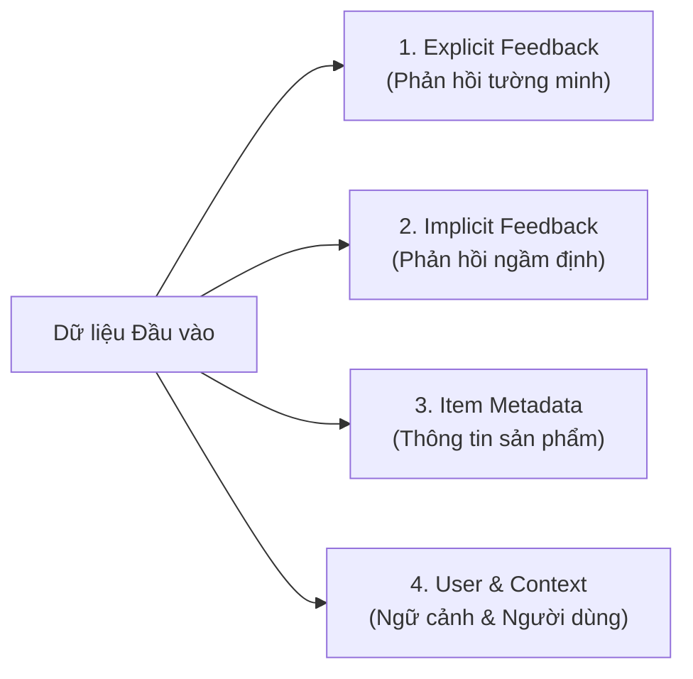
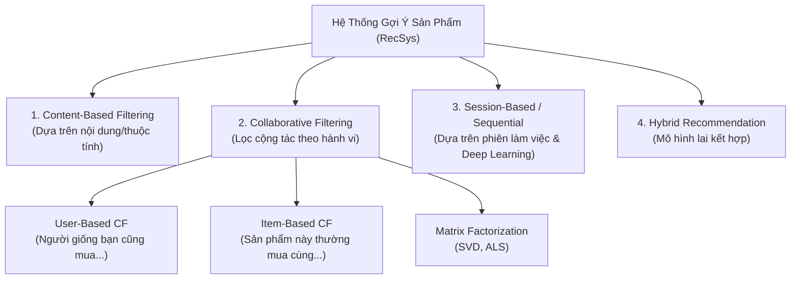
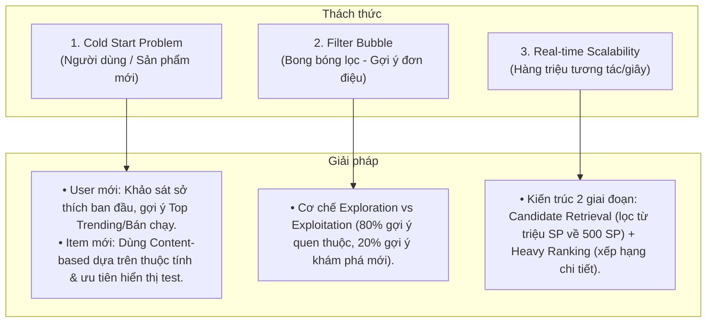

# 🛍️ Case Study: Hệ Thống Gợi Ý Sản Phẩm Trong Thương Mại Điện Tử (Product Recommendation System)

---

## 1. 📌 Bối cảnh & Bài toán nghiệp vụ (Business Context)
Trong các sàn Thương mại điện tử (TMĐT) quy mô lớn như **Shopee, Lazada, Tiki, TikTok Shop, Amazon**, số lượng sản phẩm lên đến hàng chục/hàng trăm triệu SKU.

- **Thách thức**: 
  - **Quá tải thông tin (Information Overload)**: Khách hàng bị "ngợp", khó tìm thấy món đồ mình thực sự thích hoặc có nhu cầu.
  - **Giảm tỷ lệ chuyển đổi (Low Conversion Rate)**: Nếu chỉ hiển thị sản phẩm ngẫu nhiên hoặc chỉ theo top bán chạy, khách hàng nhanh chán và thoát ứng dụng (Bounce rate cao).
- **Mục tiêu của Hệ thống Gợi ý (Recommendation Engine / RecSys)**:
  - **Cá nhân hóa trải nghiệm (Hyper-Personalization)**: Hiển thị đúng sản phẩm cho đúng người vào đúng thời điểm.
  - **Tối đa hóa doanh thu**:
    - Tăng **CTR (Click-Through Rate)**: Tỷ lệ nhấp vào xem sản phẩm.
    - Tăng **CR (Conversion Rate)**: Tỷ lệ từ xem $\rightarrow$ thêm giỏ hàng $\rightarrow$ mua hàng.
    - Tăng **AOV (Average Order Value)**: Giá trị trung bình của mỗi đơn hàng thông qua bán chéo (*Cross-selling*) và bán thêm (*Upselling*).
    - Tăng **Tần suất quay lại (Customer Retention / LTV)**.

---

## 2. 🗄️ Dữ liệu đầu vào của Hệ thống gợi ý (Data Inputs)

| Nhóm dữ liệu | Chi tiết thu thập | Ý nghĩa trong thuật toán gợi ý |
| :--- | :--- | :--- |
| **Explicit Feedback (Tường minh)** | • Đánh giá sao (Rating 1-5★) • Viết bình luận/review • Bấm "Yêu thích" / Wishlist • Bấm nút "Không quan tâm" | Thể hiện trực tiếp và rõ ràng mức độ hài lòng hoặc sở thích của người dùng đối với sản phẩm. |
| **Implicit Feedback (Ngầm định)** | • Lịch sử Click / Xem trang (Clickstream) • Thời gian dừng xem trang (Dwell time) • Lịch sử tìm kiếm từ khóa (Search queries) • Thao tác Thêm vào giỏ hàng (Add-to-cart) • Lịch sử Mua hàng & Tần suất mua | Chiếm $>90\%$ khối lượng dữ liệu; phản ánh hành vi thực tế dù người dùng không chủ động đánh giá. |
| **Item Metadata (Dữ liệu sản phẩm)** | • Tên sản phẩm, Thương hiệu (Brand) • Danh mục (Category hierarchy) • Mô tả, Thuộc tính (Màu sắc, kích cỡ, chất liệu) • Mức giá (Price range), Hình ảnh | Dùng để phân tích tính tương đồng giữa các sản phẩm (Content Similarity). |
| **User Demographics & Context (Ngữ cảnh)** | • Giới tính, Độ tuổi, Địa chỉ giao hàng (Tỉnh/Thành) • Thiết bị (iOS/Android/Web) • Thời gian trong ngày, Mùa/Thời tiết hiện tại | Định vị phân khúc khách hàng và ngữ cảnh tức thời (ví dụ: đang lướt ban đêm, thời tiết đang mưa lạnh). |

---

## 3. 🧠 Các thuật toán & Kỹ thuật gợi ý chính (Recommendation Techniques)

### 3.1. Lọc dựa trên nội dung (Content-Based Filtering)
- **Nguyên lý**: Gợi ý các sản phẩm có **đặc điểm tương đồng** với sản phẩm mà người dùng đã từng thích/xem trong quá khứ.
- **Kỹ thuật xử lý**:
  - Dùng **TF-IDF**, **Word2Vec**, hoặc mô hình ngôn ngữ **BERT** để trích xuất đặc trưng từ tiêu đề & mô tả sản phẩm.
  - Dùng **Cosine Similarity** hoặc khoảng cách Euclidean để tính độ tương đồng giữa các vector sản phẩm.
  - Dùng **Computer Vision (CNN/ResNet)** để gợi ý "Tìm sản phẩm có hình ảnh/kiểu dáng tương tự".
- **Ví dụ**: Người dùng vừa xem một chiếc váy hoa vintage của thương hiệu X $\rightarrow$ Hệ thống gợi ý các mẫu váy hoa họa tiết tương tự cùng tầm giá.

### 3.2. Lọc cộng tác (Collaborative Filtering - CF)
Không cần quan tâm đến thuộc tính chi tiết của sản phẩm, thuật toán chỉ dựa trên **ma trận tương tác giữa Người dùng và Sản phẩm (User-Item Interaction Matrix)**:
1. **User-Based CF (Dựa trên người dùng tương đồng)**:
   - Tìm những người dùng có hành vi/gu mua sắm giống bạn.
   - *Logic*: Người A và Người B đều thích sản phẩm 1, 2, 3. Nếu Người B vừa mua sản phẩm 4 $\rightarrow$ Gợi ý sản phẩm 4 cho Người A.
2. **Item-Based CF (Dựa trên sản phẩm tương đồng về người mua)**:
   - *Logic*: Đa số những người mua Điện thoại iPhone 15 cũng mua Củ sạc nhanh 20W và Ốp lưng silicon $\rightarrow$ Khi khách hàng mới xem iPhone 15, hệ thống lập tức gợi ý sạc và ốp.
3. **Phân rã ma trận (Matrix Factorization - SVD/ALS)**:
   - Nén ma trận khổng lồ thưa thớt (Sparse Matrix) thành các không gian đặc trưng ẩn (Latent Factors) để dự đoán điểm số người dùng sẽ chấm cho sản phẩm chưa từng xem.

### 3.3. Gợi ý theo phiên làm việc & Học sâu (Session-Based & Deep Learning RecSys)
- **Vấn đề**: Khách vãng lai chưa đăng nhập, hoặc sở thích hôm nay khác hoàn toàn sở thích tuần trước.
- **Kỹ thuật**: Sử dụng mô hình **RNN / GRU** hoặc **Transformers (SASRec, BERT4Rec)** để phân tích chuỗi click liên tiếp trong 5-10 phút gần nhất và dự đoán sản phẩm khách sắp click tiếp theo.

### 3.4. Mô hình lai (Hybrid System) & Khai phá giỏ hàng
- Hầu hết các nền tảng thực tế (Shopee, Amazon) đều dùng **Mô hình Lai (Hybrid)**: Kết hợp Content-Based + Collaborative Filtering + Deep Learning để phát huy tối đa ưu điểm của từng loại.
- Kết hợp thuật toán **Khai phá luật kết hợp (Apriori / FP-Growth)** cho tính năng *"Mua kèm deal sốc"*, *"Thường được mua cùng nhau"*.

---

## 4. 📍 Các điểm chạm gợi ý trên ứng dụng TMĐT (UI/UX Touchpoints)

| Vị trí trên App/Web | Tên khối gợi ý | Mục tiêu nghiệp vụ | Thuật toán ưu tiên |
| :--- | :--- | :--- | :--- |
| **Trang chủ (Home Feed)** | *"Gợi ý hôm nay" / "Dành riêng cho bạn"* | Giữ chân người dùng, tăng thời gian lướt app (Discovery). | Hybrid (User-Based CF + Deep Learning + Trending). |
| **Trang chi tiết sản phẩm (PDP)** | *"Sản phẩm tương tự" / "Có thể bạn cũng thích"* | Đưa ra lựa chọn thay thế nếu sản phẩm hiện tại chưa ưng ý. | Content-Based (Image/Text Similarity) + Item-Based CF. |
| **Dưới trang chi tiết / Giỏ hàng** | *"Thường được mua cùng nhau" / "Mua kèm giảm giá"* | **Cross-selling** (bán chéo phụ kiện, đồ đi kèm), tăng AOV. | Association Rules (Apriori) + Item-Item Co-occurrence. |
| **Trang tìm kiếm (Search Results)** | *"Từ khóa gợi ý" / "Sản phẩm liên quan"* | Tăng tốc độ tìm kiếm, giảm tỷ lệ tìm kiếm không ra kết quả. | NLP Search Ranking + Personalized Re-ranking. |
| **Thông báo đẩy (Push Noti / Email)** | *"Sản phẩm trong giỏ của bạn vừa giảm giá!" / "Ưu đãi lại cho bạn"* | **Re-targeting**, nhắc nhở giỏ hàng bị bỏ quên (Cart abandonment). | Event-driven trigger + Rule-based logic. |

---

## 5. ⚠️ Các thách thức kinh điển & Cách giải quyết (BA & Technical Challenges)

---

## 6. 👨‍💼 Góc nhìn Chuyên viên BA (Business Analyst) trong Dự án RecSys

Một BA phụ trách tính năng Gợi ý sản phẩm trên sàn TMĐT cần làm gì?

1. **Xác định mục tiêu & Bộ chỉ số KPI**:
   - **Business KPIs**: Doanh thu từ khối gợi ý (GMV from Recommendations), Tỷ lệ chuyển đổi (CVR), Giá trị đơn hàng trung bình (AOV).
   - **Technical/Model KPIs**: CTR, Recall@K, Precision@K, NDCG (độ chuẩn xác của thứ tự xếp hạng).
2. **Quy định Luật nghiệp vụ (Business Rules Filtering)**:
   - *Luật loại trừ*: Không gợi ý sản phẩm **đã hết hàng**, sản phẩm bị **khóa/vi phạm chính sách**, hoặc sản phẩm người dùng **vừa mới mua hôm qua** (trừ hàng tiêu dùng nhanh như tã bỉm, nước giặt).
   - *Luật ưu tiên*: Ưu tiên sản phẩm của gian hàng chính hãng (Shopee Mall / LazMall), sản phẩm có điểm đánh giá cao ($>4.5\star$), sản phẩm tài trợ quảng cáo (Sponsored Ads).
3. **Đặc tả yêu cầu phi chức năng (NFR)**:
   - Tốc độ phản hồi (Latency): Khối gợi ý phải render dưới **$100\text{ ms}$** để không làm giật lag ứng dụng.
4. **Thiết kế & Đánh giá A/B Testing**:
   - Chia 50% người dùng xem thuật toán cũ (Control Group), 50% xem thuật toán gợi ý mới (Treatment Group).
   - Đo lường và so sánh CTR, CVR trong 2–4 tuần trước khi release 100% người dùng.

---
*Tài liệu được tổng hợp cho học phần Phân tích Nghiệp vụ (Business Analysis) - Học viện Ngân hàng.*
