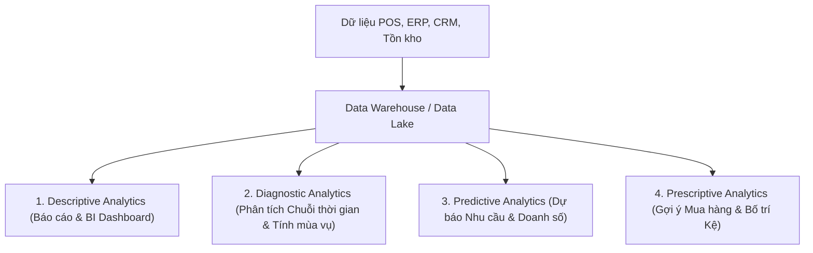

# 📊 Case Study: Phân Tích & Dự Báo Sản Phẩm Bán Chạy Theo Mùa Trong Chuỗi Siêu Thị (Big C, WinMart, Co.opmart)

---

## 1. 📌 Bối cảnh nghiệp vụ (Business Context)
Trong ngành bán lẻ (Retail) và chuỗi siêu thị/đại siêu thị (Big C/GO!, WinMart, Co.opmart, Lotte Mart), hành vi tiêu dùng của khách hàng thay đổi rất mạnh theo **thời vụ (Seasonality)**, **thời tiết**, và **các dịp lễ hội/sự kiện trong năm**.

- **Vấn đề của siêu thị**: 
  - Nếu **nhập thiếu hàng** vào đúng mùa cao điểm $\rightarrow$ Hết hàng (Stock-out), mất doanh thu, khách hàng chuyển sang siêu thị khác.
  - Nếu **nhập thừa hàng** $\rightarrow$ Tồn kho cao, chi phí lưu kho tăng, hàng hết hạn (đặc biệt là thực phẩm tươi sống, bánh kẹo có hạn ngắn), buộc phải xả lỗ (Mark-down).
- **Mục tiêu của Ban Giám Đốc/Bộ phận Mua Hàng (Merchandising & Procurement)**:
  - Biết rõ mặt hàng (SKU/Category) nào bán chạy vào từng khoảng thời gian trong năm.
  - Dự báo trước số lượng tiêu thụ để lên kế hoạch nhập hàng, đàm phán giá với nhà cung cấp (NCC), bố trí kệ hàng và chạy khuyến mãi.

---

## 2. 🗄️ Nguồn dữ liệu cần sử dụng (Data Sources)

Để trả lời được câu hỏi này, hệ thống cần tổng hợp và liên kết nhiều nguồn dữ liệu:

| Nguồn dữ liệu | Chi tiết thông tin thu thập | Ý nghĩa nghiệp vụ |
| :--- | :--- | :--- |
| **Lịch sử giao dịch POS (Point of Sale)** | Transaction ID, Ngày giờ, Chi nhánh, Mã SKU, Tên sản phẩm, Số lượng, Đơn giá, Tổng tiền, Mã giảm giá | Dữ liệu cốt lõi để thấy xu hướng mua sắm thực tế theo ngày/tuần/tháng/mùa qua các năm. |
| **Dữ liệu sản phẩm (Product Master Data)** | Mã SKU, Ngành hàng (Category), Phân loại con (Sub-category), Hạn sử dụng (Shelf life), Nhà cung cấp | Giúp nhóm sản phẩm theo ngành (ví dụ: Nước giải khát, Bánh kẹo, Đồ dùng học tập). |
| **Dữ liệu Tồn kho & Cung ứng (Inventory & SCM)** | Tồn kho tại từng siêu thị/kho tổng, Tỷ lệ đứt hàng (Out-of-stock), Lead time (thời gian NCC giao hàng) | Đánh giá nhu cầu thực tế (nếu ngày đó bị hết hàng thì doanh số giảm do thiếu hàng chứ không phải do giảm nhu cầu). |
| **Dữ liệu Thẻ thành viên (CRM / Loyalty Data)** | Khách hàng thân thiết, độ tuổi, phân khúc thu nhập, lịch sử giỏ hàng | Phân tích nhóm khách hàng nào chuộng mặt hàng nào theo mùa. |
| **Dữ liệu Ngoại cảnh (Contextual Factors)** | Lịch Dương/Lịch Âm (Tết, Trung Thu), Thời tiết (Nhiệt độ, Mưa/Nắng), Sự kiện kinh tế - xã hội | Biến số quan trọng ảnh hưởng trực tiếp đến tính thời vụ tại Việt Nam (VD: Tết Âm lịch rơi vào tháng 1 hay tháng 2). |

---

## 3. 🛠️ Ứng dụng gì? (Công nghệ & Phương pháp phân tích)

Từ góc nhìn Business Analysis & Hệ thống thông tin quản lý, bài toán này áp dụng 4 tầng phân tích:

### 3.1. Hệ thống BI Dashboard & Báo cáo Lịch sử (Descriptive Analytics)
- **Công cụ áp dụng**: Microsoft Power BI, Tableau, Qlik Sense, Looker.
- **Nghiệp vụ**:
  - Trực quan hóa doanh thu, sản lượng theo từng danh mục hàng hóa qua các tháng/quý và so sánh cùng kỳ (**YoY - Year over Year**, **MoM - Month over Month**).
  - Bảng nhiệt đồ (Heatmap) thể hiện mức độ tiêu thụ của từng nhóm hàng qua 12 tháng.
  - Giúp nhà quản lý thấy ngay: *Tháng 6-7 hàng năm ngành hàng nào tăng trưởng đột biến?*

### 3.2. Phân tích Xu hướng & Tính thời vụ (Seasonality & Time Series Analysis)
- **Phương pháp**: Phân rã chuỗi thời gian (Time Series Decomposition) tách dữ liệu thành:
  1. **Trend (Xu hướng dài hạn)**: Xu hướng tăng trưởng hay suy giảm tự nhiên qua nhiều năm.
  2. **Seasonality (Tính chu kỳ/thời vụ)**: Dao động lặp lại đều đặn theo mùa/tháng/dịp lễ.
  3. **Noise / Irregular (Biến động ngẫu nhiên)**: Ảnh hưởng bất thường (VD: Covid, bão lụt).
- **Mục đích**: Nhận diện rõ biên độ mùa vụ (Seasonal Index) của từng nhóm hàng (VD: Kem tăng $150\%$ vào mùa hè, Bia/Bánh mứt kẹo tăng $300\%$ vào tháng Chạp).

### 3.3. Mô hình Dự báo Nhu cầu & Doanh số (Demand Forecasting - Predictive Analytics)
- **Thuật toán & Mô hình**:
  - Thống kê cổ điển: **Holt-Winters Exponential Smoothing**, **SARIMA** (Seasonal AutoRegressive Integrated Moving Average).
  - Machine Learning & AI: **Facebook Prophet** (rất mạnh khi xử lý lịch nghỉ lễ/Tết Âm lịch của VN), **XGBoost**, **LightGBM**, **LSTM (Deep Learning)**.
- **Ứng dụng phần mềm doanh nghiệp thực tế**:
  - Các phân hệ chuyên dụng trong ERP/SCM: **SAP IBP (Integrated Business Planning)**, **Oracle Retail Demand Forecasting**, **Blue Yonder (JDA)**, **RELEX Solutions**.

### 3.4. Khai phá Quy luật Giỏ hàng theo mùa (Market Basket Analysis / Association Rules)
- **Thuật toán**: **Apriori**, **FP-Growth**.
- **Ý nghĩa**: Biết được theo từng mùa, khách hàng có xu hướng **mua kèm những sản phẩm nào với nhau**.
  - *Ví dụ mùa đông*: Khách mua Nước cốt lẩu $\rightarrow$ Mua kèm Nấm, Sa tế, Thịt bò đông lạnh, Rau tươi, Nồi lẩu điện.
  - *Ví dụ mùa hè*: Mua Bia $\rightarrow$ Mua kèm Đậu phộng, Mực khô, Kem cây.

---

## 4. 📅 Bảng ví dụ thực tế: Sản phẩm theo mùa tại thị trường Việt Nam

| Mùa / Dịp lễ | Thời điểm | Nhóm sản phẩm bán chạy | Hành động của siêu thị |
| :--- | :--- | :--- | :--- |
| **Mùa Tết Âm lịch** | Tháng 12 - Tháng 1 Âm lịch | Bánh kẹo hộp thiếc, Giỏ quà Tết, Rượu bia, Thịt heo/bò, Gạo nếp, Lá dong, Dưa hấu, Hạt dưa/hạt điều | Nhập hàng trước 2-3 tháng; dựng quầy giỏ quà Tết ở lối vào chính; thuê thêm kho lạnh tạm thời. |
| **Mùa Hè & Du lịch** | Tháng 5 - Tháng 8 | Kem, Nước giải khát/Bia, Đồ bơi, Kem chống nắng, Quạt mát, Thực phẩm ăn liền/đóng hộp | Chạy CTKM giải nhiệt mùa hè; bố trí tủ kem và quầy bia cạnh lối đi chính; tăng diện tích quầy đồ dùng du lịch. |
| **Mùa Tựu trường (Back to School)** | Tháng 8 - Tháng 9 | Sách vở, Bút thước, Balo học sinh, Đèn bàn, Sữa tươi, Thực phẩm tiện lợi ăn sáng | Gom toàn bộ văn phòng phẩm vào khu vực khuyến mãi trung tâm (Center Court); làm combo ưu đãi học sinh. |
| **Tết Trung Thu** | Tháng 8 Âm lịch | Bánh trung thu, Lồng đèn, Đồ chơi trẻ em, Trà mạn | Đặt quầy bánh trung thu ngoài sảnh hoặc cổng vào; liên kết với các thương hiệu bánh lớn (Kinh Đô, Như Lan...). |
| **Mùa Đông / Lạnh (Miền Bắc)** | Tháng 11 - Tháng 2 | Gia vị & nguyên liệu nấu lẩu/nướng, Thực phẩm đông lạnh, Đồ dưỡng ẩm, Quần áo ấm, Bình giữ nhiệt | Tạo khu vực chuyên đề "Góc phố Lẩu - Nướng", combo set lẩu gia đình tiện lợi. |

---

## 5. 👨‍💼 Góc nhìn Chuyên viên Phân tích Nghiệp vụ (BA Role & Workflow)

Khi triển khai giải pháp này cho chuỗi siêu thị, một Business Analyst (BA) sẽ thực hiện:

1. **Elicitation (Khảo sát yêu cầu)**:
   - Phỏng vấn Giám đốc Thu mua (Merchandising Director) và Quản lý Siêu thị (Store Manager) để hiểu rõ tiêu chí đánh giá và khó khăn hiện tại.
2. **Xác định mục tiêu & Chỉ số đo lường (KPIs)**:
   - Độ chính xác dự báo (Forecast Accuracy / MAPE $\ge 85\%$).
   - Giảm tỷ lệ hết hàng (Out-of-stock rate $< 3\%$).
   - Tối ưu vòng quay hàng tồn kho (Inventory Turnover Ratio).
3. **Phân tích Quy trình nghiệp vụ (Business Process Modeling - BPMN)**:
   - Vẽ luồng từ: `Dữ liệu bán lẻ POS` $\rightarrow$ `Mô hình chạy dự báo` $\rightarrow$ `Hệ thống gợi ý đơn hàng (Auto-PO)` $\rightarrow$ `Buyer duyệt` $\rightarrow$ `Gửi đơn đến Nhà cung cấp`.
4. **Viết tài liệu Đặc tả yêu cầu (BRD / SRS)**:
   - Đặc tả tính năng cho Dashboard BI, logic cảnh báo tồn kho tối thiểu/tối đa theo mùa, quy tắc phân rã dữ liệu bán hàng.
5. **UAT (Kiểm thử chấp nhận người dùng)**:
   - Cùng đội ngũ Thu mua chạy thử nghiệm (Pilot test) trên một vài nhóm ngành hàng trọng điểm trong 1 mùa vụ để kiểm chứng hiệu quả.

---
*Tài liệu được tổng hợp cho học phần Phân tích Nghiệp vụ (Business Analysis) - Học viện Ngân hàng.*
