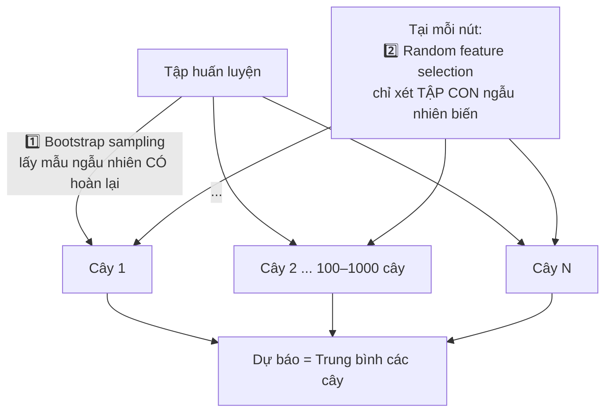

# 🌲 Mô Hình Hồi Quy: Linear Regression, Decision Tree & Random Forest

> **Nguồn:** Giáo trình "Mô hình học máy" — Học viện Ngân hàng (model.pdf, Part 2)
> *(Mô hình phân lớp Logistic Regression đã có ghi chú riêng: `Mo_Hinh_Hoi_Quy_Logistic_Regression.md`)*

---

## 1. 📐 Hồi quy tuyến tính (Linear Regression)

- **Ý tưởng:** tìm tham số sao cho **tổng bình phương phần dư (Residual Sum of Squares) nhỏ nhất** — chính là ước lượng OLS trong thống kê:

$$\min_{\beta_0, \beta_1, \dots, \beta_k} \sum_{i=1}^{n} \left(y_i - (\beta_0 + \beta_1 x_{i1} + \dots + \beta_k x_{ik})\right)^2$$

- Dùng cho bài toán dự đoán **giá trị liên tục** (doanh thu, dư nợ, điểm tín dụng số...).
- Điểm mạnh: dễ giải thích từng hệ số ($\beta_i$ = tác động biên của biến $X_i$); nhanh; là **baseline mặc định**.
- Hạn chế: chỉ bắt được quan hệ tuyến tính; nhạy cảm với outlier và đa cộng tuyến.

**Chỉ số đánh giá mô hình hồi quy:** RMSE, MAE, R².

---

## 2. 🌳 Cây quyết định hồi quy (Decision Tree Regression)

### Bản chất
Dùng cấu trúc cây phân tách để dự đoán giá trị **số liên tục**: chia dữ liệu thành các vùng nhỏ sao cho mỗi vùng có đầu ra càng đồng nhất càng tốt. Dự báo bằng **giá trị trung bình của nút lá** mà quan sát rơi vào.

### Cấu trúc ba loại nút
| Loại nút | Vai trò |
| :--- | :--- |
| **Nút gốc** (root / nút quyết định) | Lựa chọn đầu tiên → chia toàn bộ bản ghi thành các tập con loại trừ lẫn nhau |
| **Nút bên trong** (internal node) | Một lựa chọn khả dĩ tại thời điểm đó; nối nút cha với nút con/nút lá |
| **Nút lá** (leaf node) | Kết quả cuối cùng — giá trị dự báo |

### Nguyên lý hoạt động (3 bước cơ bản: chia tách → dừng → điều chỉnh)
1. Tìm **điểm chia (split)** trên một biến đầu vào sao cho **giảm sai số lớn nhất** (tiêu chí thường dùng: giảm MSE);
2. Chia nhánh dữ liệu theo điều kiện;
3. Lặp đến điều kiện dừng (**số mẫu tối thiểu, độ sâu cây, sai số đủ nhỏ**).

| ✅ Ưu điểm | ❌ Nhược điểm |
| :--- | :--- |
| Dễ hiểu, trực quan hoá (diễn giải tốt nhất trong nhóm phi tuyến) | **Dễ overfitting** nếu cây quá sâu |
| Xử lý phi tuyến rất tốt | Nhạy cảm với nhiễu |
| Không yêu cầu chuẩn hóa dữ liệu | Khó tổng quát hóa trên dữ liệu mới |
| Tự động chọn biến quan trọng | Bất ổn định: đổi nhẹ dữ liệu → cây khác hẳn |

---

## 3. 🌲🌲🌲 Rừng ngẫu nhiên (Random Forest)

### Bản chất
Kỹ thuật mở rộng cây quyết định phát triển từ thuật toán **Bagging**, đề xuất bởi **Breiman và cộng sự**: xây một lượng lớn cây từ dữ liệu lấy mẫu ngẫu nhiên, rồi gộp dự báo (hồi quy: trung bình tất cả các cây).

### Hai nguồn ngẫu nhiên (chống overfitting)

| ✅ Ưu điểm | ❌ Nhược điểm |
| :--- | :--- |
| Hiệu quả cao, chính xác hơn Decision Tree đơn lẻ | Khó giải thích hơn cây đơn lẻ ("hộp đen hơn") |
| Giảm overfitting nhờ bagging + ngẫu nhiên hóa biến | Tốn tài nguyên nếu nhiều cây |
| Xử lý tốt phi tuyến, không cần chuẩn hóa | Thời gian huấn luyện lâu hơn |
| Tự động đánh giá **feature importance** | |

> 💡 **Vì sao RF giảm tương quan giữa các cây?** Nếu không chọn ngẫu nhiên biến tại mỗi nút, mọi cây đều chia bằng cùng vài biến mạnh nhất → các cây giống nhau, lấy trung bình không giảm phương sai. Ngẫu nhiên hóa biến buộc các cây "đi đường khác nhau" → trung bình hóa triệt tiêu nhiễu hiệu quả hơn.

---

## 4. ⚔️ So sánh nhanh ba mô hình hồi quy

| Tiêu chí | Linear Regression | Decision Tree | Random Forest |
| :--- | :---: | :---: | :---: |
| Quan hệ dữ liệu | Chỉ tuyến tính | Phi tuyến | Phi tuyến |
| Khả năng diễn giải | ⭐⭐⭐ (hệ số rõ nghĩa kinh tế) | ⭐⭐⭐ (luật IF-THEN) | ⭐ (ensemble khó đọc) |
| Nguy cơ overfitting | Thấp (nhưng nhạy outlier) | **Cao** khi cây sâu | Thấp (bagging) |
| Cần chuẩn hóa? | Nên | Không | Không |
| Feature importance | Qua hệ số/p-value | Có (mức giảm MSE) | ✅ Tự động, đáng tin |
| Vai trò điển hình | Baseline / suy luận nhân quả | Rule-based, trình bày Hội đồng | Dự báo chính xác |

---

## 5. 🏦 Kết nối nghiệp vụ ngân hàng
- **Linear Regression:** ước lượng tác động lãi suất → nhu cầu vay; baseline dự báo doanh thu chi nhánh.
- **Decision Tree:** xây dựng quy tắc phê duyệt vay minh bạch trình Hội đồng tín dụng ("Thu nhập < 10tr VÀ CIC xấu → từ chối").
- **Random Forest:** chấm điểm tín dụng/dự báo dư nợ khi ưu tiên độ chính xác, kèm feature importance để bảo vệ trước phản biện.
