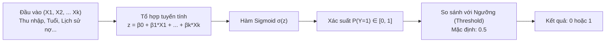
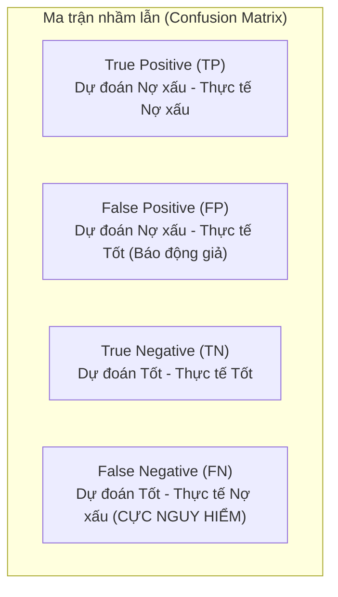

# 📈 Mô Hình Hồi Quy Logistic (Logistic Regression) trong Phân Tích Dữ Liệu & Nghiệp Vụ

---

## 1. 📌 Mô hình Logistic là gì?
**Hồi quy Logistic (Logistic Regression)** là một mô hình thống kê & Machine Learning thuộc nhóm **Học có giám sát (Supervised Learning)**, được sử dụng phổ biến nhất cho bài toán **Phân loại (Classification)** — đặc biệt là **Phân loại nhị phân (Binary Classification)** khi biến mục tiêu đầu ra $Y$ chỉ nhận 2 giá trị rời rạc:
- $Y = 1$ (Có / Xảy ra / Positive): *Ví dụ: Khách bùng nợ, Giao dịch gian lận, Mua hàng, Hủy dịch vụ.*
- $Y = 0$ (Không / Không xảy ra / Negative): *Ví dụ: Khách trả nợ đúng hạn, Giao dịch an toàn, Không mua, Tiếp tục dùng.*

> 💡 **Điểm đặc biệt**: Mặc dù mang tên là "Hồi quy" (*Regression*), nhưng Logistic Regression dùng để giải bài toán **Phân loại (*Classification*)** bằng cách ước lượng **Xác suất (Probability $P \in [0, 1]$)** xảy ra sự kiện.

---

## 2. 🧮 Bản chất toán học & Hàm Sigmoid

### 2.1. Tại sao không dùng Hồi quy tuyến tính (Linear Regression)?
- Hồi quy tuyến tính ($y = ax + b$) cho ra giá trị từ $-\infty \rightarrow +\infty$, không bị giới hạn trong khoảng xác suất $[0, 1]$.
- Hồi quy tuyến tính rất nhạy cảm với các điểm dữ liệu ngoại lai (Outliers), làm lệch toàn bộ ranh giới phân loại.

### 2.2. Hàm kích hoạt Sigmoid (Logistic Function)
Để đưa đầu ra về khoảng xác suất $[0, 1]$, mô hình đưa tổ hợp tuyến tính $z$ qua **Hàm Sigmoid**:

$$P(Y=1|X) = \sigma(z) = \frac{1}{1 + e^{-z}} = \frac{1}{1 + e^{-(\beta_0 + \beta_1 X_1 + \beta_2 X_2 + \dots + \beta_k X_k)}}$$

- Khi $z \to +\infty \implies P \to 1$
- Khi $z \to -\infty \implies P \to 0$
- Khi $z = 0 \implies P = 0.5$

### 2.3. Tỷ số chênh (Odds) và Logit
- **Odds (Tỷ số chênh)**: Tỷ lệ giữa xác suất xảy ra sự kiện chia cho xác suất không xảy ra:
  $$\text{Odds} = \frac{P}{1 - P}$$
- **Logit (Log-Odds)**: Lấy logarit tự nhiên của Odds:
  $$\ln(\text{Odds}) = \ln\left(\frac{P}{1-P}\right) = \beta_0 + \beta_1 X_1 + \dots + \beta_k X_k$$
  *(Hệ số $\beta_i$ phản ánh: Khi biến $X_i$ tăng 1 đơn vị, Log-Odds của sự kiện sẽ thay đổi một lượng là $\beta_i$).*

---

## 3. 🏦 Các ứng dụng thực tế kinh điển (Đặc biệt trong Tài chính - Ngân hàng HVNH)

| Lĩnh vực | Bài toán nghiệp vụ | Nhãn $Y=1$ (Positive) | Nhãn $Y=0$ (Negative) | Biến đầu vào ($X_i$) |
| :--- | :--- | :--- | :--- | :--- |
| **Tín dụng Ngân hàng (Credit Scoring)** | Đánh giá rủi ro vỡ nợ, chấm điểm cấp thẻ tín dụng/vay vốn | Khách hàng nợ xấu / Vỡ nợ (Default) | Khách hàng trả nợ tốt | Thu nhập, Độ tuổi, Điểm CIC, Tỷ lệ nợ trên thu nhập (DTI), Số người phụ thuộc. |
| **Thanh toán & Thẻ (Fraud Detection)** | Phát hiện giao dịch gian lận thẻ/chuyển tiền | Giao dịch Gian lận | Giao dịch Hợp lệ | Số tiền giao dịch, Vị trí IP, Khoảng cách 2 giao dịch liên tiếp, Thời điểm giao dịch. |
| **Viễn thông / SaaS / E-commerce** | Dự báo khách hàng rời bỏ dịch vụ (Customer Churn) | Khách hàng Hủy dịch vụ (Churn) | Khách hàng Tiếp tục ở lại | Tần suất sử dụng, Số ngày không đăng nhập, Khiếu nại dịch vụ, Gói cước. |
| **Tiếp thị số (Digital Marketing)** | Dự báo chuyển đổi / Mua hàng (Propensity to Buy) | Khách hàng Mua / Click | Khách không mua / Bỏ qua | Số lượt xem sản phẩm, Thêm giỏ hàng, Nguồn truy cập (Ads/Organic), Khuyến mãi. |

---

## 4. 📊 Đánh giá hiệu năng mô hình (Model Evaluation)

Trong thực tế, không chỉ nhìn vào độ chính xác (**Accuracy**), vì nếu $98\%$ khách hàng trả nợ tốt và chỉ $2\%$ nợ xấu, mô hình dự đoán tất cả là $0$ vẫn đạt $98\%$ Accuracy nhưng vô dụng. Do đó, các chỉ số sau được sử dụng:

1. **Confusion Matrix**:
   - **Precision (Độ chuẩn xác)** $= \frac{TP}{TP + FP}$: Trong các ca mô hình báo Nợ xấu, có bao nhiêu % thực sự nợ xấu?
   - **Recall / Sensitivity (Độ nhạy)** $= \frac{TP}{TP + FN}$: Mô hình bắt được bao nhiêu % trong tổng số người nợ xấu thực tế?
   - **F1-Score**: Trung bình điều hòa giữa Precision và Recall.
2. **Đường cong ROC và chỉ số AUC (Area Under the Curve)**:
   - Đo lường khả năng phân biệt giữa 2 lớp $0$ và $1$.
   - $\text{AUC} = 0.5$: Đoán mò ngẫu nhiên.
   - $\text{AUC} \ge 0.8$: Mô hình tốt; $\text{AUC} \ge 0.9$: Mô hình xuất sắc.
3. **Hệ số Gini & Chỉ số K-S (Kolmogorov-Smirnov)**:
   - **Chuẩn mực trong ngành Ngân hàng (Basel II/III)** để thẩm định mô hình xếp hạng tín dụng nội bộ.

---

## 5. ⚖️ Ưu điểm & Nhược điểm

### ✅ Ưu điểm:
1. **Tính giải thích cao (High Interpretability/Explainability)**: Đây là ưu điểm lớn nhất. Ngân hàng có thể giải thích rõ cho khách hàng hoặc Ngân hàng Nhà nước lý do từ chối hồ sơ vay (dựa vào trọng số $\beta$).
2. **Nhẹ, tính toán nhanh**: Huấn luyện và dự báo cực nhanh, tiêu tốn ít tài nguyên phần cứng.
3. **Đưa ra xác suất trực tiếp**: Không chỉ trả về $0/1$, mô hình cho biết xác suất cụ thể (ví dụ: $78\%$ khả năng nợ xấu), giúp phân cấp rủi ro linh hoạt.

### ❌ Nhược điểm:
1. **Giả định tuyến tính giữa Log-odds và biến $X$**: Kém hiệu quả nếu dữ liệu có mối quan hệ phi tuyến phức tạp (lúc này cần dùng Random Forest, XGBoost hoặc Neural Network).
2. **Dễ bị ảnh hưởng bởi đa cộng tuyến (Multicollinearity)**: Khi các biến đầu vào tương quan mạnh với nhau.

---

## 6. 👨‍💼 Góc nhìn Chuyên viên BA (Business Analyst)

Khi làm việc với mô hình Logistic trong dự án phần mềm / chuyển đổi số:

1. **Lựa chọn Ngưỡng quyết định (Decision Threshold / Cut-off)**:
   - Mặc định là $0.5$. Nhưng trong bài toán Nợ xấu hoặc Gian lận, để lọt 1 vụ gian lận (False Negative) gây thiệt hại lớn hơn nhiều so với việc cảnh báo nhầm (False Positive).
   - $\rightarrow$ BA cần cùng Risk Manager hạ ngưỡng xuống $0.2$ hoặc $0.3$ để tối đa hóa **Recall**.
2. **Quy định Luật nghiệp vụ Override (Business Rule Engine)**:
   - Mô hình Logistic chấm điểm, nhưng vẫn cần kết hợp **Hard Rules** (Ví dụ: Nếu khách đang có nợ nhóm 3 trở lên trên CIC $\rightarrow$ Từ chối tự động mà không cần chạy mô hình).
3. **Đặc tả hiển thị kết quả (UI/UX SRS)**:
   - Thiết kế màn hình cho thẩm định viên ngân hàng: Hiển thị điểm số rủi ro, xác suất vỡ nợ, và top 3 yếu tố rủi ro chính tác động tiêu cực đến điểm số của khách hàng.

---
*Tài liệu được tổng hợp cho học phần Phân tích Nghiệp vụ (Business Analysis) - Học viện Ngân hàng.*
