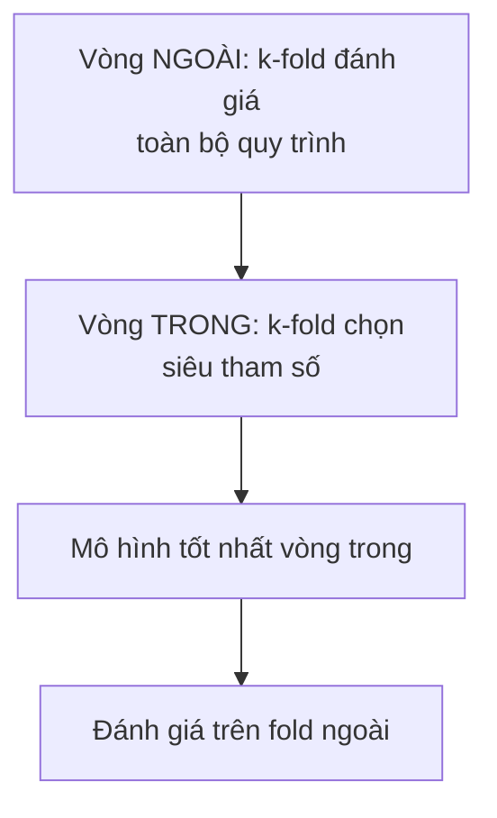

# 🔀 Quy Trình Xây Dựng Mô Hình ML & Kỹ Thuật Chia Dữ Liệu (Train/Test Split, Cross-Validation)

> **Nguồn:** Giáo trình "Mô hình học máy" — Học viện Ngân hàng (model.pdf, Part 1)
> Đây là phần **thi hay ra nhất**: quy trình 8 bước + sai lầm từng bước + các cách chia dữ liệu.

---

## 1. 🪜 Quy trình 8 bước xây dựng mô hình ML & sai lầm thường gặp

| Bước | Nội dung | ❌ Sai lầm thường gặp |
| :---: | :--- | :--- |
| 1 | Xác định bài toán và thước đo thành công | Bắt đầu từ mô hình thay vì từ câu hỏi |
| 2 | Thu thập và mô tả dữ liệu | Không kiểm tra nguồn gốc và tính đại diện |
| 3 | Làm sạch, xử lý thiếu và ngoại lai | Xoá hết hàng thiếu → làm lệch mẫu |
| 4 | Tạo đặc trưng (feature engineering) | Vô tình đưa vào biến gây **rò rỉ dữ liệu** |
| 5 | Chia tập huấn luyện / kiểm định / kiểm tra | Chia SAU khi đã xử lý toàn bộ dữ liệu |
| 6 | Huấn luyện và tinh chỉnh siêu tham số | Tinh chỉnh TRÊN tập kiểm tra |
| 7 | Đánh giá trên tập kiểm tra | Chọn chỉ số không phù hợp bài toán |
| 8 | Triển khai và giám sát | Không theo dõi khi phân phối dữ liệu đổi |

### Chuẩn 9 bước chi tiết (phiên bản đầy đủ trong slide)
1. Xác định bài toán
2. Thu thập dữ liệu (*Data collection*)
3. Tiền xử lý (*Preprocessing*):
   - Làm sạch (*cleaning*: giá trị thiếu, ngoại lệ)
   - Chuyển đổi (*transformation*: Label Encoding, One-Hot Encoding)
   - Chuẩn hoá (*normalization*: Standardization, Normalization)
   - Trích xuất đặc trưng (*feature extraction/selection/engineering*)
4. Chia train/test
5. Lựa chọn mô hình
6. Huấn luyện trên tập train
7. Đánh giá trên tập test — Phân loại: Accuracy, Precision, Recall, F1, AUC • Hồi quy: RMSE, MAE, R²
8. Hiệu chỉnh mô hình: Grid Search, Random Search, Cross-Validation
9. Triển khai: dự báo, phân lớp

---

## 2. ✂️ Chia dữ liệu thành BA tập

| Tập | Vai trò | Quy tắc sử dụng |
| :--- | :--- | :--- |
| **Huấn luyện** (training) | Ước lượng tham số mô hình | Dùng thoải mái |
| **Kiểm định** (validation) | Chọn siêu tham số (độ sâu cây, số cụm, mức phạt), so sánh mô hình | Dùng nhiều lần trong quá trình chọn |
| **Kiểm tra** (test) | Báo cáo hiệu năng cuối cùng | ⛔ Chỉ dùng đúng MỘT lần, ở cuối cùng |

- Vì sao không đánh giá ngay trên tập huấn luyện? Mô hình đã "nhìn thấy" dữ liệu đó → kết quả tốt giả tạo. Cần đo trên **dữ liệu chưa từng thấy**.
- **Tỷ lệ thường dùng:** `60/20/20` hoặc `70/15/15`. Dữ liệu càng lớn thì tỷ lệ kiểm định/kiểm tra càng có thể nhỏ.
- Dùng test set để chọn mô hình = con số báo cáo **lạc quan hơn thực tế** (đây là lỗi "rò rỉ" kinh điển).

---

## 3. 🎲 Cách 1: Chia ngẫu nhiên một lần (Random Split)

### Quy trình
1. **Trộn ngẫu nhiên** toàn bộ quan sát *(bắt buộc — dữ liệu thường sắp sẵn theo mã KH/chi nhánh/nhãn, cắt thẳng tạo ra 2 tập khác bản chất)*;
2. Cắt theo tỷ lệ đã chọn;
3. Cố định **random seed** để kết quả lặp lại được.

### Ưu điểm vs Nhược điểm
| ✅ Ưu điểm | ❌ Nhược điểm |
| :--- | :--- |
| Đơn giản, một dòng lệnh; nhanh (huấn luyện 1 lần) | Kết quả phụ thuộc 1 lần bốc thăm — đổi seed có thể đổi kết luận |
| Phù hợp khi dữ liệu RẤT LỚN | Dữ liệu ít → tập test quá nhỏ, ước lượng rất nhiễu |
| Dễ giải thích cho người ngoài ngành | "Lãng phí" 20–40% quan sát không dùng huấn luyện |
| | Có thể lệch tỷ lệ lớp hoặc tách nhầm quan sát liên quan |

→ Chính 4 nhược điểm này dẫn tới **kiểm định chéo**.

### Khi chia ngẫu nhiên là SAI
| Tình huống | Vấn đề | Cách đúng |
| :--- | :--- | :--- |
| **Lớp hiếm** (gian lận, vỡ nợ, bệnh hiếm) | Tỷ lệ lớp lệch hẳn giữa các tập; test gần như không còn lớp hiếm | **Chia phân tầng (stratified split)** — bốc thăm riêng trong từng lớp, giữ đúng tỷ lệ toàn cục |
| **Dữ liệu có nhóm** (1 khách hàng nhiều giao dịch) | Cùng 1 người nằm cả 2 tập → mô hình "nhận ra người", điểm bị thổi phồng | **Group split** — cả nhóm nằm trọn trong 1 tập |
| **Dữ liệu theo thời gian** | Trộn = dùng tương lai dự báo quá khứ (vô nghĩa) | **Time-based split** — cửa sổ mở rộng: train quá khứ, test tương lai |

---

## 4. 🔁 Cách 2: Kiểm định chéo k phần (k-Fold Cross-Validation)

### 5 bước thực hiện
1. **Tách riêng tập kiểm tra trước** và khoá lại — CV chỉ chạy trên phần còn lại;
2. Trộn rồi chia thành k phần bằng nhau (fold), thường k = 5 hoặc 10;
3. Với mỗi i = 1…k: huấn luyện trên k−1 phần, đánh giá trên phần thứ i, ghi $P_i$;
4. Tính trung bình & độ lệch chuẩn:
$$\bar{P} = \frac{P_1 + P_2 + \dots + P_k}{k}, \qquad s = \text{std}(P_1, \dots, P_k)$$
5. Chọn cấu hình có $\bar{P}$ tốt nhất → huấn luyện lại trên toàn bộ dữ liệu ngoài test → đánh giá MỘT lần duy nhất trên test.

> 💡 **Độ lệch chuẩn s cũng quan trọng:** s lớn = hiệu năng rất nhạy với cách chia dữ liệu = dấu hiệu dữ liệu quá ít hoặc mô hình thiếu ổn định.

### Các biến thể của k-Fold
| Biến thể | Cách làm | Dùng khi |
| :--- | :--- | :--- |
| k-fold thường | k = 5 hoặc 10 | Trường hợp mặc định |
| **Phân tầng** (stratified) | Giữ tỷ lệ lớp trong từng fold | Phân loại mất cân bằng (vỡ nợ, gian lận) |
| Leave-one-out (LOOCV) | k = n, mỗi lần bỏ 1 quan sát | Dữ liệu rất ít; tốn kém |
| Lặp lại (repeated) | Chạy nhiều lần, seed khác nhau | Muốn ước lượng ổn định hơn |
| Theo nhóm (group) | Cả nhóm trọn trong 1 fold | Nhiều quan sát cùng đối tượng |
| Theo thời gian | Cửa sổ mở rộng/trượt, không trộn | Chuỗi thời gian |

### Đánh đổi khi chọn k
- **k nhỏ** → nhanh nhưng mỗi fold train ít dữ liệu → thiên lệch *bi quan* (pessimistic bias).
- **k lớn** → ít thiên lệch nhưng chậm; các lần đánh giá tương quan mạnh với nhau.
- **k = 5 hoặc 10** là thoả hiệp phổ biến nhất.

### Kiểm định chéo LỒNG NHAU (Nested CV) — chống lạc quan kép

- Nếu dùng **cùng một vòng CV** vừa chọn siêu tham số vừa báo cáo hiệu năng → con số **lạc quan** (siêu tham số đã "hợp" với chính dữ liệu đó).
- Nested CV tách hai việc: vòng trong chọn siêu tham số, vòng ngoài đánh giá **cả quy trình** → ước lượng **không thiên lệch**.
- Chi phí: 5×5 = 25 lần huấn luyện/bộ siêu tham số → thường chỉ dùng khi dữ liệu ít, cần độ tin cậy cao.

---

## 5. ⚖️ So sánh hai cách chia dữ liệu

| Tiêu chí | Chia ngẫu nhiên 1 lần | Kiểm định chéo k-fold |
| :--- | :--- | :--- |
| Số lần huấn luyện | 1 | k (5–10) |
| Chi phí tính toán | Thấp | Cao gấp k lần |
| Dùng hết dữ liệu? | Không — phần kiểm định bị bỏ ra | ✅ Có — mọi quan sát đều qua cả train lẫn đánh giá |
| Độ ổn định ước lượng | Phụ thuộc 1 lần bốc thăm | Ổn định hơn nhiều |
| Cho biết độ biến động? | Không | ✅ Có — qua std của k lần |
| Phù hợp khi | Dữ liệu rất lớn, mô hình đắt | Dữ liệu vừa & nhỏ |

> 💡 Hai cách **không loại trừ nhau** — quy trình chuẩn thực tế: tách test set một lần bằng random split → chạy cross-validation trên phần còn lại để chọn mô hình.
