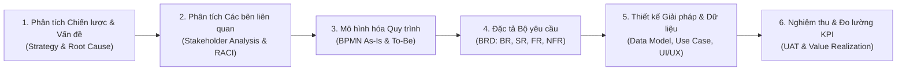
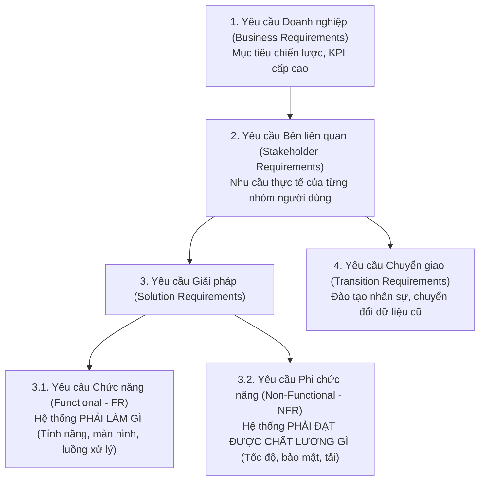

# 🏛️ Khung Chuẩn Phân Tích Nghiệp Vụ (Business Analysis Framework) - Chuẩn HVNH & BABOK v3

Tài liệu này định hình **tư duy, phương pháp luận và các bước phân tích chuẩn** của một **Chuyên viên Phân tích Nghiệp vụ (BA - Business Analyst)** tại **Học viện Ngân hàng (HVNH)** khi tiếp cận bất kỳ bài toán nghiệp vụ, case study, hoặc đề tài chuyển đổi số nào.

---

## 1. 🎯 Vai trò cốt lõi của BA tại HVNH
BA là **cầu nối (Bridge)** giữa hai thế giới:
1. **Khối Nghiệp vụ & Kinh doanh (Business / Domain Stakeholders)**: Ban Giám đốc, Khối Tín dụng, Khối Vận hành, Phòng Thu mua, Khối Thẻ, Khách hàng...
2. **Khối Kỹ thuật & Công nghệ (IT / Tech / Data Team)**: Đội ngũ Lập trình viên (Developers), Kỹ sư Dữ liệu (Data Engineers), Nhà khoa học dữ liệu (Data Scientists), Đội kiểm thử (QA/QC).

> 💡 **Tôn chỉ của BA HVNH**: *"Không bắt đầu bằng việc cắm đầu vào viết code hay chọn thuật toán, mà bắt đầu từ việc thấu hiểu nỗi đau (Pain Points), phân tích giá trị kinh doanh (Business Value) và chuẩn hóa quy trình (Business Process)."*

---

## 2. 🪜 Khung 6 bước giải quyết mọi bài toán / Case Study theo chuẩn BA HVNH



---

### 🔹 BƯỚC 1: Phân tích Vấn đề & Giá trị Kinh doanh (Strategy & Need Assessment)
* **Xác định Vấn đề cốt lõi (Root Cause Analysis)**: Áp dụng kỹ thuật **5 Whys** hoặc **Biểu đồ xương cá (Fishbone/Ishikawa Diagram)** để tìm nguyên nhân gốc rễ chứ không chỉ chữa triệu chứng.
* **Xây dựng Business Case**:
  * **Lợi ích**: Tăng doanh thu, giảm chi phí vận hành, giảm nợ xấu, rút ngắn thời gian xử lý giao dịch.
  * **Chi phí**: Chi phí bản quyền phần mềm, chi phí hạ tầng server/cloud, chi phí đào tạo nhân sự.
  * **Chỉ số tài chính**: ROI, NPV, Thời gian hoàn vốn (Payback Period).

---

### 🔹 BƯỚC 2: Phân tích & Quản lý các Bên liên quan (Stakeholder Analysis)
* **Lập Ma trận Stakeholder (Power vs Interest Grid)**: Xác định ai là người quyết định (Sponsor), ai là người dùng trực tiếp (End-user), ai là người bị ảnh hưởng.
* **Lập Ma trận RACI**:
  * **R** (Responsible): Người trực tiếp thực hiện.
  * **A** (Accountable): Người chịu trách nhiệm phê duyệt cuối cùng (duy nhất 1 người).
  * **C** (Consulted): Người được tham vấn chuyên môn.
  * **I** (Informed): Người nhận thông báo kết quả.

---

### 🔹 BƯỚC 3: Mô hình hóa Quy trình Nghiệp vụ (Business Process Modeling)
* **Quy trình Hiện trạng (As-Is Process)**: Phản ánh trung thực quy trình hiện tại đang làm thủ công, rời rạc ở đâu; nhận diện điểm nghẽn (Bottlenecks) và lãng phí (Waste).
* **Quy trình Tương lai (To-Be Process)**: Thiết kế quy trình mục tiêu sau khi đã ứng dụng tự động hóa / hệ thống phần mềm mới.
* **Ký hiệu chuẩn hóa**: Sử dụng **BPMN 2.0** với đầy đủ các thành phần: *Pool, Lane (phân quyền vai trò), Start/End Event, User Task / Service Task, Exclusive/Parallel Gateway*.

---

### 🔹 BƯỚC 4: Phân loại & Đặc tả Yêu cầu (Requirements Engineering)

Theo chuẩn **BABOK v3**, BA phân cấp yêu cầu thành 4 tầng rõ rệt:



#### Cách viết User Story & Tiêu chí chấp nhận (AC):
```text
As a [Vai trò người dùng - Role],
I want to [Hành động mong muốn - Action],
So that [Giá trị nhận được - Business Benefit].

Acceptance Criteria (Gherkin format):
- Scenario: [Tên kịch bản kiểm thử]
  - Given: [Tiền điều kiện / Bối cảnh bắt đầu]
  - When: [Hành động người dùng thực hiện]
  - Then: [Kết quả mong đợi hệ thống trả về]
```

---

### 🔹 BƯỚC 5: Thiết kế Mô hình Dữ liệu & Quy tắc Nghiệp vụ (Business Rules)
* **Mô hình hóa Dữ liệu**: Sơ đồ lớp (Class Diagram), Sơ đồ thực thể quan hệ (ERD - Conceptual & Logical).
* **Bảng Quy tắc Nghiệp vụ (Business Rule Table)**:
  * Ví dụ trong Ngân hàng: *Nếu Điểm tín dụng $< 580 \implies$ Từ chối cấp thẻ tự động; Nếu Thu nhập $\ge 20$ triệu $\implies$ Hạn mức thẻ tối đa gấp 3 lần thu nhập.*
* **Thiết kế Wireframe / Prototype**: Phác thảo giao diện luồng người dùng (User Flow) bằng Figma / Draw.io / Balsamiq.

---

### 🔹 BƯỚC 6: Kiểm thử Chấp nhận (UAT) & Đo lường Đạt mục tiêu (Value Realization)
* **UAT (User Acceptance Testing)**: Xây dựng bộ kịch bản kiểm thử nghiệp vụ (UAT Test Cases) để người dùng nghiệp vụ (Thẩm định viên, Thu mua, Kế toán...) trực tiếp xác nhận hệ thống chạy đúng yêu cầu.
* **Đo lường KPIs sau triển khai**: So sánh các chỉ số thực tế sau khi Go-live so với Business Case ban đầu (VD: Thời gian phê duyệt khoản vay giảm từ 48 giờ xuống 15 phút, Tỷ lệ hết hàng giảm từ $8\%$ xuống $< 2\%$).

---

## 3. 📂 Bảng thuật ngữ chuyên ngành BA hay dùng tại HVNH

| Thuật ngữ | Tên đầy đủ tiếng Anh | Ý nghĩa / Ứng dụng |
| :--- | :--- | :--- |
| **BRD** | Business Requirements Document | Tài liệu đặc tả yêu cầu nghiệp vụ cấp cao. |
| **SRS** | Software Requirements Specification | Tài liệu đặc tả yêu cầu kỹ thuật phần mềm chi tiết. |
| **RTM** | Requirements Traceability Matrix | Ma trận truy xuất nguồn gốc (đảm bảo mọi yêu cầu đều được code & test). |
| **BPMN** | Business Process Model and Notation | Chuẩn mô hình hóa quy trình nghiệp vụ (As-Is / To-Be). |
| **SLA** | Service Level Agreement | Cam kết chất lượng dịch vụ (VD: Thời gian phản hồi API $< 200\text{ ms}$). |
| **eKYC** | Electronic Know Your Customer | Quy trình định danh khách hàng điện tử trong Ngân hàng số. |
| **CIC** | Credit Information Center | Trung tâm Thông tin Tín dụng Quốc gia (dữ liệu tra cứu lịch sử nợ). |
| **Core Banking** | Core Banking System | Hệ thống phần mềm lõi xử lý toàn bộ giao dịch trung tâm của ngân hàng. |

---
*Tài liệu nền tảng môn Phân tích Nghiệp vụ (Business Analysis) - Học viện Ngân hàng (HVNH).*
