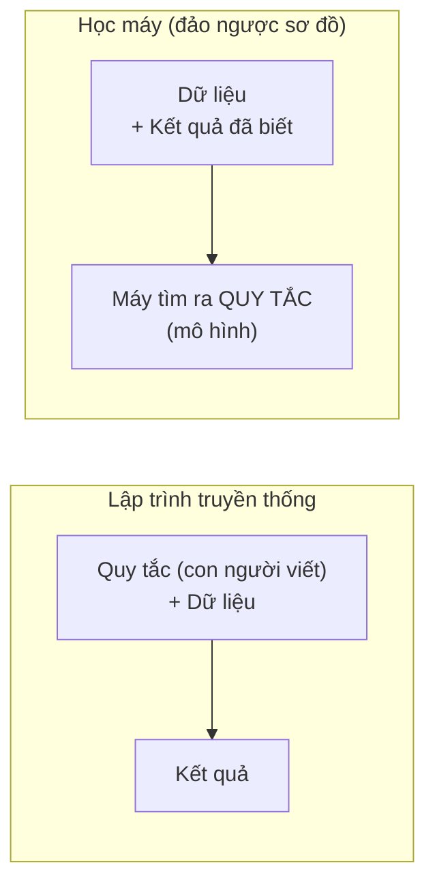
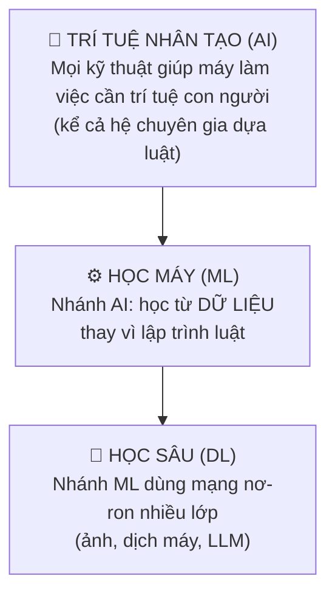
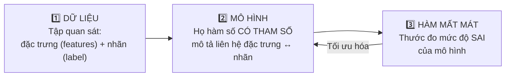

# 🤖 Tổng Quan Machine Learning: Khái Niệm, Lịch Sử & Cấu Trúc Mô Hình

> **Nguồn:** Giáo trình "Mô hình học máy" — Học viện Ngân hàng (model.pdf, Part 1)

---

## 1. 📜 Lịch sử phát triển AI / Machine Learning (8 giai đoạn)

| Giai đoạn | Thời kỳ | Cột mốc & nội dung cốt lõi |
| :--- | :--- | :--- |
| 1. Khởi đầu | trước 1950 | 1943 — McCulloch & Pitts: mô hình nơ-ron nhân tạo đầu tiên; 1950 — Turing Test |
| 2. Sơ khai AI | 1956–1970 | 1956 — Hội nghị Dartmouth, McCarthy đặt tên *Artificial Intelligence*; 1959 — Arthur Samuel: chương trình chơi cờ dama tự học (ML đầu tiên) |
| 3. Mùa đông AI lần 1 | 1970–1980 | Kỳ vọng quá cao nhưng thiếu dữ liệu, phần cứng yếu → tài trợ bị cắt |
| 4. AI dựa luật | 1980–1987 | Expert Systems: luật IF-THEN mô phỏng chuyên gia |
| 5. Mùa đông AI lần 2 | 1987–1993 | Expert Systems khó mở rộng, duy trì → thất bại thực tế |
| 6. Trỗi dậy ML | 1990–2000 | Chuyển từ AI biểu tượng sang **học từ dữ liệu**: Decision Tree, Naive Bayes, SVM, KNN; 1997 — IBM Deep Blue thắng Kasparov |
| 7. Học sâu & Big Data | 2006–2020 | 2006 — Hinton đưa lại Deep Learning; 2012 — AlexNet thắng ImageNet; GPU + Big Data + TensorFlow/PyTorch |
| 8. AI hiện đại | 2020–nay | Generative AI (ChatGPT, Midjourney, Sora), Reinforcement Learning, AutoML, AI Ethics, Explainable AI |

> 💡 **Bài học lịch sử:** mỗi lần "mùa đông AI" đều do kỳ vọng vượt quá năng lực dữ liệu/phần cứng — tương tự nguyên tắc hôm nay: mô hình phức tạp không cứu được dữ liệu tồi.

---

## 2. 🎯 Học máy là gì? (2 định nghĩa chuẩn)

### 2.1. Định nghĩa Arthur Samuel (1959)
> Lĩnh vực nghiên cứu trao cho máy tính khả năng **học mà không cần được lập trình một cách tường minh**.

### 2.2. Định nghĩa Tom Mitchell (1997) — khung E-T-P
Một chương trình **học từ kinh nghiệm E**, đối với **lớp nhiệm vụ T**, đo bằng **thước đo hiệu năng P**, nếu hiệu năng trên T (đo bằng P) được cải thiện nhờ E.

Áp dụng cho bài toán lọc thư rác:
- **T** (Task): phân loại thư đến là rác / không rác
- **E** (Experience): tập thư đã được người dùng đánh dấu
- **P** (Performance): tỷ lệ phân loại đúng trên thư chưa từng thấy

### 2.3. Lập trình truyền thống vs Học máy

---

## 3. 🪆 Quan hệ ba khái niệm: AI ⊃ ML ⊃ Deep Learning

⚠️ Ba khái niệm **lồng vào nhau, không song song**. Nói "dự án AI" khi thực chất đang làm hồi quy logistic là dùng từ gây hiểu nhầm.

---

## 4. 🧱 Ba thành phần của mọi mô hình học máy

- **Huấn luyện (training)** = quá trình đi tìm bộ tham số làm hàm mất mát **nhỏ nhất** trên tập huấn luyện.
- Ba thành phần này hiện diện từ hồi quy tuyến tính đến LLM — cái đổi chỉ là **họ hàm** và **cách tối ưu**.
- 🔗 **Điểm nối với thống kê:** ước lượng bình phương nhỏ nhất (OLS) = "mô hình tuyến tính + hàm mất mát bình phương sai số".

---

## 5. 💼 Ứng dụng đang thay đổi thế giới (ví dụ mở đầu môn học)

Dự đoán hành vi người dùng TMĐT (Shopee, Amazon) • Xe tự lái (Tesla) • Chẩn đoán bệnh qua ảnh y khoa • Hệ gợi ý (Netflix, YouTube) • Chatbot/dịch máy/nhận diện giọng nói • Sinh trắc học ngân hàng.

---

## ⚠️ Ghi chú về giáo trình (trung thực nguồn)
- File `model.pdf` chứa đầy đủ **Part 1 (Giới thiệu ML)** và **Part 2 (Ứng dụng ML trong phân tích dữ liệu)**.
- **Part 3 (Dự báo chuỗi thời gian)** chỉ xuất hiện trong OUTLINE; các trang sau là **slide mẫu Lorem ipsum chưa có nội dung giảng dạy thật** → cần bổ sung tài liệu chuỗi thời gian riêng nếu thi có phần này.
