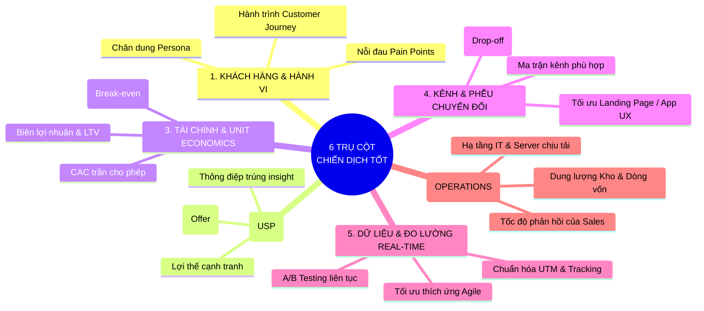

# 🎯 Các Yếu Tố Cốt Lõi Cần Nắm Bắt Để Chiến Dịch Marketing / Kinh Doanh Thành Công (BA Perspective)

---

## 1. 📌 Tổng quan: Công thức 6 Trụ Cột Nắm Bắt của BA
Đứng ở góc độ **Chuyên viên Phân tích Nghiệp vụ (BA)**, một chiến dịch Marketing/Kinh doanh thành công không chỉ dựa vào may mắn hay nội dung quảng cáo "bắt trend", mà phải được xây dựng trên **6 trụ cột có tính toán khoa học, đo lường bằng dữ liệu và liên kết chặt chẽ giữa các phòng ban**.

---

## 2. 🔍 Chi tiết 6 Yếu Tố Cốt Lõi Cần Nắm Bắt

---

### 1️⃣ NẮM BẮT KHÁCH HÀNG & HÀNH VI TIÊU DÙNG (Customer & Behavior)
Không thể bán mọi thứ cho tất cả mọi người. BA cần làm rõ:
- **Chân dung khách hàng mục tiêu (Buyer Persona)**:
  - *Nhân khẩu học*: Độ tuổi, giới tính, thu nhập, vị trí địa lý.
  - *Tâm lý & Hành vi*: Họ đang gặp vấn đề gì? Thói quen lướt mạng xã hội vào khung giờ nào? Thích xem video ngắn (TikTok/Reels) hay đọc bài viết chuyên sâu?
- **Hành trình trải nghiệm khách hàng (Customer Journey)**:
  - **See (Nhận thức)**: Khách biết đến qua đâu?
  - **Think (Cân nhắc)**: Khách so sánh mình với đối thủ về yếu tố gì (Giá, Thương hiệu, Ưu đãi)?
  - **Do (Hành động)**: Khách ra quyết định mua qua kênh nào (App, Web, Cửa hàng)?
  - **Care (Gắn kết)**: Khách có quay lại mua tiếp không?

---

### 2️⃣ NẮM BẮT ĐỀ XUẤT GIÁ TRỊ & THÔNG ĐIỆP (Value Proposition & Offer)
Khách hàng chỉ bấm vào quảng cáo và chi tiền khi họ thấy **"Tôi được lợi gì ở đây?"**:
- **USP (Unique Selling Proposition)**: Điểm độc nhất mà đối thủ không có (VD: *Mở thẻ tín dụng online phê duyệt trong 3 phút không cần chứng minh thu nhập*).
- **Ưu đãi mồi câu không thể chối từ (Irresistible Offer)**: Tặng voucher, hoàn tiền 100% lần đầu, miễn phí vận chuyển, tặng quà độc quyền.
- **Lời kêu gọi hành động (CTA - Call To Action)**: Rõ ràng, trực diện (*"Nhận ưu đãi ngay"*, *"Đăng ký miễn phí"* thay vì *"Tìm hiểu thêm"*).

---

### 3️⃣ NẮM BẮT BÀI TOÁN KINH TẾ ĐƠN VỊ & GIỚI HẠN TÀI CHÍNH (Unit Economics)
Nhiều chiến dịch doanh thu rất cao nhưng sau khi trừ tiền quảng cáo thì **lỗ nặng**. BA phải tính toán trước:
- **Ngưỡng CAC tối đa cho phép ($CAC_{max}$)**:
  $$CAC_{max} = \text{Giá trị đơn hàng trung bình (AOV)} \times \text{Biên lợi nhuận gộp (Gross Margin)}$$
  *(Ví dụ: 1 đơn hàng lãi 200.000đ thì chi phí quảng cáo để ra 1 đơn không được vượt quá 200.000đ).*
- **Điểm hòa vốn (Break-even Point)**: Cần đạt bao nhiêu đơn hàng / hợp đồng để bù đắp chi phí cố định của chiến dịch.
- **Giá trị vòng đời khách hàng (LTV)**: Khách hàng đó sau khi mua lần đầu sẽ tiếp tục mua bao nhiêu lần trong 1–2 năm tới? (Đảm bảo $\text{LTV} / \text{CAC} \ge 3:1$).

---

### 4️⃣ NẮM BẮT KÊNH TIẾP CẬN & TỐI ƯU PHỄU TRẢI NGHIỆM (Channel & Funnel)
- **Chọn đúng kênh theo bản chất sản phẩm**:
  - *Sản phẩm khách đã có nhu cầu sẵn (Tìm kiếm theo chủ đích)*: Đánh mạnh vào **Google Search Ads, SEO**.
  - *Sản phẩm kích thích cảm xúc, giới trẻ, bắt mắt*: Đánh mạnh vào **TikTok Ads, Facebook Reels, Influencer/KOL**.
  - *Sản phẩm B2B, Tài chính cấp cao*: Đánh mạnh vào **LinkedIn, Email Marketing, Hội thảo/Workshop**.
- **Tối ưu trang đích (Landing Page / App UX)**:
  - Tốc độ tải trang dưới **$2\text{ giây}$** (chậm 1 giây mất $20\%$ khách hàng).
  - Form điền thông tin tối giản (chỉ lấy Tên + SĐT, không bắt điền rườm rà).
  - Tích hợp công nghệ hiện đại: **eKYC định danh tự động**, cổng thanh toán một chạm (Apple Pay, VNPAY, MoMo).

---

### 5️⃣ NẮM BẮT DỮ LIỆU & ĐIỀU CHỈNH TỨC THỜI (Data Tracking & Agile Optimization)
Chiến dịch marketing không phải "bắn phát súng rồi ngồi chờ", mà phải liên tục theo dõi và tinh chỉnh:
- **Chuẩn hóa đo lường**: Bắt buộc gắn mã **Pixel, Conversion API, UTM Tracking** để không bị mất dấu khách hàng.
- **Thử nghiệm A/B Testing liên tục**:
  - Test 2 tiêu đề khác nhau (Xem tiêu đề nào nhiều click hơn).
  - Test 2 hình ảnh/video khác nhau (Xem mẫu nào chi phí rẻ hơn).
  - Test 2 mức giá/ưu đãi khác nhau.
- **Quy tắc cắt lỗ & gia tăng ngân sách (Scale vs Kill Rules)**:
  - *Sau 48h*: Nhóm quảng cáo nào có chỉ số chi phí/lead quá cao $\rightarrow$ **Tắt ngay để cắt lỗ**.
  - Nhóm quảng cáo nào có ROAS cao, chi phí rẻ $\rightarrow$ **Tăng ngân sách gấp 2–3 lần** để tối đa hóa doanh thu.

---

### 6️⃣ NẮM BẮT NĂNG LỰC VẬN HÀNH NỘI BỘ (Operations & Sales Alignment)
Quảng cáo đem về hàng ngàn khách nhưng nội bộ không phục vụ kịp thì chiến dịch coi như thất bại:
- **Thời gian phản hồi của đội Sales (Lead Response Time)**:
  - *Quy tắc vàng*: Gọi lại cho khách trong vòng **$5 - 15\text{ phút}$** kể từ khi họ điền form. Nếu để sau 24 giờ, tỷ lệ chốt đơn giảm tới **$80\%$**.
- **Hạ tầng hệ thống phần mềm**: Server web/app có chịu được lượng truy cập tăng đột biến gấp 10 lần ngày thường không?
- **Nguồn hàng & Vận hành**: Kho có đủ hàng tồn kho không? Đội ngũ thẩm định tín dụng/CSKH có đủ người trực ca để duyệt hồ sơ không?

---

## 3. 👨‍💼 Bảng Checklist dành cho BA trước khi duyệt bấm nút chạy Chiến dịch

| STT | Câu hỏi kiểm tra (BA Verification Checklist) | Đạt / Chưa |
| :---: | :--- | :---: |
| 1 | Đã xác định rõ ràng Chân dung khách hàng và USP của sản phẩm chưa? | [ ] |
| 2 | Đã tính toán $CAC_{max}$, Điểm hòa vốn và Lợi nhuận dự kiến chưa? | [ ] |
| 3 | Đã gắn mã tracking (UTM, Pixel, API) và test thử trên môi trường Staging chưa? | [ ] |
| 4 | Landing Page / App đã được test tốc độ tải trang ($<2\text{s}$) và hiển thị tốt trên Mobile chưa? | [ ] |
| 5 | Đội ngũ Sales / Telesale / Vận hành đã được đào tạo về kịch bản tư vấn cho chiến dịch này chưa? | [ ] |
| 6 | Đã có Dashboard theo dõi số liệu Real-time và kịch bản ứng phó sự cố (Plan B) chưa? | [ ] |

---
*Tài liệu được tổng hợp cho học phần Phân tích Nghiệp vụ (Business Analysis) - Học viện Ngân hàng.*
