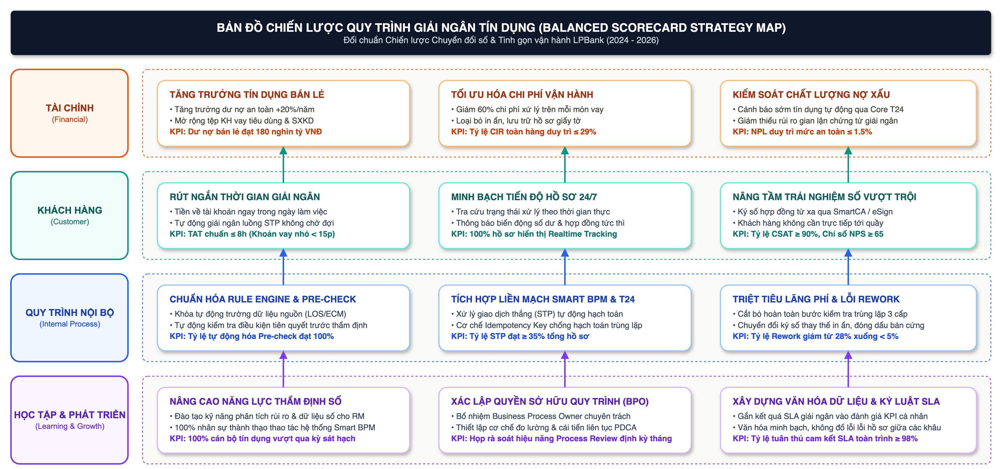
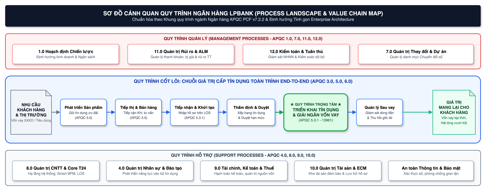
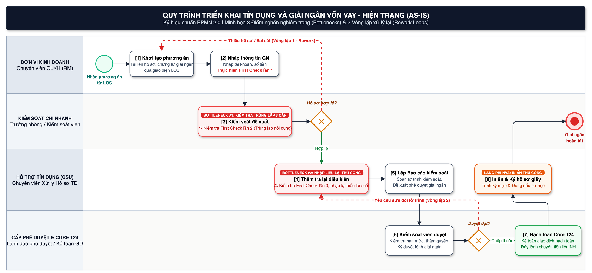
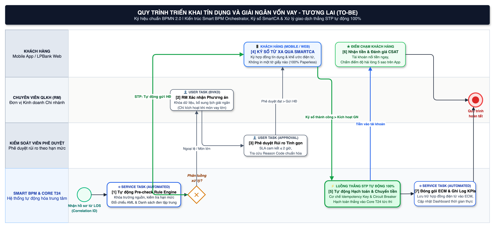

**HỌC VIỆN NGÂN HÀNG**

**KHOA SAU ĐẠI HỌC**

**BÀI TẬP NHÓM**

**MÔN HỌC: QUẢN LÝ QUY TRÌNH NGHIỆP VỤ (BPM)**

**ĐÁNH GIÁ VÀ HOÀN THIỆN QUY TRÌNH TRIỂN KHAI TÍN DỤNG VÀ GIẢI NGÂN KHOẢN VAY KHÁCH HÀNG CÁ NHÂN TẠI LPBANK TRONG BỐI CẢNH ỨNG DỤNG BPM**

| Thông tin | Nội dung |
| :--- | :--- |
| **Giảng viên hướng dẫn** | PGS.TS. Phan Thanh Đức |
| **Lớp / Khóa** | Cao học K28 – Khoa Sau Đại học |
| **Học viên thực hiện** | Nhóm học viên K28 (Trưởng nhóm: Đỗ Văn Đạt – Mã học viên: 28k405001) |
| **Đơn vị nghiên cứu** | Ngân hàng TMCP Lộc Phát Việt Nam (LPBank) |

Hà Nội, 2026

---

# **MỤC LỤC**

*Lưu ý: Mở file bằng Microsoft Word, chọn toàn bộ (Ctrl+A) rồi nhấn F9 để cập nhật tự động mục lục và số trang.*

---

# **DANH MỤC TỪ VIẾT TẮT**

| Từ viết tắt | Tên đầy đủ / Ý nghĩa nghiệp vụ |
| :--- | :--- |
| **APQC** | American Productivity & Quality Center (Trung tâm Năng suất & Chất lượng Hoa Kỳ) |
| **BPM** | Business Process Management (Quản trị quy trình nghiệp vụ) |
| **BPMN** | Business Process Model and Notation (Ký hiệu và mô hình hóa quy trình nghiệp vụ) |
| **BSC** | Balanced Scorecard (Thẻ điểm cân bằng) |
| **CIR** | Cost to Income Ratio (Tỷ lệ chi phí trên thu nhập) |
| **CSU** | Credit Support Unit (Đơn vị hỗ trợ tín dụng) |
| **ĐVKD** | Đơn vị kinh doanh (Chi nhánh / Phòng giao dịch) |
| **EA** | Enterprise Architecture (Kiến trúc doanh nghiệp) |
| **ECM** | Enterprise Content Management (Hệ thống quản lý nội dung doanh nghiệp) |
| **FTR** | First-Time-Right (Tỷ lệ xử lý đúng ngay lần đầu) |
| **KHCN** | Khách hàng cá nhân |
| **KPI** | Key Performance Indicator (Chỉ số đo lường hiệu suất cốt lõi) |
| **LOS** | Loan Origination System (Hệ thống khởi tạo khoản vay) |
| **PCF** | Process Classification Framework (Khung phân loại quy trình) |
| **RM** | Relationship Manager (Chuyên viên quan hệ khách hàng) |
| **SLA** | Service Level Agreement (Cam kết chất lượng dịch vụ) |
| **STP** | Straight-Through Processing (Xử lý giao dịch thẳng tự động) |
| **T24** | Temenos T24 (Hệ thống ngân hàng lõi - Core Banking được LPBank sử dụng) |
| **TSBĐ** | Tài sản bảo đảm |

---

# **TÓM TẮT**

Báo cáo đánh giá mảng cấp tín dụng khách hàng cá nhân tại Ngân hàng TMCP Lộc Phát Việt Nam (LPBank), tập trung sâu vào quy trình triển khai tín dụng và giải ngân vốn vay. Ranh giới quy trình bắt đầu từ thời điểm khoản cấp tín dụng đã được cấp thẩm quyền phê duyệt và người dùng khởi tạo phương án triển khai tín dụng trên hệ thống; kết thúc khi khoản vay được hạch toán thành công trên hệ thống ngân hàng lõi (Core Banking T24), luồng chuyển tiền giải ngân được thực hiện chính xác, hồ sơ chứng từ được lưu trữ an toàn và trạng thái quy trình được cập nhật hoàn tất. Cách xác định ranh giới này bám sát tài liệu thiết kế kỹ thuật luồng giải ngân của LPBank, không mở rộng sang toàn bộ vòng đời quản trị và thu hồi nợ sau vay.

Kết quả ánh xạ nghiệp vụ với Khung phân loại quy trình chuẩn quốc tế APQC Banking PCF phiên bản 7.2.2 (công bố tháng 3/2025) xác định trục phân cấp ba cấp gồm: Cấp 1 (Category) `5.0 Deliver Services` (PCF ID `20025`) $\rightarrow$ Cấp 2 (Process Group) `5.3 Deliver banking services to customers` (PCF ID `17416`) $\rightarrow$ Cấp 3 (Process) `5.3.2 Analyze customer creditworthiness` (PCF ID `13964`), trong đó hoạt động trọng tâm khảo sát trực tiếp là Cấp 4 (Activity) `5.3.2.7 Fund and disburse proceeds` (PCF ID `13961`). Nhóm quy trình `3.5.5 Manage sales applications` (PCF ID `17398`) được đối chiếu như nhóm thượng nguồn giải thích chất lượng đầu vào và tiếp nhận hồ sơ.

Tài liệu thiết kế nội bộ cho thấy hệ thống BPM được LPBank xây dựng nhằm điều phối luồng công việc theo chuẩn BPMN 2.0, hỗ trợ nhập liệu, tải chứng từ, kiểm soát nhiều cấp, tích hợp T24/LOS, chuyển tiền tự động và theo dõi trạng thái. Tuy nhiên, tài liệu đặc tả chức năng chưa tự chứng minh hiệu quả vận hành thực tế. Do đó, báo cáo tuân thủ nguyên tắc bằng chứng khoa học, không tự đặt số liệu baseline giả định hoặc khẳng định thời gian xử lý đã giảm; các chỉ số KPI mục tiêu chỉ được xác lập sau khi hoàn thành giai đoạn đo kiểm cơ sở (baseline measurement).

Nghiên cứu đề xuất hệ thống giải pháp hoàn thiện gồm ba nhóm có quan hệ phụ thuộc hữu cơ: (1) Chuẩn hóa quản trị quy trình end-to-end và phân định trách nhiệm Process Owner; (2) Tái thiết kế điểm kiểm soát, bổ sung cơ chế kiểm tra tự động trước submit (Pre-check) nhằm triệt tiêu vòng lặp trả hồ sơ; và (3) Hoàn thiện kiến trúc tích hợp với cơ chế Idempotency, đối soát hai chiều và bảng điều khiển đo lường KPI theo thời gian thực. Đóng góp cốt lõi của báo cáo là thiết lập khung đánh giá có thể kiểm chứng, trong đó thành công của dự án BPM được nghiệm thu dựa trên dữ liệu hiệu năng quy trình thay vì chỉ dừng lại ở việc bàn giao tính năng phần mềm.

*Từ khóa: Quản trị quy trình nghiệp vụ; Tín dụng khách hàng cá nhân; Giải ngân vốn vay; APQC Banking PCF; Kiến trúc doanh nghiệp; LPBank.*

---

# **MỞ ĐẦU**

## **1. Lý do chọn đề tài**

LPBank công bố định hướng chiến lược giai đoạn 2024–2028 là “Bán lẻ – Dịch vụ – Kinh doanh đa năng” với mục tiêu trọng tâm là phát triển ngân hàng bán lẻ trên nền tảng số. Năm 2024, tổng dư nợ tín dụng của ngân hàng đạt 331.606 tỷ đồng, tăng 20,39% so với năm 2023 [1]; đến năm 2025, ngân hàng tiếp tục công bố dư nợ tín dụng bán lẻ tăng trưởng 20% so với cuối năm 2024 [2]. Với quy mô và định hướng tăng trưởng này, chất lượng vận hành của quy trình triển khai tín dụng và giải ngân tác động đồng thời đến tốc độ tăng trưởng tài sản sinh lời, mức độ kiểm soát rủi ro tác nghiệp, chi phí vận hành và sự hài lòng của khách hàng vay vốn.

Tài liệu dự án nội bộ cho thấy LPBank đang triển khai hệ thống Smart BPM tín dụng KHCN nhằm tự động hóa các luồng xét duyệt, điều chỉnh điều kiện tín dụng, nhận tài sản bảo đảm, triển khai tín dụng, hoàn thiện tài sản và văn kiện tín dụng [5]–[9]. Đây là bối cảnh thực tiễn phù hợp để đánh giá quy trình từ góc độ Quản trị quy trình nghiệp vụ (BPM): không dừng lại ở việc số hóa giao diện người dùng, mà phải chuẩn hóa toàn diện ranh giới quy trình, quyền hạn trách nhiệm, luồng dữ liệu, các điểm kiểm soát rủi ro và bộ chỉ số đo lường hiệu năng.

## **2. Mục tiêu, câu hỏi và phạm vi nghiên cứu**

* **Mục tiêu nghiên cứu:**
  1. Nhận diện mối liên kết nhân quả giữa định hướng chiến lược của LPBank và kiến trúc quy trình nghiệp vụ.
  2. Ánh xạ mảng cấp tín dụng KHCN với Khung chuẩn APQC Banking PCF 7.2.2 theo đúng cấu trúc phân cấp ba cấp và mã định danh PCF ID.
  3. Đánh giá khoảng trống (Gap Analysis) dựa trên phạm vi bằng chứng thực tế; phân định rành mạch giữa 'chưa có bằng chứng' và 'không tồn tại'.
  4. Lựa chọn quy trình triển khai tín dụng – giải ngân để phân tích đa chiều dưới lăng kính Kiến trúc doanh nghiệp (Tổ chức, Dữ liệu – Ứng dụng, Hành trình khách hàng).
  5. Đề xuất mô hình quy trình tương lai (To-Be), hệ thống chỉ số KPI SMART và lộ trình kiểm chứng hiệu quả khi ứng dụng BPM.

* **Phạm vi nghiên cứu:** Phạm vi tổ chức bao gồm các vai trò tham gia luồng KHCN được ghi nhận trong tài liệu: Chuyên viên quan hệ khách hàng (RM), Người kiểm soát tại chi nhánh, Chuyên viên xử lý hồ sơ, Kiểm soát viên phê duyệt, Chuyên viên hỗ trợ tín dụng và các hệ thống công nghệ liên quan (BPM, Core Banking T24, LOS, ECM/GenDoc và dịch vụ chuyển tiền liên ngân hàng). Phạm vi không bao gồm việc xây dựng mô hình chấm điểm tín dụng, thẩm định thực địa trước phê duyệt và quản lý thu hồi nợ sau giải ngân.

* **Ba câu hỏi nghiên cứu cốt lõi:**
  1. Mảng cấp tín dụng KHCN của LPBank được định vị như thế nào trong kiến trúc quy trình tổng thể và Khung APQC Banking PCF 7.2.2?
  2. Những khoảng trống nào về quản trị, vận hành và dữ liệu có thể nhận diện có căn cứ từ tài liệu hiện có?
  3. Quy trình triển khai tín dụng – giải ngân cần được tái thiết kế, tích hợp công nghệ và đo lường hiệu quả như thế nào trong bối cảnh ứng dụng BPM?

## **3. Phương pháp nghiên cứu và nguyên tắc bằng chứng**

Nghiên cứu kết hợp các phương pháp: phân tích tài liệu nội bộ, khung Thẻ điểm cân bằng (Balanced Scorecard), Danh sách kiểm tra quy trình (Process Checklist), đối chuẩn APQC PCF, phân tích khoảng trống (Gap Analysis), ma trận ưu tiên danh mục quy trình, khung Kiến trúc doanh nghiệp (Enterprise Architecture) và phân tích chuỗi giá trị (VA/BVA/NVA).

Nguồn dữ liệu được phân định thành 4 nhóm độc lập: (i) Công bố chính thức từ LPBank (Báo cáo thường niên, thông cáo báo chí); (ii) Chuẩn mực quốc tế APQC Banking PCF; (iii) Tài liệu đặc tả, thiết kế chi tiết và hướng dẫn vận hành nội bộ hệ thống BPM LPBank; và (iv) Nhận định, đề xuất phân tích của nhóm tác giả. Báo cáo tuân thủ nguyên tắc không sử dụng các số liệu ước tính chưa được đo kiểm để tuyên bố như kết quả vận hành thực tế.

## **4. Cơ sở lý luận và khung phân tích**

### **4.1. Quản trị quy trình nghiệp vụ (BPM)**

Quy trình nghiệp vụ được định nghĩa là một tập hợp các hoạt động có cấu trúc và mối liên hệ nhân quả, sử dụng nguồn lực và cơ chế kiểm soát nhằm chuyển đổi các yếu tố đầu vào thành đầu ra mang lại giá trị cho khách hàng hoặc tổ chức. Quản trị quy trình nghiệp vụ không đồng nhất với việc trang bị một phần mềm luân chuyển văn bản điện tử (Workflow software). Hệ thống BPM chỉ phát huy tối đa giá trị khi ranh giới quy trình, chủ sở hữu (Process Owner), quy tắc nghiệp vụ, tính nhất quán của dữ liệu và hệ thống chỉ số đo lường được xác lập đồng bộ. Do đó, đối tượng trung tâm của nghiên cứu là quy trình triển khai tín dụng và giải ngân; hệ thống BPM là nền tảng công nghệ hỗ trợ thực thi và thu thập dữ liệu đo lường.

### **4.2. Balanced Scorecard và lựa chọn quy trình**

Thẻ điểm cân bằng (BSC) đóng vai trò chuyển hóa chiến lược thành hệ thống mục tiêu theo 4 khía cạnh: Tài chính, Khách hàng, Quy trình nội bộ và Học tập – Phát triển. Trong báo cáo này, BSC không nhằm chấm điểm thành tích của LPBank mà cung cấp logic định hướng: một quy trình được xếp hạng ưu tiên cải tiến khi tác động trực tiếp đồng thời lên kết quả tài chính, giá trị trải nghiệm khách hàng, năng lực kiểm soát nội bộ và nền tảng số hóa của tổ chức.

### **4.3. APQC PCF và Gap Analysis**

Khung phân loại quy trình APQC PCF là hệ thống phân cấp chức năng cho biết tổ chức cần thực hiện những nhóm năng lực nghiệp vụ nào để đạt hiệu quả tối ưu. PCF là một hệ thống phân loại (Taxonomy), không phải là lưu đồ luân chuyển tác nghiệp theo thời gian (BPMN Workflow) và không áp đặt một mô hình vận hành cố định cho mọi ngân hàng. Nghiên cứu sử dụng PCF để chuẩn hóa thuật ngữ, xác định phạm vi đối chuẩn và kiểm tra tính đầy đủ của các chức năng; sau đó đối chiếu với tài liệu thiết kế BPM để phân tích trình tự tác nghiệp, vai trò thực thi và luồng dữ liệu. Khoảng trống chỉ được xác lập khi có sự chênh lệch có bằng chứng giữa chuẩn tham chiếu và hiện trạng; trường hợp thiếu thông tin được phân loại riêng là khoảng trống bằng chứng (Evidence Gap).

### **4.4. Kiến trúc doanh nghiệp và phân tích giá trị hoạt động**

Khung Kiến trúc doanh nghiệp (EA) được vận dụng qua ba góc nhìn: Tổ chức (Ai làm, handoff thế nào), Dữ liệu – Ứng dụng (Hệ thống nào hỗ trợ, dữ liệu đồng bộ ra sao) và Sản phẩm – Khách hàng (Trải nghiệm và thời gian chờ của người vay). Phương pháp phân tích giá trị phân loại các hoạt động thành: Tạo giá trị trực tiếp (Value-Added - VA), Tạo giá trị cho hoạt động quản trị/tuân thủ (Business-Value-Added - BVA), và Hoạt động không tạo giá trị (Non-Value-Added - NVA). Trong lĩnh vực ngân hàng, một bước kiểm soát rủi ro không thể bị loại bỏ chỉ vì khách hàng không nhìn thấy giá trị trực tiếp; việc tinh gọn quy trình phải bảo đảm tuân thủ quy định pháp lý, tính toàn vẹn của kiểm soát và nguyên tắc phân tách trách nhiệm (Maker – Checker).

---

# **PHẦN 1. BỐI CẢNH CHIẾN LƯỢC VÀ NHẬN DIỆN QUY TRÌNH**

## **1.1. Tổng quan và định hướng chiến lược LPBank**

LPBank được thành lập theo Giấy phép số 91/GP-NHNN ngày 28/03/2008 của Ngân hàng Nhà nước Việt Nam. Chiến lược kinh doanh giai đoạn 2024–2028 xác định khách hàng là trọng tâm và mô hình hoạt động “Bán lẻ – Dịch vụ – Kinh doanh đa năng” [3]. Mục tiêu trung hạn hướng tới vị thế ngân hàng bán lẻ dẫn đầu tại khu vực nông thôn và đô thị loại hai trên nền tảng số, đồng thời lọt vào Top 5 dịch vụ khách hàng ưu tiên tại các đô thị lớn [2]. Báo cáo thường niên 2024 ghi nhận quy mô tổng tài sản đạt 508.330 tỷ đồng, lợi nhuận trước thuế 12.168 tỷ đồng và tỷ lệ chi phí trên thu nhập (CIR) duy trì ở mức tối ưu 29,15% [1]. Những chỉ số này đặt ra ba yêu cầu khắt khe đối với quy trình giải ngân bán lẻ: (1) Năng lực mở rộng quy mô linh hoạt theo đà tăng trưởng tín dụng; (2) Duy trì kỷ luật kiểm soát rủi ro tác nghiệp chặt chẽ; và (3) Cắt giảm tối đa ma sát và độ trễ giao dịch cho khách hàng.

## **1.2. Phân tích bối cảnh qua Thẻ điểm cân bằng (Balanced Scorecard)**

Bốn khía cạnh của BSC hình thành hệ thống ràng buộc logic hữu cơ, không phải là bốn mục tiêu tách rời. Nếu tổ chức chỉ ưu tiên chỉ tiêu tài chính bằng cách ép rút ngắn thời gian giải ngân một cách cơ học, cán bộ tác nghiệp có thể chịu áp lực bỏ qua bước kiểm tra điều kiện hoặc phê duyệt ngoại lệ thiếu thận trọng. Ngược lại, nếu siết chặt kiểm soát bằng việc bổ sung nhiều tầng kiểm soát trùng lặp, thời gian xử lý hồ sơ (Cycle time) sẽ tăng vọt, gây tổn hại trực tiếp đến trải nghiệm khách hàng. Do đó, mục tiêu quản trị là tối ưu hóa đồng thời tốc độ và chất lượng thông qua chuẩn hóa trường dữ liệu, phân luồng xử lý theo mức độ rủi ro và tái sử dụng dữ liệu đã xác thực.

Khía cạnh Học tập & Phát triển đóng vai trò nguyên nhân nền tảng. Phần mềm BPM chỉ có thể tự động hóa những quy tắc nghiệp vụ đã được chuẩn hóa thống nhất trong tổ chức. Khi tiêu chí kiểm soát, thẩm quyền phê duyệt hoặc danh mục lý do trả hồ sơ còn mơ hồ, hệ thống công nghệ sẽ chỉ số hóa chính sự thiếu nhất quán đó. Do vậy, năng lực quản trị quy tắc nghiệp vụ và văn hóa kỷ luật dữ liệu cần được xây dựng song hành với triển khai công nghệ.

**Bảng 1. Bảng điểm cân bằng (BSC) gắn với quy trình giải ngân tín dụng LPBank**

| Khía cạnh BSC | Mục tiêu chiến lược có căn cứ | Hàm ý đối với quy trình giải ngân | Chỉ báo đo lường gợi ý |
| :--- | :--- | :--- | :--- |
| **Tài chính** | Tăng trưởng tín dụng bền vững; nâng cao hiệu quả chi phí hoạt động (CIR ≤ 30%) [1]. | Rút ngắn thời gian giải ngân, giảm thiểu chi phí xử lý hồ sơ và chi phí khắc phục lỗi sai mà không làm suy yếu kiểm soát rủi ro. | Cycle time trung vị; Chi phí vận hành trên mỗi bộ hồ sơ; Tỷ lệ xử lý lại (Rework rate). |
| **Khách hàng** | Đặt khách hàng làm trọng tâm; cung ứng dịch vụ ngân hàng bán lẻ tiện ích trên nền tảng số [3]. | Minh bạch hóa trạng thái xử lý khoản vay; hạn chế tối đa việc yêu cầu khách hàng bổ sung hồ sơ nhiều lần; giải ngân đúng cam kết hẹn. | SLA cam kết giải ngân; Tỷ lệ đúng ngay lần đầu (First-time-right); Chỉ số phản hồi sau giải ngân. |
| **Quy trình nội bộ** | Chuẩn hóa, số hóa và tự động hóa; chuyển dịch sang quản trị rủi ro chủ động [2]. | Xây dựng workflow có các điểm kiểm soát tự động; tích hợp dữ liệu liền mạch giữa LOS, T24, ECM; thiết lập Audit trail và quản lý ngoại lệ. | Tỷ lệ tự động lấy dữ liệu từ hệ thống nguồn; Tỷ lệ lỗi tích hợp API; Số lượng hồ sơ tồn đọng quá hạn. |
| **Học tập & Phát triển**| Phát triển năng lực số và văn hóa trách nhiệm giải trình (Ownership & Follow-up). | Đào tạo chuyên sâu theo vai trò tác nghiệp; quản trị phiên bản quy tắc nghiệp vụ (Business rules); gắn quyền hạn với KPI đo lường. | Tỷ lệ hoàn thành đào tạo quy trình mới; Phân tích lỗi theo nguyên nhân chủ quan; Mức độ chấp nhận hệ thống BPM. |

## **1.3. Bản đồ chiến lược (Strategy Map)**

Mối quan hệ nhân quả được giả định trong quản trị: Nền tảng năng lực nhân sự và kỷ luật dữ liệu tốt hơn sẽ xây dựng quy trình tác nghiệp ổn định hơn; quy trình ổn định và tự động hóa giúp cải thiện trải nghiệm khách hàng; sự hài lòng của khách hàng và năng suất tác nghiệp cao sẽ trực tiếp thúc đẩy tăng trưởng tài chính an toàn.

*Hình 1. Bản đồ chiến lược gắn với quy trình giải ngân LPBank. Nguồn: Nhóm nghiên cứu đề xuất.*

**Bảng 2. Chuỗi quan hệ nhân quả trên Bản đồ chiến lược**

| Học tập & Phát triển | Quy trình nội bộ | Khách hàng | Tài chính |
| :--- | :--- | :--- | :--- |
| Năng lực nghiệp vụ + Kỷ luật dữ liệu + Trách nhiệm Process Owner | Chuẩn hóa điều kiện $\rightarrow$ Tích hợp API T24/LOS $\rightarrow$ Kiểm soát ngoại lệ | Giảm số lần bổ sung hồ sơ; Trạng thái minh bạch; Đúng cam kết SLA | Nâng cao năng suất lao động; Cắt giảm chi phí xử lý lại; Tăng trưởng tín dụng an toàn |

## **1.4. Process Landscape cấp cao của LPBank**

Cảnh quan kiến trúc quy trình cấp cao của LPBank được phân bổ thành 3 nhóm quy trình theo thông lệ quản trị chuẩn:

*Hình 2. Process Landscape cấp cao của LPBank. Nguồn: Nhóm nghiên cứu tổng hợp.*

**Bảng 3. Phân loại cấu trúc Process Landscape cấp cao tại LPBank**

| Nhóm quy trình | Các dòng quy trình thành phần |
| :--- | :--- |
| **Quy trình quản lý** | Hoạch định chiến lược và kế hoạch kinh doanh; Quản trị rủi ro tổng thể; Kiểm tra tuân thủ; Quản trị hiệu suất tổ chức; Quản lý danh mục chuyển đổi và dự án. |
| **Quy trình cốt lõi** | Nghiên cứu phát triển sản phẩm $\rightarrow$ Tiếp thị & Bán hàng $\rightarrow$ Tiếp nhận hồ sơ $\rightarrow$ Thẩm định & Phê duyệt tín dụng $\rightarrow$ Hoàn thiện văn kiện & Tài sản bảo đảm $\rightarrow$ **Triển khai tín dụng & Giải ngân** $\rightarrow$ Quản lý nợ sau vay $\rightarrow$ Chăm sóc khách hàng. |
| **Quy trình hỗ trợ** | Hạ tầng CNTT và quản trị dữ liệu; Quản trị nguồn nhân lực; Kế toán tài chính & Quản lý tài sản; Pháp chế; Mua sắm & Hậu cần; Quản lý văn thư lưu trữ; An toàn thông tin. |

## **1.5. Sàng lọc quy trình qua Process Checklist**

Nhằm khẳng định hoạt động được lựa chọn thỏa mãn đầy đủ các tiêu chí khoa học của một quy trình nghiệp vụ độc lập theo phương pháp luận của Dumas và cộng sự [8], nhóm nghiên cứu thiết lập Danh sách kiểm tra (Process Checklist) tại Bảng 4.

**Bảng 4. Đánh giá sàng lọc qua Danh sách kiểm tra quy trình (Process Checklist)**

| Tiêu chí kiểm tra | Đánh giá | Bằng chứng thực tế và Kết luận phân tích |
| :--- | :---: | :--- |
| **1. Đầu vào và đầu ra xác định** | Đạt | Đầu vào là phương án cấp tín dụng đã được phê duyệt hợp lệ; đầu ra là khoản vay được hạch toán thành công, tiền được giải ngân, hồ sơ lưu trữ và trạng thái hoàn tất. |
| **2. Chuỗi hoạt động liên kết logic** | Đạt | Tài liệu thiết kế chi tiết mô tả rõ ràng 14 bước từ Start đến End, phân bổ qua các cổng điều hướng (Gateways) có điều kiện [6]. |
| **3. Khách hàng/đối tượng nhận kết quả** | Đạt | Khách hàng vay vốn nhận tiền giải ngân đúng hạn; ĐVKD và các phòng ban quản trị nhận tài sản sinh lời và hồ sơ kiểm toán hợp lệ. |
| **4. Tính lặp lại và tiêu chuẩn hóa** | Đạt | Luồng tác nghiệp được vận hành thường xuyên với số lượng lớn; có biểu mẫu điện tử, checklist kiểm tra bắt buộc, phân quyền và API tích hợp rõ ràng. |
| **5. Khả năng kiểm soát và đo lường** | Đạt có điều kiện | Hệ thống ghi nhận task, trạng thái và audit trail; tuy nhiên số liệu baseline KPI cần được đo kiểm thực tế sau khi trích xuất log có cấu trúc chuẩn. |
| **6. Phạm vi phân tích phù hợp** | Đạt | Không dàn trải toàn bộ vòng đời khoản cấp tín dụng; tập trung đúng ranh giới từ khi khởi tạo phương án triển khai tới khi kết thúc giải ngân. |
| **7. Không phải tên phòng ban/phần mềm** | Đạt | Tên gọi "Triển khai tín dụng và giải ngân" phản ánh kết quả tạo giá trị nghiệp vụ; hệ thống BPM và các phòng ban là công cụ và chủ thể thực thi. |

Kết quả sàng lọc khẳng định: Triển khai tín dụng – giải ngân là một quy trình nghiệp vụ có ranh giới quản trị độc lập, không phải là một thao tác kế toán hạch toán đơn lẻ. Việc xác lập đúng ranh giới giúp báo cáo khoanh vùng chính xác Process Owner, thiết lập đúng KPI đo lường và nhận diện chuẩn luồng dữ liệu phụ thuộc từ quy trình thượng nguồn.

---

# **PHẦN 2. ĐỐI CHIẾU VỚI APQC BANKING PCF 7.2.2**

## **2.1. Nguyên tắc và phạm vi ánh xạ**

Khung phân loại APQC PCF là một hệ thống phân loại chức năng (Functional Taxonomy), không phải là lưu đồ tác nghiệp tuần tự. Do đó, một quy trình end-to-end trong ngân hàng có thể kết nối nhiều phần tử PCF thuộc các nhóm khác nhau. Nhằm đáp ứng yêu cầu cấu trúc phân cấp ba cấp của đề bài, trục phân tích chính được định vị tại Danh mục Cấp 1 `5.0 Deliver Services` (`20025`), Cấp 2 `5.3 Deliver banking services to customers` (`17416`), Cấp 3 `5.3.2 Analyze customer creditworthiness` (`13964`) và trọng tâm là hoạt động Cấp 4 `5.3.2.7 Fund and disburse proceeds` (`13961`). Nhóm `3.5.5 Manage sales applications` (`17398`) được sử dụng để phân tích quan hệ phụ thuộc thượng nguồn đối với khâu tiếp nhận và quản lý hồ sơ [4].

**Bảng 5. Trục phân cấp ánh xạ APQC Banking PCF 7.2.2**

| Cấp bậc | Hierarchy ID | Tên danh mục chuẩn APQC | PCF ID | Ý nghĩa trong nghiên cứu |
| :--- | :--- | :--- | :--- | :--- |
| **Category (Cấp 1)** | 5.0 | Deliver Services | 20025 | Nhóm quy trình cốt lõi cung ứng dịch vụ ngân hàng. |
| **Process Group (Cấp 2)** | 5.3 | Deliver banking services to customers | 17416 | Cung cấp dịch vụ ngân hàng trực tiếp tới khách hàng. |
| **Process (Cấp 3)** | 5.3.2 | Analyze customer creditworthiness | 13964 | Cụm quy trình nghiệp vụ cấp tín dụng theo cấu trúc PCF. |
| **Activity (Cấp 4 trọng tâm)** | 5.3.2.7 | Fund and disburse proceeds | 13961 | Hoạt động triển khai vốn và giải ngân thực tế (Trọng tâm phân tích sâu). |

## **2.2. Bảng ánh xạ quy trình tín dụng LPBank với APQC PCF 7.2.2**

**Bảng 6. Ma trận đối chiếu quy trình tín dụng LPBank với Khung APQC Banking PCF 7.2.2**

| Hoạt động tác nghiệp thực tế tại LPBank | Phần tử APQC Banking PCF tương ứng | PCF ID | Mức độ khớp | Căn cứ tài liệu nội bộ LPBank |
| :--- | :--- | :--- | :--- | :--- |
| Tiếp nhận, kiểm tra hồ sơ đề nghị vay vốn | 3.5.5 Manage sales applications | 17398 | Một phần (Thượng nguồn) | Quy trình xét duyệt gốc và tiếp nhận hồ sơ [7]. |
| Thu thập hồ sơ, dữ liệu định danh khách hàng | 3.5.5.2 Gather required customer data and documents | 17400 | Khớp trực tiếp | Upload chứng từ, phân loại danh mục tập hồ sơ [5]. |
| Thu thập hồ sơ phục vụ thẩm định điều kiện | 3.5.5.2.2 Gather customer documents for credit appraisal | 17402 | Khớp trực tiếp | Danh mục checklist kiểm tra điều kiện tín dụng [6]. |
| Theo dõi tiến độ hồ sơ đang xử lý | 3.5.5.4 Track/manage existing product applications | 17405 | Khớp trực tiếp | Quản lý tác vụ (Task list), trạng thái process instance [9]. |
| Kiểm tra và áp dụng điều kiện sản phẩm/khoản vay | 5.3.2.3 Apply product conditions | 17418 | Khớp trực tiếp | First check, kiểm tra điều kiện giải ngân tự động [6]. |
| Xác định lãi suất, biên độ và biểu phí | 5.3.2.4 Apply product pricing | 17419 | Khớp trực tiếp | Nhập trường lãi suất, API tính phí tự động [6]. |
| Kiểm tra tài sản bảo đảm, tình trạng thế chấp | 5.3.2.5 Evaluate collateral/guarantee | 17420 | Một phần | Luồng nhận/hoàn thiện TSBĐ, đồng bộ mã Collateral [8]. |
| Thiết lập tài khoản và khoản vay trên hệ thống lõi | 5.3.2.6 Set up and activate an account | 17421 | Khớp trực tiếp | API tích hợp T24 tạo tài khoản và hợp đồng vay (LD) [6]. |
| **Hạch toán giải ngân và chuyển tiền cho vay** | **5.3.2.7 Fund and disburse proceeds** | **13961** | **Khớp trực tiếp (Trọng tâm)** | **API tích hợp T24 hạch toán, dịch vụ chuyển tiền thanh toán [6].** |

Chuỗi khớp lệnh cao nhất nằm ở ba hoạt động kế tiếp nhau: Áp dụng điều kiện sản phẩm (`17418`) $\rightarrow$ Thiết lập khoản vay (`17421`) $\rightarrow$ Giải ngân vốn vay (`13961`). Đây là chuỗi logic bất biến trong vận hành ngân hàng: Khoản vay không thể được giải ngân nếu điều kiện phê duyệt chưa được thỏa mãn hoặc hợp đồng tín dụng chưa được kích hoạt chuẩn xác trên Core Banking. Việc ánh xạ chi tiết giúp tránh sai lầm gộp toàn bộ quy trình vào duy nhất một mã APQC rồi bỏ qua các phụ thuộc kiểm soát rủi ro.

## **2.3. Phân tích khoảng trống (Gap Analysis)**

Phân tích khoảng trống dưới đây đánh giá dựa trên tài liệu thiết kế nội bộ hiện có của LPBank, phân biệt rõ giữa khoảng trống đã xác nhận trong thiết kế và khoảng trống về mặt bằng chứng đo lường thực tế:

**Bảng 7. Phân tích khoảng trống (Gap Analysis) so với chuẩn APQC PCF**

| Chuẩn năng lực APQC | Bằng chứng thiết kế hiện có | Đánh giá phân loại | Khoảng trống cần xác minh và hoàn thiện |
| :--- | :--- | :--- | :--- |
| **17400/17402 – Thu thập dữ liệu & hồ sơ** | Có màn hình upload, checklist hồ sơ, kết nối ECM/GenDoc. | Cơ hội cải tiến (Improvement opportunity) | Cần đo lường tỷ lệ hồ sơ đúng ngay lần đầu (FTR); kiểm soát nguy cơ trùng lặp chứng từ giữa các luồng. |
| **17405 – Giám sát tiến độ hồ sơ** | Có quản lý task, trạng thái tiến trình và màn hình monitor. | Khoảng trống tài liệu (Documentation gap) | Chưa có cơ chế cảnh báo suy giảm SLA nghiệp vụ theo từng bước và báo cáo phân rã thời gian chờ (Aging report). |
| **17418 – Kiểm soát điều kiện sản phẩm** | Có tính năng First check và kiểm tra điều kiện phê duyệt. | Khoảng trống bằng chứng (Evidence gap) | Cần xác minh rõ đơn vị chủ trì quản trị quy tắc (Rule Owner), lịch sử phiên bản rule và quy trình phê duyệt cập nhật. |
| **17419 – Biểu phí và lãi suất** | Có trường nhập lãi suất, lịch trả nợ và API tính phí. | Khoảng trống bằng chứng (Evidence gap) | Cần làm rõ quy trình phê duyệt ngoại lệ lãi suất và nguồn dữ liệu chuẩn (Master data). |
| **17420 – Đánh giá tài sản bảo đảm** | Có các luồng nhận và hoàn thiện tài sản, đồng bộ mã collateral. | Cơ hội cải tiến (Improvement opportunity) | Cần kiểm thử tính nhất quán của mã tài sản giữa các luồng thẩm định, nhận nợ và Core T24. |
| **17421 – Thiết lập khoản vay Core** | Có bảng ánh xạ trường dữ liệu và API tích hợp T24. | Khoảng trống bằng chứng (Evidence gap) | Cần xác minh cơ chế xử lý lỗi timeout, tính Idempotency để ngăn tạo trùng hợp đồng vay trên T24. |
| **13961 – Giải ngân và chuyển tiền** | Có luồng hạch toán, lệnh chuyển tiền, maker–checker. | Khoảng trống bằng chứng (Evidence gap) | Chưa có số liệu sản xuất thực tế để lượng hóa Cycle time trung bình, tỷ lệ lỗi giao dịch hay mức độ tự động hóa. |
| **Quản trị quy trình End-to-End** | Nhiều luồng nghiệp vụ và hệ thống công nghệ phối hợp. | Khoảng trống quản trị (Governance gap) | Thiếu vai trò Process Owner chịu trách nhiệm KPI xuyên suốt chuỗi giá trị; hiện chỉ phân mảnh trách nhiệm theo phòng ban. |
| **Phân tích nguyên nhân trả hồ sơ** | Có trường văn bản nhập lý do trả hồ sơ. | Cơ hội cải tiến (Improvement opportunity) | Chưa chuẩn hóa mã nguyên nhân trả hồ sơ (Reason codes); thiếu bảng điều khiển Pareto phân tích điểm nghẽn nghiệp vụ. |

Ba cấp độ khoảng trống được rút ra:
1. *Khoảng trống bằng chứng (Evidence Gap):* Tài liệu mô tả tính năng nhưng thiếu log vận hành thực tế để lượng hóa thời gian chờ, tỷ lệ xử lý lại.
2. *Khoảng trống quản trị (Governance Gap):* Chưa xác lập Process Owner chịu trách nhiệm kết quả E2E và chưa có cơ chế quản trị phiên bản quy tắc nghiệp vụ.
3. *Khoảng trống tích hợp kỹ thuật (Integration Gap):* Cần cơ chế Idempotency, đối soát hai chiều và Circuit Breaker để ngăn chặn lỗi tích hợp giữa BPM và Core T24.

*Về vấn đề "Quy trình dư thừa, chồng chéo":* Tài liệu thiết kế cho thấy ngân hàng không có quy trình thừa ở cấp danh mục. Tuy nhiên, rủi ro chồng chéo tiềm tàng xuất hiện ở cấp độ tác vụ: cùng một bộ dữ liệu phương án được nhập và kiểm tra lại tại nhiều màn hình độc lập, tạo nguy cơ xung đột dữ liệu và lãng phí nguồn lực kiểm tra trùng lặp.

## **2.4. Thảo luận kết quả ánh xạ**

Kết quả đối chiếu chứng minh rằng quy trình tín dụng của LPBank mang đặc tính cắt ngang chức năng (Cross-functional value chain). Giai đoạn tiếp nhận thuộc nhóm `3.5.5`, trong khi khâu kiểm tra điều kiện, khởi tạo tài khoản và giải ngân thuộc nhóm `5.3.2`. Việc giữ trục `5.0` $\rightarrow$ `5.3` $\rightarrow$ `5.3.2` $\rightarrow$ `5.3.2.7` bảo đảm tính nhất quán với cấu trúc phân cấp ba cấp mà đề bài yêu cầu.

Khoảng trống cốt lõi của LPBank không nằm ở việc thiếu tên một chức năng nghiệp vụ trong danh mục. Tài liệu Smart BPM đã bao phủ hầu hết các bước kỹ thuật cần thiết. Thách thức lớn nhất là chuyển hóa từ "có tính năng phần mềm" sang "quản trị được hiệu suất quy trình" thông qua dữ liệu sự kiện (Event logs), cam kết SLA từng bước và phân định trách nhiệm Process Owner.

---

# **PHẦN 3. ĐÁNH GIÁ HIỆN TRẠNG VÀ LỰA CHỌN QUY TRÌNH ƯU TIÊN**

## **3.1. Ma trận lựa chọn danh mục đầu tư quy trình (Process Portfolio Matrix)**

Nhằm lựa chọn có căn cứ quy trình trọng yếu cần phân tích sâu theo lý thuyết Process Portfolio Management, nhóm nghiên cứu thiết lập ma trận đánh giá với 5 tiêu chí định lượng (thang điểm 1–5, trọng số phản ánh định hướng chiến lược bán lẻ số của LPBank):

**Bảng 8. Ma trận đánh giá lựa chọn danh mục quy trình ưu tiên**

| Ứng viên quy trình | Tác động chiến lược (25%) | Tác động khách hàng (20%) | Mức độ rủi ro tác nghiệp (25%) | Mức độ điểm nghẽn (15%) | Khả thi bằng chứng dữ liệu (15%) | Điểm tổng hợp (/5.00) |
| :--- | :---: | :---: | :---: | :---: | :---: | :---: |
| **Tiếp nhận hồ sơ** | 4 | 4 | 3 | 3 | 4 | **3,60** |
| **Thẩm định & phê duyệt** | 5 | 4 | 5 | 4 | 3 | **4,35** |
| **Văn kiện & bảo đảm** | 4 | 3 | 5 | 4 | 4 | **4,10** |
| **Triển khai tín dụng & giải ngân**| **5** | **5** | **5** | **4** | **5** | **4,85** |

*Giải thích lý do lựa chọn:* Quy trình Triển khai tín dụng & Giải ngân đạt điểm số cao nhất (4,85/5,00) vì những lý do mang tính quyết định:
1. *Điểm chuyển hóa giá trị tài chính:* Đây là khâu chuyển giao quyết định phê duyệt thành dòng tiền thực tế; bất kỳ sai sót nào cũng dẫn tới rủi ro tác nghiệp, thất thoát vốn hoặc rủi ro pháp lý tức thì.
2. *Tác động trực tiếp đến trải nghiệm khách hàng:* Khách hàng có thể kiên nhẫn trong khâu thẩm định, nhưng khi đã có thông báo phê duyệt, thời gian chờ giải ngân là yếu tố quyết định sự hài lòng.
3. *Mức độ hoàn thiện của bằng chứng:* Tài liệu thiết kế luồng giải ngân của LPBank cung cấp đầy đủ thông tin nhất về workflow, trường dữ liệu và tích hợp API, cho phép phân tích khoa học có căn cứ xác thực.

## **3.2. Mô tả quy trình hiện trạng / chuyển tiếp**

Quy trình giải ngân chuyển tiếp của LPBank được tổng hợp từ Tài liệu thiết kế chi tiết [6] với 14 bước tác nghiệp tuần tự:

*Hình 3. Swimlane rút gọn quy trình hiện trạng/chuyển tiếp. Nguồn: Tổng hợp từ tài liệu thiết kế LPBank [6].*

**Bảng 9. Trình tự tác nghiệp 14 bước của quy trình hiện trạng/chuyển tiếp**

| Bước | Tên bước tác nghiệp | Chủ thể / Hệ thống thực hiện | Kết quả đầu ra và Điểm kiểm soát |
| :---: | :--- | :--- | :--- |
| **1** | Khởi tạo phương án | ĐVKD / BPM | Lựa chọn phương án tín dụng đã duyệt; sinh process instance trên BPM. |
| **2** | Đề xuất giải ngân | Chuyên viên QLKH (RM) | Nhập thông tin giải ngân, đính kèm chứng từ, thực hiện First check. |
| **3** | Kiểm soát đề xuất | Kiểm soát viên chi nhánh | Kiểm tra tính đầy đủ; ký duyệt chuyển tiếp hoặc trả hồ sơ về RM. |
| **4** | Gateway điều hướng | Hệ thống BPM | Tự động định tuyến hồ sơ theo quyết định của Kiểm soát viên chi nhánh. |
| **5–6**| Soạn báo cáo kiểm soát | Chuyên viên xử lý hồ sơ (CSU) | Rà soát điều kiện; nhập thông tin lãi suất, kỳ hạn, lịch trả nợ, bảo lãnh. |
| **7–8**| Phê duyệt báo cáo kiểm soát| Kiểm soát viên CSU / T24 | Thẩm tra báo cáo; phê duyệt lệnh tích hợp T24 hạch toán và chuyển tiền. |
| **9–10**| Gateway sau phê duyệt | Hệ thống BPM | Tự động chuyển tiếp luồng: in ký (nếu có bảo lãnh) hoặc chuyển lưu trữ. |
| **11**| In ký chứng từ | Chuyên viên hỗ trợ tín dụng | In và hoàn thiện chữ ký vật lý trên chứng từ khi sản phẩm yêu cầu. |
| **12**| Lưu trữ hồ sơ | Chuyên viên hỗ trợ / ECM | Đóng gói hồ sơ giấy và đẩy bản scan vào hệ thống lưu trữ điện tử ECM. |
| **13–14**| Cập nhật và đóng luồng | Hệ thống BPM | Cập nhật trạng thái hoàn thành khoản vay; đóng tiến trình nghiệp vụ. |

## **3.3. Phân tích Enterprise Architecture đa chiều**

### **a) Góc nhìn Tổ chức (Organization View)**
Quy trình có mật độ bàn giao (Handoff) tương đối dày đặc: RM $\rightarrow$ Kiểm soát viên chi nhánh $\rightarrow$ Chuyên viên CSU $\rightarrow$ Kiểm soát viên CSU $\rightarrow$ Chuyên viên hỗ trợ. Các handoff này bắt nguồn từ nguyên tắc phân tách nhiệm vụ và kiểm soát bốn mắt (Four-eyes principle). Tuy nhiên, rủi ro lớn nhất là sự hình thành các vòng lặp trả hồ sơ (Rework loops): Mỗi lần trả hồ sơ từ CSU về Chi nhánh hoặc giữa các cấp kiểm soát đều làm cycle time kéo dài theo cấp số nhân. Nguyên nhân không nằm ở số lượng vai trò, mà do thiếu tiêu chí kiểm tra tự động trước submit (Pre-check) và thiếu cam kết SLA ràng buộc thời gian xử lý từng khâu.

### **b) Góc nhìn Dữ liệu và Ứng dụng (Data & Application View)**

**Bảng 10. Phân tích kiến trúc hệ thống công nghệ và luồng dữ liệu**

| Hệ thống thành phần | Vai trò kiến trúc được thiết kế | Rủi ro kỹ thuật và Điểm đứt gãy dữ liệu tiềm tàng |
| :--- | :--- | :--- |
| **Smart BPM Tín dụng** | Điều phối tiến trình BPMN, quản lý task list, kiểm soát trạng thái, phân quyền. | Nguy cơ task bị treo khi mất kết nối; quản trị phiên bản business rules chưa tách bạch. |
| **Core Banking T24** | Quản lý tài khoản, tạo hợp đồng vay (LD), hạch toán giải ngân, ghi nhận dư nợ. | Lỗi timeout khi gọi API; thiếu Idempotency key gây nguy cơ hạch toán trùng lặp. |
| **LOS / TBPD** | Nguồn lưu trữ quyết định cấp tín dụng và phương án vay vốn ban đầu đã phê duyệt. | Không đồng bộ phiên bản phê duyệt nếu phương án có sửa đổi bổ sung sau phê duyệt. |
| **ECM / GenDoc** | Quản lý kho chứng từ số, mẫu biểu hợp đồng điện tử và lưu trữ tài liệu. | Thiếu cơ chế kiểm soát phiên bản tài liệu; kiểm tra thiếu đủ chứng từ còn thủ công. |
| **Hệ thống Chuyển tiền**| Tích hợp cổng thanh toán liên ngân hàng (NAPAS, Citad) thực hiện lệnh chi. | Rủi ro trạng thái giao dịch không nhất quán (tiền đã đi nhưng BPM chưa cập nhật). |
| **Dashboard / Monitor** | Theo dõi tiến độ hồ sơ theo thời gian thực và quản trị vận hành. | Hiện mới theo dõi trạng thái kỹ thuật của task, chưa tách bạch chỉ số hiệu năng KPI. |

### **c) Góc nhìn Khách hàng (Customer Experience View)**
Khách hàng không trực tiếp nhìn thấy các bước kiểm soát nội bộ nhưng chịu tác động trực tiếp từ: (1) Tổng thời gian chờ đợi nhận tiền giải ngân; (2) Sự phiền hà khi bị yêu cầu bổ sung chứng từ nhiều lần; và (3) Sự thiếu minh bạch về trạng thái hồ sơ. Các bước kiểm soát rủi ro nội bộ là cần thiết (BVA), nhưng nếu không có công cụ số hóa để tương tác minh bạch, thời gian chờ nội bộ sẽ chuyển hóa thành sự thất vọng của khách hàng. Do đó, chỉ số First-Time-Right và SLA giải ngân phản ánh trải nghiệm khách hàng chính xác hơn số lượng màn hình tác nghiệp đã số hóa.

## **3.4. Các vấn đề ưu tiên cần kiểm chứng bằng dữ liệu vận hành**

1. *Vòng lặp trả hồ sơ (Rework loops):* Đo lường tần suất và tỷ lệ trả hồ sơ giữa ĐVKD và CSU; phân loại theo mã nguyên nhân chuẩn.
2. *Nhập liệu và kiểm tra trùng lặp:* Kiểm tra field-level log để xác định mức độ cán bộ phải gõ lại các thông tin đã có sẵn trên hệ thống LOS hoặc T24.
3. *Quản lý ngoại lệ tích hợp hệ thống:* Đo lường tỷ lệ lỗi timeout khi gọi API T24 và kiểm tra cơ chế xử lý Idempotency, đối soát hai chiều.
4. *Thiếu số liệu cơ sở (Baseline gaps):* Cần trích xuất dữ liệu production để đo chính xác Cycle time (phân rã Processing time vs Waiting time), SLA compliance và FTR.
5. *Trách nhiệm quản trị end-to-end:* Xác lập Process Owner chịu trách nhiệm kết quả chung của toàn bộ quy trình thay vì chỉ chịu trách nhiệm cục bộ từng phòng ban.

## **3.5. Tổng hợp nguyên nhân theo mô hình Con người – Quy trình – Dữ liệu – Công nghệ**

**Bảng 11. Bảng tổng hợp nguyên nhân bất cập theo mô hình đa chiều**

| Chiều phân tích | Biểu hiện cần kiểm chứng thực tế | Hệ quả vận hành tiềm tàng | Phương pháp thu thập dữ liệu xác minh |
| :--- | :--- | :--- | :--- |
| **Con người & Trách nhiệm** | Nhiều vai trò tác nghiệp; ranh giới trách nhiệm theo task rõ hơn trách nhiệm E2E. | Thời gian hồ sơ nằm chờ bàn giao lớn; khó quy trách nhiệm khi vi phạm cam kết khách hàng. | Khảo sát ma trận RACI thực tế; đo thời gian hàng đợi (Queue time) theo từng vai trò. |
| **Quy trình** | Tồn tại nhiều cổng gateway trả hồ sơ ngược về các bước trước; kiểm soát trùng lặp. | Tỷ lệ xử lý lại (Rework) cao; biến động cycle time giữa các hồ sơ quá lớn. | Trích xuất task history log; phân tích reason code; đếm số chu trình lặp trên mỗi hồ sơ. |
| **Dữ liệu** | Dữ liệu khách hàng, tài sản, phương án vay lưu chuyển qua nhiều hệ thống độc lập. | Dữ liệu không nhất quán; cán bộ phải nhập lại hoặc kiểm tra chéo thủ công. | Lập sơ đồ Data Lineage; so sánh Field Mapping; đo tỷ lệ ghi đè dữ liệu (Override rate). |
| **Công nghệ** | Tích hợp đa hệ thống (BPM, LOS, T24, ECM, NAPAS) qua các giao thức API. | Lỗi timeout, phát sinh giao dịch ở trạng thái trung gian, nguy cơ hạch toán lặp. | Phân tích API gateway log; đối soát Correlation ID; kiểm thử kịch bản gián đoạn kết nối. |
| **Đo lường** | Tài liệu thiết kế tập trung vào hoàn thiện tính năng hơn là đo lường hiệu năng. | Thiếu cơ sở dữ liệu chứng minh hiệu quả kinh tế của dự án đầu tư BPM. | Chuẩn hóa bộ dữ liệu sự kiện (Event log) phục vụ Process Mining và KPI Dashboard. |

---

# **PHẦN 4. ĐỀ XUẤT GIẢI PHÁP HOÀN THIỆN**

## **4.1. Phân tích giá trị hoạt động (VA/BVA/NVA) và Tái cấu trúc**

**Bảng 12. Phân loại giá trị các hoạt động trong quy trình giải ngân**

| Hoạt động tác nghiệp | Phân loại | Định hướng tái cấu trúc và Tối ưu hóa |
| :--- | :---: | :--- |
| Xác lập nhu cầu và khởi tạo phương án giải ngân | **VA** | Giữ lại; tự động hóa việc tải trước toàn bộ dữ liệu phương án đã phê duyệt từ LOS. |
| Kiểm tra điều kiện giải ngân và tính đầy đủ của hồ sơ | **BVA** | Giữ lại; chuyển hóa danh mục kiểm tra thủ công thành công cụ Pre-check tự động bằng Rule Engine. |
| Kiểm soát hồ sơ và phê duyệt giải ngân | **BVA** | Giữ lại nguyên tắc Maker–Checker; áp dụng phân luồng thông minh theo hạn mức và mức độ rủi ro. |
| Nhập lại các dữ liệu đã có sẵn từ hệ thống nguồn | **NVA** | **Triệt tiêu hoàn toàn;** khóa các trường dữ liệu gốc, chỉ cho phép hiển thị và override có lý do. |
| Thời gian hồ sơ nằm chờ phân công hoặc chờ duyệt | **NVA** | **Loại bỏ lãng phí;** áp dụng tự động phân bổ tác vụ (Auto-assignment), cảnh báo aging và escalation. |
| Trả hồ sơ lòng vòng do thiếu chứng từ / sai thông tin | **NVA** | **Hạn chế tối đa;** áp dụng validation bắt buộc tại màn hình khởi tạo; phân tích Pareto nguyên nhân trả. |
| In ấn chứng từ giấy và ký lăn tay thủ công | **BVA/NVA** | Chuyển đổi sang hợp đồng điện tử và ký số từ xa (SmartCA) khi hành lang pháp lý cho phép. |
| Đóng gói và lưu trữ hồ sơ giải ngân | **BVA** | Tự động hóa việc đồng bộ chứng từ điện tử, metadata và thiết lập chính sách lưu trữ về kho ECM. |

*Ma trận chuyển đổi thiết kế quy trình (As-Is sang To-Be):*

**Bảng 13. Ma trận chuyển đổi thiết kế quy trình (Process Transformation Matrix)**

| Bước quy trình hiện trạng | Vấn đề / Điểm nghẽn | Quyết định thiết kế To-Be | Giải pháp kỹ thuật tương ứng | Lợi ích kỳ vọng | Cơ chế kiểm soát rủi ro |
| :--- | :--- | :--- | :--- | :--- | :--- |
| **Khởi tạo & Lấy phương án** | Nguy cơ sai lệch phiên bản quyết định tín dụng. | Chuẩn hóa và tự động lấy dữ liệu nguồn. | Kéo tự động từ LOS; sinh mã giao dịch duy nhất (Correlation ID). | Giảm 100% việc nhập lại dữ liệu cơ bản. | Kiểm tra tính hiệu lực của quyết định phê duyệt. |
| **Đề xuất & First check** | Thiếu chứng từ dẫn tới bị trả hồ sơ nhiều lần. | Tự động hóa kiểm tra tính đầy đủ (Pre-check). | Tích hợp Rule Engine kiểm tra checklist bắt buộc theo từng sản phẩm. | Nâng cao tỷ lệ hồ sơ đúng ngay lần đầu (FTR). | Ghi nhận log kết quả kiểm tra tự động trước submit. |
| **Kiểm soát đề xuất** | Hồ sơ bị nghẽn trong hàng đợi không có SLA. | Giữ Maker–Checker; áp dụng phân luồng động. | Định tuyến theo thẩm quyền; kích hoạt đồng hồ đếm ngược SLA và Escalation. | Cắt giảm thời gian chờ duyệt (Waiting time). | Ghi nhận Audit trail; thông báo tự động cấp quản lý. |
| **Soạn báo cáo kiểm soát**| Cán bộ CSU phải gõ lại thông tin lãi suất, hạn mức. | Đồng bộ hóa dữ liệu từ hệ thống phê duyệt. | Hệ thống tự điền dữ liệu; cán bộ chỉ nhập các thông tin phát sinh tại thời điểm giải ngân. | Tiết kiệm 40–50% thời gian thao tác màn hình. | Cơ chế phân quyền; thay đổi dữ liệu phải có giải trình. |
| **Phê duyệt & Hạch toán** | Rủi ro timeout hoặc hạch toán trùng trên T24. | Giữ phê duyệt; tăng cường kiểm soát kỹ thuật. | Áp dụng Idempotency Key, Circuit Breaker và cơ chế đối soát trạng thái cuối. | Ngăn chặn hoàn toàn lỗi giao dịch trùng lặp. | Đối soát tự động hai chiều giữa BPM và T24. |
| **In ký & Lưu trữ** | Thao tác thủ công, tốn chi phí in ấn và kho bãi. | Số hóa quy trình hoàn thiện hồ sơ. | Triển khai ký số điện tử SmartCA; tự động đóng gói hồ sơ đẩy sang kho số ECM. | Rút ngắn thời gian hoàn tất giải ngân. | Quản lý phân quyền truy cập và chính sách lưu trữ số. |

## **4.2. Thiết kế mô hình quy trình tương lai (To-Be)**

Quy trình To-Be được thiết kế theo chuẩn BPMN 2.0 phân bổ qua 4 làn bơi (Lanes): Khách hàng & RM, Kiểm soát chi nhánh, Trung tâm hỗ trợ tín dụng (CSU) và Tầng công nghệ tích hợp (BPM Orchestrator / Core T24 / ECM).

*Hình 4. Swimlane quy trình To-Be đề xuất. Nguồn: Nhóm nghiên cứu đề xuất.*

**Bảng 14. Bát phân giai đoạn kiểm soát trong quy trình To-Be**

| Giai đoạn To-Be | Luồng tác nghiệp To-Be đề xuất | Cơ chế kiểm soát rủi ro tương ứng |
| :---: | :--- | :--- |
| **1. Khởi tạo** | Tiếp nhận phương án đã phê duyệt từ LOS; sinh Correlation ID và Idempotency Key; tự động tải dữ liệu nguồn. | Xác thực chữ ký số trên quyết định phê duyệt; kiểm tra hiệu lực hạn mức và quyền khởi tạo. |
| **2. Pre-check** | Rule Engine tự động rà soát danh mục chứng từ bắt buộc theo gói sản phẩm; cảnh báo thiếu dữ liệu ngay trên giao diện. | Ngăn chặn việc submit hồ sơ khi chưa đủ điều kiện; lưu vết phiên bản rule và kết quả pre-check. |
| **3. Đề xuất** | RM rà soát dữ liệu tự điền, chỉ nhập các thông tin đặc thù tại thời điểm giải ngân (tài khoản nhận, thông tin giải tỏa). | Khóa toàn bộ các trường dữ liệu kế thừa từ LOS; việc override bắt buộc phải có lý do giải trình. |
| **4. Kiểm soát** | Hệ thống định tuyến hồ sơ theo ma trận thẩm quyền; áp dụng kiểm soát bốn mắt; trả hồ sơ bắt buộc chọn Reason Code chuẩn. | Đồng hồ đếm ngược SLA từng khâu; tự động chuyển cấp (Escalation) khi quá hạn xử lý. |
| **5. Hạch toán** | BPM Orchestrator gọi API T24 tạo hợp đồng vay (LD) và giải ngân; kích hoạt dịch vụ chuyển tiền qua Napas/Citad. | Áp dụng Idempotency Key chống trùng giao dịch; cơ chế Retry có kiểm soát và Circuit Breaker. |
| **6. Xác nhận** | Đối soát trạng thái cuối hai chiều: chỉ khi Core T24 và dịch vụ chuyển tiền phản hồi thành công mới đóng lệnh tài chính. | Không cho phép cập nhật trạng thái "Hoàn tất" nếu hạch toán tài chính đang ở trạng thái trung gian. |
| **7. Lưu trữ** | Tự động sinh bộ hồ sơ điện tử đầy đủ metadata; ký số xác thực; đóng gói lưu trữ an toàn về hệ thống ECM. | Kiểm tra tính toàn vẹn của tệp hồ sơ; thiết lập phân quyền truy cập và chính sách lưu trữ lâu dài. |
| **8. Đo lường** | Tự động đẩy dữ liệu sự kiện (Event log) sang cơ sở dữ liệu phân tích; hiển thị chỉ số hiệu năng trên Dashboard thời gian thực. | Bảo đảm chất lượng dữ liệu log; đối chiếu định kỳ giữa Process Owner và Giám đốc vận hành. |

## **4.3. Kiến trúc công nghệ hỗ trợ**

1. *Vai trò của BPM Orchestrator:* BPM đóng vai trò là tầng điều phối quy trình và quản trị tác vụ người dùng (Human task); tuyệt đối không sao chép hoặc thay thế chức năng hạch toán tài chính của Core Banking T24 hay chức năng phê duyệt của LOS. Phải xác lập rõ System of Record cho từng miền dữ liệu: LOS quản lý quyết định cấp tín dụng, T24 quản lý tài khoản và giao dịch tài chính, ECM quản lý chứng từ hồ sơ.
2. *Quản trị tích hợp và kiểm soát lỗi mạng:* Toàn bộ các kết nối API giữa BPM, T24 và cổng thanh toán phải áp dụng cơ chế `Idempotency-Key` (dựa trên mã giao dịch duy nhất) để bảo đảm việc gửi lại request (Retry) khi gặp sự cố mạng không gây ra giao dịch trùng lặp. Tích hợp mẫu thiết kế Circuit Breaker để cô lập sự cố khi Core Banking quá tải.
3. *Tách biệt Quản trị quy tắc nghiệp vụ (Business Rule Engine):* Tách các điều kiện kiểm tra hồ sơ, ma trận thẩm quyền ra khỏi mã nguồn quy trình (Workflow code). Các quy tắc này được quản trị tập trung trên hệ thống quản lý luật (BRMS) với phiên bản rõ ràng, có phân quyền Rule Owner và quy trình kiểm thử trước khi áp dụng.
4. *Bảo vệ dữ liệu và Nguyên tắc ứng dụng AI có trách nhiệm:* Tuân thủ nghiêm ngặt Luật An ninh mạng và Nghị định 13/2023/NĐ-CP về bảo vệ dữ liệu cá nhân (áp dụng nguyên tắc Least Privilege, mã hóa dữ liệu nhạy cảm và che giấu thông tin cá nhân trong log). Không sử dụng trí tuệ nhân tạo (AI) để tự động ra quyết định phê duyệt giải ngân. Các công nghệ AI/OCR chỉ được ứng dụng ở khâu trích xuất và đối chiếu chứng từ, bắt buộc phải có sự kiểm tra và xác nhận của con người (Human-in-the-loop).

## **4.4. Hệ thống chỉ số đo lường hiệu năng KPI SMART theo chuẩn APQC**

Hệ thống KPI được thiết kế bám sát chuẩn mực Open Standards Benchmarking của APQC [11], [12], bảo đảm nguyên tắc cân bằng giữa tốc độ xử lý, chất lượng nghiệp vụ, năng suất lao động và kiểm soát rủi ro.

**Bảng 15. Hệ thống chỉ số KPI SMART đo lường hiệu năng quy trình sau cải tiến**

| Tên chỉ số KPI và Công thức xác định | Nguồn thu thập dữ liệu | Thời gian đo Baseline | Mục tiêu quản trị To-Be đề xuất | Process Owner / Tần suất rà soát |
| :--- | :--- | :--- | :--- | :--- |
| **1. Cycle time (Thời gian xử lý toàn trình E2E)** • *Chuẩn APQC OSB:* Process efficiency / Cycle time to fund and disburse proceeds. • *Công thức:* T_Cycle = T_End - T_Start (Tính theo giờ làm việc hiệu dụng, báo cáo đồng thời giá trị **Trung vị - Median** và **Phân vị 90 - P90**). | Timestamp sự kiện Start (khởi tạo phương án) và End (hạch toán thành công) trên Event log của Smart BPM. | Đo liên tục 4 tuần sản xuất thực tế trên tập mẫu đại diện. | Giảm ≥ 20% giá trị Median sau 3 tháng triển khai ổn định; giá trị P90 không vượt quá 150% Median (triệt tiêu đuôi trễ). | Process Owner / Giám đốc Vận hành. Rà soát hàng tuần. |
| **2. First-Time-Right (Tỷ lệ đúng ngay lần đầu - FTR)** • *Chuẩn APQC OSB:* Process quality / First-time-right rate. • *Công thức:* FTR = [Số hồ sơ giải ngân không bị trả lại lần nào / Tổng số hồ sơ submit khởi tạo giải ngân lần đầu] × 100%. | Task outcome log kết hợp cơ sở dữ liệu Reason code trên BPM. | Đo liên tục 4 tuần sản xuất thực tế trên tập mẫu đại diện. | Tăng ≥ 15 điểm phần trăm sau 3 tháng nhờ công cụ Pre-check tự động bằng Rule Engine trước submit. | Chủ quản nghiệp vụ tín dụng. Rà soát hàng tháng. |
| **3. SLA Compliance (Tỷ lệ tuân thủ cam kết SLA)** • *Chuẩn APQC OSB:* Service level / SLA adherence rate (Percentage of loan disbursement requests completed within agreed SLA). • *Công thức E2E toàn trình (loại bỏ Survivor bias):* SLA_E2E = [N_Hoàn tất đúng hạn (≤ SLA_Mục tiêu) / (N_Đến hạn trong kỳ + N_Tồn đọng quá hạn)] × 100% • *Công thức Task SLA (công đoạn nội bộ):* SLA_Task = [N_Tác vụ hoàn thành trong hạn định mức / N_Tổng tác vụ phát sinh đến hạn tại trạm] × 100% | Timestamp tại Process Instance (cho E2E SLA) và User Task log (cho Task SLA) trên hệ thống Smart BPM. | Khảo sát 4 tuần sản xuất theo khung SLA hiện hành của LPBank. | • SLA_E2E ≥ 95% trên toàn mạng lưới sau giai đoạn pilot (≤ 4h với khoản vay chuẩn). • Tỷ lệ vi phạm quá hạn (Breach rate) ≤ 5%; không có hồ sơ trễ > 150% SLA. | Trưởng phòng Vận hành tín dụng. Rà soát hàng tuần. |
| **4. Straight-Through Rate (Tỷ lệ xử lý thẳng tự động - STP)** • *Chuẩn APQC OSB:* Process automation / Straight-through processing rate. • *Công thức:* STP = [Số hồ sơ tự động lấy dữ liệu và hạch toán Core T24 không cần can thiệp thủ công / Tổng số hồ sơ giải ngân qua hệ thống BPM] × 100%. | Log giao diện người dùng và API Gateway đối soát giữa BPM và T24. | Đo liên tục 4 tuần sản xuất thực tế trên tập mẫu đại diện. | Tăng ≥ 20 điểm phần trăm sau 6 tháng tích hợp sâu đa hệ thống (LOS – BPM – T24 – ECM). | Khối CNTT & Khối Vận hành. Rà soát hàng tháng. |
| **5. Post-disbursement Defect Rate (Tỷ lệ sai sót sau giải ngân)** • *Chuẩn APQC OSB:* Process quality / Error & defect rate. • *Công thức:* Defect_Rate = [Số khoản vay phải tra soát, sửa đổi hạch toán hoặc bổ sung hồ sơ sau giải ngân / Tổng số khoản vay giải ngân thành công] × 100%. | Dữ liệu Core Banking T24, hệ thống quản lý tra soát và báo cáo kiểm toán nội bộ. | Đo kiểm liên tục trong 3 tháng vận hành. | Duy trì không vượt quá mức baseline; hướng tới giảm ≥ 30% sau 6 tháng tối ưu hóa. | Khối Quản trị Rủi ro & Khối Vận hành. Rà soát hàng tháng. |

*Lưu ý phương pháp luận đo lường và kiểm soát thiên lệch:*
1. *Khắc phục sai lệch tồn đọng (Survivor Bias) trong tính toán SLA:* Công thức tuân thủ SLA truyền thống thường chỉ lấy mẫu số là "Tổng số hồ sơ hoàn tất", dẫn đến hiện tượng làm đẹp chỉ số giả tạo do bỏ qua các hồ sơ đang bị nghẽn quá hạn chưa đóng lệnh hoặc hồ sơ bị rút do chờ đợi quá lâu. Báo cáo khắc phục triệt để bằng cách đưa toàn bộ các hồ sơ đang tồn đọng quá hạn tính đến cuối kỳ khảo sát vào mẫu số phân tích, bảo đảm tính trung thực tuyệt đối của thước đo năng lực phục vụ.
2. *Phân tách hai tầng SLA (Two-tier SLA Framework):* Phân định rành mạch giữa **SLA Toàn trình (Customer-facing E2E SLA)** gắn với thời gian giải ngân thực tế mà khách hàng cảm nhận (cam kết $\le 4\text{ giờ làm việc}$) và **SLA Công đoạn nội bộ (Internal Task SLA)** tại từng trạm kiểm soát (ĐVKD $\le 1\text{h}$, CSU $\le 1.5\text{h}$, Phê duyệt & T24 $\le 0.5\text{h}$) nhằm phục vụ công tác quy trách nhiệm và phân bổ nguồn lực vận hành.
3. *Sử dụng cặp chỉ số Trung vị (Median) và Phân vị 90 (P90):* Chỉ số trung bình cộng đơn lẻ dễ bị bóp méo bởi các hồ sơ phức tạp cá biệt (Outliers). Việc kết hợp Median (phản ánh trải nghiệm của đa số khách hàng) và P90 (phản ánh năng lực xử lý các trường hợp ngoại lệ) cho phép ban lãnh đạo nhận diện chính xác độ biến động và rủi ro đuôi trễ (Tail latency) của toàn hệ thống.

## **4.5. Lộ trình triển khai và Quản trị thay đổi**

**Bảng 16. Lộ trình triển khai giải pháp theo mô hình 4 giai đoạn**

| Giai đoạn | Thời lượng gợi ý | Nội dung công việc trọng tâm | Điều kiện tiên quyết qua cổng (Gate Criteria) |
| :---: | :---: | :--- | :--- |
| **Giai đoạn 0: Chuẩn bị & Đo Baseline** | 2–4 tuần | Tổ chức Workshop chuẩn hóa As-Is; ban hành Từ điển dữ liệu (Data Dictionary); thiết lập ma trận RACI; cấu hình Event log để đo Baseline 4 tuần. | Process Owner và các bên liên quan ký biên bản phê duyệt phạm vi và số liệu baseline. |
| **Giai đoạn 1: Triển khai thí điểm (Pilot)** | 6–8 tuần | Triển khai mô hình To-Be trên một nhóm sản phẩm tiêu chuẩn tại 3–5 chi nhánh đại diện; đào tạo người dùng; kích hoạt Pre-check. | Không phát sinh lỗi hạch toán nghiêm trọng; các chỉ số FTR và SLA đạt ngưỡng nghiệm thu pilot. |
| **Giai đoạn 2: Mở rộng toàn hàng (Roll-out)** | 8–12 tuần | Mở rộng triển khai cho toàn bộ mạng lưới chi nhánh và các gói sản phẩm KHCN còn lại; tối ưu hóa Rule Engine và tích hợp sâu T24. | Toàn bộ mạng lưới đạt chỉ số SLA $\ge 90\%$; các đơn vị vận hành làm chủ 100% quy trình mới. |
| **Giai đoạn 3: Tối ưu liên tục (Sustain)** | Vận hành liên tục | Ứng dụng Process Mining phân tích luồng thực tế; rà soát biểu đồ Pareto nguyên nhân trả hồ sơ; định kỳ cập nhật quy tắc và ma trận thẩm quyền. | Duy trì chu kỳ cải tiến liên tục hàng quý; các chỉ số KPI đạt và vượt mục tiêu quản trị đề ra. |

## **4.6. Phân tích ma trận rủi ro của giải pháp và Biện pháp ứng phó**

**Bảng 17. Ma trận rủi ro giải pháp và Kế hoạch phòng ngừa, ứng phó**

| Nhóm rủi ro | Khả năng | Mức độ | Biện pháp phòng ngừa và Kế hoạch ứng phó |
| :--- | :---: | :---: | :--- |
| **1. Số hóa quy trình chưa tối ưu** | Trung bình | Cao | Bắt buộc hoàn thành phân tích loại bỏ lãng phí (NVA) và chuẩn hóa dữ liệu trước khi cấu hình workflow trên hệ thống phần mềm. |
| **2. Tích hợp kỹ thuật gây trùng giao dịch** | Thấp | Rất cao | Áp dụng bắt buộc Idempotency Key trên toàn bộ API hạch toán; thiết lập cơ chế đối soát trạng thái hai chiều trước khi hoàn tất lệnh. |
| **3. Quy tắc nghiệp vụ bị lỗi thời** | Trung bình | Trung bình | Tách biệt Rule Engine khỏi mã nguồn quy trình; phân định rõ Rule Owner nghiệp vụ; thiết lập quy trình kiểm thử định kỳ hàng quý. |
| **4. Áp lực tốc độ làm suy giảm kiểm soát** | Trung bình | Cao | Thiết lập hệ thống KPI cân bằng giữa tốc độ (Cycle time) và chất lượng (Defect rate); không đánh giá hiệu quả chỉ dựa trên thời gian xử lý. |
| **5. Rò rỉ thông tin cá nhân của khách hàng** | Thấp | Rất cao | Áp dụng nguyên tắc đặc quyền tối thiểu (Least Privilege); mã hóa dữ liệu; che giấu thông tin nhạy cảm trong hệ thống log; giám sát truy cập. |
| **6. Kháng cự thay đổi từ người dùng** | Cao | Trung bình | Tổ chức đào tạo chuyên sâu theo từng vai trò; cử đội ngũ hỗ trợ trực tiếp tại chi nhánh trong giai đoạn pilot; lắng nghe phản hồi cải tiến UI/UX. |

## **4.7. Cơ chế nghiệm thu lợi ích đầu tư BPM**

Nghiệm thu hiệu quả đầu tư hệ thống BPM phải được thực hiện qua hai cấp độ độc lập nhằm bảo đảm tính bền vững:
1. *Nghiệm thu chức năng và kiểm soát kỹ thuật:* Kiểm tra tính chính xác của luồng điều hướng, phân quyền người dùng, khả năng ngăn chặn lỗi của cơ chế Pre-check, tính toàn vẹn của Audit trail và cơ chế xử lý ngoại lệ Idempotency khi tích hợp Core T24.
2. *Nghiệm thu hiệu quả kinh tế và nghiệp vụ:* Đánh giá dựa trên thiết kế so sánh Trước – Sau (Before-and-After design) với cùng định nghĩa KPI, cùng phân khúc sản phẩm tín dụng và có chuẩn hóa theo độ phức tạp của hồ sơ. Lợi ích về tốc độ và năng suất chỉ được chính thức công nhận khi tỷ lệ lỗi và mức độ tuân thủ rủi ro được duy trì an toàn.

**Bảng 18. Khung tiêu chí và bằng chứng nghiệm thu lợi ích BPM**

| Hạng mục nghiệm thu | Tiêu chí đánh giá cụ thể | Bằng chứng kiểm tra bắt buộc |
| :--- | :--- | :--- |
| **Tính toàn vẹn của Event log** | Ghi nhận đầy đủ timestamp tại các mốc Start, End và từng task thành phần; đồng nhất Correlation ID giữa các hệ thống. | Trích xuất mẫu dữ liệu log từ cơ sở dữ liệu Smart BPM; kiểm tra tính liên tục của chuỗi thời gian. |
| **Độ tin cậy của tích hợp API** | Mọi request hạch toán sang T24 đều có Idempotency Key; truy vết được toàn bộ lịch sử request, response và retry. | Báo cáo kiểm thử tải; biên bản đối soát giao dịch giữa BPM Orchestrator và Core T24. |
| **Kỷ luật dữ liệu nghiệp vụ** | 100% hồ sơ bị trả lại đều được gắn mã nguyên nhân (Reason code) chuẩn; tỷ lệ thiếu dữ liệu tại khâu submit $\le 2\%$. | Báo cáo phân tích dữ liệu task history; trích xuất cơ sở dữ liệu Reason codes. |
| **Đo lường so sánh Trước – Sau** | Cùng phương pháp tính toán; phân tổ rõ ràng theo gói sản phẩm; báo cáo đầy đủ các chỉ số Median, P90, FTR và tỷ lệ lỗi. | Báo cáo phân tích thống kê hiệu năng vận hành do độc lập kiểm tra giữa Khối Vận hành và Khối CNTT. |
| **Biên bản xác nhận liên phòng ban**| Hiệu quả cải tiến được các đơn vị liên quan thống nhất công nhận mà không làm gia tăng rủi ro tác nghiệp. | Biên bản họp nghiệm thu có chữ ký của Process Owner, Lãnh đạo Khối QLRR, Khối Vận hành và Khối CNTT. |

---

# **KẾT LUẬN VÀ KIẾN NGHỊ**

Quy trình triển khai tín dụng và giải ngân vốn vay cho khách hàng cá nhân tại LPBank là dòng giá trị trọng yếu hội tụ đầy đủ tác động chiến lược, rủi ro tác nghiệp và tính sẵn sàng của dữ liệu để tiến hành cải tiến theo phương pháp luận Quản trị quy trình nghiệp vụ (BPM). Cấu trúc ánh xạ chuẩn mực với Khung APQC Banking PCF 7.2.2 được xác lập chính xác tại `5.0 Deliver Services` $\rightarrow$ `5.3 Deliver banking services to customers` $\rightarrow$ `5.3.2 Analyze customer creditworthiness` $\rightarrow$ `5.3.2.7 Fund and disburse proceeds` (PCF ID `13961`). Tài liệu thiết kế nội bộ chứng minh LPBank đã xây dựng được nền tảng công nghệ Smart BPM tương đối hoàn thiện về mặt tính năng tác nghiệp, nhưng vẫn tồn tại khoảng trống đáng kể về bằng chứng đo lường thực tế và quản trị quy trình end-to-end.

Khuyến nghị trọng tâm của báo cáo không phải là bổ sung thêm các tầng nấc phê duyệt thủ công, mà là tập trung vào 4 hành động chiến lược:
1. *Xác lập vai trò Process Owner end-to-end* chịu trách nhiệm toàn diện về hiệu năng và cam kết SLA của toàn bộ chuỗi giá trị giải ngân.
2. *Chuyển dịch kiểm soát sang thời gian thực* thông qua việc triển khai cơ chế Pre-check tự động bằng Rule Engine nhằm triệt tiêu các vòng lặp trả hồ sơ không đáng có.
3. *Hoàn thiện kiến trúc tích hợp hệ sinh thái* bằng việc áp dụng chuẩn Idempotency Key, đối soát tự động hai chiều giữa BPM và Core Banking T24, đồng thời số hóa toàn diện khâu chứng từ qua chữ ký số SmartCA và kho số ECM.
4. *Thiết lập kỷ luật đo lường dựa trên dữ liệu sự kiện* với hệ thống chỉ số KPI SMART cân bằng giữa tốc độ và chất lượng, thực hiện đo kiểm cơ sở (baseline measurement) nghiêm túc trước khi tiến hành nghiệm thu diện rộng.

Xét theo chuỗi quan hệ vấn đề – giải pháp: Chất lượng hồ sơ đầu vào chưa đồng đều dẫn đến vòng lặp trả hồ sơ khó kiểm soát $\rightarrow$ Giải pháp là chuẩn hóa bộ quy tắc Pre-check tự động và danh mục Reason code. Các handoff cần thiết để kiểm soát rủi ro nhưng thiếu dữ liệu đo lường thời gian $\rightarrow$ Giải pháp là chuẩn hóa Event log và cam kết SLA ràng buộc từng bước. Việc tích hợp nhiều hệ thống tạo nguy cơ đứt gãy trạng thái giao dịch $\rightarrow$ Giải pháp là phân định System of Record, ứng dụng Idempotency Key và đối soát hai chiều. Thiếu số liệu cơ sở khiến hiệu quả đầu tư BPM chưa thể lượng hóa $\rightarrow$ Giải pháp là thiết kế đo lường Trước – Sau có kiểm chứng khoa học. Chuỗi lập luận này chứng minh các giải pháp được đề xuất xuất phát trực tiếp từ việc bóc tách nguyên nhân cốt lõi của hiện trạng, mang lại giá trị đóng góp thực tiễn và tính khả thi cao cho LPBank.

---

# **TÀI LIỆU THAM KHẢO**

[1] LPBank (2025), *Báo cáo thường niên năm 2024*, Ngân hàng TMCP Lộc Phát Việt Nam, Hà Nội. Đường dẫn: https://lpbank.com.vn/api/content-file/public/file/view/5bb2a4bb-a070-415a-8eea-54b36c848de6 (truy cập ngày 13/10/2026).

[2] LPBank (2026), *“LPBank về đích ấn tượng năm 2025, tổng tài sản vượt 605.000 tỷ đồng, lợi nhuận tăng trưởng 17%”*, Thông cáo báo chí, Ngân hàng TMCP Lộc Phát Việt Nam. Đường dẫn: https://lpbank.com.vn/cham-soc-khach-hang/bai-viet/3073-lpbank-ve-dich-an-tuong-nam-2025-tong-tai-san-vuot-605-000-ty-dong-loi-nhuan-tang-truong-17 (truy cập ngày 13/10/2026).

[3] LPBank (2026), *Giới thiệu chung về LPBank – Tầm nhìn và Định hướng chiến lược bán lẻ*, Ngân hàng TMCP Lộc Phát Việt Nam. Đường dẫn: https://lpbank.com.vn/ve-lpbank (truy cập ngày 13/10/2026).

[4] APQC (2025), *Banking Process Classification Framework (PCF)*, Version 7.2.2, American Productivity & Quality Center, Houston, Texas. Đường dẫn: https://www.apqc.org/resource-library/resource-listing/apqc-process-classification-framework-pcf-banking-pcf-pdf-1 (truy cập ngày 13/10/2026).

[5] LPBank (2025), *Tài liệu đặc tả yêu cầu nghiệp vụ – Quy trình triển khai tín dụng Smart BPM KHCN*, Bản cập nhật ngày 29/12/2025, Khối Công nghệ thông tin & Khối Vận hành, LPBank, Hà Nội.

[6] LPBank (2025), *Tài liệu thiết kế chi tiết luồng nghiệp vụ – Quy trình triển khai tín dụng KHCN*, Bản cập nhật ngày 12/05/2025, Ban Dự án Smart BPM, LPBank, Hà Nội.

[7] LPBank (2025), *Tài liệu đặc tả yêu cầu nghiệp vụ – Quy trình xét duyệt gốc khoản cấp tín dụng KHCN*, Bản cập nhật ngày 22/12/2025, LPBank, Hà Nội.

[8] LPBank (2025), *Tài liệu đặc tả yêu cầu nghiệp vụ – Quy trình soạn thảo và hoàn thiện văn kiện tín dụng*, Bản cập nhật ngày 29/12/2025, LPBank, Hà Nội.

[9] LPBank (2025), *Hướng dẫn vận hành hệ thống Smart BPM KHCN dành cho Đơn vị kinh doanh và Đơn vị hỗ trợ*, Bản ban hành ngày 30/12/2025, LPBank, Hà Nội.

[10] Học viện Ngân hàng (2026), *Đề bài và Tiêu chí đánh giá bài tập nhóm – Môn Quản lý Quy trình Nghiệp vụ (BPM)*, Khoa Sau Đại học, Học viện Ngân hàng, Hà Nội.

[11] APQC (2025), *Open Standards Benchmarking – Banking & Financial Services Operational Measures*, American Productivity & Quality Center, Houston, Texas. Đường dẫn: https://www.apqc.org/resources/benchmarking/open-standards-benchmarking (truy cập ngày 13/10/2026).

[12] APQC (2025), *Picking Process Measures and Benchmarking: How to Apply the PCF to Drive Performance*, APQC Research Report, Houston, Texas. Đường dẫn: https://www.apqc.org/resource-library/resource-listing/picking-process-measures-and-benchmarking-how-apply-process (truy cập ngày 13/10/2026).

---

# **PHỤ LỤC A. MA TRẬN PHÂN CÔNG TRÁCH NHIỆM RACI ĐỀ XUẤT**

Ma trận RACI được đề xuất nhằm phân định ranh giới trách nhiệm cho quy trình To-Be:
* **R (Responsible):** Vai trò trực tiếp thực hiện tác vụ.
* **A (Accountable):** Vai trò chịu trách nhiệm giải trình cuối cùng về kết quả tác vụ.
* **C (Consulted):** Vai trò được tham vấn chuyên môn hai chiều trước khi ra quyết định.
* **I (Informed):** Vai trò được thông báo một chiều về kết quả hoàn tất tác vụ.

**Bảng A.1. Ma trận phân công trách nhiệm RACI cho quy trình To-Be**

| Hoạt động tác nghiệp trong quy trình To-Be | ĐVKD / Chuyên viên RM | Kiểm soát viên Chi nhánh | Chuyên viên CSU | Cấp phê duyệt tín dụng | Chuyên viên hỗ trợ tín dụng | Đội ngũ IT Vận hành | Process Owner quy trình |
| :--- | :---: | :---: | :---: | :---: | :---: | :---: | :---: |
| **1. Khởi tạo phương án & Tải dữ liệu** | **R** | C | I | I | I | I | **A** |
| **2. Pre-check hồ sơ tự động** | **R** | C | I | I | I | C | **A** |
| **3. Kiểm soát đề xuất tại ĐVKD** | C | **R** | I | I | I | I | **A** |
| **4. Rà soát báo cáo kiểm soát CSU** | C | I | **R** | C | I | I | **A** |
| **5. Phê duyệt & Hạch toán Core T24** | I | I | C | **R** | I | C | **A** |
| **6. Hoàn thiện chứng từ & Lưu trữ ECM** | I | I | C | C | **R** | I | **A** |
| **7. Quản lý sự cố tích hợp kỹ thuật** | I | I | C | I | I | **R** | **A** |
| **8. Đo lường KPI & Tối ưu hóa liên tục**| C | C | C | C | C | C | **A / R** |

*Ghi chú:* Ma trận RACI trên là đề xuất phương án chuẩn mực của nhóm nghiên cứu; việc áp dụng chính thức cần được LPBank chuẩn hóa theo cơ cấu tổ chức và quy chế phân cấp thẩm quyền cụ thể của ngân hàng.

---

# **PHỤ LỤC B. NHẬT KÝ GIẢ ĐỊNH VÀ GIỚI HẠN NGHIÊN CỨU**

**Bảng B.1. Nhật ký giả định và Giới hạn nghiên cứu**

| Nội dung giả định / Giới hạn | Thực trạng bằng chứng ghi nhận | Cách thức xử lý khoa học trong báo cáo |
| :--- | :--- | :--- |
| **Tình trạng triển khai hệ thống BPM** | LPBank đang trong quá trình xây dựng, cấu hình và triển khai từng phần hệ thống Smart BPM. | Không đồng nhất việc có tài liệu đặc tả chức năng với việc đã đạt được hiệu quả vận hành thực tế. |
| **Số liệu thời gian và tỷ lệ lỗi As-Is** | Chưa có số liệu sản xuất thực tế (Production log) được công bố trong các tài liệu nội bộ trích xuất. | Đề xuất khung đo Baseline nghiêm ngặt trong 4 tuần; tuyệt đối không tự tạo lập các số liệu thời gian giả định. |
| **Tên gọi các chức danh tác nghiệp** | Tên chức danh có thể có sự khác biệt nhỏ giữa các mô hình chi nhánh (truyền thống vs số hóa). | Sử dụng tên gọi chức năng tổng quát (RM, Kiểm soát CN, CSU, Hỗ trợ) và kiến nghị ngân hàng chuẩn hóa. |
| **Tính bảo mật của thông tin nội bộ** | Tài liệu dự án chứa các tham số kỹ thuật, cấu trúc bảng dữ liệu và cấu hình giao diện. | Báo cáo trừu tượng hóa ở mức kiến trúc khái niệm; không đưa endpoint API cụ thể hoặc dữ liệu khách hàng. |
| **Bản chất của Khung APQC PCF** | APQC PCF là khung phân loại chức năng (Taxonomy), không phải là quy trình luân chuyển tác nghiệp. | Dùng PCF để đối chuẩn cấu trúc năng lực và KPI; sử dụng chuẩn BPMN 2.0 để mô tả dòng tác nghiệp tuần tự. |