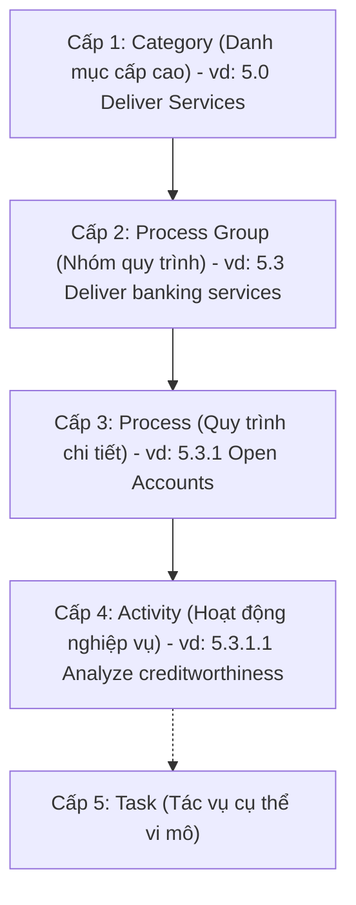

# Chuyên đề: Khung Chuẩn Phân Loại Quy Trình Nghiệp Vụ APQC PCF (Banking Edition)

> **Tài liệu tham khảo đối chuẩn:**  
> - `Banking_722_March_2025 (1).pdf` (APQC Process Classification Framework® - Banking Version 7.2.2)  
> - `K06640_ Banking_v721_vs_Banking_v610-202001_2025 (1).xlsx` (Bảng phân tích vi sai v7.2.1 vs v6.1.0)

---

## 1. Tổng quan về APQC và Khung PCF

### 1.1. Nguồn gốc và Tổ chức APQC
- **APQC (American Productivity & Quality Center)** là tổ chức phi lợi nhuận hàng đầu thế giới về nghiên cứu năng suất, chất lượng và quản trị tri thức/quy trình, có trụ sở tại Houston, Texas, Hoa Kỳ.
- **Process Classification Framework (PCF)®** được APQC khởi xướng từ năm 1992 nhằm tạo ra một mô hình quy trình doanh nghiệp mở, trung lập về ngành và công nghệ, phục vụ mục đích **đối chuẩn (Benchmarking)** và nâng cao hiệu suất.

### 1.2. Mục đích cốt lõi của APQC PCF
1. **Định nghĩa ngôn ngữ chung (Common Language):** Cung cấp hệ thống thuật ngữ và định nghĩa chuẩn hóa toàn cầu về quy trình, xóa bỏ sự bất đồng ngữ nghĩa giữa các phòng ban nội bộ và giữa tổ chức với các đối tác bên ngoài.
2. **Đối chuẩn hiệu suất (Performance Benchmarking):** Cho phép so sánh năng suất, thời gian chu kỳ (Cycle Time), chi phí vận hành và tỷ lệ lỗi với cơ sở dữ liệu **Open Standards Benchmarking (OSB)** của APQC trên toàn cầu (cả trong nội bộ ngành ngân hàng lẫn liên ngành).
3. **Cơ sở cho Tái thiết kế quy trình (BPR) và Quản trị BPM:** Là "tấm bản đồ mẫu" giúp doanh nghiệp rà soát tính đầy đủ, phát hiện các quy trình bị thiếu sót hoặc chồng chéo để tái cấu trúc.
4. **Chuẩn hóa kiến trúc khi triển khai ERP, Core Banking, CRM:** Giúp xác định phạm vi phân hệ nghiệp vụ, dữ liệu đầu vào/đầu ra và giảm thiểu rủi ro tùy biến phần mềm (customization) quá đà.

---

## 2. Cấu trúc Phân cấp (Hierarchy) và Hệ Thống Mã Hóa 5 Số

APQC PCF sử dụng cấu trúc phân tầng hình cây gồm 4 cấp độ cơ bản (kèm Cấp độ 5 tùy chọn):



| Cấp độ | Tên gọi chuẩn | Quy tắc đánh số Hierarchy ID | Định danh chuẩn APQC (PCF ID) | Ví dụ minh họa trong Ngân hàng |
| :---: | :--- | :--- | :--- | :--- |
| **Level 1** | **Category** | `X.0` (vd: `5.0`) | Mã số duy nhất (5 chữ số) | `5.0 Deliver Services` (`20025`) |
| **Level 2** | **Process Group** | `X.Y` (vd: `5.3`) | Mã số duy nhất | `5.3 Deliver banking services to customers` (`17416`) |
| **Level 3** | **Process** | `X.Y.Z` (vd: `5.3.1`) | Mã số duy nhất | `5.3.1 Open Accounts` (`17417`) |
| **Level 4** | **Activity** | `X.Y.Z.N` (vd: `5.3.1.1`) | Mã số quy trình 5 chữ số (*Bắt buộc đối chuẩn*) | `5.3.1.1 Analyze customer creditworthiness` (`13964`) |
| **Level 5** | **Task** | `X.Y.Z.N.M` | Mã số chi tiết | `Collect customer financial statements` |

> [!IMPORTANT]
> **Quy ước Mã 5 chữ số (5-digit Reference Number):**  
> Mỗi phần tử trong APQC đều sở hữu một **PCF ID** duy nhất mang tính toàn cầu (ví dụ: `10002`, `13964`, `17420`). Khi làm bài tập nhóm đối chiếu quy trình, giảng viên chấm điểm bắt buộc nhóm phải dẫn chiếu mã 5 chữ số này trong Bảng Ánh Xạ (Mapping Table).

---

## 3. Kiến Trúc 13 Danh Mục Quy Trình Lớn (APQC Banking PCF)

Trong kiến trúc tổng thể của APQC, toàn bộ hoạt động của ngân hàng được phân bổ vào hai khối lớn:
1. **Operating Processes (Quy trình vận hành cốt lõi - Cấp 1.0 đến 6.0):** Trực tiếp tạo ra chuỗi giá trị và phục vụ khách hàng.
2. **Management and Support Services (Quy trình quản lý & hỗ trợ - Cấp 7.0 đến 13.0):** Đảm bảo nguồn lực, hạ tầng kỹ thuật, tuân thủ và năng lực tổ chức.

```text
┌────────────────────────────────────────────────────────────────────────────────────────┐
│                        OPERATING PROCESSES (QUY TRÌNH VẬN HÀNH)                        │
├────────────────────────────────────────────────────────────────────────────────────────┤
│ 1.0 Develop Vision and Strategy (10002)                                                │
│ 2.0 Develop and Manage Products and Services (10003)                                   │
│ 3.0 Market and Sell Products and Services (10004)                                      │
│ 4.0 Deliver Physical Products (20022)                                                  │
│ 5.0 Deliver Services (20025)  <--- Trọng tâm nghiệp vụ Ngân hàng cốt lõi (Core)       │
│ 6.0 Manage Customer Service (20085)                                                    │
├────────────────────────────────────────────────────────────────────────────────────────┤
│                  MANAGEMENT & SUPPORT SERVICES (QUY TRÌNH HỖ TRỢ & QUẢN LÝ)             │
├────────────────────────────────────────────────────────────────────────────────────────┤
│ 7.0 Develop and Manage Human Capital (10007)                                           │
│ 8.0 Manage Information Technology (IT) (20607)                                         │
│ 9.0 Manage Financial Resources (17058)                                                 │
│ 10.0 Acquire, Construct, and Manage Assets (19207)                                     │
│ 11.0 Manage Enterprise Risk, Compliance, Remediation, and Resiliency (16437)            │
│ 12.0 Manage External Relationships (10012)                                             │
│ 13.0 Develop and Manage Business Capabilities (10013)                                  │
└────────────────────────────────────────────────────────────────────────────────────────┘
```

---

## 4. Phân Tích So Sánh Vi Sai: Banking v7.2.1/v7.2.2 vs v6.1.0

Căn cứ vào dữ liệu từ file `K06640_ Banking_v721_vs_Banking_v610-202001_2025 (1).xlsx`, phiên bản mới (v7.2.1 & v7.2.2 - March 2025) có những bước cải tiến mang tính bước ngoặt so với bản cũ v6.1.0:

### 4.1. Bảng tổng hợp chỉ số khác biệt (Difference Index) theo từng Category

| PCF ID | Hierarchy ID | Tên danh mục (Category Name) | Difference Index | Chi tiết biến động chính | Sẵn có chỉ số đo lường (Metrics)? |
| :---: | :---: | :--- | :---: | :--- | :---: |
| `10002` | `1.0` | Develop Vision and Strategy | 74 | Thêm mới `+20944`, chỉnh sửa `c10016` | **Có** |
| `10003` | `2.0` | Develop and Manage Products and Services | 80 | Bổ sung quy trình vòng đời `+19696, +19698` | **Có** |
| `10004` | `3.0` | Market and Sell Products and Services | 140 | Thêm `+20008`, loại bỏ `-10104`, chỉnh sửa `c10101` | **Có** |
| `20022` | `4.0` | Deliver Physical Products | 94 | **TÁCH MỚI (NEW):** Tách riêng quy trình cung ứng hàng hóa vật lý | **Có** |
| `20025` | `5.0` | Deliver Services | 69 | **TÁCH MỚI (NEW):** Gom toàn bộ nghiệp vụ dịch vụ & Ngân hàng `5.3` | **Có** |
| `20085` | `6.0` | Manage Customer Service | 88 | **TÁCH MỚI (NEW):** Nâng cấp mảng CSKH thành một Category độc lập | **Có** |
| `10007` | `7.0` | Develop and Manage Human Capital | 57 | Cơ cấu lại quản trị nhân sự ngân hàng, bỏ `-10409, -17458` | **Có** |
| `20607` | `8.0` | Manage Information Technology (IT) | **321** | **CẢI TỔ TOÀN DIỆN (NEW):** 321 thay đổi về Cloud, AI, Data Analytics | **Có** |
| `17058` | `9.0` | Manage Financial Resources | 66 | Chỉnh sửa hạch toán, ALM ngân hàng `c10731` | **Có** |
| `19207` | `10.0` | Acquire, Construct, and Manage Assets | 55 | Quản lý tài sản ngân hàng, mạng lưới chi nhánh `+19208` | Không |
| `16437` | `11.0` | Manage Enterprise Risk, Compliance, Resiliency | 14 | **TÁCH MỚI (NEW):** Bổ sung khả năng phục hồi hoạt động (Resiliency) | Không |
| `10012` | `12.0` | Manage External Relationships | 18 | Tối ưu quan hệ cổ đông, cơ quan quản lý (SBV) | **Có** |
| `10013` | `13.0` | Develop and Manage Business Capabilities | 36 | Nâng cấp quản trị tri thức & chuyển đổi số `+20959` | **Có** |

### 4.2. Ba thay đổi mang tính cốt lõi học viên cần nắm vững:
1. **Phân tách rạch ròi Sản phẩm Vật lý (4.0) và Dịch vụ (5.0):**  
   Ở bản cũ v6.1.0, các quy trình giao nhận sản phẩm và cung ứng dịch vụ bị trộn lẫn. Ở bản mới v7.2.x, Category `5.0 Deliver Services` (`20025`) được xây dựng chuyên biệt hóa cao độ cho các tổ chức dịch vụ tài chính.
2. **Cải tổ khổng lồ ở Category 8.0 Quản trị CNTT (321 điểm thay đổi):**  
   Phản ánh sự bùng nổ của ngân hàng số (Digital Banking), điện toán đám mây (Cloud), kiến trúc Microservices/API mở và bảo mật dữ liệu khách hàng.
3. **Mở rộng Category 11.0 Quản trị Rủi ro & Phục hồi hoạt động (Resiliency):**  
   Không chỉ dừng lại ở tuân thủ thụ động, bản mới tích hợp mô hình quản trị rủi ro tích hợp (ERM), phòng chống gian lận số và khả năng duy trì hoạt động kinh doanh liên tục (Business Continuity Planning - BCP).

---

## 5. Trọng Tâm Nghiệp Vụ Ngân Hàng: Phân Nhóm 5.3 (Deliver Banking Services)

Trong tài liệu `Banking_722_March_2025` và file đối chuẩn `K06640`, nhánh nghiệp vụ ngân hàng cốt lõi nằm trọn vẹn tại:  
**`5.3 Deliver banking services to customers` (PCF ID: `17416`)**.

Dưới đây là cây quy trình chi tiết phục vụ trực tiếp cho đề tài Tín dụng / Giải ngân / Quản lý tài khoản:

### 5.3.1. Nhóm Khởi tạo & Mở tài khoản / Phê duyệt khoản vay (`17417 Open Accounts`)
- **`5.3.1.1 Analyze customer creditworthiness` (`13964`):** Thẩm định tín nhiệm và khả năng tài chính của khách hàng (Thu nhập, lịch sử tín dụng CIC, mô hình Credit Scoring).
- **`5.3.1.2 Apply Anti-Money Laundering (AML) policy` (`13953`):** Kiểm tra tuân thủ phòng chống rửa tiền, danh sách cấm vận (Blacklist/PEP).
- **`5.3.1.3 Apply customer identification policy` (`13957`):** Định danh và xác thực khách hàng (KYC truyền thống hoặc eKYC sinh trắc học).
- **`5.3.1.4 Apply product conditions` (`17418`):** Kiểm tra và áp dụng điều kiện gói sản phẩm cho vay (hạn mức, mục đích vay, thời hạn).
- **`5.3.1.5 Apply product pricing` (`17419`):** Định giá sản phẩm tín dụng, xác định biên độ lãi suất và biểu phí cam kết.
- **`5.3.1.6 Evaluate collateral/guarantee` (`17420`):** Định giá, kiểm tra pháp lý và xác lập biện pháp bảo đảm tài sản (TSBĐ/Bảo lãnh).
- **`5.3.1.7 Set up and activate an account` (`17421`):** Thiết lập và kích hoạt tài khoản vay trên hệ thống Core Banking.
- **`5.3.1.8 Fund and disburse proceeds` (`13961`):** Kiểm soát hồ sơ giải ngân và chuyển tiền vốn vay vào tài khoản khách hàng/bên thụ hưởng.

### 5.3.2. Nhóm Quản lý & Duy trì khoản vay (`17422 Maintain accounts`)
- **`5.3.2.1 Monitor account status` (`13962`):** Giám sát trạng thái tài khoản nợ, nhóm nợ theo thông tư phân loại nợ.
- **`5.3.2.2 Manage fees/interest/commissions` (`17423`):** Tính toán và thu hồi lãi suất định kỳ, phí phạt chậm trả.
- **`5.3.2.3 Monitor account transactions` (`17424`):** Giám sát mục đích sử dụng vốn sau giải ngân qua dòng tiền giao dịch.
- **`5.3.2.4 Review collateral/guarantee periodically` (`17425`):** Tái thẩm định và định giá lại tài sản bảo đảm định kỳ (hàng năm/quý).
- **`5.3.2.6 Reconcile accounts` (`13950`):** Đối soát tài khoản nợ nội bộ và hệ thống sổ cái GL.
- **`5.3.2.9 Perform settlement` (`17429`):** Thực hiện tất toán khoản vay khi hết hạn hoặc trả nợ trước hạn.

### 5.3.3. Nhóm Đóng tài khoản (`17431 Close accounts`)
- **`5.3.3.1 Authenticate customer instruction` (`17432`):** Xác thực lệnh đề nghị đóng tài khoản / giải chấp tài sản.
- **`5.3.3.3 Determine final settlement amount` (`17434`):** Quyết toán toàn bộ số dư gốc, lãi và phí còn lại.
- **`5.3.3.4 Record account closure in system of record` (`17435`):** Cập nhật đóng hợp đồng tín dụng và xóa thế chấp trên hệ thống Core Banking.

### 5.3.5. Nhóm Dịch vụ Khách hàng Ngân hàng (`13959 Service bank customers`)
- **`5.3.5.2 Manage repayments` (`17441`):** Quản lý lịch thu nợ gốc và lãi tự động hoặc tại quầy.
- **`5.3.5.5 Review and extend credit` (`17444`):** Thẩm định tái cấp hạn mức tín dụng định kỳ hoặc cơ cấu lại thời hạn trả nợ.

---

## 6. Hướng Dẫn Thực Hành Mapping & Gap Analysis Đạt Điểm Tuyệt Đối

Khi thực hiện Phần 2 của bài tập nhóm môn BPM, học viên cần lập 2 bảng công cụ chuẩn sau:

### 6.1. Bảng Ánh Xạ Quy Trình (Mapping Table)

| STT | Bước thực tế tại Ngân hàng | Cấp độ APQC | Mã định danh APQC (5-digit ID) | Tên quy trình chuẩn APQC | Nhận xét độ khớp (Fit / Partial / None) |
| :---: | :--- | :---: | :---: | :--- | :--- |
| 1 | Tiếp nhận HS & Xác minh CCCD | Activity (L4) | `13957` | Apply customer identification policy | **Fit 100%** (Tương ứng khâu eKYC) |
| 2 | Tra cứu lịch sử CIC & Chấm điểm | Activity (L4) | `13964` | Analyze customer creditworthiness | **Fit 100%** (Thẩm định năng lực tài chính) |
| 3 | Khảo sát thực địa & Định giá BĐS | Activity (L4) | `17420` | Evaluate collateral/guarantee | **Fit 100%** (Thẩm định tài sản bảo đảm) |
| 4 | Trình phê duyệt hạn mức cho vay | Process (L3) | `17417` | Open Accounts | **Partial** (Nội bộ chia thành cấp Chi nhánh & Hội sở) |
| 5 | Công chứng thế chấp & Đăng ký GDBĐ | Activity (L4) | `17420` | Evaluate collateral/guarantee | **Partial** (Bước hoàn thiện thủ tục pháp lý) |
| 6 | Nhập hạn mức lên Core Banking | Activity (L4) | `17421` | Set up and activate an account | **Fit 100%** |
| 7 | Kiểm soát chứng từ & Bơm vốn | Activity (L4) | `13961` | Fund and disburse proceeds | **Fit 100%** (Khâu giải ngân) |

### 6.2. Ma Trận Phân Tích Khoảng Trống (Gap Analysis Matrix)

Nhóm cần phân loại các phát hiện thành 3 nhóm rõ rệt:

1. **Khoảng trống THIẾU (Missing Processes):**
   - *Ví dụ:* Ngân hàng thực tế chưa có bước kiểm tra tự động phòng chống rửa tiền tập trung (`13953 Apply AML policy`) ở khâu khởi tạo tín dụng mà chỉ làm thủ công sơ sài tại quầy; hoặc thiếu bước đánh giá độ thỏa dụng của khách hàng sau giải ngân (`20031 Solicit feedback on service delivery satisfaction`).
2. **Quy trình DƯ THỪA / KHÔNG TẠO GIÁ TRỊ (Redundant / NVA):**
   - *Ví dụ:* Bước yêu cầu in 3 bộ hồ sơ giấy ký tươi để lưu trữ song song tại Phòng Khách hàng, Phòng Thẩm định và Phòng Hỗ trợ tín dụng $\rightarrow$ Gây lãng phí chi phí in ấn và kéo dài thời gian luân chuyển.
3. **Quy trình CHỒNG CHÉO / PHÂN LOẠI SAI (Overlapping / Misclassified):**
   - *Ví dụ:* Cả Chuyên viên Quản lý Khách hàng (RM) và Chuyên viên Thẩm định rủi ro độc lập đều cùng đi định giá lại tài sản bảo đảm tại hiện trường $\rightarrow$ Chồng chéo trách nhiệm, gây phiền hà cho khách hàng.

---

*Học viện Ngân hàng — Khoa HTTTQL — Bộ môn Quản trị Quy trình Nghiệp vụ.*
