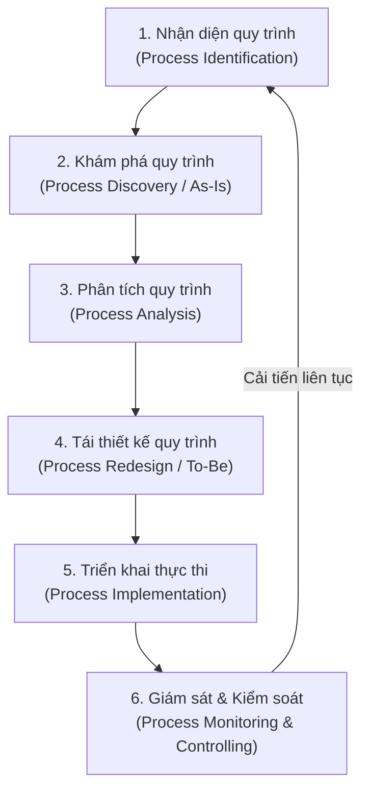

# Chuyên đề: Tổng Hợp Lý Thuyết BPM & Chuẩn Mô Hình Hóa BPMN 2.0

> **Tài liệu tham khảo đối chuẩn:**  
> - Giáo trình: *Fundamentals of Business Process Management* (Marlon Dumas et al.)  
> - Hệ thống Slide bài giảng: `Chapter 01` đến `Chapter 04`

---

## 1. Bản Chất của BPM và Vòng Đời Quy Trình (BPM Lifecycle)

### 1.1. Từ Tổ Chức Chức Năng (Functional Organization) đến Tư Duy Quy Trình (Process Thinking)
- **Tổ chức theo chức năng truyền thống:** Doanh nghiệp bị chia nhỏ thành các "ốc đảo" (Phòng Kinh doanh, Phòng Thẩm định, Phòng Hỗ trợ tín dụng, Phòng Kế toán). Mỗi bộ phận chỉ tối ưu hóa cục bộ mục tiêu của mình mà bỏ quên mục tiêu tổng thể của khách hàng, gây ra hiện tượng **đứt gãy thông tin (handoff friction)** và **thời gian chờ (idle time)** lớn.
- **Tư duy quy trình (Process Thinking):** Xem xét chuỗi hoạt động xuyên suốt từ đầu đến cuối (End-to-End) bắt đầu từ nhu cầu của khách hàng (Input) và kết thúc khi trao giá trị cho khách hàng (Output/Outcome).

### 1.2. Vòng Đời 6 Giai Đoạn của BPM (The BPM Lifecycle)

1. **Process Identification (Nhận diện):** Xác lập bản đồ kiến trúc quy trình (Process Architecture), phân loại và ưu tiên các quy trình trọng yếu cần cải tiến.
2. **Process Discovery (Khám phá):** Thu thập thông tin hiện trạng và xây dựng mô hình quy trình hiện tại (**As-Is Process Model**).
3. **Process Analysis (Phân tích):** Định lượng và định tính các điểm nghẽn (Bottlenecks), lãng phí (Waste/NVA), thời gian chu kỳ (Cycle Time) và nguyên nhân gốc rễ (Root Cause Analysis).
4. **Process Redesign (Tái thiết kế):** Đề xuất giải pháp cải tiến và mô hình hóa quy trình tương lai tối ưu (**To-Be Process Model**).
5. **Process Implementation (Thực thi):** Chuyển đổi mô hình To-Be vào thực tế thông qua phát triển phần mềm/tự động hóa (BPMS, RPA, API) hoặc đào tạo, thay đổi cơ cấu nhân sự.
6. **Process Monitoring & Controlling (Giám sát):** Đo lường hiệu suất thực tế qua các chỉ số KPIs để phát hiện độ lệch và kích hoạt vòng cải tiến mới.

---

## 2. Nhận Diện & Kiến Trúc Quy Trình (Process Architecture)

### 2.1. Phân loại 3 nhóm quy trình lớn (Process Landscape)
Theo thông lệ quốc tế và giáo trình Dumas, mọi hoạt động trong một tổ chức/ngân hàng đều được chia thành 3 tầng:

1. **Quy trình Cốt lõi (Core Processes / Operating):**
   - Trực tiếp tạo ra chuỗi giá trị (Value Chain) cung cấp cho khách hàng bên ngoài.
   - *Ví dụ ngân hàng:* Mở tài khoản và phát hành thẻ, Thẩm định và Giải ngân khoản vay, Dịch vụ Thanh toán quốc tế, Huy động tiền gửi.
2. **Quy trình Hỗ trợ (Support Processes):**
   - Cung cấp nguồn lực nội bộ để các quy trình cốt lõi vận hành trơn tru.
   - *Ví dụ:* Quản trị Nhân sự & Tuyển dụng, Quản trị Hạ tầng CNTT & Core Banking, Mua sắm & Quản lý tài sản, Pháp chế & Xử lý khiếu nại.
3. **Quy trình Quản lý (Management Processes):**
   - Định hướng chiến lược, giám sát hiệu suất và quản trị rủi ro doanh nghiệp.
   - *Ví dụ:* Lập kế hoạch kinh doanh và ALM, Quản trị rủi ro tín dụng và thanh khoản, Kiểm toán nội bộ, Quản trị quan hệ cổ đông & cơ quan thanh tra (SBV).

### 2.2. Bộ lọc "Danh Sách Kiểm Tra Quy Trình" (Process Checklist)
Để tránh nhầm lẫn giữa một "hoạt động vi mô (task)" hoặc một "dự án (project)" với một "quy trình kinh doanh (business process)", cần áp dụng 5 tiêu chí sàng lọc:

| Tiêu chí sàng lọc | Câu hỏi kiểm tra | Đánh giá đạt chuẩn |
| :--- | :--- | :--- |
| **1. Tính quy trình (Process-nature)** | Hoạt động có bao gồm chuỗi các bước liên tiếp kích hoạt bởi một sự kiện và tạo ra kết quả rõ ràng không? | Phải có Trigger $\rightarrow$ Activities $\rightarrow$ Outcome |
| **2. Tính lặp lại (Repeatability)** | Hoạt động diễn ra lặp đi lặp lại hay chỉ diễn ra một lần duy nhất (one-off project)? | Nếu chỉ diễn ra 1 lần duy nhất $\rightarrow$ Là Dự án, không phải BPM |
| **3. Khả năng kiểm soát (Manageability)** | Tổ chức có quyền hạn đo lường, can thiệp và tối ưu hóa các bước bên trong không? | Nằm trong phạm vi thẩm quyền của ngân hàng |
| **4. Quy mô hợp lý (Appropriate Scale)** | Hoạt động có quá nhỏ (ví dụ: in giấy) hoặc quá vĩ mô (toàn bộ kinh doanh ngân hàng)? | Đủ tầm một luồng giá trị (ví dụ: Quy trình Giải ngân tín dụng) |
| **5. Ý nghĩa kinh tế (Economic Value)** | Quy trình có tác động đáng kể đến chi phí, rủi ro hoặc trải nghiệm của khách hàng không? | Đóng góp trực tiếp vào mục tiêu chiến lược |

---

## 3. Chuẩn Mô Hình Hóa Quy Trình Nghiệp Vụ BPMN 2.0 (Toàn Diện)

**BPMN 2.0 (Business Process Model and Notation)** là tiêu chuẩn toàn cầu do OMG (*Object Management Group*) ban hành.

### 3.1. Các phần tử cơ bản (Flow Objects & Swimlanes)

#### A. Phân định trách nhiệm (Pools & Lanes)
- **Pool (Hồ quy trình):** Đại diện cho một pháp nhân hoặc đối tác độc lập (ví dụ: *Khách hàng*, *Ngân hàng*, *Trung tâm CIC*). Giao tiếp giữa các Pool bắt buộc phải dùng **Message Flow (mũi tên nét đứt)**.
- **Swimlane (Làn quy trình):** Phân chia trách nhiệm nội bộ giữa các phòng ban trong cùng một Pool (ví dụ: *Chuyên viên QLKH (RM)*, *Bộ phận Thẩm định rủi ro*, *Ban Giám đốc phê duyệt*, *Bộ phận Hỗ trợ tín dụng (CSU)*). Trong cùng Pool, các bước kết nối bằng **Sequence Flow (mũi tên nét liền)**.

#### B. Cổng rẽ nhánh (Gateways)
- **Exclusive Gateway (XOR - Ký hiệu dấu X hoặc trống):** Lựa chọn duy nhất 1 nhánh thỏa mãn điều kiện (vd: Hồ sơ Đạt HOẶC Không đạt). Khi gộp nhánh (join), chỉ cần 1 nhánh hoàn thành là đi tiếp.
- **Parallel Gateway (AND - Ký hiệu dấu +):** Mở ra tất cả các nhánh song song đồng thời (vd: Vừa tra cứu CIC vừa đi định giá hiện trường tài sản). Khi gộp nhánh, bắt buộc phải đợi **toàn bộ** các nhánh hoàn thành mới đi tiếp.
- **Inclusive Gateway (OR - Ký hiệu vòng tròn O):** Mở ra một hoặc nhiều nhánh thỏa mãn điều kiện đồng thời.
- **Event-Based Gateway (Ký hiệu hình ngũ giác trong 2 vòng tròn):** Rẽ nhánh dựa trên sự kiện xảy ra trước (vd: Khách hàng bổ sung hồ sơ TRƯỚC thời hạn 3 ngày HOẶC Hết hạn 3 ngày hệ thống tự động hủy hồ sơ).

---

### 3.2. Hệ thống Sự kiện (Events) Nâng Cao (Chapter 4)

| Loại sự kiện | Bắt đầu (Start Event - Viền đơn mảnh) | Trung gian (Intermediate Event - Viền đôi) | Kết thúc (End Event - Viền đậm) | Ý nghĩa ứng dụng trong Ngân hàng |
| :--- | :---: | :---: | :---: | :--- |
| **None** | ⭕ (Tròn trơn) | ⊚ (Tròn đôi trơn) | ⬤ (Tròn đậm) | Bắt đầu/kết thúc luồng thông thường |
| **Message** | ✉️ trong vòng tròn | ✉️ trắng (Catching) / ✉️ đen (Throwing) | ✉️ đen trong vòng đậm | Nhận đơn đề nghị vay / Gửi thông báo phê duyệt tín dụng |
| **Timer** | ⏱️ trong vòng tròn | ⏱️ trong vòng đôi | *(Không có)* | Đếm thời gian: SLA xử lý quá 48h, Lịch nhắc nợ tự động hàng tháng |
| **Error** | ⚡ trong vòng tròn | ⚡ (Catching boundary) | ⚡ đen trong vòng đậm | Lỗi hệ thống Core / Phát hiện gian lận $\rightarrow$ Kích hoạt luồng xử lý ngoại lệ |
| **Terminate** | *(Không có)* | *(Không có)* | 🞉 Đen đặc trong vòng | **Hủy toàn bộ quy trình ngay lập tức** (vd: Khách hàng rút hồ sơ) |

---

### 3.3. Quy trình con (Sub-processes) và Xử lý Ngoại lệ
- **Collapsed Sub-process (Quy trình con thu gọn - Dấu [+]):** Giúp bản vẽ ở mức độ tổng quan không bị rối mắt; chi tiết của nó được vẽ ở trang/sơ đồ riêng.
- **Boundary Event (Sự kiện gắn trên đường biên):**
  - **Interrupting (Viền nét liền):** Khi sự kiện xảy ra, ngắt ngay lập tức tác vụ đang chạy để rẽ sang luồng xử lý khẩn cấp (vd: Phát hiện khách hàng dính nợ xấu nhóm 5 $\rightarrow$ Ngắt ngay khâu thẩm định).
  - **Non-interrupting (Viền nét đứt):** Sự kiện xảy ra nhưng tác vụ chính vẫn tiếp tục chạy song song (vd: Gửi tin nhắn SMS cập nhật tiến độ xử lý cho khách hàng).

---

*Học viện Ngân hàng — Khoa HTTTQL — Bộ môn Quản trị Quy trình Nghiệp vụ.*
