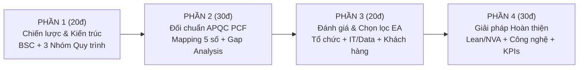

# Cẩm Nang Thực Chiến: Bài Tập Nhóm BPM Đạt Điểm Tuyệt Đối (100 Điểm)

> **Căn cứ yêu cầu & Tiêu chí đánh giá:**  
> - Đề bài: [BÀI TẬP NHÓM - Nhận diện và đánh giá quy trình.md](file:///Users/dovandat/WORKSPACE/HVNH/BPM/Bai_tap_lon/B%C3%80I%20T%E1%BA%ACP%20NH%C3%93M%20-%20Nh%E1%BA%ADn%20di%E1%BB%87n%20v%C3%A0%20%C4%91%C3%A1nh%20gi%C3%A1%20quy%20tr%C3%ACnh.md)  
> - Rubric chấm điểm: [TIÊU CHÍ ĐÁNH GIÁ BÀI TẬP NHÓM.md](file:///Users/dovandat/WORKSPACE/HVNH/BPM/Bai_tap_lon/TI%C3%8AU%20CH%C3%8D%20%C4%90%C3%81NH%20GI%C3%81%20B%C3%80I%20T%E1%BA%ACP%20NH%C3%93M.md)  
> - Báo cáo thực tế tham chiếu: [Bao_cao_BPM_Tin_dung_Giai_ngan_LPBank_HOAN_THIEN.md](file:///Users/dovandat/WORKSPACE/HVNH/BPM/Bai_tap_lon/Bao_cao_BPM_Tin_dung_Giai_ngan_LPBank_HOAN_THIEN.md)

---

## 🗺️ Bản Đồ Chiến Lược Triển Khai (Master Blueprint)

Bài tập nhóm môn BPM được thiết kế gồm 4 phần chính, tương ứng 4 giai đoạn tư duy từ vĩ mô đến vi mô:

---

## 🎯 Chi Tiết Từng Phần & Kỹ Thuật Đạt Điểm Tối Đa

### PHẦN 1: BỐI CẢNH CHIẾN LƯỢC VÀ NHẬN DIỆN QUY TRÌNH (20 Điểm)

#### 1. Phân tích Chiến lược kinh doanh qua Bảng điểm cân bằng (Balanced Scorecard - 10 điểm)
Phải chỉ rõ 4 khía cạnh có quan hệ nhân quả (Cause-and-Effect Relationship):
- **Khía cạnh Tài chính (Financial Perspective):**
  - Tăng trưởng dư nợ tín dụng an toàn, tối ưu hóa tỷ lệ thu nhập lãi thuần (NIM).
  - Kiểm soát tỷ lệ nợ xấu (NPL) dưới mức 1.5% - 2.0%.
  - Giảm thiểu chi phí vận hành trên thu nhập (Tỷ lệ CIR $\le 38\%$).
- **Khía cạnh Khách hàng (Customer Perspective):**
  - Giảm thời gian xử lý phê duyệt khoản vay (Turnaround Time - TAT) từ 3 ngày xuống dưới 8 giờ làm việc.
  - Tăng chỉ số hài lòng của khách hàng vay vốn (CSAT $\ge 90\%$, NPS $\ge 65$).
  - Đa dạng hóa các kênh tiếp cận số (Omnichannel / Mobile Banking App).
- **Khía cạnh Quy trình nội bộ (Internal Business Processes):**
  - Chuẩn hóa luồng thẩm định tín dụng và tự động hóa khâu tra cứu CIC.
  - Số hóa hồ sơ giải ngân không giấy tờ (Paperless Loan Disbursement).
  - Tích hợp dữ liệu kiểm soát sau vay giữa Hội sở và Chi nhánh.
- **Khía cạnh Học tập & Phát triển (Learning and Growth):**
  - Đào tạo nâng cao năng lực phân tích tài chính và nhận diện gian lận cho đội ngũ Chuyên viên QLKH (RM) và Thẩm định viên.
  - Nâng cấp hạ tầng kiến trúc tích hợp hệ thống (ESB/API Gateway) và triển khai mô hình chấm điểm tín dụng AI Scoring.

#### 2. Phác thảo Kiến trúc quy trình cấp cao (Process Landscape - 10 điểm)
- Phân loại rõ ràng 3 nhóm quy trình lớn:
  1. **Quy trình Cốt lõi (Core):** Huy động vốn, Cấp tín dụng & Giải ngân, Dịch vụ Thanh toán & Chuyển tiền, Thẻ & Ngân hàng số.
  2. **Quy trình Hỗ trợ (Support):** Quản trị Nhân sự, Quản trị Hạ tầng IT & Core Banking, Pháp chế & Xử lý nợ, Mua sắm trang thiết bị.
  3. **Quy trình Quản lý (Management):** Hoạch định chiến lược kinh doanh, Quản trị rủi ro & ALM, Kiểm toán nội bộ, Tuân thủ NHNN.
- **Bắt buộc có:** Bảng minh chứng sử dụng **Process Checklist** (kiểm tra 5 tiêu chí: Có phải quy trình không, tính lặp lại, khả năng kiểm soát, quy mô, giá trị gia tăng).
- *Điểm cộng:* Trình bày bằng sơ đồ khối trực quan (Process Landscape Map).

---

### PHẦN 2: ĐỐI CHIẾU VỚI KHUNG APQC PCF (30 Điểm - Trọng Số Lớn Nhất)

#### 1. Ánh xạ quy trình (Mapping Table - 15 điểm)
- Chọn mảng nghiệp vụ: **Cấp tín dụng và Giải ngân khoản vay (Lending Operations)** thuộc Category `5.0 Deliver Services` (`20025`).
- Tuân thủ cấu trúc phân cấp chuẩn của APQC:
  - Cấp 1: `5.0 Deliver Services` (`20025`)
  - Cấp 2: `5.3 Deliver banking services to customers` (`17416`)
  - Cấp 3: `5.3.1 Open Accounts` (`17417`) / `5.3.2 Maintain accounts` (`17422`)
  - Cấp 4: Các hoạt động nghiệp vụ kèm mã 5 chữ số:
    - `13957`: Định danh khách hàng (KYC/eKYC)
    - `13964`: Thẩm định tín nhiệm và khả năng trả nợ (Analyze customer creditworthiness)
    - `17420`: Thẩm định và định giá tài sản bảo đảm (Evaluate collateral/guarantee)
    - `17418`: Áp dụng điều kiện gói vay (Apply product conditions)
    - `17419`: Áp dụng biểu lãi suất và phí (Apply product pricing)
    - `17421`: Mở và thiết lập tài khoản vay trên Core Banking (Set up and activate account)
    - `13961`: Giải ngân tiền vay (Fund and disburse proceeds)
    - `17425`: Định giá lại tài sản bảo đảm định kỳ (Review collateral periodically)

#### 2. Phân tích khoảng trống (Gap Analysis - 15 điểm)
- **Điểm THIẾU (Missing):**
  - Thiếu quy trình đo lường trải nghiệm khách hàng sau khi giải ngân (`20031 Solicit feedback from customer on service delivery satisfaction`).
  - Thiếu khâu kiểm tra tự động tuân thủ AML tập trung (`13953 Apply Anti-Money Laundering policy`) trước khi phê duyệt.
- **Điểm DƯ THỪA / CHỒNG CHÉO (Redundant / Overlapping):**
  - Thẩm định tài sản bảo đảm 2 lần độc lập: RM khảo sát xong, bộ phận Tái thẩm định rủi ro lại cử người đi khảo sát lại độc lập mà không chia sẻ dữ liệu ảnh/định vị.
  - Ký tươi và luân chuyển bản cứng hồ sơ tín dụng qua 4 cấp phê duyệt gây tắc nghẽn.

---

### PHẦN 3: ĐÁNH GIÁ HIỆN TRẠNG & CHỌN QUY TRÌNH ƯU TIÊN (20 Điểm)

#### 1. Lọc danh mục đầu tư quy trình (Process Portfolio - 5 điểm)
- Chọn 01 quy trình cụ thể: **"Quy trình Thẩm định Tín dụng và Giải ngân vốn vay Khách hàng Cá nhân/SME"**.
- Luận giải lý do:
  - Đây là hoạt động mang lại 70% tổng thu nhập lãi của ngân hàng (Tầm quan trọng chiến lược cao).
  - Hiện tại tỷ lệ phản ánh về thời gian xử lý chậm (TAT trung bình 4–5 ngày) là điểm nghẽn lớn nhất khiến ngân hàng mất khách hàng vào tay các đối thủ số hóa (Tính bất cập cao).

#### 2. Phân tích đa chiều theo Kiến trúc Doanh nghiệp (EA - 15 điểm)
- **Góc nhìn Tổ chức (5đ):**
  - Xác định ma trận phân nhiệm RACI giữa các bên: Khách hàng $\rightarrow$ RM $\rightarrow$ Phòng Quản lý rủi ro $\rightarrow$ Cấp phê duyệt $\rightarrow$ Phòng Hỗ trợ tín dụng (CSU) $\rightarrow$ Thủ quỹ/Kế toán giao dịch.
  - Điểm nghẽn: Có quá nhiều điểm bàn giao (Handoffs) không cần thiết giữa RM và CSU.
- **Góc nhìn Dữ liệu & IT (5đ):**
  - Đứt gãy dữ liệu (Data Silos): Hệ thống LOS (Loan Origination System) chưa tích hợp tự động 2 chiều với hệ thống Core Banking và cổng dữ liệu CIC. Chuyên viên phải tra cứu CIC thủ công ngoài trình duyệt rồi gõ tay kết quả vào hồ sơ Word.
- **Góc nhìn Khách hàng (5đ):**
  - Hành trình khách hàng bị phân mảnh: Khách hàng phải đến phòng giao dịch ít nhất 3 lần (nộp hồ sơ, ký hợp đồng tín dụng/thế chấp, nhận tiền giải ngân).

---

### PHẦN 4: ĐỀ XUẤT GIẢI PHÁP HOÀN THIỆN (30 Điểm)

#### 1. Giải pháp Cấu trúc & Vận hành (Lean & NVA - 10 điểm)
- Loại bỏ hoàn toàn khâu photo công chứng giấy tờ tùy thân bằng việc đối soát dữ liệu CSDL Quốc gia về Dân cư (VNeID/Chip CCCD).
- Gộp bước thẩm định hiện trường và định giá TSBĐ thông qua ứng dụng Mobile App định vị số hóa của ngân hàng.
- Phân luồng phê duyệt (Straight-Through Processing - STP): Các khoản vay tiêu dùng dưới 100 triệu có lịch sử tín dụng tốt được phê duyệt tự động 100% không qua con người.

#### 2. Giải pháp Công nghệ & Tự động hóa (10 điểm)
- Triển khai **Hệ thống Khởi tạo Khoản vay số (Digital LOS)** tích hợp API:
  - API kết nối tự động trung tâm CIC (giảm thời gian tra cứu từ 2 giờ xuống 30 giây).
  - Ứng dụng mô hình máy học (Machine Learning Credit Scoring) đánh giá rủi ro tức thì.
  - Ký số hợp đồng tín dụng từ xa (FPT.eSign / VNPT SmartCA) và giải ngân trực tuyến 24/7 vào tài khoản thanh toán.

#### 3. Bộ 3-5 chỉ số KPIs chuẩn APQC Open Standards Benchmarking (10 điểm)

| Mã KPI Benchmark | Tên chỉ số KPI | Định nghĩa & Công thức đo lường | Hiện trạng (As-Is) | Mục tiêu sau cải tiến (To-Be) |
| :---: | :--- | :--- | :---: | :---: |
| **KPI-01** | **Thời gian chu kỳ (Turnaround Time - TAT)** | Thời gian từ lúc nhận đủ hồ sơ vay đến khi tiền về tài khoản | **4.5 ngày** | **$\le 8$ giờ** (Khoản vay nhỏ: $< 15$ phút) |
| **KPI-02** | **Tỷ lệ phê duyệt tự động (STP Rate)** | Số hồ sơ giải ngân tự động / Tổng số hồ sơ tiếp nhận $\times 100\%$ | **0%** | **$\ge 45\%$** |
| **KPI-03** | **Chi phí trên mỗi giao dịch (Cost per Loan Origination)** | Tổng chi phí vận hành thẩm định chia cho số khoản vay thành công | **~ 1.200.000 VNĐ** | **$\le 450.000$ VNĐ** |
| **KPI-04** | **Tỷ lệ lỗi hồ sơ hoàn trả (Rework Rate)** | Tỷ lệ hồ sơ bị phòng Thẩm định/CSU trả lại yêu cầu bổ sung | **32%** | **$\le 5\%$** |
| **KPI-05** | **Độ hài lòng của khách hàng (CSAT/NPS)** | Điểm khảo sát mức độ hài lòng về quy trình giải ngân tín dụng | **68%** | **$\ge 92\%$** |

---

*Học viện Ngân hàng — Khoa HTTTQL — Bộ môn Quản trị Quy trình Nghiệp vụ.*
