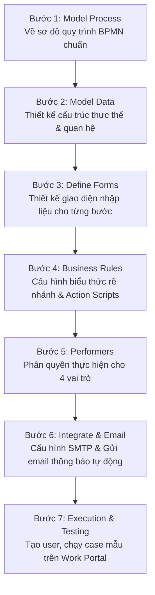

# Hướng Dẫn Thực Hành: Bài Tập Lớn Cá Nhân Cuối Khóa (Bizagi BPM Suite)

> **Tài liệu nguồn:** [Final_Project_LoanAssessment_K28.md](file:///Users/dovandat/WORKSPACE/HVNH/BPM/Bai_tap_lon/Final_Project_LoanAssessment_K28.md) / `Final Project - LoanAssessment K28.pdf`  
> **Chương trình:** Khóa Cao học K28 — Ngành Hệ thống Thông tin Quản lý — Học viện Ngân hàng  
> **Yêu cầu nộp bài:** *"Hãy làm bài tập theo các hướng dẫn cụ thể dưới đây, đóng gói và nén file project với tên riêng của bạn và submit tại đây"*

---

## 📌 1. Tổng Quan Bài Tập Cá Nhân

- **Tên đề tài:** **Loan Assessment Process Automation** (Tự động hóa Quy trình Đánh giá & Phê duyệt Khoản vay thế chấp).
- **Công cụ thực hành:** **Bizagi BPM Suite** (bao gồm: *Bizagi Process Modeler*, *Bizagi Studio*, và *Bizagi Work Portal*).
- **Thời lượng thực hành ước tính:** 10 – 12 giờ làm việc trên phần mềm.
- **Sản phẩm bàn giao:** File đóng gói Project Bizagi đã kiểm thử thành công, nén định dạng `.zip` theo cú pháp quy định (ví dụ: `DoVanDat_K28_LoanAssessment.zip`).

---

## 🏢 2. Kịch Bản Nghiệp Vụ & Phân Vai (Roles & Responsibilities)

Quy trình diễn ra giữa **Người xin vay (Applicant)** và **Ngân hàng cho vay (Loan Provider)** nhằm thẩm định và phê duyệt hồ sơ vay thế chấp mua nhà, với sự tham gia của 4 vai trò tác nghiệp nội bộ:

```text
┌────────────────────────────────────────────────────────────────────────────────────────┐
│                              4 VAI TRÒ NGHIỆP VỤ TRONG BIZAGI                           │
├──────────────────────────┬─────────────────────────────────────────────────────────────┤
│ 1. Loan Officer          │ Cán bộ Tín dụng: Đầu mối tiếp nhận đơn, kiểm tra tính đầy đủ│
│    (Đầu mối chính)       │ của hồ sơ, đánh giá điều kiện tiên quyết, gửi gói chấp nhận │
│                          │ (Acceptance pack) và ký thỏa thuận trả nợ.                  │
├──────────────────────────┼─────────────────────────────────────────────────────────────┤
│ 2. Financial Officer     │ Chuyên viên Tài chính: Kiểm tra lịch sử tín dụng (CIC),     │
│    (Thẩm định tài chính) │ thu nhập và kích hoạt tính toán trọng số rủi ro tự động.    │
├──────────────────────────┼─────────────────────────────────────────────────────────────┤
│ 3. Property Appraiser    │ Thẩm định viên Tài sản: Khảo sát hiện trường, kiểm tra pháp │
│    (Định giá TSBĐ)       │ lý bất động sản và xác định giá trị định giá của tài sản.   │
├──────────────────────────┼─────────────────────────────────────────────────────────────┤
│ 4. Insurance Sales Rep   │ Đại diện Bảo hiểm: Tiếp nhận nhu cầu bảo hiểm nhà chiết khấu│
│    (Bán chéo bảo hiểm)   │ và phát hành bản chào phí bảo hiểm (Insurance Quote).        │
└──────────────────────────┴─────────────────────────────────────────────────────────────┘
```

> [!NOTE]
> **Quy tắc Phê duyệt Hai Người (Two-man Rule / Dual Control):**  
> Để phòng ngừa rủi ro đạo đức, Cán bộ tín dụng đưa ra quyết định phê duyệt cuối cùng (*Take final decision*) **bắt buộc phải là một người khác** so với Cán bộ tín dụng đã tiếp nhận và lập hồ sơ ban đầu.

---

## 🔄 3. Luồng Quy Trình BPMN Chi Tiết (Process Routing)

### 3.1. Các giai đoạn chính
1. **Tiếp nhận & Kiểm tra tính đầy đủ (`Check application form`):**
   - Đơn nộp vào hệ thống. Cán bộ tín dụng kiểm tra.
   - **Gateway 1 (`Form complete?`):**
     - *Nếu chưa đủ:* Trả hồ sơ cho khách hàng bổ sung. Kích hoạt **Timer Event 5 ngày**. Nếu quá 5 ngày không gửi lại $\rightarrow$ Tự động hủy hồ sơ (*Terminate*).
     - *Nếu đầy đủ:* Chuyển tiếp sang bước thẩm định chuyên sâu song song.
2. **Thẩm định Song song (Parallel Check):**
   - Nhánh 1: Chuyên viên Tài chính kiểm tra lịch sử tín dụng (`Check credit history`) $\rightarrow$ Hệ thống tự động tính điểm rủi ro (`Loan Risk Assessment service`).
   - Nhánh 2: Thẩm định viên định giá tài sản bảo đảm (`Appraise property`).
3. **Đánh giá Tính đủ điều kiện (`Assess eligibility`):**
   - Sau khi cả 2 nhánh hoàn tất, Cán bộ tín dụng tổng hợp kết quả.
   - **Gateway 2 (`Applicant eligible?`):**
     - *Không đủ điều kiện:* Từ chối hồ sơ (`Reject application`) và gửi email thông báo lý do.
     - *Đủ điều kiện:* Lập gói chấp thuận cho vay (`Prepare and send acceptance pack`), in và gửi bản cứng thỏa thuận trả nợ qua bưu điện.
4. **Kiểm tra Nhu cầu Bảo hiểm (`Gateway 3: Quote requested?`):**
   - Nếu khách hàng tích chọn mua bảo hiểm $\rightarrow$ Đại diện bảo hiểm gửi báo giá (`Prepare and send home insurance quote`).
5. **Ký Thỏa Thuận Trả Nợ & Quyết Định Cuối Cùng:**
   - Khách hàng ký thỏa thuận trả nợ và gửi lại trong vòng 2 tuần.
   - Cán bộ tín dụng kiểm tra xác thực thỏa thuận (`Verify payment agreement`).
   - Cán bộ tín dụng thứ hai xem xét phê duyệt cuối cùng (`Take final decision`): Chấp thuận (*Approve*) hoặc Từ chối (*Reject*).
   - Hệ thống tự động gửi email thông báo kết quả cuối cùng cho khách hàng.

---

## 🛠️ 4. Quy Trình 7 Bước Triển Khai Trên Bizagi Studio

Theo hướng dẫn từ tài liệu workshop, học viên cần lần lượt hoàn thành 7 module của Bizagi Studio Wizard:



### Chi tiết các bước kỹ thuật:

#### Bước 1: Model Process (Vẽ quy trình)
- Sử dụng Bizagi Process Modeler để kéo thả các Task, Gateways, Pools, Swimlanes, Timer events đúng chuẩn sơ đồ Diagram 1 trong tài liệu.

#### Bước 2: Model Data (Mô hình dữ liệu)
- **Thực thể quy trình chính (Process Entity):** `LoanAssessment`
- **Các thực thể liên kết (Master Entities):**
  - `Applicant` (Họ tên, CCCD, Email, Số điện thoại, Thu nhập hàng tháng, Lịch sử tín dụng...).
  - `Property` (Địa chỉ, Diện tích, Giá trị ước tính, Giá trị định giá, Loại BĐS...).
  - `InsuranceQuote` (Gói bảo hiểm, Giá trị bảo hiểm, Phí năm...).
- **Các thực thể tham số (Parameter Entities):** `LoanStatus`, `IdentificationType`, `MaritalStatus`, `PropertyType`...

#### Bước 3: Define Forms (Thiết kế giao diện)
- Sử dụng Form Builder để thiết kế form hiển thị cho từng Task:
  - Form `Check application form`: Bắt buộc nhập thông tin khách hàng, số tiền vay, mục đích.
  - Form `Check credit history`: Điểm tín dụng, nợ xấu nhóm 1–5, cảnh báo rủi ro.
  - Form `Appraise property`: Tải lên ảnh khảo sát, định giá tài sản, ghi chú hiện trường.
  - Form `Take final decision`: Nút Phê duyệt / Từ chối kèm lý do.

#### Bước 4: Business Rules & Routing
- Viết biểu thức logic điều kiện cho các Gateway:
  - Gateway 1: `<LoanAssessment.FormComplete> == true`
  - Gateway 2: `<LoanAssessment.ApplicantEligible> == true`
  - Gateway 3: `<LoanAssessment.HomeInsuranceInterest> == true`
- Cấu hình các **Activity Actions (On Exit / On Enter)**:
  - Tính toán trọng số rủi ro: `Set the Risk Weight`
  - Cập nhật trạng thái hồ sơ: `Set Status = "Approved"` hoặc `"Rejected"`
  - Ghi nhận ngày thẩm định và phân bổ nhân sự tự động.

#### Bước 5: Performers (Phân công công việc)
- Thiết lập quy tắc phân bổ:
  - Giao việc theo Role: `Role = "Loan Officer"`, `Role = "Financial Officer"`, `Role = "Property Appraiser"`.
  - Thực thi quy tắc Two-man Rule cho tác vụ `Take final decision`: Người thực hiện $\neq$ người tạo hồ sơ ban đầu.

#### Bước 6: Email Notifications & Document Template
- Cấu hình máy chủ SMTP trong Environment Settings.
- Tạo mẫu email tự động kèm biến động (Placeholders XPath) gửi cho khách hàng:
  - *Email từ chối hồ sơ (Reject application)*
  - *Email gửi gói chấp nhận vay (Prepare and send acceptance pack)*
  - *Email báo giá bảo hiểm nhà (Home insurance quote)*
  - *Email thông báo phê duyệt thành công (Approval notification)*

#### Bước 7: Kiểm thử trên Work Portal
- Khởi tạo ít nhất 4 user tương ứng 4 vai trò.
- Đăng nhập tài khoản `Loan Officer` để tạo Case mới.
- Luân chuyển hồ sơ qua từng vai trò để kiểm tra tính liên tục, tính đúng đắn của dữ liệu và luồng email.

---

## 📦 5. Hướng Dẫn Đóng Gói Và Nộp Bài

1. **Sao lưu & Đóng gói Project Bizagi:**
   - Trong Bizagi Studio, chọn menu **Export / Backup Project**.
   - Lưu trữ toàn bộ thư mục project Bizagi bao gồm cơ sở dữ liệu (`.mdf` / `.ldf` hoặc file backup Bizagi).
2. **Quy ước đặt tên file nén:**
   - Nén file dưới dạng `.zip` hoặc `.rar`.
   - Cú pháp chuẩn: `[HọVàTên]_[MãHọcViên]_LoanAssessment_Bizagi.zip`  
   - *Ví dụ:* `DoVanDat_CH280123_LoanAssessment_Bizagi.zip`
3. **Nộp bài:**
   - Đăng tải file nén lên đúng đường link nộp bài tập cá nhân được chỉ định trên cổng thông tin học tập của giảng viên.

---

*Học viện Ngân hàng — Khoa HTTTQL — Hướng dẫn thực hành hệ thống thông tin chuyên sâu.*
