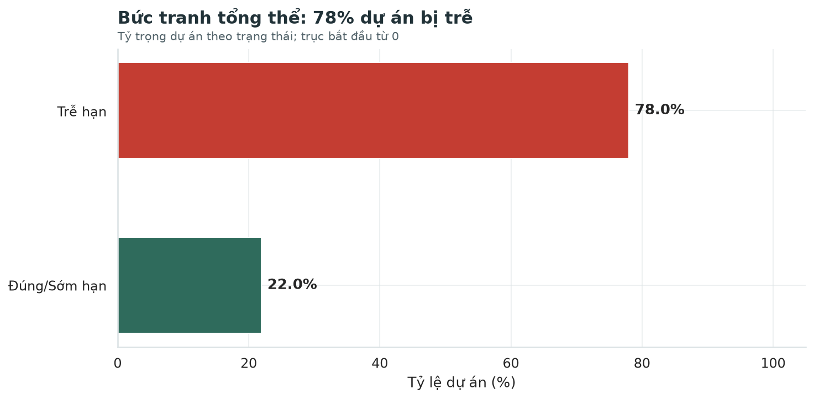
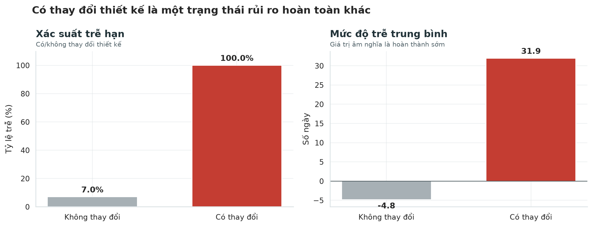
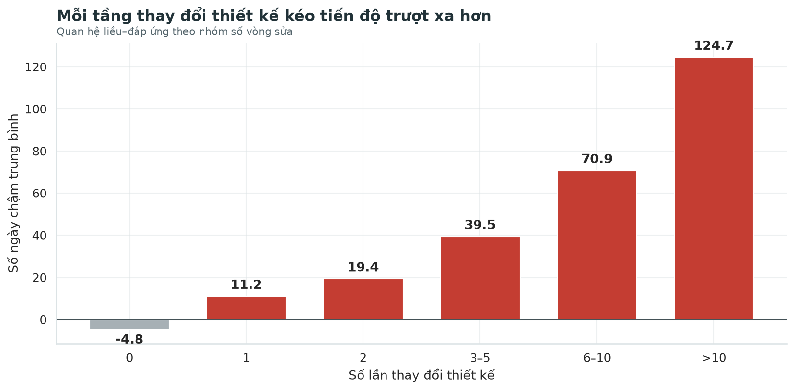
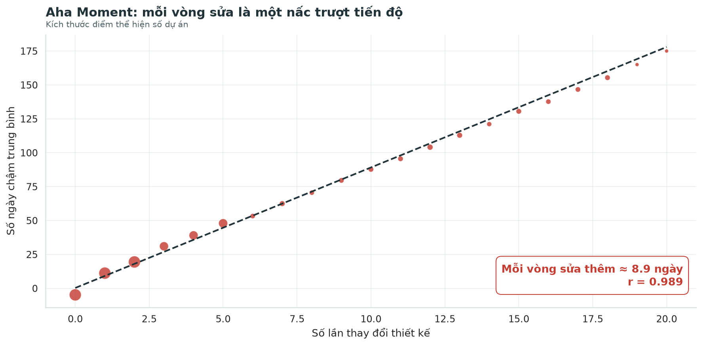
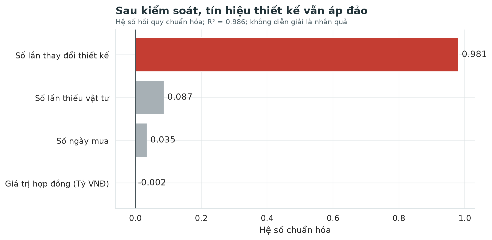
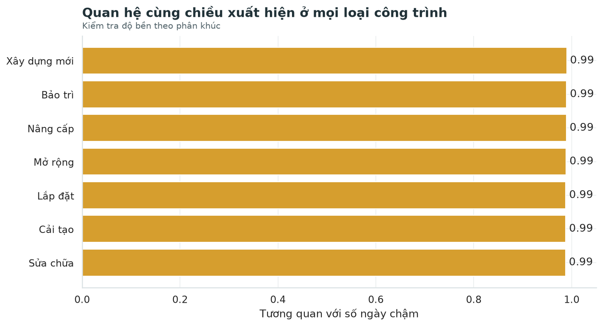
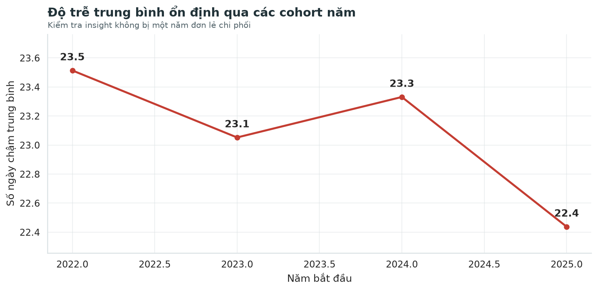
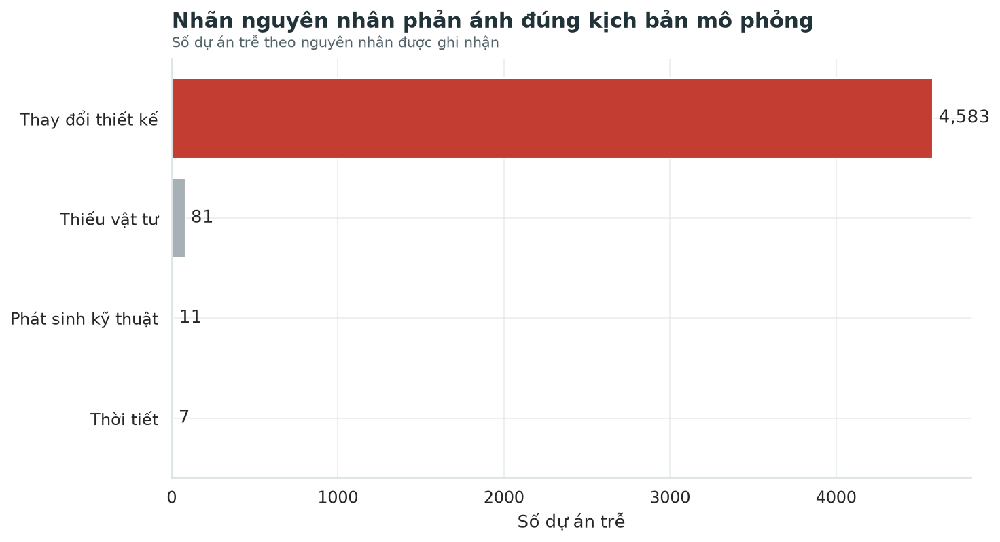
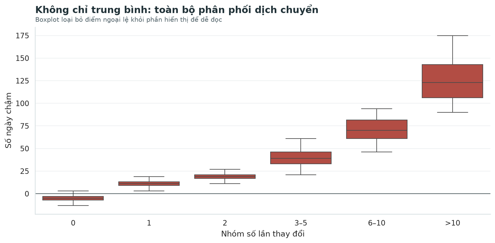
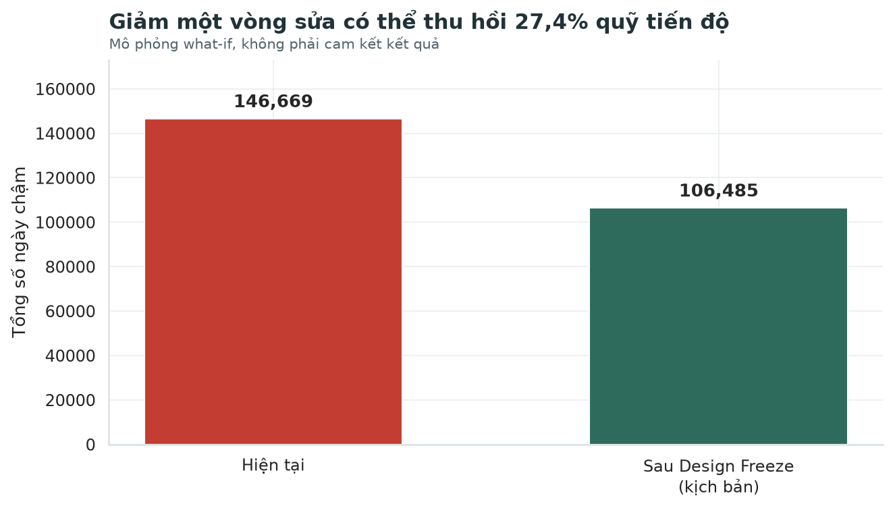

# DESIGN FREEZE: CHẶN HIỆU ỨNG DOMINO TỪ THAY ĐỔI THIẾT KẾ

## Báo cáo Phân tích và Câu chuyện Dữ liệu

**Môn học:** Data Storytelling  
**Chủ đề:** Tối ưu tiến độ dự án xây dựng  
**Quy mô dữ liệu:** 6,000 dự án mô phỏng  
**Insight trung tâm:** Thay đổi thiết kế là tín hiệu chi phối độ trễ  

> **Thông điệp điều hành:** Đừng để mỗi vòng sửa bản vẽ trở thành một vòng trượt tiến độ. Hãy khóa thiết kế đúng mốc, kiểm soát mọi thay đổi sau freeze và chứng minh hiệu quả bằng pilot có đối chứng.

### Tuyên bố sử dụng dữ liệu

Bộ dữ liệu trong báo cáo là dữ liệu mô phỏng phục vụ mục đích học tập. Các số liệu thể hiện logic của kịch bản đã xây dựng, không đại diện cho hồ sơ vận hành thực tế của một doanh nghiệp cụ thể. Báo cáo phân biệt rõ giữa kết quả mô tả trong dữ liệu và kết luận nhân quả cần được xác minh ngoài thực địa.

## Trang 2 — Tóm tắt điều hành

Trong 6,000 dự án, tỷ lệ trễ hạn là **78.0%**. Tuy nhiên, tỷ lệ chung chưa đủ để quyết định hành động. Khi tách theo trạng thái thiết kế, hồ sơ rủi ro thay đổi hoàn toàn: nhóm không thay đổi thiết kế có độ trễ trung bình **-4.8 ngày**, trong khi nhóm có thay đổi thiết kế chậm trung bình **31.9 ngày**. Tỷ lệ trễ của hai nhóm lần lượt là **7.0%** và **100.0%**.

Quan hệ không dừng ở khác biệt nhị phân. Số ngày chậm tăng đều theo số vòng sửa, tạo thành một quan hệ “liều–đáp ứng”. Đường xu hướng cho thấy mỗi vòng sửa thêm đi cùng khoảng **8.9 ngày chậm**, với tương quan **r = 0.989**. Sau khi đưa mưa, thiếu vật tư và giá trị hợp đồng vào mô hình mô tả, thay đổi thiết kế vẫn có hệ số chuẩn hóa lớn nhất; mô hình đạt R² **0.986**.

Báo cáo đề xuất Design Freeze theo stage-gate, Change Control Board và SLA 48 giờ. Trong kịch bản giảm tối đa một vòng sửa ở mỗi dự án có thay đổi, tổng số ngày chậm dương có thể giảm từ **146,669** xuống **106,485**, tương đương **27.4%**. Đây là mô phỏng what-if, không phải cam kết kết quả. Bước đúng tiếp theo là pilot có đối chứng và theo dõi KPI trước–sau.

## Trang 3 — Vấn đề kinh doanh và tính cấp thiết

Tiến độ là một trong ba ràng buộc cốt lõi của quản lý dự án cùng với phạm vi và chi phí. Khi tiến độ trượt, doanh nghiệp không chỉ chịu thêm ngày công hoặc chi phí thiết bị. Hệ quả còn lan sang kế hoạch nghiệm thu, dòng tiền, uy tín với khách hàng và khả năng tiếp nhận dự án tiếp theo. Vì vậy, câu hỏi kinh doanh không nên dừng ở “có bao nhiêu dự án trễ”, mà phải chuyển thành “điểm can thiệp nào có thể giảm độ trễ một cách có hệ thống”.

Trong thực tế, các cuộc họp tiến độ thường phân tán sự chú ý vào nhiều yếu tố: mưa, thiếu vật tư, năng lực nhà thầu phụ, thay đổi quy mô, giải phóng mặt bằng hoặc lỗi kỹ thuật. Nếu không có cấu trúc phân tích, tổ chức dễ chọn nguyên nhân phù hợp với trực giác sẵn có. Điều đó dẫn đến giải pháp dàn trải: tăng nhân lực ở mọi nơi, yêu cầu nhà thầu làm thêm giờ hoặc bổ sung dự phòng mà không xử lý nguồn phát sinh chính.

Báo cáo chọn thay đổi thiết kế làm insight trung tâm không phải vì tên biến nghe thuyết phục, mà vì dữ liệu tạo thành chuỗi bằng chứng nhất quán: khác biệt giữa hai trạng thái, quan hệ tăng theo số vòng sửa, ưu thế sau kiểm soát yếu tố nhiễu, sự ổn định theo loại công trình và tác động what-if có thể lượng hóa. Mạch kể chuyện vì vậy hướng người đọc từ bức tranh chung đến một quyết định quản trị cụ thể.

## Trang 4 — Đối tượng mục tiêu và câu hỏi họ quan tâm

Đối tượng chính của câu chuyện là Ban Giám đốc, Ban Quản lý dự án và Phòng Kế hoạch. Mỗi nhóm nhìn cùng một dữ liệu qua một lăng kính khác nhau. Ban Giám đốc quan tâm tới rủi ro bàn giao, uy tín và khả năng chuyển insight thành thay đổi quản trị. Ban Quản lý dự án cần biết tín hiệu cảnh báo nào có thể theo dõi hằng tuần và cơ chế xử lý nào nằm trong quyền kiểm soát. Phòng Kế hoạch cần hiểu khi nào phải cập nhật baseline, phân bổ nguồn lực hoặc điều chỉnh chuỗi cung ứng.

Do đó, báo cáo tránh kể câu chuyện thuần kỹ thuật. Mỗi biểu đồ trả lời một câu hỏi quyết định: quy mô vấn đề là gì; trạng thái nào tạo khác biệt lớn; mức độ rủi ro tăng ra sao; insight có bền trước các lời giải thích cạnh tranh không; và hành động nào có thể đo lường. Các hệ số thống kê được dịch sang ngôn ngữ vận hành như “ngày chậm trên mỗi vòng sửa” thay vì chỉ nêu tương quan.

Câu hỏi nghiên cứu gồm: tỷ lệ trễ hiện tại; khác biệt giữa nhóm có và không thay đổi; quan hệ liều–đáp ứng; độ bền sau khi xét mưa, vật tư, quy mô hợp đồng và phân khúc; tác động tiềm năng khi giảm vòng sửa. Cấu trúc này đảm bảo khán giả không bị dẫn thẳng đến kết luận mà không có bối cảnh và kiểm chứng.

## Trang 5 — Khung 4D giữ phân tích tập trung

Khung 4D gồm Problem, Outcome, Action và Measure. **Problem** được định nghĩa là độ trễ dự án và sự thiếu rõ ràng về tác nhân có thể can thiệp. **Outcome** là giảm tổng số ngày chậm và tăng tỷ lệ đúng hạn, không phải chỉ tạo ra biểu đồ đẹp. **Action** là Design Freeze, kiểm soát change order và cơ chế phản hồi nhanh. **Measure** là hệ KPI liên kết biến dẫn dắt với kết quả cuối.

Điểm mạnh của 4D là ngăn nhóm phân tích sa vào EDA vô tận. Một biến chỉ được đưa vào câu chuyện nếu giúp mô tả vấn đề, kiểm tra insight, định hình hành động hoặc đo hiệu quả. Ví dụ, số ngày mưa và thiếu vật tư không phải nhân vật chính, nhưng cần xuất hiện ở phần kiểm soát yếu tố nhiễu. Giá trị hợp đồng được dùng để kiểm tra quy mô, không được dùng để suy diễn tác động tài chính khi chưa có chi phí chậm tiến độ.

4D cũng giúp giữ liên kết từ insight đến giải pháp. Nếu insight là số vòng sửa, hành động phải tác động trực tiếp vào vòng đời thay đổi thiết kế; KPI phải đo được số vòng sửa và thời điểm phát sinh. Một khuyến nghị chung chung như “tăng cường quản lý” sẽ không đạt yêu cầu vì không chỉ rõ ai làm gì, vào thời điểm nào và biết hiệu quả bằng chỉ số nào.

## Trang 6 — Mô tả dữ liệu và phạm vi

Bộ dữ liệu gồm 6,000 dự án và 15 trường thông tin, bao quát định danh dự án, khách hàng, giá trị hợp đồng, ba mốc thời gian, số ngày chậm, loại công trình, số lần thay đổi thiết kế, số ngày mưa, thầu phụ, số lần thiếu vật tư, nguyên nhân chậm và địa điểm. Đơn vị phân tích là một dự án; biến kết quả chính là số ngày chậm, với giá trị dương là trễ và giá trị không dương là đúng hoặc sớm hạn.

Biến trung tâm là số lần thay đổi thiết kế. Báo cáo tạo thêm các biến dẫn xuất: trạng thái tiến độ, có/không thay đổi thiết kế, năm bắt đầu và nhóm số vòng sửa. Việc nhóm số vòng sửa thành 0, 1, 2, 3–5, 6–10 và trên 10 được xác định trước khi trực quan hóa. Cách làm này giảm nhiễu ở các mức có ít quan sát và hạn chế việc chọn điểm thuận lợi sau khi nhìn dữ liệu.

Phạm vi dữ liệu phù hợp để xây dựng một tình huống kinh doanh giả định có độ phức tạp tương đương thực tế, đúng yêu cầu môn học. Tuy nhiên, dữ liệu không chứa chi phí phát sinh thực tế, mức độ phức tạp bản vẽ, ngày phê duyệt change order hay trạng thái dự án bị hủy. Vì vậy, báo cáo không quy đổi ngày chậm thành tiền và không tuyên bố bao phủ toàn bộ rủi ro vận hành.

## Trang 7 — Quy trình xử lý và kiểm soát chất lượng

Quy trình xử lý được xây dựng thành các hàm có thể tái sử dụng trong notebook. Bước đầu tiên là tìm đúng file dữ liệu từ nhiều vị trí chạy khác nhau. Tiếp theo, ba cột ngày được chuẩn hóa về datetime; các cột số được ép kiểu; giá trị hợp đồng được quy đổi về tỷ VNĐ; và các biến phân tích được tạo theo cùng một quy tắc.

Kiểm soát chất lượng gồm năm điều kiện: đúng 6.000 dòng, STT không trùng, không thiếu ở trường trọng yếu, số lần thay đổi không âm, và chênh lệch giữa ngày hoàn thành thực tế với ngày kế hoạch phải khớp số ngày chậm. Các assert trong notebook biến những điều kiện này thành kiểm tra tự động thay vì chỉ quan sát bằng mắt.

Một điểm quan trọng là không sửa dữ liệu để làm đẹp chart trong giai đoạn phân tích. Tất cả biểu đồ đọc cùng một file nguồn và dùng chung hàm chuẩn hóa. Điều này đảm bảo con số 78% ở biểu đồ bối cảnh, 100% ở nhóm có thay đổi và hệ số trong mô hình đều xuất phát từ cùng một định nghĩa. Tính nhất quán giữa chart là một phần của độ tin cậy, không chỉ là vấn đề thẩm mỹ.

## Trang 8 — Nền tảng tin cậy và giới hạn suy luận

Độ tin cậy được đánh giá trên hai lớp. Lớp thứ nhất là tính nhất quán nội bộ: mã dự án không trùng, kiểu dữ liệu đúng, quan hệ ngày tháng khớp và công thức phân nhóm rõ ràng. Lớp thứ hai là tính phù hợp với câu hỏi: dữ liệu có biến kết quả, biến thay đổi thiết kế và các yếu tố vận hành cạnh tranh cần thiết để xây dựng một câu chuyện phân tích.

Tuy vậy, độ tin cậy nội bộ không đồng nghĩa với giá trị ngoại suy. Dữ liệu được mô phỏng với insight trung tâm đã xác định, nên cường độ quan hệ phản ánh kịch bản thiết kế. Báo cáo phải nói rõ điều này ngay từ đầu để tránh tạo ấn tượng đây là bằng chứng thu thập tại doanh nghiệp thật. Cách trình bày trung thực không làm yếu câu chuyện; ngược lại, nó thể hiện năng lực phân biệt dữ liệu mô phỏng, phân tích mô tả và kiểm chứng thực nghiệm.

Giới hạn quan trọng nhất là không thể khẳng định quan hệ nhân quả chỉ từ tương quan. Một yếu tố ẩn như độ phức tạp kỹ thuật có thể đồng thời làm tăng số vòng sửa và số ngày chậm. Vì vậy, kết luận đúng là: trong bộ dữ liệu mô phỏng, thay đổi thiết kế là tín hiệu dự báo chi phối; để xác nhận tác động trong doanh nghiệp, cần pilot có đối chứng hoặc thiết kế trước–sau đáng tin cậy.

## Trang 9 — Context: quy mô vấn đề tiến độ

Biểu đồ bức tranh tổng thể cho thấy **78.0%** dự án bị trễ. Con số này tạo cảm giác cấp bách nhưng chưa đủ để hành động, bởi tỷ lệ trễ có thể là kết quả cộng dồn của nhiều cơ chế khác nhau. Vai trò của biểu đồ context là thiết lập quy mô và đưa khán giả vào vấn đề, không phải cố chứng minh insight trung tâm ngay lập tức.

Biểu đồ sử dụng thanh ngang trên đường cơ sở 0, thay vì donut hoặc trục bị cắt. Lựa chọn này giúp người đọc so sánh tỷ lệ chính xác và tránh phóng đại. Màu xanh được dùng cho đúng/sớm hạn, màu đỏ cho trễ hạn. Đây là mã màu cố định trong toàn bộ báo cáo: đỏ luôn gắn với rủi ro thiết kế hoặc độ trễ; xám là nhóm nền; xanh là trạng thái tích cực hoặc giải pháp.

Từ context, câu chuyện chuyển sang câu hỏi hook: nếu phần lớn dự án đều trễ, có trạng thái vận hành nào tách rõ nhóm rủi ro khỏi nhóm còn lại hay không? Câu trả lời được xây dựng bằng so sánh có/không thay đổi thiết kế ở trang tiếp theo.

## Trang 10 — Hook: hai trạng thái rủi ro trái ngược

Trong nhóm không thay đổi thiết kế, tỷ lệ trễ là **7.0%** và số ngày chậm trung bình là **-4.8**. Trong nhóm có ít nhất một thay đổi, tỷ lệ trễ tăng lên **100.0%**, còn độ trễ trung bình đạt **31.9 ngày**. Hai biểu đồ đặt cạnh nhau để người đọc nhìn đồng thời xác suất xảy ra và mức độ hậu quả.

Hook hiệu quả vì nó chuyển một khái niệm kỹ thuật thành sự đối lập dễ nhớ: “không sửa” và “có sửa” không chỉ khác nhau vài điểm phần trăm; chúng tạo ra hai hồ sơ tiến độ hoàn toàn khác. Màu xám giữ nhóm nền ở vai trò tham chiếu, trong khi màu đỏ tập trung sự chú ý vào nhóm thiết kế.

Tuy nhiên, khác biệt nhị phân vẫn có thể bị phản biện. Có thể các dự án phức tạp vừa cần sửa thiết kế vừa thường bị trễ. Do đó, hook không được coi là bằng chứng cuối. Nó chỉ mở ra xung đột và tạo động lực để xem xét quan hệ theo số vòng sửa, các yếu tố nhiễu và độ bền theo phân khúc.

## Trang 11 — Rising Insight: quan hệ liều–đáp ứng

Quan hệ liều–đáp ứng là mắt xích quan trọng nhất giữa hook và Aha Moment. Nếu thay đổi thiết kế chỉ là nhãn phân loại ngẫu nhiên, độ trễ không nhất thiết tăng có trật tự theo số vòng sửa. Trong dữ liệu, các nhóm 0, 1, 2, 3–5, 6–10 và trên 10 lần tạo thành một thang tăng rõ ràng.

Việc gộp các mức cao phục vụ hai mục tiêu. Thứ nhất, các mức 19–20 lần có cỡ mẫu rất nhỏ; hiển thị từng cột dễ khiến người đọc đánh giá quá mức dao động ngẫu nhiên. Thứ hai, nhóm hóa làm biểu đồ gọn và phù hợp với câu hỏi quyết định: rủi ro thay đổi ra sao khi dự án bước từ ít vòng sửa sang vùng thay đổi nhiều.

Insight này có ý nghĩa vận hành: số vòng sửa có thể được theo dõi sớm hơn ngày hoàn thành. Vì vậy, nó là leading indicator phù hợp cho cảnh báo. Một dự án bước sang vòng sửa thứ ba không nên chỉ cập nhật hồ sơ; nó cần kích hoạt một cơ chế quản trị mạnh hơn như rà soát tác động, tái lập baseline và phê duyệt cấp cao.

## Trang 12 — Aha Moment: mỗi vòng sửa là một nấc trượt

Biểu đồ Aha cô đọng toàn bộ câu chuyện thành một thông điệp: **mỗi vòng sửa thêm đi cùng khoảng 8.9 ngày chậm**. Tương quan giữa số lần thay đổi và số ngày chậm là **0.989**, thể hiện quan hệ gần tuyến tính trong dữ liệu mô phỏng. Kích thước điểm đại diện cho số dự án ở mỗi mức, giúp người đọc không đánh đồng mức có hàng nghìn dự án với mức chỉ có vài quan sát.

Tiêu đề được viết thành một câu kết luận thay vì tên biến. Đường xu hướng nét đứt đóng vai trò hướng dẫn mắt, không thay thế dữ liệu điểm. Trục y giữ mốc 0 để phân biệt hoàn thành sớm với trễ hạn. Chú thích đặt trực tiếp trong vùng trống của chart nhằm giảm nhu cầu dò chú giải.

Khi thuyết trình, người nói nên dừng tại chart này và diễn đạt một câu ngắn: “Mỗi lần bản vẽ quay lại bàn thiết kế, lịch bàn giao trượt thêm một nấc.” Sau đó mới nêu con số 8.9 ngày. Cách trình bày từ hình ảnh đến con số giúp insight dễ hiểu và dễ nhớ hơn việc đọc hệ số trước.

## Trang 13 — Kiểm soát yếu tố nhiễu

Một câu chuyện thuyết phục phải chủ động đối diện với lời giải thích cạnh tranh. Báo cáo xây dựng mô hình hồi quy chuẩn hóa gồm số lần thay đổi thiết kế, số ngày mưa, số lần thiếu vật tư và giá trị hợp đồng. Chuẩn hóa cho phép so sánh độ mạnh tương đối giữa các biến có đơn vị khác nhau.

Kết quả cho thấy hệ số của thay đổi thiết kế vượt xa các yếu tố còn lại, trong khi R² của mô hình là **0.986**. Điều này chứng minh insight không biến mất khi đưa ba yếu tố cạnh tranh vào cùng một mô hình mô tả. Giá trị hợp đồng gần như không tạo tín hiệu đáng kể; mưa và thiếu vật tư có hướng dương nhưng nhỏ hơn nhiều.

Phần này phải được diễn giải thận trọng. Hệ số chuẩn hóa không chứng minh nhân quả và không bao gồm tất cả biến ẩn. Mô hình cũng phản ánh cơ chế tạo dữ liệu mô phỏng. Giá trị của phân tích nằm ở việc cho thấy nhóm đã nhận diện correlation fallacy và không chỉ chọn một scatter plot thuận lợi. Trong dự án thật, mô hình cần bổ sung độ phức tạp, thời điểm change order, năng lực nhà thầu và hiệu ứng theo khách hàng.

## Trang 14 — Kiểm tra độ bền theo loại công trình

Một quan hệ tổng thể có thể bị chi phối bởi một phân khúc lớn hoặc đặc thù. Để tránh hasty generalization, báo cáo tính tương quan thay đổi thiết kế–số ngày chậm riêng trong từng loại công trình. Kết quả cùng chiều và rất mạnh ở các nhóm bảo trì, cải tạo, lắp đặt, mở rộng, nâng cấp, sửa chữa và xây dựng mới.

Kiểm tra phân khúc làm tăng độ tin cậy nội bộ của insight: quan hệ không chỉ xuất hiện vì một loại công trình chiếm ưu thế. Biểu đồ dùng cùng một thang 0–1 cho tất cả thanh, giúp so sánh chính xác. Màu vàng được dùng cho bằng chứng hỗ trợ, không cạnh tranh với màu đỏ của nhân vật chính.

Tuy nhiên, độ bền trong dữ liệu mô phỏng vẫn không thay thế kiểm chứng thực tế. Trong pilot, nên phân tầng dự án theo loại công trình và quy mô trước khi so sánh. Nếu Design Freeze chỉ hiệu quả ở dự án xây dựng mới nhưng không phù hợp với bảo trì khẩn cấp, chính sách cần có ngoại lệ rõ ràng thay vì áp dụng đồng loạt.

## Trang 15 — Kiểm tra theo thời gian và cơ cấu nguyên nhân

Hai kiểm tra bổ sung được dùng để tránh kết luận dựa vào một lát cắt thuận lợi. Thứ nhất, độ trễ trung bình được quan sát theo cohort năm bắt đầu. Mục tiêu không phải tìm xu hướng thời gian, mà xác nhận mức độ chậm không bị một năm bất thường chi phối. Thứ hai, cơ cấu nhãn nguyên nhân được kiểm tra để đảm bảo nhất quán với logic mô phỏng.

Biểu đồ theo năm cho thấy độ trễ trung bình tương đối ổn định giữa các cohort. Điều này hỗ trợ tính nhất quán, nhưng không được dùng để dự báo tương lai vì khoảng thời gian ngắn và dữ liệu mô phỏng. Biểu đồ nguyên nhân cho thấy “Thay đổi thiết kế” chiếm phần lớn dự án trễ, đúng với quy tắc tạo dữ liệu.

Đây cũng là nơi cần minh bạch nhất: nhãn nguyên nhân không phải bằng chứng độc lập nếu nó được sinh từ cùng quy tắc đã dùng để tạo độ trễ. Vì vậy, báo cáo không dùng biểu đồ nguyên nhân làm Aha Moment. Bằng chứng chính vẫn là quan hệ theo số vòng sửa và các kiểm tra định lượng. Nhãn nguyên nhân chỉ được dùng như phép kiểm tra cấu trúc dữ liệu.

## Trang 16 — Phân phối và rủi ro ngoài giá trị trung bình

Giá trị trung bình có thể bị kéo bởi một số dự án cực đoan. Vì vậy, báo cáo bổ sung boxplot theo nhóm số lần thay đổi. Biểu đồ cho thấy toàn bộ phân phối dịch chuyển lên khi số vòng sửa tăng, không chỉ riêng trung bình. Trung vị, khoảng tứ phân vị và vùng biến thiên đều thay đổi theo cùng hướng.

Các điểm ngoại lệ được ẩn khỏi phần hiển thị để chart dễ đọc, nhưng không bị loại khỏi dữ liệu phân tích. Cách làm này được ghi rõ trong phụ đề nhằm tránh hiểu nhầm. Trong báo cáo thực tế, nên cung cấp thêm phụ lục về ngoại lệ, đặc biệt các dự án có thay đổi cao nhưng độ trễ thấp hoặc ngược lại. Những trường hợp lệch khỏi xu hướng thường chứa bài học về khả năng phục hồi tiến độ.

Thông điệp quản trị từ phân phối là: không nên chỉ tập trung vào vài dự án thảm họa. Ngay cả dự án “điển hình”, rủi ro cũng tăng theo số vòng sửa. Do đó, Design Freeze là chính sách hệ thống, còn cơ chế escalation theo ngưỡng là cách tập trung nguồn lực vào nhóm có rủi ro cao nhất.

## Trang 17 — Từ insight đến giải pháp Design Freeze

Design Freeze là mốc mà phạm vi và bản vẽ đủ ổn định để chuyển sang mua sắm hoặc thi công. Sau mốc này, mọi thay đổi phải đi qua Change Control Board. Mục tiêu không phải cấm thay đổi tuyệt đối; trong xây dựng, thay đổi có thể cần thiết vì an toàn, pháp lý hoặc điều kiện hiện trường. Mục tiêu là làm cho chi phí và tác động thời gian của thay đổi trở nên hữu hình trước khi phê duyệt.

Quy trình đề xuất gồm năm bước: ghi nhận yêu cầu; phân loại bắt buộc hay tùy chọn; đánh giá tác động trong 48 giờ; phê duyệt đúng thẩm quyền; cập nhật baseline và truyền thông tới các bên liên quan. Mỗi change order cần có mã, người yêu cầu, lý do, hạng mục bị ảnh hưởng, số ngày dự kiến và quyết định cuối.

Ngưỡng escalation có thể dựa trên số vòng sửa. Vòng đầu được xử lý ở cấp quản lý dự án; từ vòng ba cần rà soát liên phòng ban; các vòng cao hơn phải trình cấp điều hành hoặc tái phê duyệt business case. Cách làm này bám trực tiếp vào quan hệ liều–đáp ứng thay vì đưa ra một chính sách chung chung.

## Trang 18 — Mô phỏng tác động kinh doanh

Kịch bản what-if giả định mỗi dự án có thay đổi thiết kế giảm tối đa một vòng sửa. Số ngày có thể tránh được ước tính bằng độ dốc **8.9 ngày/vòng**, nhưng không cho phép số ngày chậm giảm dưới 0. Tổng quỹ ngày chậm dương giảm từ **146,669** xuống **106,485**, tương đương **40,184 ngày** hoặc **27.4%**.

Kịch bản này có tác dụng chuyển insight thành quy mô hành động, nhưng không phải forecast tài chính. Nó giả định quan hệ tuyến tính và các yếu tố khác không đổi. Nó cũng không tính chi phí triển khai Change Control Board hoặc trường hợp thay đổi thiết kế giúp tránh lỗi lớn hơn về sau. Vì vậy, con số 27,4% nên được trình bày là “tiềm năng trong dữ liệu mô phỏng”, không phải cam kết tiết kiệm.

Để lượng hóa tài chính trong dự án thật, cần bổ sung chi phí ngày công, thiết bị, phạt hợp đồng, chi phí cơ hội và chi phí change order. Khi đó, business case phải so sánh giá trị ngày chậm tránh được với chi phí của quy trình kiểm soát mới.

## Trang 19 — KPI, pilot và cơ chế đo lường

Pilot nên áp dụng cho một nhóm dự án mới và lựa chọn nhóm đối chứng tương đồng về loại công trình, giá trị hợp đồng, khu vực và thời gian bắt đầu. Trước khi triển khai, cần chốt định nghĩa KPI và kỳ đo để tránh thay đổi tiêu chí sau khi thấy kết quả. Thời gian theo dõi phải đủ dài để quan sát ít nhất một chu kỳ từ freeze đến nghiệm thu.

Nhóm KPI dẫn dắt gồm số vòng sửa mỗi dự án, tỷ lệ change order phát sinh sau freeze, thời gian đánh giá tác động và tỷ lệ phản hồi trong SLA 48 giờ. KPI kết quả gồm số ngày chậm, tỷ lệ đúng hạn và ngày chậm trên mỗi vòng sửa. KPI cân bằng gồm số lỗi thiết kế phát hiện muộn và số thay đổi bắt buộc vì an toàn, nhằm tránh việc khóa thiết kế quá sớm chỉ để làm đẹp tiến độ.

Pilot được coi là tích cực khi số vòng sửa sau freeze giảm, thời gian xử lý change order ngắn hơn và tỷ lệ đúng hạn tăng so với baseline lẫn nhóm đối chứng. Không nên tuyên bố thành công nếu chỉ một KPI thuận lợi. Kết quả cần được phân tích theo loại công trình để nhận diện nơi chính sách phù hợp hoặc cần ngoại lệ.

## Trang 20 — Kiểm soát bias và ngụy biện

**Confirmation bias** được giảm bằng cách đưa mưa, thiếu vật tư và quy mô hợp đồng vào mô hình, đồng thời kiểm tra theo phân khúc. **Correlation fallacy** được xử lý bằng cách gọi kết quả là quan hệ dự báo trong dữ liệu mô phỏng và yêu cầu pilot trước khi khẳng định nhân quả. **Texas sharpshooter** được hạn chế bằng nhóm số vòng sửa định nghĩa trước và hiển thị cỡ mẫu.

**Hasty generalization** được kiểm soát qua việc nêu rõ phạm vi 6.000 dự án mô phỏng và không suy rộng sang toàn ngành. **Survivorship bias** vẫn có thể tồn tại nếu dữ liệu thật bỏ qua dự án bị hủy hoặc đang dở dang; đây là trường cần bổ sung trong triển khai thực tế. **Curse of knowledge** được giảm bằng tiêu đề biểu đồ dạng câu kết luận, chú thích trực tiếp và ngôn ngữ “ngày/vòng sửa”.

Nguyên tắc bảo vệ khi Q&A là tách ba tầng phát biểu: dữ liệu cho thấy gì; nhóm suy luận điều gì; và doanh nghiệp cần kiểm chứng điều gì. Câu trả lời đáng tin cậy không phải câu trả lời tuyệt đối, mà là câu trả lời chỉ rõ bằng chứng, giới hạn và bước xác minh tiếp theo.

## Trang 21 — Nguyên tắc thiết kế trực quan

Tất cả chart sử dụng cùng một hệ màu: đỏ cho thay đổi thiết kế và rủi ro, xám cho tham chiếu, vàng cho bằng chứng hỗ trợ, xanh cho kết quả tốt hoặc giải pháp. Trục so sánh bắt đầu từ 0 ở biểu đồ cột. Tiêu đề được viết thành thông điệp, phụ đề nêu mẫu số hoặc giới hạn. Chú giải được giảm tối đa bằng nhãn trực tiếp.

Mỗi loại biểu đồ phục vụ đúng câu hỏi. Bar chart dùng cho so sánh chính xác; line chart dùng để kiểm tra cohort năm; scatter/bubble và trend line dùng cho Aha Moment; boxplot dùng để xem phân phối; hệ số hồi quy dùng để so sánh độ mạnh tương đối. Không dùng biểu đồ 3D, trục kép hoặc màu cầu vồng vì chúng tăng tải nhận thức và dễ gây hiểu sai.

Chuỗi biểu đồ giữ logic thống nhất: context mô tả quy mô; hook tạo đối lập; dose response tăng bằng chứng; confounder và segment kiểm tra phản biện; Aha cô đọng insight; scenario chuyển sang hành động. Không chart nào đưa ra một nhân vật chính mới làm đứt mạch câu chuyện.

## Trang 22 — Hướng dẫn thuyết trình 10 phút

Phút 0–1 mở bằng hook: “Nếu một vòng sửa bản vẽ chỉ là thay đổi trên giấy, vì sao lịch bàn giao lại trượt gần chín ngày?” Phút 1–2 trình bày quy mô 78% dự án trễ. Phút 2–4 so sánh có/không thay đổi và dẫn qua quan hệ liều–đáp ứng. Phút 4–6 dừng ở Aha Moment, nêu hệ số ngày/vòng và giải thích ý nghĩa vận hành.

Phút 6–7 chủ động phản biện bằng chart yếu tố nhiễu và phân khúc. Phút 7–9 trình bày Design Freeze, Change Control Board và tác động what-if. Phút 9–10 kết thúc bằng pilot, KPI và lời kêu gọi hành động. Mỗi slide chỉ nên có một thông điệp, không đọc bảng số liệu dài.

Câu kết đề xuất: “Chúng ta không thể loại bỏ mọi thay đổi, nhưng có thể ngăn một vòng sửa nhỏ trở thành một vòng trượt tiến độ lớn. Hãy khóa thiết kế đúng mốc, kiểm soát thay đổi trong 48 giờ và đo kết quả bằng pilot.”

## Trang 23 — Kịch bản Q&A trọng yếu

**Dữ liệu có phải dữ liệu thật không?** Không. Đây là dữ liệu mô phỏng phục vụ học tập; báo cáo không che giấu nguồn gốc. **Vì sao tương quan cao như vậy?** Vì bộ dữ liệu được xây dựng để thể hiện insight trung tâm; do đó cần pilot thực tế trước khi suy rộng. **Có thể nói thay đổi thiết kế gây chậm không?** Chưa thể khẳng định nhân quả từ phân tích này; phát biểu đúng là thay đổi thiết kế là tín hiệu dự báo chi phối trong dữ liệu.

**Tại sao không đổ lỗi cho thời tiết hoặc vật tư?** Các biến này đã được đưa vào mô hình chuẩn hóa và có tín hiệu nhỏ hơn trong kịch bản. **Tại sao không cấm mọi thay đổi?** Một số thay đổi bắt buộc vì an toàn hoặc điều kiện hiện trường; giải pháp là quản trị thay đổi, không phủ nhận thay đổi. **27,4% có chắc đạt được không?** Không; đó là what-if dựa trên giảm một vòng sửa, dùng để định cỡ cơ hội.

**Làm sao biết Design Freeze không gây lỗi thiết kế muộn?** Pilot phải theo dõi KPI cân bằng như lỗi phát hiện sau freeze và thay đổi bắt buộc. Nếu tiến độ tốt lên nhưng lỗi tăng, chính sách không được coi là thành công.

## Trang 24 — Kết luận và lời kêu gọi hành động

Bộ dữ liệu mô phỏng cho thấy một chuỗi bằng chứng nhất quán: 78.0% dự án trễ; nhóm có thay đổi thiết kế có tỷ lệ trễ 100.0%; độ trễ tăng theo số vòng sửa; mỗi vòng sửa thêm đi cùng khoảng 8.9 ngày; và tín hiệu vẫn mạnh khi xem xét các yếu tố vận hành cạnh tranh. Kịch bản giảm một vòng sửa cho thấy tiềm năng thu hồi 27.4% quỹ ngày chậm.

Insight không nên kết thúc ở câu “thay đổi thiết kế gây chậm”. Giá trị kinh doanh nằm ở việc biến insight thành cơ chế: Design Freeze theo stage-gate, Change Control Board, SLA 48 giờ, ngưỡng escalation và hệ KPI trước–sau. Đồng thời, tính trung thực yêu cầu ghi rõ dữ liệu mô phỏng và không biến tương quan thành tuyên bố nhân quả.

Hành động đề xuất là chọn một nhóm dự án mới để pilot trong chu kỳ tiếp theo, chốt baseline trước khi can thiệp và báo cáo kết quả theo cả KPI dẫn dắt, KPI đầu ra và KPI cân bằng. Nếu pilot xác nhận quan hệ, doanh nghiệp có cơ sở mở rộng chính sách; nếu không, dữ liệu thực sẽ giúp điều chỉnh mô hình nguyên nhân.

> **Kết luận một câu:** Đừng để mỗi vòng sửa bản vẽ trở thành một vòng trượt tiến độ — khóa thiết kế đúng mốc, kiểm soát thay đổi và đo hiệu quả bằng dữ liệu thực.

## Phụ lục A — Danh mục hình ảnh

1. `01_buc_tranh_tien_do.png` — Context tiến độ.  
2. `02_hook_co_khong_thay_doi.png` — So sánh hai trạng thái thiết kế.  
3. `03_lieu_dap_ung.png` — Quan hệ liều–đáp ứng.  
4. `04_aha_moment.png` — Đường xu hướng trung tâm.  
5. `05_kiem_soat_yeu_to_nhieu.png` — Hệ số chuẩn hóa.  
6. `06_do_ben_theo_loai_cong_trinh.png` — Kiểm tra phân khúc.  
7. `07_on_dinh_theo_nam.png` — Kiểm tra cohort.  
8. `08_co_cau_nguyen_nhan.png` — Cơ cấu nguyên nhân.  
9. `09_phan_phoi_theo_muc_thay_doi.png` — Phân phối độ trễ.  
10. `10_tac_dong_design_freeze.png` — Mô phỏng tác động.

## Phụ lục B — Tệp tái lập

- `lecture3.ipynb`: toàn bộ hàm xử lý, kiểm tra và phân tích.
- `data_synthetic_design_dominant.csv`: dữ liệu mô phỏng đầu vào.
- `charts/`: ảnh PNG dùng trực tiếp trong báo cáo và slide.
