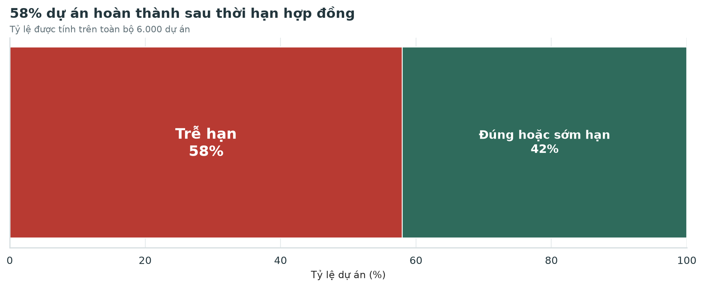
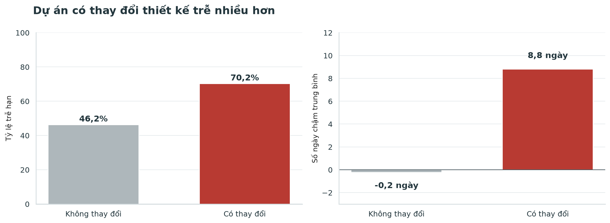
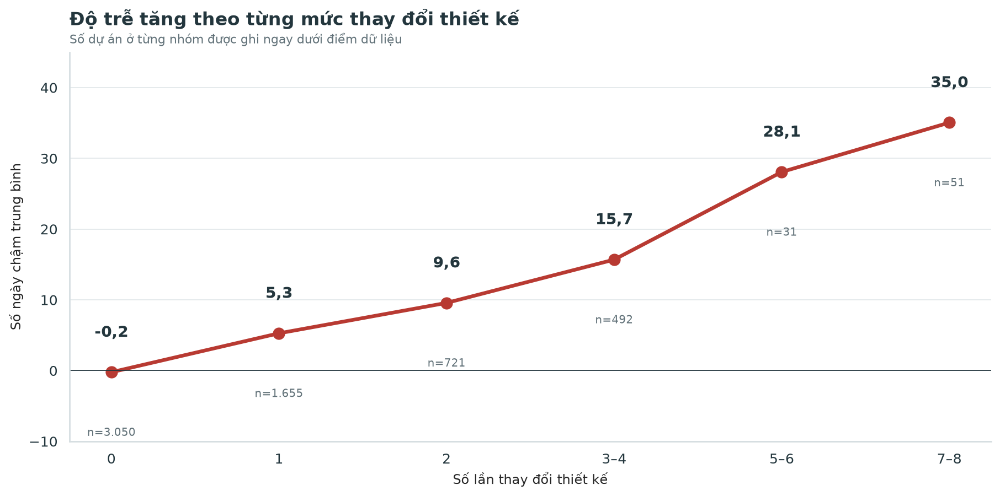
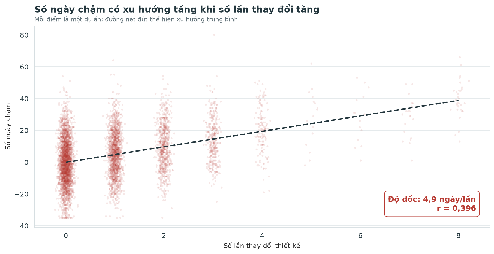
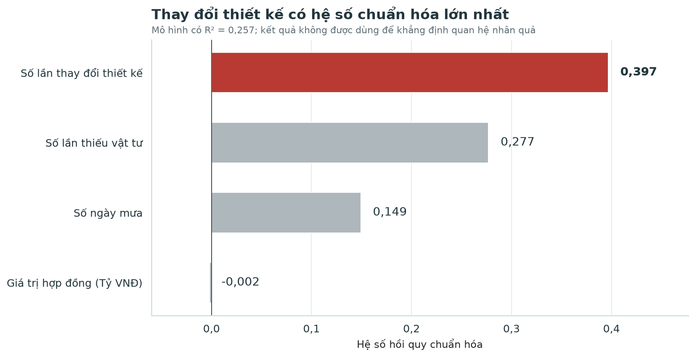
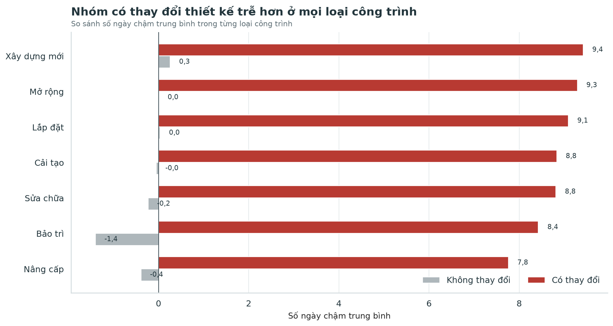
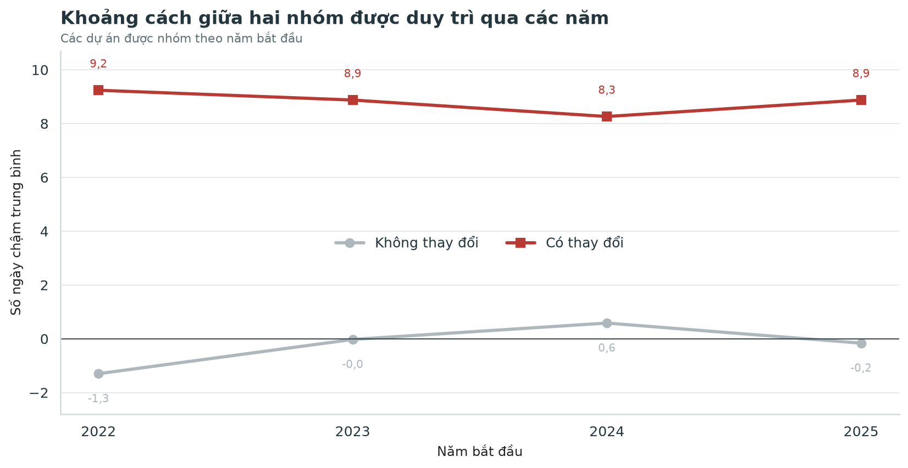
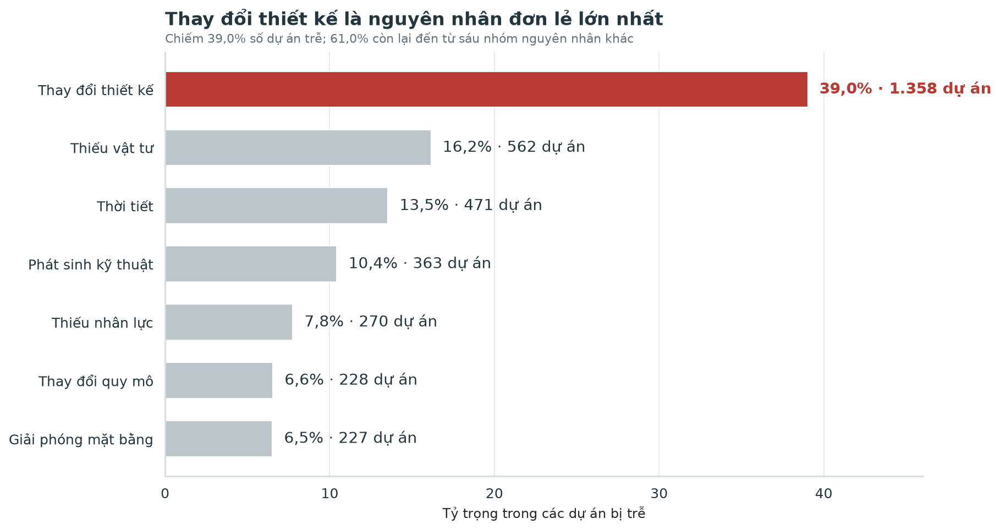
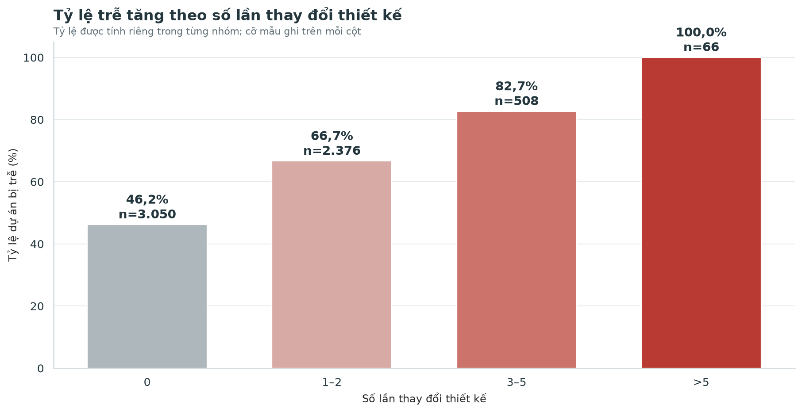
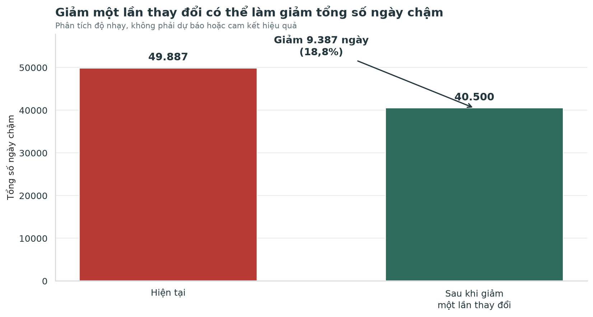

# QUẢN LÝ THAY ĐỔI THIẾT KẾ ĐỂ HẠN CHẾ CHẬM TIẾN ĐỘ

## Báo cáo Phân tích và Câu chuyện Dữ liệu

**Môn học:** Data Storytelling  
**Chủ đề:** Tối ưu tiến độ dự án xây dựng  
**Quy mô dữ liệu:** 6.000 dự án  
**Phát hiện chính:** Thay đổi thiết kế là yếu tố có liên hệ mạnh nhất với số ngày chậm trong các biến được phân tích  

> **Đề xuất điều hành:** Thiết lập mốc chốt thiết kế, kiểm soát các yêu cầu thay đổi phát sinh sau mốc và đánh giá hiệu quả bằng một chương trình thí điểm có nhóm so sánh.

### Phạm vi sử dụng dữ liệu

Báo cáo sử dụng bộ dữ liệu tiến độ gồm 6.000 dự án và 15 trường thông tin được cung cấp trong phạm vi bài tập cuối kỳ. Nhóm kiểm tra tính đầy đủ, tính nhất quán của mã dự án, ngày kế hoạch, ngày hoàn thành và số ngày chậm trước khi phân tích. Mọi kết luận trong báo cáo được giới hạn trong phạm vi bộ dữ liệu này; quan hệ thống kê không được diễn giải thay cho quan hệ nhân quả.

## Mục lục theo cấu trúc chấm điểm

| Phần | Nội dung | Trọng số |
|---|---|---:|
| Phần 1 | Giới thiệu và Bối cảnh | 5 điểm |
| Phần 2 | Dữ liệu và Phân tích Insight | 15 điểm |
| Phần 3 | Xây dựng Cấu trúc Câu chuyện | 20 điểm |
| Phần 4 | Thiết kế Trực quan | 20 điểm |

Phần nội dung chính bám trực tiếp bốn nhóm tiêu chí trong hướng dẫn bài tập cuối kỳ. Phụ lục chỉ dùng để liệt kê hình ảnh, notebook và file dữ liệu tái lập; các lập luận chính không được đẩy xuống phụ lục.

## Tóm tắt điều hành

Trong 6.000 dự án, tỷ lệ trễ hạn là **58,0%**. Tuy nhiên, tỷ lệ chung chưa đủ để quyết định hành động. Khi tách theo trạng thái thiết kế, kết quả tiến độ của hai nhóm khác nhau rõ rệt: nhóm không thay đổi thiết kế có độ trễ trung bình **-0,2 ngày**, trong khi nhóm có thay đổi thiết kế chậm trung bình **8,8 ngày**. Tỷ lệ trễ của hai nhóm lần lượt là **46,2%** và **70,2%**.

Khác biệt không chỉ xuất hiện khi so sánh hai nhóm. Số ngày chậm còn tăng theo số lần thay đổi thiết kế. Đường xu hướng cho thấy mỗi lần thay đổi thêm đi cùng khoảng **4,9 ngày chậm**, với tương quan **r = 0,396**. Sau khi bổ sung các biến số ngày mưa, số lần thiếu vật tư và giá trị hợp đồng vào mô hình, thay đổi thiết kế vẫn có hệ số chuẩn hóa lớn nhất; mô hình đạt R² **0,257**.

Báo cáo đề xuất mốc chốt thiết kế theo từng cổng phê duyệt, tổ kiểm soát thay đổi và thời hạn xử lý 48 giờ. Trong kịch bản giảm tối đa một lần thay đổi ở mỗi dự án có thay đổi, tổng số ngày chậm dương có thể giảm từ **49.887** xuống **40.500**, tương đương **18,8%**. Đây là phân tích độ nhạy, không phải cam kết kết quả. Bước tiếp theo phù hợp là chương trình thí điểm có đối chứng và theo dõi KPI trước–sau.

## Tóm tắt dành cho người ra quyết định

Nếu người nghe chỉ có một phút, phần trình bày có thể bắt đầu từ sáu ý sau:

- Bộ dữ liệu gồm **6.000 dự án**, trong đó khoảng **58,0% dự án bị trễ**.
- Khoảng **49,2% dự án có ít nhất một lần thay đổi thiết kế**. Nhóm không thay đổi có độ lệch tiến độ trung bình **-0,2 ngày**, trong khi nhóm có thay đổi chậm trung bình **8,8 ngày**.
- Mỗi lần thay đổi thiết kế đi kèm mức tăng trung bình khoảng **4,9 ngày chậm** trong bộ dữ liệu này.
- Trong các dự án trễ, thay đổi thiết kế là nguyên nhân đơn lẻ lớn nhất với **39,0%**, không phải nguyên nhân của toàn bộ trường hợp.
- Đề xuất trước mắt là thử nghiệm **mốc chốt thiết kế**, đi cùng tổ kiểm soát thay đổi và thời hạn phản hồi thay đổi trong **48 giờ**.
- Theo trường hợp giả định giảm được một lần thay đổi, tổng số ngày chậm có thể giảm là **9.387 ngày**, tương đương **18,8%** tổng số ngày chậm hiện tại. Đây là kết quả của phép phân tích độ nhạy, không phải cam kết hiệu quả.

Người cần ra quyết định chính là **Trưởng Ban Quản lý dự án**. Ban điều hành và bộ phận Kế hoạch là nhóm theo dõi, phản biện và cung cấp nguồn lực cho chương trình thí điểm.

Thông điệp một câu: **Cần chặn thay đổi thiết kế muộn ở điểm kiểm soát trước thi công, thay vì chỉ xử lý độ trễ sau khi lịch đã trượt.**

# PHẦN 1 — GIỚI THIỆU VÀ BỐI CẢNH

Phần này xác định vấn đề kinh doanh, giới thiệu bộ dữ liệu và phạm vi, chỉ rõ người ra quyết định chính và chốt mục tiêu phân tích. Điểm kết thúc của Phần 1 là một câu hỏi quản trị cụ thể: doanh nghiệp nên can thiệp vào đâu để giảm độ trễ mà không dàn trải nguồn lực?

## Vấn đề kinh doanh và tính cấp thiết

Tiến độ là một trong ba ràng buộc cốt lõi của quản lý dự án cùng với phạm vi và chi phí. Khi tiến độ trượt, doanh nghiệp không chỉ chịu thêm ngày công hoặc chi phí thiết bị. Hệ quả còn lan sang kế hoạch nghiệm thu, dòng tiền, uy tín với khách hàng và khả năng tiếp nhận dự án tiếp theo. Vì vậy, câu hỏi kinh doanh không nên dừng ở “có bao nhiêu dự án trễ”, mà phải chuyển thành “điểm can thiệp nào có thể giảm độ trễ một cách có hệ thống”.

Trong thực tế, các cuộc họp tiến độ thường phân tán sự chú ý vào nhiều yếu tố: mưa, thiếu vật tư, năng lực nhà thầu phụ, thay đổi quy mô, giải phóng mặt bằng hoặc lỗi kỹ thuật. Nếu không có cấu trúc phân tích, tổ chức dễ chọn nguyên nhân phù hợp với trực giác sẵn có. Điều đó dẫn đến giải pháp dàn trải: tăng nhân lực ở mọi nơi, yêu cầu nhà thầu làm thêm giờ hoặc bổ sung dự phòng mà không xử lý nguồn phát sinh chính.

Báo cáo tập trung vào thay đổi thiết kế vì kết quả so sánh hai nhóm, phân tích theo số lần thay đổi, hồi quy nhiều biến và kiểm tra theo loại công trình đều cho cùng một hướng. Trình tự trình bày dẫn từ quy mô vấn đề đến đề xuất quản lý.

## Dữ liệu và nguồn dữ liệu

Bộ dữ liệu gồm 6.000 dự án và 15 trường thông tin, bao quát định danh dự án, khách hàng, giá trị hợp đồng, ba mốc thời gian, số ngày chậm, loại công trình, số lần thay đổi thiết kế, số ngày mưa, thầu phụ, số lần thiếu vật tư, nguyên nhân chậm và địa điểm. Đơn vị phân tích là một dự án; biến kết quả chính là số ngày chậm, với giá trị dương là trễ và giá trị không dương là đúng hoặc sớm hạn.

Biến trung tâm là số lần thay đổi thiết kế. Báo cáo tạo thêm các biến dẫn xuất: trạng thái tiến độ, có/không thay đổi thiết kế, năm bắt đầu và nhóm số lần thay đổi. Việc nhóm số lần thay đổi thành 0, 1, 2, 3–4, 5–6 và 7–8 được xác định trước khi trực quan hóa. Cách làm này giảm nhiễu ở các mức có ít quan sát và hạn chế việc chọn điểm thuận lợi sau khi nhìn dữ liệu.

Phạm vi dữ liệu phù hợp với vấn đề tối ưu tiến độ và yêu cầu của bài tập cuối kỳ. Tuy nhiên, dữ liệu không chứa chi phí phát sinh thực tế, mức độ phức tạp bản vẽ, ngày phê duyệt yêu cầu thay đổi hay trạng thái dự án bị hủy. Vì vậy, báo cáo không quy đổi ngày chậm thành tiền và không tuyên bố bao phủ toàn bộ rủi ro vận hành.

## Đối tượng mục tiêu

Đối tượng chính của câu chuyện là Ban Giám đốc, Ban Quản lý dự án và Phòng Kế hoạch. Mỗi nhóm sử dụng kết quả phân tích cho một mục đích khác nhau. Ban Giám đốc quan tâm tới rủi ro bàn giao, uy tín và khả năng chuyển kết quả phân tích thành biện pháp quản lý. Ban Quản lý dự án cần biết chỉ báo cảnh báo nào có thể theo dõi hằng tuần và cơ chế xử lý nào nằm trong quyền kiểm soát. Phòng Kế hoạch cần hiểu khi nào phải cập nhật tiến độ cơ sở, phân bổ nguồn lực hoặc điều chỉnh chuỗi cung ứng.

Do đó, báo cáo tránh kể câu chuyện thuần kỹ thuật. Mỗi biểu đồ trả lời một câu hỏi quyết định: quy mô vấn đề là gì; trạng thái nào tạo khác biệt lớn; mức độ rủi ro tăng ra sao; kết quả có còn nhất quán khi bổ sung các biến khác hay không; và hành động nào có thể đo lường. Các hệ số thống kê được dịch sang ngôn ngữ vận hành như “ngày chậm trên mỗi lần thay đổi” thay vì chỉ nêu tương quan.

Câu hỏi nghiên cứu gồm: tỷ lệ trễ hiện tại; khác biệt giữa nhóm có và không thay đổi; xu hướng theo số lần thay đổi; tính nhất quán sau khi xét số ngày mưa, số lần thiếu vật tư, giá trị hợp đồng và loại công trình; tác động tiềm năng khi giảm lần thay đổi. Cấu trúc này bảo đảm người đọc không bị dẫn thẳng đến kết luận mà không có bối cảnh và kiểm chứng.

## Mục tiêu phân tích và câu hỏi nghiên cứu

Mục tiêu của phân tích là xác định một chỉ báo có thể theo dõi sớm và chuyển thành hành động quản trị cụ thể nhằm giảm độ trễ dự án. Nhóm không đặt mục tiêu giải thích toàn bộ nguyên nhân chậm tiến độ hoặc xây dựng mô hình dự báo hoàn chỉnh. Phạm vi được giữ ở câu hỏi: thay đổi thiết kế liên hệ thế nào với số ngày chậm và cơ chế nào có thể giảm rủi ro phát sinh sau mốc chốt thiết kế?

Năm câu hỏi nghiên cứu được sử dụng xuyên suốt báo cáo:

1. Tỷ lệ dự án trễ và tổng quy mô ngày chậm hiện tại là bao nhiêu?
2. Kết quả tiến độ khác nhau thế nào giữa dự án có và không thay đổi thiết kế?
3. Khi số lần thay đổi tăng, độ trễ có tăng theo một trình tự rõ ràng hay không?
4. Mối liên hệ này có còn xuất hiện khi xét thêm số ngày mưa, số lần thiếu vật tư, giá trị hợp đồng, loại công trình và năm bắt đầu?
5. Nếu giảm được một lần thay đổi, quy mô tác động tiềm năng và hệ KPI cần theo dõi là gì?

Đầu ra mong muốn không chỉ là một kết quả thống kê. Phân tích phải dẫn đến một đề xuất có người chịu trách nhiệm, thời hạn xử lý, phạm vi chương trình thí điểm và tiêu chí đánh giá. Đây là cơ sở để lựa chọn mốc chốt thiết kế, tổ kiểm soát thay đổi và thời hạn xử lý 48 giờ làm trọng tâm của phần giải pháp.

## Thông điệp trung tâm và người ra quyết định

**Nếu doanh nghiệp tiếp tục cho phép thay đổi thiết kế sau mốc chốt mà không có cơ chế kiểm soát, lịch bàn giao sẽ tiếp tục tích lũy độ trễ; vì vậy Trưởng Ban Quản lý dự án nên phê duyệt một chương trình thí điểm áp dụng mốc chốt thiết kế, kèm tổ kiểm soát thay đổi và thời hạn xử lý 48 giờ trước khi áp dụng rộng.**

Đây là thông điệp trung tâm của báo cáo. Câu này nêu rõ vấn đề, hệ quả và quyết định mà nhóm đề xuất. Toàn bộ phần phân tích phía sau chỉ giữ lại những bằng chứng giúp kiểm tra hoặc làm rõ câu này.

### Nhóm người đọc

- **Người ra quyết định chính:** Trưởng Ban Quản lý dự án, người có quyền duyệt chương trình thí điểm và chỉ định đầu mối kiểm soát thay đổi.
- **Nhóm sử dụng kết quả:** Ban điều hành và bộ phận Kế hoạch, quan tâm đến rủi ro bàn giao, nguồn lực và cách đo hiệu quả.
- **Nhóm trực tiếp thực hiện:** quản lý dự án, kỹ sư kế hoạch và nhóm thiết kế, là những người trực tiếp tạo, xem xét hoặc tiếp nhận yêu cầu thay đổi.

Báo cáo tập trung vào mục tiêu **giải thích** trong quá trình khám phá và trình bày dữ liệu: có một kết luận trung tâm, phạm vi hữu hạn, trình tự tuyến tính và dữ liệu đã được chọn lọc. Các bảng kiểm tra chi tiết vẫn được giữ ở lớp phụ lục để phục vụ người đọc muốn đi sâu.

# PHẦN 2 — DỮ LIỆU VÀ PHÂN TÍCH INSIGHT

Phần 2 trình bày nền tảng dữ liệu, quy trình làm sạch và khám phá, khung 4D, cách kiểm soát sai lệch nhận thức và ngụy biện, cùng các kết quả làm cơ sở cho phát hiện chính. Trọng tâm là kiểm tra mối liên hệ giữa thay đổi thiết kế và tiến độ sau khi đã xem xét thêm thời tiết, vật tư, giá trị hợp đồng, loại công trình và thời gian.

## Khung 4D giữ phân tích tập trung

Khung 4D gồm Problem, Outcome, Action và Measure. **Problem** được định nghĩa là độ trễ dự án và sự thiếu rõ ràng về tác nhân có thể can thiệp. **Outcome** là giảm tổng số ngày chậm và tăng tỷ lệ đúng hạn, không phải chỉ tạo ra biểu đồ đẹp. **Action** là mốc chốt thiết kế, kiểm soát yêu cầu thay đổi và cơ chế phản hồi nhanh. **Measure** là hệ KPI liên kết biến dẫn dắt với kết quả cuối.

Điểm mạnh của 4D là ngăn nhóm phân tích mở rộng phân tích khám phá vượt quá câu hỏi nghiên cứu. Một biến chỉ được đưa vào câu chuyện nếu giúp mô tả vấn đề, kiểm tra kết quả, định hình hành động hoặc đo hiệu quả. Ví dụ, số ngày mưa và số lần thiếu vật tư không phải biến trọng tâm, nhưng cần xuất hiện ở phần kiểm soát yếu tố nhiễu. Giá trị hợp đồng được dùng để kiểm tra quy mô, không được dùng để suy diễn tác động tài chính khi chưa có chi phí chậm tiến độ.

Khung 4D cũng giúp bảo đảm sự thống nhất giữa kết quả và giải pháp. Nếu kết quả chính liên quan đến số lần thay đổi, hành động phải tác động trực tiếp vào vòng đời thay đổi thiết kế; KPI phải đo được số lần thay đổi và thời điểm phát sinh. Một khuyến nghị chung chung như “tăng cường quản lý” sẽ không đạt yêu cầu vì không chỉ rõ ai làm gì, vào thời điểm nào và biết hiệu quả bằng chỉ số nào.

## Quy trình xử lý và kiểm soát chất lượng

Quy trình xử lý được xây dựng thành các hàm có thể tái sử dụng trong notebook. Bước đầu tiên là tìm đúng file dữ liệu từ nhiều vị trí chạy khác nhau. Tiếp theo, ba cột ngày được chuẩn hóa về cùng kiểu ngày tháng; các cột số được ép kiểu; giá trị hợp đồng được quy đổi về tỷ VNĐ; và các biến phân tích được tạo theo cùng một quy tắc.

Kiểm soát chất lượng gồm năm điều kiện: đúng 6.000 dòng, STT không trùng, không thiếu ở trường trọng yếu, số lần thay đổi không âm, và chênh lệch giữa ngày hoàn thành thực tế với ngày kế hoạch phải khớp số ngày chậm. Các điều kiện này được kiểm tra tự động trong notebook thay vì chỉ quan sát bằng mắt.

Một điểm quan trọng là không sửa dữ liệu để làm đẹp biểu đồ trong giai đoạn phân tích. Tất cả biểu đồ đọc cùng một file nguồn và dùng chung hàm chuẩn hóa. Điều này đảm bảo con số 58% ở biểu đồ bối cảnh, 70,2% ở nhóm có thay đổi và hệ số trong mô hình đều xuất phát từ cùng một định nghĩa. Tính nhất quán giữa biểu đồ là một phần của độ tin cậy, không chỉ là vấn đề thẩm mỹ.

## Nền tảng tin cậy và giới hạn suy luận

Độ tin cậy được đánh giá trên hai lớp. Lớp thứ nhất là tính nhất quán nội bộ: mã dự án không trùng, kiểu dữ liệu đúng, quan hệ ngày tháng khớp và công thức phân nhóm rõ ràng. Lớp thứ hai là tính phù hợp với câu hỏi: dữ liệu có biến kết quả, biến thay đổi thiết kế và các biến vận hành khác cần thiết để xây dựng một câu chuyện phân tích.

Tuy vậy, độ tin cậy trong bộ dữ liệu không đồng nghĩa với khả năng áp dụng rộng. Cường độ của các mối liên hệ được đánh giá bằng tương quan, hồi quy chuẩn hóa và kiểm tra theo loại công trình. Báo cáo vì vậy giới hạn kết luận trong phạm vi quan sát và dùng chương trình thí điểm có đối chứng làm bước kiểm tra trước khi mở rộng chính sách.

Giới hạn quan trọng nhất là không thể khẳng định quan hệ nhân quả chỉ từ tương quan. Một yếu tố ẩn như độ phức tạp kỹ thuật có thể đồng thời làm tăng số lần thay đổi và số ngày chậm. Vì vậy, kết luận đúng là: trong bộ dữ liệu, thay đổi thiết kế là biến có liên hệ mạnh nhất trong số các biến được phân tích; để xác nhận tác động trong doanh nghiệp, cần chương trình thí điểm có đối chứng hoặc thiết kế trước–sau đáng tin cậy.

## Sơ đồ nội dung trình bày

Nhóm xác định kết luận cần truyền đạt trước, sau đó lựa chọn các bước dẫn dắt đến kết luận này. Nhờ đó, mỗi biểu đồ đều phục vụ một câu hỏi cụ thể thay vì trình bày toàn bộ kết quả phân tích.

| Cảnh | Hình chính | Câu hỏi mà cảnh trả lời |
|---|---|---|
| Bối cảnh | Thanh tỷ lệ 100% | Vấn đề trễ tiến độ có đủ lớn để cần hành động không? |
| Điểm mở đầu | Hai biểu đồ cột | Kết quả tiến độ khác nhau thế nào giữa nhóm có và không thay đổi thiết kế? |
| Bằng chứng 1 | Biểu đồ đường theo mức thay đổi | Khi số lần thay đổi tăng, độ trễ có tăng theo không? |
| Bằng chứng 2 | Biểu đồ thanh hệ số, cột theo loại công trình và đường theo năm | Kết quả có còn nhất quán khi xét các yếu tố khác, loại công trình và thời gian không? |
| Kết luận chính | Biểu đồ phân tán và đường xu hướng | Mức liên hệ trung bình giữa số lần thay đổi và số ngày chậm là bao nhiêu? |
| Giải pháp | Biểu đồ cột trước–sau | Nếu giảm được một lần thay đổi, quy mô tác động tiềm năng là bao nhiêu? |

Mỗi bước chỉ truyền đạt một ý chính. Biểu đồ theo loại công trình, theo năm và theo nguyên nhân được dùng để kiểm tra tính nhất quán; chúng không làm thay đổi hướng lập luận. Khi cần rút ngắn thời gian, người trình bày vẫn có thể giữ trình tự Bối cảnh → Điểm mở đầu → Bằng chứng → Kết luận → Hành động.

# PHẦN 3 — XÂY DỰNG CẤU TRÚC CÂU CHUYỆN

Phần này trình bày lần lượt bối cảnh, khác biệt giữa hai nhóm, các bằng chứng kiểm tra, kết luận chính và đề xuất triển khai. Mỗi bước sử dụng một biểu đồ dễ đọc và trả lời một câu hỏi cụ thể.

## Context: quy mô vấn đề tiến độ

Biểu đồ bức tranh tổng thể cho thấy **58,0%** dự án bị trễ. Con số này cho thấy quy mô vấn đề nhưng chưa đủ để xác định hành động, vì tỷ lệ trễ có thể là kết quả cộng dồn của nhiều cơ chế khác nhau. Biểu đồ mở đầu chỉ dùng để xác định quy mô chậm tiến độ; kết luận chính được kiểm tra ở các phần sau.

Biểu đồ thanh ngang chia tổng thể thành hai phần: dự án trễ hạn và dự án đúng hoặc sớm hạn. Trục từ 0% đến 100% giúp người đọc nhận biết ngay tỷ lệ của từng nhóm. Màu xanh được dùng cho đúng/sớm hạn, màu đỏ cho trễ hạn. Đây là mã màu cố định trong toàn bộ báo cáo: đỏ luôn gắn với rủi ro thiết kế hoặc độ trễ; xám là nhóm nền; xanh là trạng thái tích cực hoặc giải pháp.

Từ kết quả tổng thể, phân tích chuyển sang câu hỏi tiếp theo: nếu phần lớn dự án đều trễ, có trạng thái vận hành nào tách rõ nhóm rủi ro khỏi nhóm còn lại hay không? Câu trả lời được xây dựng bằng so sánh có/không thay đổi thiết kế ở trang tiếp theo.

## Hook: khác biệt giữa dự án có và không thay đổi thiết kế

Trong nhóm không thay đổi thiết kế, tỷ lệ trễ là **46,2%** và số ngày chậm trung bình là **-0,2**. Trong nhóm có ít nhất một thay đổi, tỷ lệ trễ tăng lên **70,2%**, còn độ trễ trung bình đạt **8,8 ngày**. Hai biểu đồ cột đặt cạnh nhau trình bày tỷ lệ trễ và số ngày chậm trung bình. Cùng một thứ tự nhóm được giữ ở cả hai hình để người đọc đối chiếu trực tiếp.

So sánh hai nhóm giúp thể hiện khác biệt một cách trực tiếp: “không sửa” và “có sửa” không chỉ khác nhau vài điểm phần trăm; kết quả tiến độ của hai nhóm khác nhau đáng kể. Màu xám giữ nhóm nền ở vai trò tham chiếu, trong khi màu đỏ tập trung sự chú ý vào nhóm thiết kế.

Tuy nhiên, kết quả so sánh hai nhóm vẫn cần được kiểm tra thêm. Có thể các dự án phức tạp vừa cần sửa thiết kế vừa thường bị trễ. Do đó, điểm mở đầu không được coi là bằng chứng cuối. Kết quả này là cơ sở để tiếp tục kiểm tra xu hướng theo số lần thay đổi, các biến khác và tính nhất quán theo loại công trình.

## Rising Insights: độ trễ tăng theo mức thay đổi thiết kế

Bước tiếp theo là kiểm tra số ngày chậm theo từng mức thay đổi thiết kế. Nếu số lần thay đổi thiết kế không liên hệ với tiến độ, độ trễ không nhất thiết tăng có trật tự theo số lần thay đổi. Trong dữ liệu, các nhóm 0, 1, 2, 3–4, 5–6 và 7–8 lần tạo thành một thang tăng rõ ràng.

Việc gộp các mức cao phục vụ hai mục tiêu. Thứ nhất, các mức 7–8 lần có cỡ mẫu rất nhỏ; hiển thị từng cột dễ khiến người đọc đánh giá quá mức dao động ngẫu nhiên. Thứ hai, nhóm hóa làm biểu đồ gọn và phù hợp với câu hỏi quyết định: số ngày chậm thay đổi ra sao khi dự án chuyển từ ít sang nhiều lần thay đổi.

Kết quả này có ý nghĩa quản lý: số lần thay đổi có thể được theo dõi sớm hơn ngày hoàn thành. Vì vậy, số lần thay đổi có thể được sử dụng như một chỉ báo cảnh báo sớm. Một dự án bước sang lần thay đổi thứ ba không nên chỉ cập nhật hồ sơ; nó cần kích hoạt một cơ chế quản trị mạnh hơn như rà soát tác động, cập nhật tiến độ cơ sở và phê duyệt cấp cao.

## Aha Moment: mỗi lần thay đổi đi kèm trung bình 4,9 ngày chậm

Biểu đồ phân tán cho thấy kết quả chính: **mỗi lần thay đổi thêm đi cùng khoảng 4,9 ngày chậm**. Tương quan giữa số lần thay đổi và số ngày chậm là **0,396**, thể hiện mối liên hệ dương ở mức vừa trong bộ dữ liệu. Mỗi điểm đại diện cho một dự án. Độ trong suốt của điểm giúp người đọc nhận biết vùng có nhiều quan sát.

Tiêu đề được viết thành một câu kết luận thay vì tên biến. Đường xu hướng nét đứt đóng vai trò hướng dẫn mắt, không thay thế dữ liệu điểm. Trục y giữ mốc 0 để phân biệt hoàn thành sớm với trễ hạn. Chú thích được đặt trực tiếp trong vùng trống của biểu đồ nhằm giảm nhu cầu dò chú giải.

Khi thuyết trình, người trình bày nên dừng tại biểu đồ này và diễn đạt một câu ngắn: “Trong bộ dữ liệu, số ngày chậm có xu hướng tăng cùng số lần thay đổi thiết kế.” Sau đó, người trình bày nêu mức tăng trung bình 4,9 ngày cho mỗi lần thay đổi. Trình tự này giúp người nghe quan sát xu hướng trước khi tiếp nhận hệ số thống kê.

## Kiểm soát yếu tố nhiễu

Để kiểm tra các cách giải thích khác, nhóm xây dựng mô hình hồi quy chuẩn hóa gồm số lần thay đổi thiết kế, số ngày mưa, số lần thiếu vật tư và giá trị hợp đồng. Chuẩn hóa cho phép so sánh độ mạnh tương đối giữa các biến có đơn vị khác nhau.

Kết quả cho thấy hệ số của thay đổi thiết kế cao nhất, nhưng số lần thiếu vật tư và số ngày mưa cũng có hệ số dương, trong khi R² của mô hình là **0,257**. Điều này cho thấy mối liên hệ với thay đổi thiết kế vẫn còn khi đưa ba biến giải thích khác vào cùng một mô hình mô tả. Hệ số của giá trị hợp đồng gần 0; số ngày mưa và số lần thiếu vật tư có hướng dương nhưng nhỏ hơn nhiều.

Phần này phải được diễn giải thận trọng. Hệ số chuẩn hóa không chứng minh nhân quả và không bao gồm tất cả biến ẩn. Mô hình cũng phản ánh cấu trúc quan sát của dữ liệu. Giá trị của phân tích nằm ở việc cho thấy nhóm đã nhận diện ngụy biện đồng nhất tương quan với quan hệ nhân quả và không chỉ dựa vào một biểu đồ phân tán. Trong giai đoạn triển khai, mô hình cần bổ sung độ phức tạp, thời điểm phát sinh yêu cầu thay đổi, năng lực nhà thầu và đặc điểm riêng của từng khách hàng.

## Kiểm tra tính nhất quán theo loại công trình

Một kết quả tổng thể có thể bị chi phối bởi một loại công trình chiếm tỷ trọng lớn. Vì vậy, báo cáo so sánh số ngày chậm trung bình giữa nhóm có và không thay đổi thiết kế trong từng loại công trình. Nhóm có thay đổi thiết kế đều chậm hơn ở các nhóm bảo trì, cải tạo, lắp đặt, mở rộng, nâng cấp, sửa chữa và xây dựng mới.

Kết quả theo loại công trình giúp kiểm tra tính nhất quán: khác biệt giữa hai nhóm không chỉ xuất hiện ở một loại công trình. Biểu đồ cột ngang theo nhóm đặt hai trạng thái thiết kế cạnh nhau trong từng loại công trình. Cách trình bày này cho phép so sánh trực tiếp mà không cần giải thích thang màu. Màu xám thể hiện nhóm không thay đổi; màu đỏ thể hiện nhóm có thay đổi thiết kế.

Tuy nhiên, tính nhất quán trong bộ dữ liệu vẫn không thay thế kiểm chứng thực tế. Trong chương trình thí điểm, nên phân tầng dự án theo loại công trình và quy mô trước khi so sánh. Nếu mốc chốt thiết kế chỉ hiệu quả ở dự án xây dựng mới nhưng không phù hợp với bảo trì khẩn cấp, chính sách cần có ngoại lệ rõ ràng thay vì áp dụng đồng loạt.

## Kiểm tra theo thời gian và cơ cấu nguyên nhân

Hai kiểm tra bổ sung được dùng để tránh kết luận dựa vào một lát cắt thuận lợi. Thứ nhất, độ trễ trung bình được quan sát theo nhóm dự án theo năm bắt đầu. Mục tiêu không phải tìm xu hướng thời gian, mà xác nhận kết quả không bị chi phối bởi một năm bất thường. Thứ hai, cơ cấu nhãn nguyên nhân được kiểm tra để đảm bảo nhất quán với logic dữ liệu.

Hai đường theo năm cho thấy khoảng cách giữa nhóm có và không thay đổi thiết kế xuất hiện ở các năm bắt đầu khác nhau. Điều này hỗ trợ tính nhất quán, nhưng không được dùng để dự báo tương lai do khoảng thời gian quan sát còn ngắn. Biểu đồ nguyên nhân cho thấy “Thay đổi thiết kế” là nhóm nguyên nhân đơn lẻ lớn nhất với 39,0%; các nguyên nhân khác cộng lại chiếm 61,0%.

Nhãn nguyên nhân phản ánh nguyên nhân được ghi nhận trong hồ sơ dự án. Do một dự án có thể chịu nhiều tác động đồng thời, biểu đồ này chỉ dùng để mô tả cơ cấu nguyên nhân, không được sử dụng riêng lẻ để kết luận quan hệ nhân quả.

## Tỷ lệ trễ theo mức thay đổi thiết kế

Để bổ sung cho số ngày chậm trung bình, báo cáo tính tỷ lệ dự án bị trễ trong bốn nhóm số lần thay đổi: 0, 1–2, 3–5 và trên 5. Tỷ lệ trễ tăng dần theo số lần thay đổi thiết kế.

Mỗi cột thể hiện tỷ lệ dự án bị trễ trong một nhóm số lần thay đổi; cỡ mẫu được ghi ngay trên cột để tránh đánh giá quá cao các nhóm có ít dự án. Cỡ mẫu được ghi trực tiếp trên mỗi cột, đặc biệt để người đọc thận trọng với nhóm có ít dự án.

Kết quả cho thấy số lần thay đổi có thể được dùng để phân nhóm theo dõi. Dự án có nhiều lần thay đổi cần được rà soát sớm hơn và trình cấp có thẩm quyền khi vượt ngưỡng đã quy định.

## Solution & Next Steps: mốc chốt thiết kế và các bước triển khai

Mốc chốt thiết kế là thời điểm mà phạm vi và bản vẽ đủ ổn định để chuyển sang mua sắm hoặc thi công. Sau mốc này, mọi thay đổi phải đi qua tổ kiểm soát thay đổi. Mục tiêu không phải cấm thay đổi tuyệt đối; trong xây dựng, thay đổi có thể cần thiết vì an toàn, pháp lý hoặc điều kiện hiện trường. Mục tiêu là làm cho chi phí và tác động thời gian của thay đổi trở nên hữu hình trước khi phê duyệt.

Quy trình đề xuất gồm năm bước: ghi nhận yêu cầu; phân loại bắt buộc hay tùy chọn; đánh giá tác động trong 48 giờ; phê duyệt đúng thẩm quyền; cập nhật tiến độ cơ sở và truyền thông tới các bên liên quan. Mỗi yêu cầu thay đổi cần có mã, người yêu cầu, lý do, hạng mục bị ảnh hưởng, số ngày dự kiến và quyết định cuối.

Ngưỡng trình cấp có thẩm quyền có thể dựa trên số lần thay đổi. Vòng đầu được xử lý ở cấp quản lý dự án; từ vòng ba cần rà soát liên phòng ban; các vòng cao hơn phải trình cấp điều hành hoặc tái phê duyệt phương án kinh doanh. Cách làm này dựa trực tiếp trên xu hướng tăng của số ngày chậm theo số lần thay đổi thay vì đưa ra một chính sách chung chung.

## Phân tích tác động kinh doanh

Phân tích độ nhạy xem xét trường hợp mỗi dự án có thay đổi thiết kế giảm tối đa một lần thay đổi. Số ngày có thể tránh được ước tính bằng độ dốc **4,9 ngày/vòng**, nhưng không cho phép số ngày chậm giảm dưới 0. Tổng số ngày chậm dương giảm từ **49.887** xuống **40.500**, tương đương **9.387 ngày** hoặc **18,8%**.

Phương án phân tích này có tác dụng chuyển kết quả phân tích thành quy mô tác động có thể theo dõi, nhưng không phải dự báo tài chính. Phép tính giữ quan hệ tuyến tính và các yếu tố khác không đổi. Phép tính này cũng chưa bao gồm chi phí triển khai tổ kiểm soát thay đổi hoặc trường hợp thay đổi thiết kế giúp tránh lỗi lớn hơn về sau. Vì vậy, con số 18,8% nên được trình bày là “tiềm năng trong bộ dữ liệu”, không phải cam kết tiết kiệm.

Để lượng hóa tài chính trong dự án thật, cần bổ sung chi phí ngày công, thiết bị, phạt hợp đồng, chi phí cơ hội và chi phí yêu cầu thay đổi. Khi đó, phương án kinh doanh phải so sánh giá trị ngày chậm tránh được với chi phí của quy trình kiểm soát mới.

## KPI và kế hoạch thí điểm

Chương trình thí điểm nên áp dụng cho một nhóm dự án mới và lựa chọn nhóm đối chứng tương đồng về loại công trình, giá trị hợp đồng, khu vực và thời gian bắt đầu. Trước khi triển khai, cần chốt định nghĩa KPI và kỳ đo để tránh thay đổi tiêu chí sau khi thấy kết quả. Thời gian theo dõi phải đủ dài để quan sát ít nhất một chu kỳ từ mốc chốt thiết kế đến nghiệm thu.

Nhóm KPI dẫn dắt gồm số lần thay đổi mỗi dự án, tỷ lệ yêu cầu thay đổi phát sinh sau mốc chốt thiết kế, thời gian đánh giá tác động và tỷ lệ phản hồi trong thời hạn xử lý 48 giờ. KPI kết quả gồm số ngày chậm, tỷ lệ đúng hạn và ngày chậm trên mỗi lần thay đổi. KPI cân bằng gồm số lỗi thiết kế phát hiện muộn và số thay đổi bắt buộc vì an toàn, nhằm tránh việc khóa thiết kế quá sớm chỉ để làm đẹp tiến độ.

Chương trình thí điểm được coi là tích cực khi số lần thay đổi sau mốc chốt thiết kế giảm, thời gian xử lý yêu cầu thay đổi ngắn hơn và tỷ lệ đúng hạn tăng so với tiến độ cơ sở lẫn nhóm đối chứng. Không nên tuyên bố thành công nếu chỉ một KPI thuận lợi. Kết quả cần được phân tích theo loại công trình để nhận diện nơi chính sách phù hợp hoặc cần ngoại lệ.

## Kiểm soát sai lệch nhận thức và ngụy biện

**Thiên lệch xác nhận (confirmation bias)** được giảm bằng cách bổ sung các biến số ngày mưa, số lần thiếu vật tư và giá trị hợp đồng vào mô hình, đồng thời kiểm tra theo loại công trình. **Ngụy biện đồng nhất tương quan với quan hệ nhân quả (correlation fallacy)** được xử lý bằng cách không diễn giải tương quan thành quan hệ nhân quả và yêu cầu chương trình thí điểm trước khi khẳng định nhân quả. **Ngụy biện chọn điểm thuận lợi (Texas sharpshooter)** được hạn chế bằng nhóm số lần thay đổi định nghĩa trước và hiển thị cỡ mẫu.

**Khái quát vội vàng (hasty generalization)** được kiểm soát qua việc nêu rõ phạm vi 6.000 dự án và không suy rộng sang toàn ngành. **Thiên lệch sống sót (survivorship bias)** vẫn có thể tồn tại nếu dữ liệu vận hành bỏ qua dự án bị hủy hoặc đang dở dang; đây là trường dữ liệu cần được bổ sung khi triển khai thực tế. **Lời nguyền kiến thức (curse of knowledge)** được giảm bằng tiêu đề biểu đồ dạng câu kết luận, chú thích trực tiếp và ngôn ngữ “ngày/lần thay đổi”.

Nguyên tắc bảo vệ khi Q&A là tách ba tầng phát biểu: dữ liệu cho thấy gì; nhóm suy luận điều gì; và doanh nghiệp cần kiểm chứng điều gì. Câu trả lời đáng tin cậy không phải câu trả lời tuyệt đối, mà là câu trả lời chỉ rõ bằng chứng, giới hạn và bước xác minh tiếp theo.

# PHẦN 4 — THIẾT KẾ TRỰC QUAN

Phần 4 đối chiếu trực tiếp các biểu đồ với hai nhóm nguyên tắc trong hướng dẫn: Setting the Scenes và Polishing the Scenes. Mỗi lựa chọn trực quan phải trả lời được ba câu hỏi: dữ liệu nào cần đưa lên, loại biểu đồ nào phù hợp và cách bố trí nào giúp người xem đọc đúng thông điệp.

## Setting the Scenes: trực quan hóa đúng dữ liệu

Chỉ số được lựa chọn theo câu hỏi quyết định, không theo mức độ sẵn có của cột dữ liệu. Ở phần Context, tỷ lệ dự án trễ được tính trên toàn bộ 6.000 dự án để xác định quy mô. Ở phần Hook, cùng một định nghĩa trễ hạn được dùng cho hai nhóm có và không thay đổi thiết kế. Việc giữ chung mẫu số giúp chênh lệch **46,2% so với 70,2%** có ý nghĩa so sánh.

Giá trị trung bình được đặt cạnh tỷ lệ trễ để tránh phụ thuộc vào một thước đo duy nhất. Số lần thay đổi được nhóm thành 0, 1–2, 3–5 và trên 5 khi tính tỷ lệ trễ. Mỗi cột ghi rõ cỡ mẫu n, giúp người đọc nhận biết các nhóm có ít dự án và diễn giải thận trọng hơn.

Phần tác động sử dụng tổng ngày chậm dương thay vì cộng cả ngày hoàn thành sớm và ngày trễ. Cách tính này phù hợp với câu hỏi “tổng số ngày chậm có thể giảm bao nhiêu”. Báo cáo không quy đổi ngày thành tiền vì bộ dữ liệu không có chi phí ngày công, thiết bị, phạt hợp đồng hoặc chi phí cơ hội. Đây là ranh giới cần giữ để không tạo ra một con số tài chính thiếu căn cứ.

## Choose the Right Visualizations: chọn biểu đồ theo mục đích

| Câu hỏi | Biểu đồ | Lý do lựa chọn |
|---|---|---|
| Quy mô trễ hạn là bao nhiêu? | Thanh tỷ lệ 100% | Cho biết trực tiếp tỷ lệ trễ và đúng hạn |
| Hai nhóm khác nhau thế nào? | Hai biểu đồ cột | So sánh tỷ lệ trễ và số ngày chậm trung bình bằng cùng thứ tự nhóm |
| Độ trễ thay đổi theo số lần thay đổi ra sao? | Biểu đồ đường | Thể hiện sự thay đổi theo các mức có thứ tự |
| Số lần thay đổi liên hệ thế nào với số ngày chậm? | Biểu đồ phân tán | Mỗi điểm là một dự án; đường xu hướng cho biết chiều liên hệ chung |
| Yếu tố nào có liên hệ mạnh hơn? | Thanh ngang hệ số chuẩn hóa | So sánh các hệ số trên cùng một trục |
| Kết quả có nhất quán theo loại công trình? | Cột ngang theo nhóm | Đặt hai trạng thái thiết kế cạnh nhau trong từng loại công trình |
| Nguyên nhân nào đứng đầu? | Thanh ngang xếp hạng | Sắp xếp tỷ trọng và giữ tên nguyên nhân dễ đọc |
| Tỷ lệ trễ thay đổi theo số lần thay đổi ra sao? | Biểu đồ cột | Hiển thị tỷ lệ và cỡ mẫu của từng nhóm |
| Quy mô tác động tiềm năng là bao nhiêu? | Hai cột trước–sau | So sánh trực tiếp tổng ngày chậm trước và sau phép tính độ nhạy |

Bộ biểu đồ có chủ ý thay đổi hình thức theo câu hỏi, nhưng vẫn dùng chung hệ màu và cách viết tiêu đề. Sự đa dạng này phục vụ chức năng đọc dữ liệu, không nhằm trang trí.

## Calibrate the Visuals to Your Message: hiệu chỉnh theo thông điệp

Các yếu tố cần so sánh được đặt gần nhau. Hai cột có và không thay đổi thiết kế luôn xuất hiện theo cùng thứ tự. Biểu đồ theo loại công trình đặt hai trạng thái cạnh nhau trong từng hàng; biểu đồ theo năm đặt hai đường trên cùng hệ trục. Cách bố trí này giảm số bước đối chiếu mà người đọc phải thực hiện.

Đường cơ sở 0 được giữ ở các biểu đồ cột, hệ số và số ngày chậm. Với biểu đồ đường theo mức thay đổi, vùng dưới 0 được tô nhẹ để phân biệt dự án hoàn thành sớm; vùng trên 0 thể hiện số ngày trễ. Không biểu đồ nào cắt trục theo cách làm phóng đại chênh lệch.

Màu đỏ được dành cho thay đổi thiết kế hoặc rủi ro cần chú ý. Xám là nhóm tham chiếu; xanh là trạng thái đúng hoặc sớm hạn và kết quả sau cải thiện. Quy tắc màu không thay đổi giữa các trang. Tiêu đề biểu đồ được viết thành kết luận, phụ đề nói rõ mẫu số hoặc giới hạn, nhãn số được đặt ngay gần điểm cần đọc. Nhờ vậy, người xem không phải dựa vào chú giải dài hoặc tự suy ra thông điệp từ tên biến.

## Polishing the Scenes: loại bỏ nhiễu và tập trung chú ý

Các biểu đồ không sử dụng 3D, bóng đổ, nền trang trí, màu cầu vồng hoặc đường lưới đậm. Khung trên và phải được bỏ khi không mang thông tin. Nhãn lặp lại được giảm, nhưng những con số cần cho quyết định như tỷ lệ, độ dốc, cỡ mẫu và quy mô tác động vẫn được giữ. Đây là cách loại bỏ nhiễu mà không làm mất khả năng kiểm tra con số.

Sự chú ý được điều khiển bằng tương phản có giới hạn. Chỉ biến thay đổi thiết kế dùng đỏ đậm; các yếu tố còn lại dùng xám. Ở biểu đồ nguyên nhân, thanh thay đổi thiết kế được nhấn nhưng sáu nguyên nhân khác vẫn hiển thị đầy đủ. Biểu đồ hệ số vẫn giữ biến thiếu vật tư và số ngày mưa để thể hiện đây là bài toán đa yếu tố.

Ngôn ngữ trên biểu đồ ưu tiên cách nói quen thuộc với quản lý dự án: “ngày chậm”, “lần thay đổi”, “tỷ lệ trễ”, “tổng số ngày chậm có thể giảm”. Thuật ngữ thống kê như R² hoặc hệ số chuẩn hóa chỉ xuất hiện ở nơi cần kiểm tra tính nhất quán và luôn có câu diễn giải đi kèm. Cách làm này hỗ trợ người nghe có mức độ hiểu dữ liệu khác nhau mà không làm đơn giản hóa quá mức.

## Instill Trust in Your Numbers: xây dựng sự tin cậy

Mỗi hình đều ghi nguồn thống nhất: bộ dữ liệu tiến độ 6.000 dự án và phần tính toán của nhóm. Các tỷ lệ dùng mẫu số rõ ràng; các nhóm ít quan sát có nhãn cỡ mẫu; các phép tính trước–sau nêu công thức và không được trình bày như cam kết. Notebook đi kèm tạo lại toàn bộ hình từ cùng một file dữ liệu, nhờ đó số liệu trong báo cáo, biểu đồ và bảng tổng hợp không bị lệch nhau.

Báo cáo trình bày cả những kết quả cho thấy mô hình còn giới hạn. Tương quan **r = 0,396** chỉ ở mức vừa; R² **0,257** cho thấy mô hình chưa giải thích toàn bộ biến động tiến độ. Thiếu vật tư và thời tiết có ảnh hưởng đáng kể. Các kết quả này được giữ lại để người đọc đánh giá đúng mức độ giải thích của mô hình.

Cuối cùng, báo cáo tách rõ quan sát, diễn giải và hành động. Quan sát là sự khác biệt giữa các nhóm và độ dốc trong mẫu. Diễn giải là thay đổi thiết kế có thể dùng như chỉ báo quản trị sớm. Hành động là chương trình thí điểm áp dụng mốc chốt thiết kế, với KPI dẫn dắt, KPI kết quả và KPI cân bằng. Cấu trúc này giúp người đọc hiểu con số hỗ trợ quyết định đến đâu và phần nào vẫn cần được kiểm chứng trong quá trình triển khai.

## Nguyên tắc thiết kế trực quan

Tất cả biểu đồ sử dụng cùng một hệ màu: đỏ cho thay đổi thiết kế và rủi ro, xám cho nhóm tham chiếu, xanh cho trạng thái đúng hoặc sớm hạn và kết quả sau cải thiện. Trục so sánh bắt đầu từ 0 ở biểu đồ cột. Tiêu đề được viết thành thông điệp, phụ đề nêu mẫu số hoặc giới hạn. Chú giải được giảm tối đa bằng nhãn trực tiếp.

Mỗi hình trả lời một câu hỏi cụ thể bằng các dạng biểu đồ quen thuộc. Biểu đồ thanh thể hiện tỷ lệ và so sánh nhóm; biểu đồ đường thể hiện thay đổi theo mức và theo năm; biểu đồ phân tán thể hiện mối liên hệ giữa hai biến. Bộ hình không dùng 3D, trục kép hoặc thang màu phức tạp.

Chuỗi biểu đồ đi từ quy mô vấn đề, so sánh hai nhóm, xu hướng theo số lần thay đổi, kiểm tra các biến khác, đến phân tích tác động và đề xuất triển khai. Không biểu đồ nào đưa thêm một chủ đề ngoài câu hỏi nghiên cứu.

## Hướng dẫn thuyết trình 10 phút

Phút 0–1 mở bằng điểm mở đầu: “Số ngày chậm thay đổi thế nào khi dự án phát sinh thêm một lần thay đổi thiết kế?” Phút 1–2 trình bày quy mô 58% dự án trễ. Phút 2–4 so sánh có/không thay đổi và trình bày xu hướng theo số lần thay đổi. Phút 4–6 dừng ở Kết luận chính, nêu hệ số ngày/vòng và giải thích ý nghĩa vận hành.

Phút 6–7 chủ động phản biện bằng biểu đồ hệ số và kết quả theo loại công trình. Phút 7–9 trình bày mốc chốt thiết kế, tổ kiểm soát thay đổi và tác động phân tích độ nhạy. Phút 9–10 kết thúc bằng chương trình thí điểm, KPI và lời kêu gọi hành động. Mỗi slide chỉ nên có một thông điệp, không đọc bảng số liệu dài.

Câu kết đề xuất: “Không thể loại bỏ mọi thay đổi thiết kế, nhưng có thể kiểm soát thời điểm phát sinh và tác động của từng yêu cầu. Nhóm đề xuất áp dụng mốc chốt thiết kế, xử lý yêu cầu trong 48 giờ và đánh giá kết quả qua chương trình thí điểm.”

## Kịch bản Q&A trọng yếu

**Nguồn và phạm vi dữ liệu được xác định thế nào?** Nhóm sử dụng file dữ liệu dự án được cung cấp trong phạm vi bài tập, kiểm tra 6.000 dòng và giới hạn kết luận trong đúng phạm vi quan sát. **Vì sao tương quan chỉ ở mức vừa?** Vì tiến độ đồng thời chịu ảnh hưởng của thiếu vật tư, thời tiết, loại công trình và các yếu tố chưa quan sát. **Có thể nói thay đổi thiết kế gây chậm không?** Chưa thể khẳng định nhân quả từ phân tích này; phát biểu đúng là thay đổi thiết kế là biến có liên hệ mạnh nhất trong số các biến được phân tích trong dữ liệu.

**Tại sao không đổ lỗi cho thời tiết hoặc vật tư?** Các biến này đã được bổ sung vào mô hình và có hệ số thấp hơn thay đổi thiết kế. **Tại sao không cấm mọi thay đổi?** Một số thay đổi bắt buộc vì an toàn hoặc điều kiện hiện trường; giải pháp là quản trị thay đổi, không phủ nhận thay đổi. **18,8% có chắc đạt được không?** Không; đó là phân tích độ nhạy dựa trên giảm một lần thay đổi, dùng để ước lượng quy mô tác động.

**Làm sao biết mốc chốt thiết kế không gây lỗi thiết kế muộn?** Chương trình thí điểm phải theo dõi KPI cân bằng như lỗi phát hiện sau mốc chốt thiết kế và thay đổi bắt buộc. Nếu tiến độ tốt lên nhưng lỗi tăng, chính sách không được coi là thành công.

## Kết luận và đề xuất triển khai

Bộ dữ liệu cho thấy một chuỗi bằng chứng nhất quán: 58,0% dự án trễ; nhóm có thay đổi thiết kế có tỷ lệ trễ 70,2%; độ trễ tăng theo số lần thay đổi; mỗi lần thay đổi thêm đi cùng khoảng 4,9 ngày; và mối liên hệ vẫn xuất hiện khi bổ sung các biến vận hành khác. Phân tích độ nhạy cho thấy tổng số ngày chậm có thể giảm 18,8% nếu mỗi dự án có thay đổi giảm được tối đa một lần thay đổi.

Kết quả phân tích cần được chuyển thành cơ chế quản lý cụ thể: mốc chốt thiết kế theo từng cổng phê duyệt, tổ kiểm soát thay đổi, thời hạn xử lý 48 giờ, ngưỡng trình cấp có thẩm quyền và hệ KPI trước–sau. Đồng thời, nhóm không biến tương quan thành tuyên bố nhân quả và giữ kết luận trong phạm vi dữ liệu đã phân tích.

Hành động đề xuất là chọn một nhóm dự án mới để triển khai chương trình thí điểm trong chu kỳ tiếp theo, chốt tiến độ cơ sở trước khi can thiệp và báo cáo kết quả theo cả KPI dẫn dắt, KPI đầu ra và KPI cân bằng. Nếu nhóm thí điểm cải thiện đồng thời các chỉ số đã xác định, doanh nghiệp có thể xem xét mở rộng chính sách; nếu không, dữ liệu theo dõi sau chương trình thí điểm sẽ giúp điều chỉnh mô hình nguyên nhân.

> **Đề xuất:** Áp dụng mốc chốt thiết kế, kiểm soát yêu cầu thay đổi sau mốc và đánh giá hiệu quả bằng dữ liệu thu thập trong chương trình thí điểm.

## Tài liệu tham khảo và ghi chú sử dụng

1. Bộ bài giảng môn *Kể chuyện bằng dữ liệu*, Chương 1–6, thư mục `DataStory/data`. Các chương được dùng để rà soát chuỗi data → insight → decision → action, continuum khám phá–giải thích, khung 4D, Data Storytelling Arc, storyboard và nguyên tắc trực quan.
2. Knaflic, C. N. *Storytelling with Data: Let's Practice!*. Nguồn tham khảo cho việc thu hẹp người nghe, viết Big Idea thành một câu hoàn chỉnh và dựng storyboard trước khi hoàn thiện biểu đồ.
3. Knaflic, C. N. *Storytelling with Data*. Nguồn tham khảo cho việc loại bỏ chi tiết thừa, sử dụng đường cơ sở phù hợp, nhấn bằng tương phản và ưu tiên cách thể hiện dễ đọc.
4. Duarte, N. và cộng sự. *Effective Data Storytelling*. Nguồn tham khảo cho sáu thành phần của một câu chuyện dữ liệu, khung 4D và cách chuyển insight thành hành động.
5. Project Management Institute. *Practice Standard for Scheduling – Third Edition*. Tài liệu này được dùng để tham khảo cách duy trì và truyền thông mô hình tiến độ: https://www.pmi.org/standards/scheduling-third-edition
6. U.S. Government Accountability Office. *Schedule Assessment Guide: Best Practices for Project Schedules (GAO-16-89G)*. Báo cáo sử dụng nguyên tắc tiến độ cơ sở, cập nhật thay đổi và phân tích tác động lịch: https://www.gao.gov/products/gao-16-89g
7. Project Management Institute. *Practice Standard for Project Configuration Management*. Nguồn tham khảo cho kiểm soát tiến độ cơ sở và yêu cầu: https://www.pmi.org/standards/project-configuration-management
8. Bộ dữ liệu `du_lieu_tien_do_du_an.csv` và notebook `lecture3_v2.ipynb` trong thư mục nộp bài.

