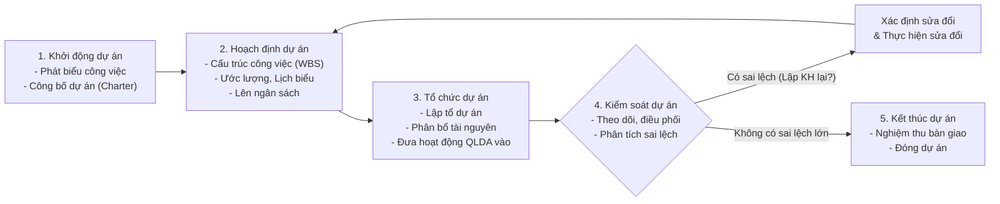
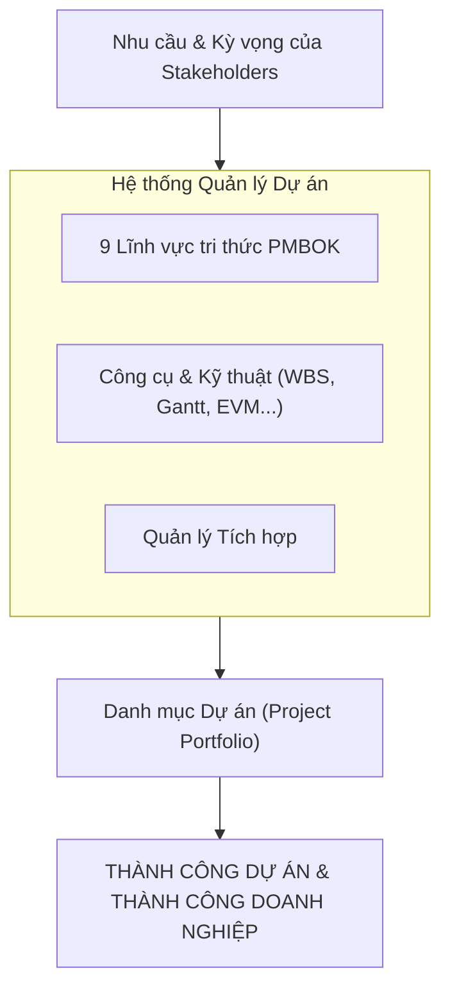
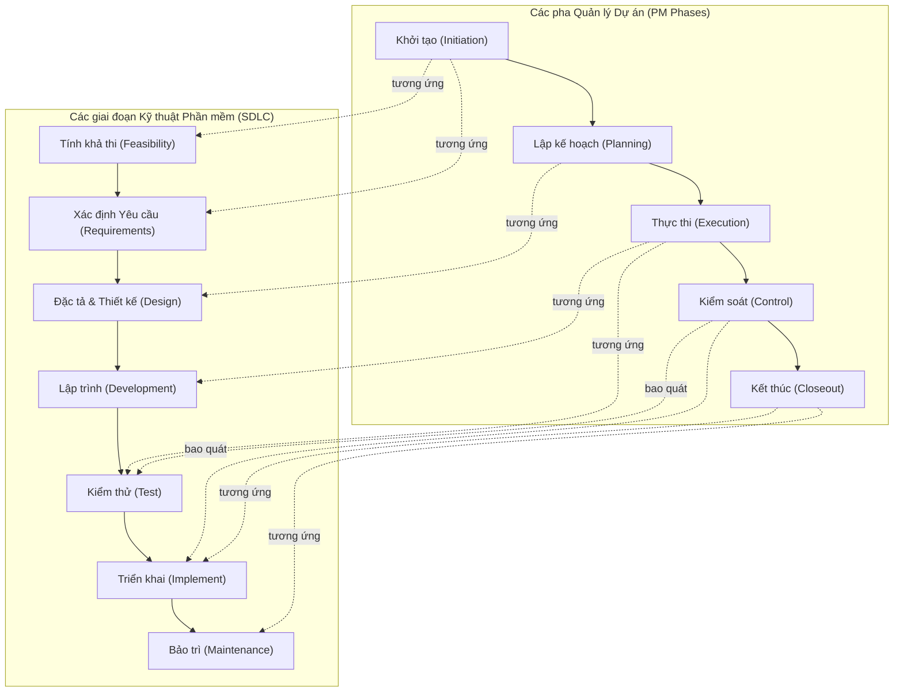
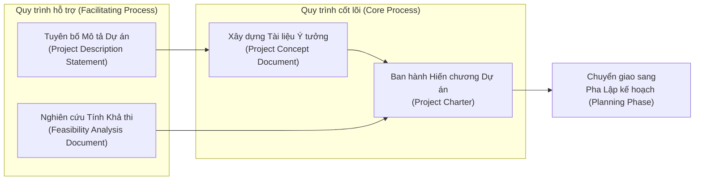
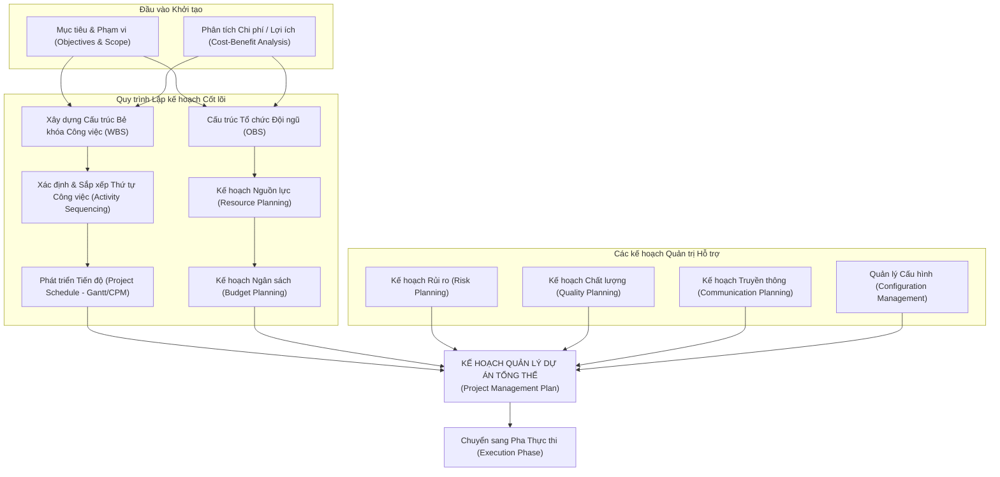

# CHƯƠNG 1: TỔNG QUAN VỀ QUẢN LÝ DỰ ÁN CNTT

> **Học viện Ngân hàng — Khoa Công nghệ thông tin & Kinh tế số**  
> **Môn học**: Quản lý Dự án Công nghệ Thông tin (IT Project Management)  
> **Tài liệu**: Tóm lược bài giảng điện tử & Chuẩn hóa kiến thức cốt lõi  
> **Nội dung chính**: Khái niệm dự án, Quản lý dự án, 5 nhóm quy trình, 9 lĩnh vực tri thức PMBOK, chu trình phát triển hệ thống (SDLC), phân loại bên liên quan và ma trận các giai đoạn dự án CNTT.

---

## MỤC LỤC
1. [Bức tranh tổng thể về Quản lý Dự án](#1-bức-tranh-tổng-thể-về-quản-lý-dự-án)
2. [Khái niệm cơ bản về Dự án](#2-khái-niệm-cơ-bản-về-dự-án)
   - [Định nghĩa dự án](#21-định-nghĩa-dự-án)
   - [Đặc trưng cơ bản của dự án](#22-đặc-trưng-cơ-bản-của-dự-án)
   - [Phân loại dự án](#23-phân-loại-dự-án)
   - [Các vấn đề thường gặp trong dự án](#24-các-vấn-đề-thường-gặp-trong-dự-án)
3. [Bản chất và Lợi ích của Quản lý Dự án](#3-bản-chất-và-lợi-ích-của-quản-lý-dự-án)
   - [Quản lý dự án là gì?](#31-quản-lý-dự-án-là-gì)
   - [Tiêu chí đánh giá dự án thành công](#32-tiêu-chí-đánh-giá-dự-án-thành-công)
   - [Lợi ích của Quản lý dự án](#33-lợi-ích-của-quản-lý-dự-án)
4. [Khung kiến trúc PMBOK: Quy trình và Lĩnh vực Tri thức](#4-khung-kiến-trúc-pmbok-quy-trình-và-lĩnh-vực-tri-thức)
   - [5 Nhóm quy trình quản lý dự án](#41-5-nhóm-quy-trình-quản-lý-dự-án)
   - [9 Lĩnh vực tri thức PMBOK](#42-9-lĩnh-vực-tri-thức-pmbok)
   - [Biểu đồ mức độ nỗ lực của các giai đoạn](#43-biểu-đồ-mức-độ-nỗ-lực-level-of-effort)
5. [Mối quan hệ giữa QLDA và Vòng đời Phát triển Hệ thống (SDLC)](#5-mối-quan-hệ-giữa-qlda-và-vòng-đời-phát-triển-hệ-thống-sdlc)
6. [Giai đoạn Khởi động Dự án (Project Initiation)](#6-giai-đoạn-khởi-động-dự-án-project-initiation)
   - [Các câu hỏi cốt lõi](#61-các-câu-hỏi-cốt-lõi-giai-đoạn-khởi-động)
   - [Quy trình cốt lõi và Quy trình hỗ trợ](#62-quy-trình-cốt-lõi-và-quy-trình-hỗ-trợ)
   - [Thứ tự chuẩn bị hồ sơ tài liệu](#63-thứ-tự-chuẩn-bị-hồ-sơ-tài-liệu)
   - [Nhận diện các bên tham gia (Stakeholders)](#64-nhận-diện-các-bên-tham-gia-stakeholders)
7. [Quy trình Lập kế hoạch Dự án (Project Planning)](#7-quy-trình-lập-kế-hoạch-dự-án-project-planning)
8. [Ma trận Chi tiết Các Giai đoạn của Dự án CNTT](#8-ma-trận-chi-tiết-các-giai-đoạn-của-dự-án-cntt)

---

## 1. Bức tranh tổng thể về Quản lý Dự án
*(Nguồn: Slide 2)*

Quá trình quản lý một dự án trải qua một chuỗi các giai đoạn khép kín có sự kiểm soát và phản hồi liên tục:



---

## 2. Khái niệm cơ bản về Dự án
*(Nguồn: Slide 3 - 8)*

### 2.1. Định nghĩa dự án
* **Theo PMBOK Guide (Project Management Institute - PMI):**  
  > *"Dự án là một nỗ lực tạm thời được cam kết để tạo ra một sản phẩm, dịch vụ hoặc kết quả duy nhất."*
* **Định nghĩa tổng quát trong CNTT:**  
  Dự án là một chuỗi các công việc (nhiệm vụ, hoạt động) có liên quan lẫn nhau, được thực hiện bởi một tập thể nhằm đạt được mục tiêu đề ra trong điều kiện ràng buộc khắt khe về **Phạm vi (Scope)**, **Thời gian (Time)** và **Ngân sách (Cost)** (Bộ ba ràng buộc - *Triple Constraints*).

### 2.2. Đặc trưng cơ bản của dự án
1. **Tính tập thể (Team Collaboration):**
   - Đội ngũ gồm nhiều cá nhân với chuyên môn, kinh nghiệm và vai trò khác nhau.
   - Thời gian tham gia linh hoạt theo từng giai đoạn (toàn thời gian hoặc bán thời gian).
   - Đòi hỏi sự phối hợp và giao tiếp chặt chẽ giữa các thành viên.
2. **Tính mục tiêu & kết quả chuyển giao (Deliverables):**
   - Hướng đến việc tạo ra sản phẩm/dịch vụ có đặc tính, thông số kỹ thuật rõ ràng.
   - Mang lại giá trị sử dụng và hiệu quả kinh tế - nghiệp vụ thiết thực cho khách hàng/tổ chức.
3. **Tính hữu hạn về thời gian (Definite Timeline):**
   - Luôn có điểm bắt đầu và điểm kết thúc xác định rõ ràng.
   - Được phân chia thành các mốc trung gian quan trọng (*Milestones*).
4. **Tính ràng buộc về kinh phí (Budget Constraints):**
   - Có tổng vốn đầu tư xác định trước.
   - Thường được phê duyệt và giải ngân theo từng pha/mốc tiến độ.
5. **Tính không chắc chắn & rủi ro (Uncertainty & Risk):**
   - Do tính chất mới lạ và duy nhất, dự án luôn tiềm ẩn các rủi ro kỹ thuật, nhân sự và thị trường.

### 2.3. Phân loại dự án
* **Theo quy mô (Tầm cỡ):**
  - *Dự án lớn:* Tầm mức doanh nghiệp, tập đoàn, đa phòng ban, ngân sách lớn, thời gian kéo dài nhiều năm.
  - *Dự án trung bình và nhỏ:* Triển khai cục bộ, thời gian ngắn, ngân sách giới hạn.
* **Theo nguồn lực & chủ thể:**
  - *Dự án cá nhân (một người)* vs *Dự án tập thể (nhiều người)*.
  - *Dự án nội bộ (Internal)*: Phục vụ cải tiến vận hành cho chính tổ chức.
  - *Dự án bên ngoài (External)*: Ký kết hợp đồng thực hiện cho khách hàng bên ngoài.

### 2.4. Các vấn đề thường gặp trong dự án CNTT
* Không hoàn thành đúng hạn (Chậm tiến độ - *Schedule Delays*).
* Vượt dự toán ngân sách (*Cost Overrun*).
* Chất lượng không đảm bảo, không đạt yêu cầu kỹ thuật hoặc kỳ vọng của người dùng.
* Phạm vi phình to không kiểm soát (*Scope Creep*).

---

## 3. Bản chất và Lợi ích của Quản lý Dự án
*(Nguồn: Slide 9 - 11, 21 - 23)*

### 3.1. Quản lý dự án là gì?
Quản lý dự án (Project Management) là việc áp dụng kiến thức, kỹ năng, công cụ và kỹ thuật vào các hoạt động của dự án nhằm đáp ứng hoặc vượt quá các yêu cầu và kỳ vọng của các bên liên quan.

Các hoạt động chính bao gồm:
* Lập kế hoạch chi tiết (Planning).
* Quản lý rủi ro và các vấn đề phát sinh (Risk & Issue Management).
* Quản lý phân bổ nguồn nhân lực (Human Resource Management).
* Điều hành, phối hợp và theo dõi tiến độ (Executing & Monitoring).
* Đảm bảo kiểm soát chất lượng và tích hợp toàn diện.



### 3.2. Tiêu chí đánh giá dự án thành công
Một dự án CNTT được coi là thành công khi thỏa mãn 4 tiêu chí cơ bản:
1. **Chất lượng, Phạm vi, Thời gian & Chi phí:**  
   Sản phẩm bàn giao đáp ứng đầy đủ yêu cầu của người dùng; thời gian và chi phí không vượt quá **10% – 20%** so với dự tính ban đầu (mức dung sai chấp nhận được).
2. **Sự thỏa mãn của người dùng (Customer Satisfaction):**  
   Khách hàng/người dùng hài lòng với quá trình thực hiện, được tham gia góp ý và đồng hành xuyên suốt.
3. **Tính minh bạch đối với Lãnh đạo (Management Visibility):**  
   Ban lãnh đạo và Người bảo trợ (Sponsor) được cung cấp thông tin kịp thời, minh bạch và chính xác về trạng thái dự án.
4. **Sự gắn kết của Đội ngũ phát triển (Team Morale):**  
   Thành viên đội dự án làm việc phấn khởi, không bị kiểm soát quá mức hoặc quá tải, tích lũy thêm năng lực chuyên môn và tăng thêm thu nhập.

### 3.3. Lợi ích của Quản lý dự án
* Kiểm soát tối ưu các tài nguyên: tài chính, trang thiết bị, nhân lực.
* Nâng cao chất lượng mối quan hệ và sự tin cậy với khách hàng.
* Rút ngắn thời gian phát triển và đưa sản phẩm ra thị trường (*Time-to-Market*).
* Cắt giảm chi phí lãng phí và tối đa hóa biên lợi nhuận.
* Tăng cường tính ổn định, độ tin cậy và chất lượng phần mềm.
* Cải tiến năng suất lao động và thúc đẩy tinh thần làm việc nhóm.

---

## 4. Khung kiến trúc PMBOK: Quy trình và Lĩnh vực Tri thức
*(Nguồn: Slide 12 - 13, 25 - 26, 30)*

### 4.1. 5 Nhóm quy trình quản lý dự án (5 Process Groups)
1. **Khởi tạo (Initiating):** Xác định dự án mới hoặc giai đoạn mới, cấp quyền chính thức cho Giám đốc Dự án (PM).
2. **Lập kế hoạch (Planning):** Thiết lập phạm vi tổng thể, xác định mục tiêu và lộ trình chi tiết để đạt mục tiêu.
3. **Thực thi (Executing):** Hoàn thành các công việc theo kế hoạch để đáp ứng các tiêu chuẩn kỹ thuật.
4. **Giám sát & Kiểm soát (Monitoring & Controlling):** Theo dõi, rà soát tiến độ và hiệu suất, đề xuất thay đổi khi cần.
5. **Kết thúc (Closing):** Hoàn tất toàn bộ hoạt động, nghiệm thu bàn giao chính thức và giải tán dự án.

### 4.2. 9 Lĩnh vực tri thức PMBOK (9 Knowledge Areas)

| Nhóm lĩnh vực | Lĩnh vực tri thức | Chức năng & Nhiệm vụ cốt lõi |
| :--- | :--- | :--- |
| **4 Lĩnh vực Cốt lõi** *(Core Functions)* | **1. Quản lý Phạm vi** *(Scope)* | Xác định và kiểm soát toàn bộ khối lượng công việc phải làm (không thừa, không thiếu). |
| | **2. Quản lý Thời gian** *(Time/Schedule)* | Ước lượng thời lượng hoạt động, xây dựng tiến độ Gantt, theo dõi đảm bảo đúng hạn. |
| | **3. Quản lý Chi phí** *(Cost)* | Dự toán ngân sách, dòng tiền và kiểm soát chi phí thực tế không vượt hạn mức. |
| | **4. Quản lý Chất lượng** *(Quality)* | Đảm bảo sản phẩm thỏa mãn tiêu chuẩn chất lượng và yêu cầu khách hàng. |
| **4 Lĩnh vực Bổ trợ** *(Facilitating Functions)* | **5. Quản lý Nhân lực** *(Human Resource)* | Xây dựng đội ngũ, phân công vai trò (RACI), đào tạo và quản lý hiệu quả làm việc. |
| | **6. Quản lý Truyền thông** *(Communications)* | Thu thập, lưu trữ, truyền đạt và phân phối thông tin dự án đúng đối tượng, đúng lúc. |
| | **7. Quản lý Rủi ro** *(Risk)* | Nhận diện, phân tích định tính/định lượng và lập kế hoạch ứng phó nguy cơ rủi ro. |
| | **8. Quản lý Mua sắm** *(Procurement)* | Mua sắm trang thiết bị, thuê dịch vụ ngoài và quản lý hợp đồng đối tác. |
| **Lĩnh vực Tích hợp** *(Integration)* | **9. Quản lý Tích hợp** *(Integration)* | Điều phối, kết nối, hài hòa và cân bằng mọi lĩnh vực và quyết định đánh đổi trong dự án. |

### 4.3. Biểu đồ mức độ nỗ lực (Level of Effort)
*(Nguồn: Slide 13)*

```
Mức độ
hoạt động (Effort)
  ^
  |                     [ THỰC THI (Executing) ]  <-- Đỉnh cao nhất về nhân lực & chi phí
  |                               /\
  |             [ LẬP KẾ HOẠCH ] /  \
  |                   /\        /    \       [ GIÁM SÁT & KIỂM SOÁT ]
  |                  /  \      /      \      (Kéo dài liên tục xuyên suốt)
  |   [ KHỞI TẠO ]  /    \    /        \
  |        /\      /      \  /          \          [ KẾT THÚC ]
  |       /  \    /        \/            \              /\
  +------+----+--+----------+-------------+------------+--+--------> Thời gian
      Bắt đầu                                           Kết thúc
```

> [!NOTE]
> - Giai đoạn **Thực thi** luôn tiêu tốn nguồn lực và kinh phí cao nhất.
> - Giai đoạn **Giám sát & Kiểm soát** diễn ra đồng thời và bao trùm từ lúc bắt đầu lập kế hoạch cho đến khi đóng dự án.

---

## 5. Mối quan hệ giữa QLDA và Vòng đời Phát triển Hệ thống (SDLC)
*(Nguồn: Slide 14, 29)*

Chu trình sống phát triển hệ thống (SDLC) tập trung vào khía cạnh **kỹ thuật phần mềm**, trong khi Chu trình quản lý dự án tập trung vào khía cạnh **quản trị và điều phối**:



* **Mức độ nỗ lực của Khối Nghiệp vụ (Business Level of Effort):** Tập trung mạnh ở giai đoạn đầu (xác định yêu cầu, tính khả thi) và giai đoạn cuối (nghiệm thu UAT, tiếp nhận vận hành).
* **Mức độ nỗ lực của Khối CNTT (IT Level of Effort):** Đạt mức cao nhất ở giai đoạn giữa (thiết kế kiến trúc, lập trình, kiểm thử hệ thống).

---

## 6. Giai đoạn Khởi động Dự án (Project Initiation)
*(Nguồn: Slide 15 - 19)*

### 6.1. Các câu hỏi cốt lõi giai đoạn khởi động
1. **Làm gì? (What):** Mục tiêu dự án là gì? Sản phẩm cụ thể sẽ bàn giao gồm những gì?
2. **Tại sao làm? (Why):** Dự án giải quyết bài toán nghiệp vụ nào? Đem lại giá trị kinh tế ra sao?
3. **Làm thế nào? (How):** Cách tiếp cận sơ bộ, thời hạn ước lượng và ngân sách khung là bao nhiêu?

### 6.2. Quy trình cốt lõi và Quy trình hỗ trợ


### 6.3. Thứ tự chuẩn bị hồ sơ tài liệu
*(Nguồn: Slide 19)*

Các tài liệu khởi tạo cần được xây dựng theo trình tự logic từng bước:

$$\text{Nhu cầu (Need)} \longrightarrow \text{Mục tiêu (Objectives)} \longrightarrow \text{Mô tả sản phẩm (Product Description)}$$
$$\downarrow$$
$$\text{Ngân sách sơ bộ} \longleftarrow \text{Thời hạn dự kiến} \longleftarrow \text{Tính khả thi (Feasibility)}$$
$$\downarrow$$
$$\mathbf{Hiến\ chương\ Dự\ án\ (Project\ Charter)}$$

### 6.4. Nhận diện các bên tham gia (Stakeholders)
*(Nguồn: Slide 16, 24)*

Bên liên quan (Stakeholder) là tất cả các cá nhân, nhóm hoặc tổ chức có quyền lợi liên quan, tham gia hoặc chịu tác động (tích cực hoặc tiêu cực) từ hoạt động của dự án.

* **Bên trong tổ chức (Internal):**
  - Giám đốc Dự án (PM - Project Manager).
  - Trưởng nhóm kỹ thuật (Tech Lead), các Trưởng nhóm chuyên môn.
  - Các thành viên đội triển khai (Lập trình viên, Kiểm thử viên, BA, Designer).
  - Ban lãnh đạo tổ chức, Người bảo trợ dự án (Project Sponsor).
* **Bên ngoài tổ chức (External):**
  - Khách hàng (Customer) — Người chi trả tiền hoặc ký hợp đồng.
  - Người dùng cuối (End-users) — Người trực tiếp vận hành sản phẩm.
  - Nhà cung cấp, Đối tác cung ứng dịch vụ/hạ tầng.
  - Nhóm phản đối / có quan ngại về dự án (*Resisters/Opponents*).

---

## 7. Quy trình Lập kế hoạch Dự án (Project Planning)
*(Nguồn: Slide 20)*

Giai đoạn lập kế hoạch tích hợp đồng thời các luồng công việc cốt lõi và các kế hoạch hỗ trợ chuyên sâu:



---

## 8. Ma trận Chi tiết Các Giai đoạn của Dự án CNTT
*(Nguồn: Slide 27 - 28)*

Bảng tổng hợp đối sánh chi tiết toàn bộ vòng đời phát triển dự án CNTT từ khởi đầu đến khi bàn giao và vận hành:

| Giai đoạn | Mục đích | Các hoạt động trọng tâm | Cách thức tiến hành | Tài liệu & Mốc nghiệm thu (Milestones) | Vai trò PM & Cán bộ Kỹ thuật (CBKT) |
| :--- | :--- | :--- | :--- | :--- | :--- |
| **1. XÁC ĐỊNH** *(Initiation)* | Tìm hiểu để có đánh giá ban đầu về bài toán và tính khả thi. | Trình bày bài toán nghiệp vụ; Đánh giá sơ bộ rủi ro; Lập kế hoạch và ước tính ngân sách ban đầu. | Thu thập thông tin từ lãnh đạo và khách hàng; Tổ chức họp khởi động. | - Ý tưởng dự án (*Concept Document*)<br/>- Bản yêu cầu người dùng sơ bộ<br/>- Bảng nhận diện rủi ro ban đầu<br/>- **Hiến chương Dự án (*Project Charter*)** *(Khách hàng/Sponsor ký)* | PM chủ trì; CBKT đóng vai trò tư vấn giải pháp công nghệ. |
| **2. PHÂN TÍCH** *(Analysis)* | Làm rõ hệ thống phần mềm sẽ làm gì (*What to do*). | Thu thập yêu cầu chi tiết; Thiết kế giao diện mẫu (*Wireframes*); Rà soát các điều khoản hợp đồng. | Phỏng vấn người dùng; Tổ chức workshop nghiệp vụ; Xem xét hiện trạng. | - **Tài liệu Đặc tả Yêu cầu (*SRS / FRS*)** *(Người dùng thông qua)*<br/>- Kế hoạch dự án chi tiết lần cuối<br/>- Đề xuất giải pháp triển khai | PM điều phối phạm vi; CBKT (BA/Architect) phân tích yêu cầu. |
| **3. THIẾT KẾ** *(Design)* | Xác định các thành phần của hệ thống và cách thức hoạt động (*How it works*). | Quyết định Tự xây dựng hay Mua ngoài (*Build vs Buy*); Thiết kế kiến trúc tổng thể, CSDL (ERD) và API. | Phân tích giải pháp kỹ thuật; Họp hội đồng thẩm định kiến trúc (*Architecture Review*). | - **Tài liệu Đặc tả Thiết kế (*ADD / SDD*)** *(CBKT phê duyệt)*<br/>- Kế hoạch kiểm thử chấp nhận (*UAT Test Plan*)<br/>- Bảng ước tính chi phí tinh chỉnh | PM giám sát tiến độ và chi phí; CBKT chịu trách nhiệm kỹ thuật chính. |
| **4. THỰC HIỆN** *(Development)* | Xây dựng và lắp ráp các thành phần phần mềm. | Lập trình phần mềm; Tùy biến mã nguồn; Mua sắm/cấu hình máy chủ; Kiểm thử từng đơn vị (*Unit Test*). | Chia sprint/giai đoạn phát triển; Quản lý mã nguồn trên Git; Báo cáo tiến độ hàng ngày. | - Mã nguồn và các module hoàn thành<br/>- Kế hoạch kiểm thử hệ thống (*System Test Plan*)<br/>- Báo cáo kết quả Unit Test<br/>- Tài liệu hướng dẫn sử dụng sơ bộ | PM theo dõi tiến độ, điều phối nhân lực; CBKT (Dev/Tester) trực tiếp thực thi. |
| **5. KIỂM THỬ HỆ THỐNG** *(System Test)* | Rà soát toàn bộ hệ thống hoạt động thống nhất, khắc phục sai sót. | Tích hợp toàn diện các phân hệ; Kiểm thử chức năng, hiệu năng, bảo mật và tải. | Chạy kịch bản kiểm thử tự động/thủ công; Ghi nhận lỗi trên hệ thống Bug Tracking; Fix bug. | - Hệ thống phần mềm đã tích hợp<br/>- **Báo cáo Kiểm thử Hệ thống (*System Test Report*)** *(Đảm bảo chất lượng thông qua)* | PM giám sát chất lượng và thời gian xử lý bug; CBKT (QA/Tester) chủ trì. |
| **6. KIỂM THỬ CHẤP NHẬN** *(UAT)* | Đạt được sự chấp nhận chính thức của khách hàng. | Cài đặt môi trường thử nghiệm (Staging); Khách hàng chạy thử nghiệp vụ thực tế; Ký biên bản UAT. | Đào tạo người dùng thử nghiệm; Hỗ trợ người dùng thao tác; Ghi nhận phản hồi chỉnh sửa. | - Kịch bản kiểm thử UAT<br/>- **Biên bản Kiểm thử Chấp nhận (*UAT Sign-off*)** *(Người dùng/Khách hàng ký duyệt)* | PM làm việc trực tiếp với khách hàng để chốt nghiệm thu; CBKT hỗ trợ kỹ thuật. |
| **7. VẬN HÀNH & BÀN GIAO** *(Operations)* | Cài đặt hệ thống rộng rãi trong thực tế và hoàn thành dự án. | Triển khai Production; Chuyển đổi dữ liệu (*Data Migration*); Đào tạo người dùng diện rộng; Hỗ trợ vận hành; Họp tổng kết. | Chạy song song hoặc chuyển đổi trực tiếp; Hỗ trợ trực tiếp onsite/remote; Khảo sát mức độ hài lòng. | - Hệ thống chính thức vận hành (Live)<br/>- Báo cáo kết quả đào tạo<br/>- Kế hoạch hỗ trợ bảo hành (*SLA Plan*)<br/>- **Báo cáo Tổng kết Hoàn thành Dự án (*Project Closure Report*)** | PM chủ trì thủ tục đóng dự án và thanh lý hợp đồng; CBKT chuyển giao cho đội vận hành. |

---

> [!TIP]
> **Gợi ý ôn tập & Vận dụng làm Bài tập lớn (BTL):**
> 1. Hiến chương dự án (*Project Charter*) là tài liệu cốt lõi đánh dấu dự án được phê duyệt chính thức. Hãy tham chiếu mẫu trong thư mục `Bai_tap_lon/Ho_so_du_an/01_Khoi_tao/A2_Project_Charter_HRM.md`.
> 2. Ma trận các bên liên quan (*Stakeholder Matrix*) và quyền lực/mức độ quan tâm cần được xác định ngay từ giai đoạn 1 (Tham chiếu `A3_A4_Stakeholder_Register_Power_Interest.md`).
> 3. Cấu trúc bẻ khóa công việc (*WBS*) và tiến độ (*Gantt/CPM*) là trung tâm của giai đoạn Lập kế hoạch (Tham chiếu `B3_B4_WBS_Va_WBS_Dictionary.md` và `B5_B6_Lich_trinh_PERT_CPM_Gantt.md`).
