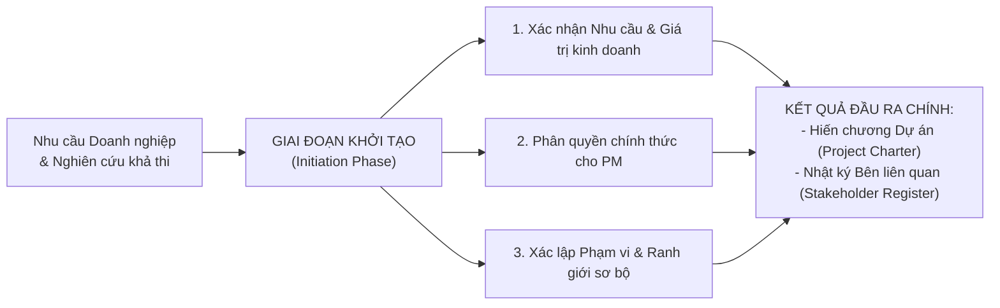

# CHƯƠNG 2: KHỞI TẠO DỰ ÁN (PROJECT INITIATION)

> **Học viện Ngân hàng — Khoa Công nghệ thông tin & Kinh tế số**  
> **Môn học**: Quản lý Dự án Công nghệ Thông tin  
> **Tài liệu**: Tóm lược bài giảng điện tử & Chuẩn hóa kiến thức cốt lõi  
> **Nội dung chính**: Mục tiêu giai đoạn khởi tạo, các yếu tố đầu vào (Business Case, Hợp đồng, OPA, EEF), Hiến chương dự án (Project Charter), Xác định các bên liên quan (Stakeholder Register) và Ma trận Quyền lực / Mức độ quan tâm (Power/Interest Grid).

---

## MỤC LỤC
1. [Mục tiêu Cốt lõi của Giai đoạn Khởi tạo](#1-mục-tiêu-cốt-lõi-của-giai-đoạn-khởi-tạo)
2. [Đầu vào và Cơ sở để Khởi tạo Dự án](#2-đầu-vào-và-cơ-sở-để-khởi-tạo-dự-án)
3. [Điều lệ Dự án / Hiến chương Dự án (Project Charter)](#3-điều-lệ-dự-án--hiến-chương-dự-án-project-charter)
   - [Định nghĩa và Thẩm quyền ban hành](#31-định-nghĩa-và-thẩm-quyền-ban-hành)
   - [Các thành phần cấu thành Project Charter](#32-các-thành-phần-cấu-thành-project-charter)
4. [Xác định Các bên Liên quan (Stakeholder Management)](#4-xác-định-các-bên-liên-quan-stakeholder-management)
   - [Tầm quan trọng của việc xác định sớm](#41-tầm-quan-trọng-của-việc-xác-định-sớm)
   - [Nhật ký các bên liên quan (Stakeholder Register)](#42-nhật-ký-các-bên-liên-quan-stakeholder-register)
   - [Ma trận Quyền lực / Mức độ Quan tâm (Power/Interest Grid)](#43-ma-trận-quyền-lực--mức-độ-quan-tâm-powerinterest-grid)

---

## 1. Mục tiêu Cốt lõi của Giai đoạn Khởi tạo
*(Nguồn: Slide 2)*

Khởi tạo (Initiation) là giai đoạn đầu tiên trong 5 nhóm quy trình PMBOK, đóng vai trò đặt nền móng pháp lý và định hướng chiến lược cho toàn bộ dự án.



* **Xác nhận nhu cầu:** Đảm bảo dự án mang lại giá trị kinh tế/nghiệp vụ rõ ràng và phù hợp với mục tiêu chiến lược của tổ chức.
* **Phân quyền hợp pháp:** Trao quyền chính thức cho Giám đốc Dự án (Project Manager - PM) để bắt đầu huy động và sử dụng ngân sách, nhân sự, trang thiết bị của tổ chức.
* **Xác định phạm vi sơ bộ:** Thiết lập ranh giới rõ ràng những gì thuộc phạm vi dự án (*In-Scope*) và những gì nằm ngoài phạm vi (*Out-of-Scope*).
* **Kết quả đầu ra chính (Key Deliverables):**
  1. **Hiến chương Dự án (*Project Charter*)**
  2. **Nhật ký các Bên Liên quan (*Stakeholder Register*)**

---

## 2. Đầu vào và Cơ sở để Khởi tạo Dự án
*(Nguồn: Slide 3)*

Trước khi ban hành quyết định khởi tạo dự án, PM và Nhà bảo trợ cần xem xét 4 nhóm yếu tố đầu vào nền tảng:

| STT | Yếu tố đầu vào | Nội dung & Vai trò | Câu hỏi trả lời |
| :---: | :--- | :--- | :--- |
| **1** | **Nghiên cứu Khả thi (*Feasibility Study*) / Nhu cầu Kinh doanh (*Business Need*)** | Xác nhận vấn đề thực tế cần giải quyết, cơ hội kinh doanh cần đón đầu, hoặc các yêu cầu tuân thủ quy định pháp luật. | *"Chúng ta có nên làm dự án này không? Có khả thi về mặt kỹ thuật, tài chính và nghiệp vụ không?"* |
| **2** | **Thỏa thuận / Hợp đồng (*Agreements / Contracts*)** | Nếu dự án thực hiện cho khách hàng bên ngoài, hợp đồng là căn cứ pháp lý cao nhất ràng buộc mục tiêu, phạm vi và ngân sách. | *"Cam kết pháp lý, quyền lợi và nghĩa vụ của các bên là gì?"* |
| **3** | **Tài sản Quy trình Tổ chức (*Organizational Process Assets - OPA*)** | Các quy trình, biểu mẫu tiêu chuẩn (*templates*), chính sách nội bộ và bài học kinh nghiệm (*Lessons Learned*) từ các dự án quá khứ. | *"Tổ chức đã có sẵn kinh nghiệm, quy trình hoặc mẫu biểu nào để tái sử dụng?"* |
| **4** | **Yếu tố Môi trường Doanh nghiệp (*Enterprise Environmental Factors - EEF*)** | Văn hóa doanh nghiệp, cơ cấu tổ chức, hệ thống thông tin quản lý dự án (PMIS), hạ tầng kỹ thuật và quy định pháp lý ngành. | *"Môi trường và bối cảnh bên trong / bên ngoài tác động thế nào đến dự án?"* |

---

## 3. Điều lệ Dự án / Hiến chương Dự án (Project Charter)
*(Nguồn: Slide 4 - 6)*

### 3.1. Định nghĩa và Thẩm quyền ban hành
* **Định nghĩa:** Hiến chương Dự án (*Project Charter*) là văn kiện chính thức có giá trị cao nhất trong giai đoạn khởi tạo, xác nhận sự ra đời của dự án.
* **Thẩm quyền ban hành:** Được ban hành và ký duyệt bởi **Người bảo trợ dự án (*Project Sponsor*)** hoặc cơ quan lãnh đạo có thẩm quyền trong tổ chức.
* **Mục đích:** Trao thẩm quyền chính thức cho Giám đốc Dự án (PM) được quyền sử dụng các nguồn lực của tổ chức để triển khai các hoạt động dự án.

### 3.2. Các thành phần cấu thành Project Charter
Một bản Hiến chương Dự án chuẩn mực bao gồm 7 nội dung trọng yếu:

1. **Mục tiêu Dự án (*Project Goals*) & Căn chỉnh Chiến lược:**
   - Các mục tiêu định lượng theo nguyên tắc SMART (ví dụ: *Rút ngắn 30% thời gian xử lý hồ sơ nhân sự, tăng 15% sự hài lòng của nhân viên*).
   - Minh chứng dự án đóng góp vào chiến lược phát triển dài hạn của tổ chức.
2. **Yêu cầu cấp cao & Phạm vi sơ bộ (*High-level Requirements & Scope*):**
   - Mô tả tổng thể về giải pháp phần mềm/hệ thống cần tạo ra.
   - Danh sách các phân hệ chính (chưa cần đi sâu vào chi tiết kỹ thuật).
3. **Chỉ định Giám đốc Dự án & Người bảo trợ (*PM & Sponsor Designation*):**
   - Họ tên, chức danh và mức độ thẩm quyền phê duyệt của PM.
   - Cam kết đồng hành và hỗ trợ từ Người bảo trợ (Sponsor).
4. **Các mốc tiến độ quan trọng (*Key Milestones*):**
   - Lịch trình tổng quan và hạn chót hoàn thành các giai đoạn chính (ví dụ: *Hoàn thành khảo sát & thiết kế trong Q1, nghiệm thu UAT trong Q3*).
5. **Ngân sách sơ bộ được duyệt (*Pre-approved Financial Budget*):**
   - Khung tổng mức đầu tư được phê duyệt ban đầu và các hạn mức kiểm soát chi tiêu.
6. **Rủi ro cấp cao & Giả định (*High-level Risks & Assumptions*):**
   - Nhận diện sớm các mối đe dọa hoặc thách thức kỹ thuật lớn nhất.
   - Các giả định nền tảng (ví dụ: *Hạ tầng mạng hiện tại của doanh nghiệp đáp ứng băng thông; CSDL cũ sẵn sàng để migration*).
7. **Tiêu chí nghiệm thu & Phê duyệt (*Project Approval Criteria*):**
   - Xác định rõ tiêu chí đánh giá thành công của dự án và người có thẩm quyền ký biên bản nghiệm thu cuối cùng.

---

## 4. Xác định Các bên Liên quan (Stakeholder Management)
*(Nguồn: Slide 7 - 9)*

### 4.1. Tầm quan trọng của việc xác định sớm
Xác định các bên liên quan (*Identify Stakeholders*) là quá trình xác định tất cả các cá nhân, nhóm người hoặc tổ chức chịu ảnh hưởng hoặc có khả năng ảnh hưởng đến dự án.
* **Tại sao cần làm sớm?**
  - Giúp thu thập đầy đủ yêu cầu nghiệp vụ ngay từ đầu, tránh việc phát sinh yêu cầu đột ngột làm vỡ kế hoạch về sau (*Scope Creep*).
  - Giảm thiểu tối đa xung đột lợi ích hoặc sự kháng cự thay đổi từ phía người dùng cuối.
  - Các bên liên quan chính là người trực tiếp nghiệm thu và quyết định sự sống còn của sản phẩm dự án.

### 4.2. Nhật ký các bên liên quan (Stakeholder Register)
Tài liệu ghi chép chi tiết thông tin và đánh giá về từng bên liên quan, bao gồm:
* **Thông tin nhận diện:** Họ tên, vị trí, vai trò trong dự án, tổ chức/phòng ban trực thuộc, thông tin liên hệ.
* **Thông tin đánh giá:**
  - *Mức độ Quan tâm (Interest):* Mức độ quan tâm đến kết quả dự án (Thấp / Cao).
  - *Mức độ Quyền lực / Ảnh hưởng (Power / Influence):* Khả năng định đoạt, thay đổi phạm vi hoặc ngân sách dự án (Thấp / Cao).
  - *Mức độ Tham gia (Involvement):* Vai trò thực tế (Người ra quyết định, Người tư vấn chuyên môn, hay Chỉ nhận thông báo).
* **Chiến lược quản lý (*Management Strategy*):** Kế hoạch cụ thể để giao tiếp, truyền thông và thu hút sự ủng hộ của họ.

### 4.3. Ma trận Quyền lực / Mức độ Quan tâm (Power/Interest Grid)
Công cụ kinh điển để phân loại và xây dựng chiến lược ứng xử phù hợp cho từng nhóm Stakeholder:

```
Quyền lực
(Power)
  ^
  |  -------------------------------------------------------------
  |  |  QUẢN LÝ CHẶT CHẼ          |  DUY TRÌ SỰ HÀI LÒNG         |
Cao |  (Manage Closely)          |  (Keep Satisfied)            |
  |  |  - Quyền lực CAO           |  - Quyền lực CAO             |
  |  |  - Quan tâm CAO            |  - Quan tâm THẤP             |
  |  |  * Ví dụ: Project Sponsor, |  * Ví dụ: Ban lãnh đạo cấp   |
  |  |    Khách hàng ký hợp đồng  |    cao, Cơ quan kiểm toán    |
  |  -------------------------------------------------------------
  |  |  THEO DÕI TỐI THIỂU        |  CUNG CẤP THÔNG TIN ĐẦY ĐỦ   |
Thấp|  (Monitor)                 |  (Keep Informed)             |
  |  |  - Quyền lực THẤP          |  - Quyền lực THẤP            |
  |  |  - Quan tâm THẤP           |  - Quan tâm CAO              |
  |  |  * Ví dụ: Nhà cung cấp phụ,|  * Ví dụ: Người dùng cuối,   |
  |  |    Nhóm bị tác động gián   |    Chuyên viên vận hành hệ   |
  |  |    tiếp                   |    thống                     |
  |  -------------------------------------------------------------
  +-------------------------------------------------------------> Mức độ quan tâm (Interest)
                                 Thấp                            Cao
```

| Nhóm đối tượng | Mức độ Quyền lực | Mức độ Quan tâm | Chiến lược ứng xử tối ưu | Đại diện điển hình |
| :--- | :---: | :---: | :--- | :--- |
| **Manage Closely** *(Quản lý chặt chẽ)* | **Cao** | **Cao** | Tham khảo ý kiến thường xuyên, mời tham gia các cuộc họp quyết định quan trọng, cập nhật báo cáo tiến độ chi tiết. | Project Sponsor, Khách hàng, Giám đốc khối nghiệp vụ tiếp nhận sản phẩm |
| **Keep Satisfied** *(Giữ cho hài lòng)* | **Cao** | **Thấp** | Đáp ứng đúng các yêu cầu pháp lý/báo cáo tổng quát, không làm phiền bởi các chi tiết vụn vặt nhưng phải đảm bảo họ luôn hài lòng. | Ban Lãnh đạo cấp cao (Board of Directors), Pháp chế, Kiểm toán nội bộ |
| **Keep Informed** *(Thông tin thường xuyên)* | **Thấp** | **Cao** | Cập nhật tiến độ liên tục, gửi thông báo thay đổi, tổ chức đào tạo và thu nhận phản hồi đóng góp. | Người dùng cuối (*End-users*), Đội ngũ hỗ trợ kỹ thuật vận hành (*Helpdesk*) |
| **Monitor** *(Theo dõi định kỳ)* | **Thấp** | **Thấp** | Theo dõi định kỳ với nỗ lực tối thiểu, sẵn sàng điều chỉnh chiến lược nếu mức độ quan tâm của họ thay đổi. | Nhà cung cấp thiết bị phụ trợ, các phòng ban ít liên quan |

---

> [!TIP]
> **Ứng dụng làm Bài tập lớn (BTL HRM):**
> - Mẫu Điều lệ Dự án chi tiết đã được biên soạn tại: [A2_Project_Charter_HRM.md](file:///Users/dovandat/WORKSPACE/HVNH/QLDA/Bai_tap_lon/Ho_so_du_an/01_Khoi_tao/A2_Project_Charter_HRM.md)
> - Bảng Nhật ký Stakeholder và Ma trận Power/Interest hoàn chỉnh tại: [A3_A4_Stakeholder_Register_Power_Interest.md](file:///Users/dovandat/WORKSPACE/HVNH/QLDA/Bai_tap_lon/Ho_so_du_an/01_Khoi_tao/A3_A4_Stakeholder_Register_Power_Interest.md)
