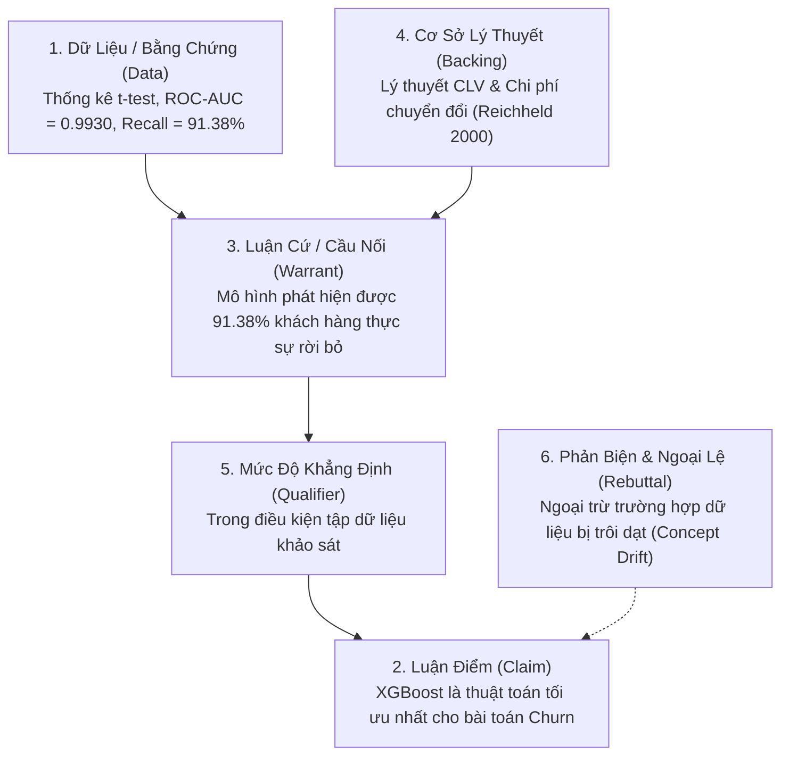

# Cẩm Nang Viết Học Thuật Trình Độ Sau Đại Học & Kiểm Soát Tính Chính Xác Khái Niệm (Academic Writing Mastery)

Tài liệu này chuẩn hóa toàn diện phương pháp luận viết nghiên cứu, biên tập học thuật, kiểm soát tính chính xác khái niệm (*Epistemic Precision*), cấu trúc lập luận logic (*Toulmin & Swales Models*), và bộ lọc chống sáo ngữ AI (*Anti-AI Cliché Filter*) cho các tài liệu khoa học tiếng Việt trình độ Cao học / Luận văn Thạc sĩ / Báo cáo Chuyên đề.

---

## 1. Triết Lý Cốt Lõi: Epistemic Precision & Calibration

> **"Mức độ khẳng định của câu văn phải tương xứng tuyệt đối với sức nặng của bằng chứng thực nghiệm."**

### 1.1. Thang Đo Mức Độ Khẳng Định (Epistemic Modality Spectrum)
Trong văn phong khoa học sau đại học, mỗi động từ và trạng từ diễn đạt đều mang một trọng lượng bằng chứng xác định:

| Mức Độ Khẳng Định | Ngữ Cảnh Sử Dụng | Động Từ & Cụm Từ Chuẩn Mực | Cần Tránh (Cảm tính / Tuyệt đối hóa) |
| :--- | :--- | :--- | :--- |
| **Tuyệt đối (100%)** | Kết quả toán học thuần túy, kiểm định giả thuyết bác bỏ $H_0$ với $p < 0.001$ | *kiểm định khẳng định, chứng minh, bác bỏ giả thuyết $H_0$* | *hoàn toàn đúng, chắc chắn 100%, chân lý* |
| **Mạnh mẽ (80 - 95%)** | Mô hình đạt hiệu năng vượt trội trên tập kiểm thử độc lập (ROC-AUC > 0.95) | *cho thấy, chỉ ra, xác nhận, minh chứng thực nghiệm* | *đột phá không thể chối cãi, vô song* |
| **Thận trọng (50 - 80%)** | Phân tích xu hướng, mối liên hệ tương quan giữa các biến số | *gợi ý, phản ánh, hàm ý, có xu hướng, có mối liên hệ thuận/nghịch* | *gây ra, bắt buộc dẫn đến, tạo ra* |
| **Phỏng đoán có cơ sở (< 50%)** | Lý giải nguyên nhân tiềm năng cần nghiên cứu thêm | *có thể lý giải bởi, đặt ra giả thuyết rằng, gợi mở khả năng* | *chắc chắn do, hiển nhiên vì* |

### 1.2. Phân Biệt Tường Minh: Tương Quan vs Nhân Quả (Correlation vs Causation)
* **Sai lầm phổ biến:** Nhìn thấy biến $X$ tương quan với $Y$ liền kết luận *"X gây ra Y"* hoặc *"X tác động trực tiếp làm tăng Y"*.
* **Chuẩn mực học thuật:**
  * Nếu là nghiên cứu cắt ngang (Cross-sectional Data / Correlation analysis): Sử dụng *"có mối tương quan đồng biến/nghịch biến với"*, *"phản ánh mối liên hệ thống kê có ý nghĩa ($r = 0.45, p < 0.01$)"*.
  * Chỉ khẳng định quan hệ nhân quả (*causal effect*) khi có thiết kế thực nghiệm ngẫu nhiên (RCT), phương pháp biến công cụ (IV), phương pháp sai biệt kép (DID), hoặc hồi quy gián đoạn (RDD).

---

## 2. Các Mô Hình Lập Luận Khoa Học Chuẩn Mực

### 2.1. Mô Hình Lập Luận Toulmin (Toulmin Model of Argumentation)
Mỗi phân tích trong báo cáo sau đại học phải cấu thành từ 6 thành tố:

1. **Claim (Luận điểm):** Khẳng định cốt lõi cần bảo vệ.
2. **Data / Evidence (Bằng chứng):** Số liệu thực nghiệm ($p$-value, ma trận nhầm lẫn, bảng tính ROI).
3. **Warrant (Luận cứ):** Nguyên lý kinh tế hoặc logic thuật toán kết nối bằng chứng với luận điểm.
4. **Backing (Hỗ trợ lý thuyết):** Các công trình nghiên cứu tiền lệ đã được công bố trên các tạp chí uy tín.
5. **Qualifier (Điều kiện hiệu lực):** Phạm vi áp dụng của kết luận.
6. **Rebuttal (Dự phòng phản biện):** Nhận diện trước các giới hạn và trường hợp ngoại lệ.

### 2.2. Mô Hình Dẫn Nhập Swales CARS (Create A Research Space)
Áp dụng cho Chương Mở đầu (Chương 1) của bài báo hoặc luận văn:
* **Move 1: Xác lập Địa bàn Nghiên cứu (Establishing a Territory):** Khẳng định vai trò trung tâm của thẻ tín dụng trong cơ cấu doanh thu ngân hàng bán lẻ.
* **Move 2: Xác lập Khoảng trống Nghiên cứu (Establishing a Niche):** Chỉ ra điểm nghẽn: Các mô hình truyền thống thiếu tính dự báo sớm và chưa tối ưu hóa ngưỡng quyết định theo bài toán kinh tế.
* **Move 3: Chiếm lĩnh Khoảng trống (Occupying the Niche):** Giới thiệu mục tiêu đề tài, bộ dữ liệu BankChurners và hệ thống cảnh báo sớm EWS.

---

## 3. Bộ Lọc Chống Sáo Ngữ & "Văn Mẫu AI" (Anti-AI Cliché Filter)

### 3.1. Bảng Tra Cứu Chuyển Đổi Từ Ngữ Sáo Rỗng Sang Văn Phong Học Thuật
| ❌ Cụm Từ Sáo Rỗng / AI Smell | ⚠️ Lý Do Bị Loại Bỏ | ✅ Diễn Đạt Chuẩn Mực Học Thuật |
| :--- | :--- | :--- |
| *"Trong bối cảnh hiện nay / Trong thời đại 4.0..."* | Mở đầu sáo rỗng, không cung cấp thông tin | Bắt đầu trực diện bằng đối tượng và số liệu: *"Thị trường thẻ tín dụng ngân hàng bán lẻ ghi nhận..."* |
| *"Đóng vai trò vô cùng quan trọng / Góp phần không nhỏ..."* | Tính từ cảm tính, mơ hồ, thiếu định lượng | *"Là nguồn thu nhập cốt lõi, đóng góp X% trong tổng cơ cấu..."* |
| *"Có thể thấy rằng / Không thể phủ nhận rằng..."* | Khẩu ngữ, áp đặt quan điểm chủ quan | *"Số liệu thực nghiệm tại Bảng X.Y chỉ ra rằng..."* |
| *"Mang tính đột phá / Đạt kết quả vô cùng ấn tượng..."* | Thổi phồng kết quả thiếu cơ sở | *"Đạt độ chính xác ROC-AUC = 0.9930, vượt trội 5.82% so với mô hình cơ sở"* |
| *"Ngày càng trở nên cấp thiết..."* | Khẩu hiệu hành chính, không mang tính học thuật | *"Làm gia tăng chi phí bù đắp khách hàng mới lên gấp 5 - 7 lần"* |
| *"Tiến hành thực hiện việc phân tích..."* | Dài dòng, lặp từ vô nghĩa | *"Phân tích..."* |
| *"Đưa ra một cái nhìn sâu sắc..."* | Dịch vụng từ tiếng Anh (*give a deep insight*) | *"Làm rõ cơ chế hành vi...", "Nhận diện quy luật..."* |

---

## 4. Quy Tắc Tham Chiếu Chéo (Cross-Referencing) & Trích Dẫn Theo Loại Tài Liệu

### 4.1. Tham chiếu tường minh
   * ✅ *"Số liệu tại Bảng 3.2 cho thấy..."*, *"Kết quả kiểm định tại Hình 5.3 chỉ ra..."*
   * ❌ *"Bảng bên dưới cho thấy..."*, *"Hình trên đây phản ánh..."* (Lỗi định dạng khi dàn trang in).
   * Luận văn HVNH: caption gắn số chương (`Bảng 2.1`, `Hình 4.5`), không đánh số phẳng.

### 4.2. Chọn phong cách trích dẫn theo loại tài liệu
| Loại tài liệu | Phong cách | Dạng trong văn bản |
| :--- | :--- | :--- |
| **Luận văn / Khóa luận HVNH** (chuẩn gốc) | **Số thứ tự trong ngoặc vuông** | `[15]`, `[15, tr.314-315]`, nhiều nguồn `[19], [25]` |
| Bài báo quốc tế (khoa học xã hội/quản trị) | APA 7th author-date | `(Reichheld & Schefter, 2000)` |

**Chi tiết chuẩn HVNH cho luận văn:**
* Số trong ngoặc vuông = số thứ tự tài liệu trong danh mục TLTK (đánh số liên tục xuyên hai nhóm ngôn ngữ).
* Trích dài hơn 2 câu hoặc 4 dòng: tách đoạn riêng, lề trái lùi thêm 2 cm, bỏ ngoặc kép.
* Danh mục TLTK: tách **Tiếng Việt / Tiếng Anh**; VN xếp ABC theo tên, nước ngoài theo họ; sách in nghiêng tên sách, bài báo tên bài trong ngoặc kép + tên tạp chí in nghiêng.
* Entry dài quá một dòng: dòng thứ hai lùi vào **1 cm** (hanging indent 1 cm).

### 4.3. Quy chuẩn trích dẫn APA 7th (cho bài báo quốc tế)
   * Trích dẫn trong văn bản: `(Reichheld & Schefter, 2000)` hoặc `Theo Chen và Guestrin (2016)...`
   * Danh mục tài liệu tham khảo: Sắp xếp theo thứ tự chữ cái của họ tác giả đầu tiên, định dạng **Hanging Indent 0.5 inch (1.27 cm)**.
