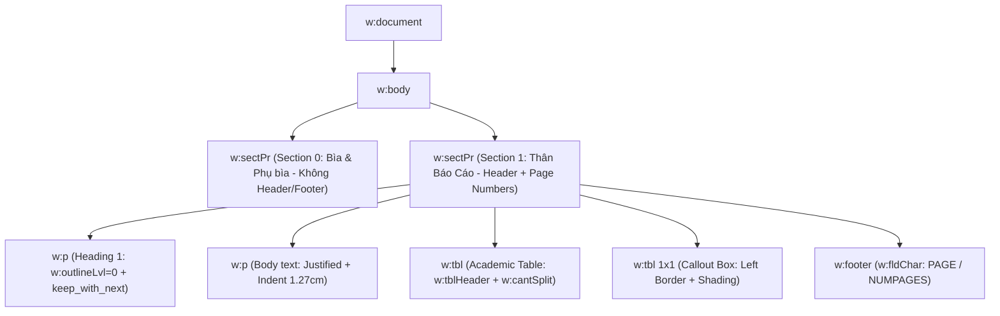

# Kỹ Nghệ Định Dạng Tài Liệu Microsoft Word OpenXML Chuẩn Sau Đại Học (Word Document Engineering)

Tài liệu này cung cấp hướng dẫn kỹ thuật chuyên sâu về cấu trúc OpenXML và lập trình tự động hóa tài liệu học thuật định dạng `.docx` bằng `python-docx`, đáp ứng 100% tiêu chuẩn Luận văn Thạc sĩ / Báo cáo Chuyên đề của Học viện Ngân hàng và Nghị định 30/2020/NĐ-CP.

---

## 1. Cấu Trúc Phân Cấp OpenXML Trong Tài Liệu Word



---

## 2. Các Tiêu Chuẩn Kỹ Thuật OpenXML Cốt Lõi

### 2.1. Cấu Hình Khổ Giấy & Lề — Chọn Đúng Profile Chuẩn
> **Lưu ý phạm vi:** Nghị định 30/2020/NĐ-CP chỉ chi phối **văn bản hành chính** (công văn, báo cáo hành chính).
> **Luận văn Thạc sĩ HVNH** chịu sự chi phối của "Quy định về trình bày luận văn" — Khoa Sau đại học HVNH,
> có thông số nghiêm ngặt riêng (xem `hvnh_thesis_standard.md`).

| Profile | Lề Trái | Lề Phải | Lề Trên | Lề Dưới | Giãn dòng | Dùng cho |
| :--- | :---: | :---: | :---: | :---: | :---: | :--- |
| **`hvnh-thesis`** | **3.5 cm** | 2.0 cm | **3.5 cm** | **3.0 cm** | **1.5** | Luận văn Thạc sĩ HVNH (chuẩn gốc) |
| `hvnh-khoaluan` | 3.5 cm | 2.0 cm | 3.5 cm | 3.0 cm | 1.3–1.5 | Khóa luận / Chuyên đề tốt nghiệp |
| `nd30-report` | 3.0 cm | 2.0 cm | 2.5 cm | 2.0 cm | ≤ 1.5 | Báo cáo hành chính ND 30 |

Trong code (`word_docx_recipes.py`): `configure_academic_document(doc, profile="hvnh-thesis")`.
Khổ giấy A4 cho mọi profile ($210 \times 297$ mm).

### 2.2. Word Native Heading & Navigation Pane (Cây Mục Lục Bên Trái)
Để thanh điều hướng **Navigation Pane** của Microsoft Word hiển thị cây mục lục tự động (cho phép click nhảy trang và thu gọn/mở rộng từng chương), bắt buộc phải sử dụng các Built-in Heading Styles:
* `Heading 1`: Gán tự động mức `w:outlineLvl w:val="0"`.
* `Heading 2`: Gán tự động mức `w:outlineLvl w:val="1"`.
* `Heading 3`: Gán tự động mức `w:outlineLvl w:val="2"`.
* **Thuộc tính chống rớt tiêu đề:** Bắt buộc bật `p.paragraph_format.keep_with_next = True` trên tất cả Heading để tiêu đề không bao giờ bị cô lập ở dòng cuối cùng của trang.

### 2.3. Đánh Số Trang Tự Động (Field Codes) — Đúng Vị Trí Chuẩn HVNH
**Vị trí bắt buộc cho luận văn Thạc sĩ:** số trang nằm ở **GIỮA, PHÍA TRÊN** đầu mỗi trang,
**bắt đầu đếm từ trang MỞ ĐẦU (= 1)**; các trang trước đó (bìa, cam đoan, mục lục, danh mục...)
không hiển thị số trang.

Kỹ thuật thực thi trong `word_docx_recipes.py`:
1. Soạn xong phần đầu (bìa → danh mục), gọi `apply_page_numbers_top_center(doc, 1)` **trước khi thêm tiêu đề MỞ ĐẦU**.
2. Hàm tạo một section mới (`WD_SECTION.NEW_PAGE`); section thân bài khai báo header riêng
   (unlinked) chứa field `PAGE` căn giữa; các section trước không có headerReference → trắng số.
3. Ghi `<w:pgNumType w:start="1"/>` vào sectPr của section thân bài để bộ đếm khởi động lại từ 1.
4. Các section về sau (chương, TLTK...) kế thừa header của section thân bài tự động.

Cấu trúc chuỗi trường mã `w:fldChar` (tự cập nhật trên mọi phần mềm — MS Word, WPS, LibreOffice):
```xml
<w:p>
  <w:r><w:t>Trang </w:t></w:r>
  <!-- Trường đếm số trang hiện tại -->
  <w:r>
    <w:fldChar w:fldCharType="begin"/>
    <w:instrText xml:space="preserve"> PAGE </w:instrText>
    <w:fldChar w:fldCharType="separate"/>
    <w:t>1</w:t> <!-- Cached value phục vụ previewer -->
    <w:fldChar w:fldCharType="end"/>
  </w:r>
  <w:r><w:t> / </w:t></w:r>
  <!-- Trường đếm tổng số trang -->
  <w:r>
    <w:fldChar w:fldCharType="begin"/>
    <w:instrText xml:space="preserve"> NUMPAGES </w:instrText>
    <w:fldChar w:fldCharType="separate"/>
    <w:t>25</w:t>
    <w:fldChar w:fldCharType="end"/>
  </w:r>
</w:p>
```

### 2.4. Tiêu Chuẩn Bảng Biểu Học Thuật (Academic Tables)
1. **Lặp lại tiêu đề bảng khi sang trang mới (`w:tblHeader`):** Thêm thẻ `<w:tblHeader/>` vào thuộc tính hàng đầu tiên (`trPr`) của bảng để khi bảng dài bị tách qua 2 trang, hàng tiêu đề cột tự động xuất hiện ở đầu trang sau.
2. **Chống ngắt hàng dở dang (`w:cantSplit`):** Thêm thẻ `<w:cantSplit/>` vào mọi hàng của bảng để các dòng nội dung không bao giờ bị cắt đôi giữa 2 trang.
3. **Đệm ô (Cell Margins/Padding):** Thiết lập `w:tcMar` với Top/Bottom = $90\text{ dxa}$ ($4.5\text{ pt}$), Left/Right = $110\text{ dxa}$ ($5.5\text{ pt}$) để nội dung bảng thông thoáng.
4. **Zebra Striping:** Tô màu xen kẽ các hàng dữ liệu bằng màu xám nhạt Slate 50 (`#F8FAFC`) để tăng khả năng đọc quét số liệu.

### 2.5. Phòng Ngừa Lỗi Giãn Chữ (Anti-Justification Word-Spacing Stretch)
* **Nguyên nhân:** Khi áp dụng `WD_ALIGN_PARAGRAPH.JUSTIFY` lên các đoạn văn ngắn, tiêu đề Callout, danh sách gạch đầu dòng, hoặc dòng công thức toán học (`1,600 × $500 = $800,000`), Word sẽ kéo dãn khoảng cách các từ toét sang hai mép lề.
* **Quy tắc vàng:**
  * **CHỈ** áp dụng `JUSTIFY` cho đoạn văn phân tích dài (Body text).
  * **BẮT BUỘC** áp dụng `LEFT` cho: Tiêu đề Callout, Tiêu đề Bảng/Hình, Gạch đầu dòng tính toán, Công thức toán học và Chân trang Footer.

### 2.6. Ngắt Trang Chuẩn Mực Từng Chương (Page Break per Chapter)
* Mỗi Chương (`CHƯƠNG 1` đến `CHƯƠNG 7` và `TÀI LIỆU THAM KHẢO`) phải luôn có `doc.add_page_break()` đứng trước.
* Việc này đảm bảo tính tôn nghiêm của văn bản học thuật sau đại học, mỗi chương luôn khởi đầu ở vị trí trên cùng của một trang giấy mới.
* Ngoại lệ: phần **Tóm tắt chương** nằm cuối chương, không nhất thiết sang trang riêng.

### 2.7. Quy Tắc Cấu Trúc Luận Văn Chuẩn HVNH
1. **Trình tự toàn văn:** Bìa ngoài → Phụ bìa → Bìa trong → Cam đoan → Mục lục → Danh mục chữ viết tắt → Danh mục bảng biểu/hình vẽ → **MỞ ĐẦU (bắt đầu đánh số trang)** → Chương 1..N → Kết luận → Danh mục công trình đã công bố → Tài liệu tham khảo → Phụ lục.
2. **Tiểu mục:** tối đa 4 cấp số (`3.1.2.1`); **cấm tiểu mục mồ côi** — phải có ít nhất 2 tiểu mục trong nhóm (không tồn tại `2.1.1` nếu không có `2.1.2`).
3. **Caption gắn số chương:** `Hình 3.4` = hình thứ 4 Chương 3; bảng caption PHÍA TRÊN, hình caption PHÍA DƯỚI; mọi bảng/hình từ nguồn ngoài phải ghi "Nguồn: ..." khớp với danh mục TLTK.
4. **Phương trình:** đánh số `(5.1)` trong ngoặc đơn căn lề phải; nhóm liên quan `(5.1.1), (5.1.2)`.
5. **Trích dẫn số:** `[15]`, `[15, tr.314-315]`; nhiều nguồn `[19], [25], [41], [42]`.
6. **Trích dẫn dài** (> 2 câu hoặc 4 dòng): tách đoạn riêng, lề trái lùi thêm 2 cm, bỏ ngoặc kép.
7. **Mục lục động đến 3 cấp** (`TOC \o "1-3" \h \z \u` + cờ `w:updateFields`).
8. **Văn phong trình bày:** tên chương/mục lớn IN HOA không kết thúc bằng dấu chấm; không để 1 từ đơn lẻ trong 1 dòng; xuống dòng lùi đều 1 tab (~1.27 cm).
9. **Cuối mỗi chương bắt buộc có Tóm tắt chương** (kết luận chương).
