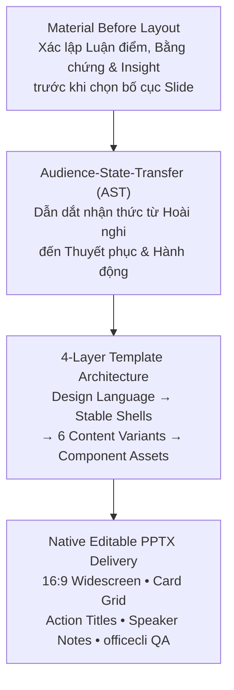

# Academic Postgraduate Writer & Document Engineering Skill

Kỹ năng chuyên sâu về **viết học thuật tiếng Việt trình độ sau đại học**, biên tập khoa học, kiểm soát tính chính xác khái niệm (*Epistemic Precision*), lập luận logic (*Toulmin & Swales Models*) và **tự động hóa định dạng tài liệu Microsoft Word (.docx) & PowerPoint (.pptx) chuẩn OpenXML** kế thừa kiến trúc mã nguồn mở **EasySlides** (`Rimagination/easyslides`), **ppt-master** (`hugohe3/ppt-master`), **academic-pptx-skill** (`Gabberflast/academic-pptx-skill`) và **humanize-ppt** (`LearnPrompt/humanize-ppt`).

---

## 1. Tuyên Ngôn Triết Lý & Nguyên Tắc Tối Thượng

> **Precision > Clarity > Logic > Evidence > Concision > Formality**

1. **Không tạo văn bản "trang trọng giả tạo":** Tuyệt đối không thay thế từ ngữ đơn giản bằng từ Hán-Việt phức tạp nếu không làm tăng độ chính xác của khái niệm (*sử dụng* $\rightarrow$ không cần đổi thành *vận dụng*; *làm rõ* $\rightarrow$ không cần đổi thành *minh định*).
2. **Không sáo ngữ & Không "AI smell":** Loại bỏ triệt để các cụm từ sáo rỗng (*"trong bối cảnh hiện nay", "có thể thấy rằng", "đóng vai trò vô cùng quan trọng", "góp phần không nhỏ", "ngày càng trở nên cấp thiết", "mang tính đột phá"...*).
3. **Độ chính xác nhận thức (Epistemic Precision):**
   * **Tương quan $\neq$ Nhân quả:** Không chuyển từ *"có tương quan với"* thành *"gây ra / dẫn đến / tác động đến"* nếu thiết kế nghiên cứu không đủ để xác lập quan hệ nhân quả.
   * **Mức độ khẳng định phải tương xứng với bằng chứng:** Phân biệt rõ *cho thấy, chỉ ra, gợi ý, hàm ý, có thể lý giải, chưa đủ cơ sở để kết luận* vs *chứng minh, cho phép kết luận*.
4. **Cấu trúc Lập luận Toulmin chuẩn mực:**
   $$\text{Luận điểm (Claim)} \longleftarrow \text{Bằng chứng (Data)} + \text{Luận cứ (Warrant)} + \text{Cơ sở (Backing)} + \text{Mức độ (Qualifier)}$$

---

## 2. Quy Chuẩn Định Dạng Microsoft Word (.docx) Bậc Sau Đại Học

### 2.1. Chọn Đúng Profile Chuẩn Trước Khi Soạn Thảo
> **Phạm vi chuẩn:** ND 30/2020/NĐ-CP chỉ áp cho **văn bản hành chính**. Luận văn Thạc sĩ HVNH
> tuân theo "Quy định về trình bày luận văn" — Khoa Sau đại học HVNH (`hvnh_thesis_standard.md`).

| Profile | Lề (T/D/TR/P) | Giãn dòng | Trích dẫn | Số trang | Dùng cho |
| :--- | :---: | :---: | :--- | :--- | :--- |
| **`hvnh-thesis`** ⭐ | 3.5 / 3.0 / 3.5 / 2.0 cm | **1.5** | Số `[15, tr.314]` | Giữa-phía-trên, đếm từ MỞ ĐẦU | **Luận văn Thạc sĩ HVNH** |
| `hvnh-khoaluan` | như trên | 1.3–1.5 | theo hướng dẫn Khoa | Giữa-phía-trên | Khóa luận / Chuyên đề TN |
| `nd30-report` | 2.5 / 2.0 / 3.0 / 2.0 cm | ≤ 1.5 | tùy chọn | Footer | Báo cáo hành chính ND 30 |

```python
from word_docx_recipes import configure_academic_document, apply_page_numbers_top_center
configure_academic_document(doc, profile="hvnh-thesis")   # gọi đầu tiên
# ... soạn bìa → cam đoan → mục lục → danh mục ...
apply_page_numbers_top_center(doc, start_value=1)          # gọi TRƯỚC tiêu đề MỞ ĐẦU
```

* **Khổ giấy:** A4 ($210 \times 297\text{ mm}$).
* **Font chữ đồng nhất:** **Times New Roman**, bảng mã Unicode.

### 2.2. Quy Chuẩn Đoạn Văn (Body Text) & Heading Phân Cấp
| Thành Phần | Cỡ Chữ | Kiểu Dáng / Màu Sắc | Giãn Dòng & Đoạn | Canh Lề / Thụt Đầu Dòng |
| :--- | :---: | :--- | :--- | :--- |
| **Body Text** | `13.0 pt` | Regular, Slate 900 (`#0F172A`) | Line $1.35$ • After $6\text{ pt}$ | **Justified** • First-line indent $1.27\text{ cm}$ |
| **Heading 1 (Chương)** | `15.0 - 15.5 pt` | **Bold**, Navy (`#0A2540`), ALL CAPS | Before $16\text{ pt}$ • After $8\text{ pt}$ | **Left** • First-line indent $0\text{ cm}$ |
| **Heading 2 (Mục 1.1)** | `13.5 pt` | **Bold**, Slate Blue (`#1F4D78`) | Before $14\text{ pt}$ • After $6\text{ pt}$ | **Left** • First-line indent $0\text{ cm}$ |
| **Heading 3 (Mục 1.1.1)** | `13.0 pt` | **Bold**, Cyan Blue (`#2E74B5`) | Before $10\text{ pt}$ • After $4\text{ pt}$ | **Left** • First-line indent $0\text{ cm}$ |
| **Caption (Bảng/Hình)** | `11.5 pt` | **Bold / Italic**, Navy (`#0A2540`) | Before $10\text{ pt}$ • After $4\text{ pt}$ | **Center / Left** • No indent |

> [!CRITICAL]
> **Giãn dòng theo profile:** bảng trên ghi giá trị legacy 1.35 của `nd30-report`; với
> `hvnh-thesis` / `hvnh-khoaluan`, giãn dòng thân bài là **1.5** (bắt buộc theo quy định Khoa Sau đại học).
>
> **Quy Tắc Chống Giãn Chữ (Anti-Justification Stretch):**
> 1. Chỉ áp dụng `Justified` cho các đoạn văn phân tích dài (Body text nhiều dòng).
> 2. Các **Tiêu đề Callout, Tiêu đề Bảng, Danh sách gạch đầu dòng ngắn, và Công thức tính toán** BẮT BUỘC phải đặt căn **TRÁI (Left Align)** để tránh bị Word kéo dãn khoảng cách giữa các từ/ký tự (`×`, `=`, `$`).
> 3. Mỗi Chương (`CHƯƠNG 1` đến `CHƯƠNG 7` và `TÀI LIỆU THAM KHẢO`) phải luôn bắt đầu bằng một **Page Break** (`doc.add_page_break()`) để tránh ngắt trang dở dang.
>
> **Quy Tắc Cấu Trúc Luận Văn HVNH:** caption gắn số chương (`Hình 3.4`, `Bảng 2.1`);
> bảng caption TRÊN — hình caption DƯỚI; tiểu mục tối đa 4 cấp và cấm mồ côi (phải có ≥2 tiểu mục);
> cuối mỗi chương có Tóm tắt chương; trích dài >4 dòng lùi lề trái 2cm bỏ ngoặc kép;
> TLTK đánh số `[n]` tách Tiếng Việt/Tiếng Anh, hanging indent 1cm; mục lục động 3 cấp.

---

## 3. Kiến Trúc Slide Nghiên Cứu Học Thuật (EasySlides & McKinsey Architecture)



### 3.1. Sáu Biến Thể Bố Cục Nội Dung (Content Variants)
1. **Metric & KPI Cards Grid:** Bố cục 3-4 thẻ với số liệu lớn `30-36pt Bold` ở đầu thẻ.
2. **Chart Deep-Dive (60/40 Layout):** $60\%$ khung hình ảnh biểu đồ độ nét cao bên trái, $40\%$ phân tích insight bên phải.
3. **Multi-Step Process Pipeline:** Trình diễn quy trình tiền xử lý, EDA hoặc mô hình hóa theo các bước $01, 02, 03, 04$.
4. **Side-by-Side Model Comparison:** Bảng so sánh 4 mô hình máy học với thẻ Winner được làm nổi bật viền Cam HVNH.
5. **Persona Profiles:** Thẻ chân dung khách hàng với hành vi nhận diện và hành động can thiệp.
6. **Strategic Tier Matrix:** Khung giải pháp giữ chân 4 tầng và chỉ số đo lường hiệu quả (KPIs).

### 3.2. Tiêu Đề Hành Động (Action Titles) & Speaker Notes
* **Action Title:** Mọi slide phải sử dụng tiêu đề hành động đúc kết kết luận chính (ví dụ: *"XGBoost Classifier Dẫn đầu Toàn diện với ROC-AUC 0.9930 & Recall 91.38%"* thay vì tiêu đề chung chung *"Kết quả mô hình"*).
* **Ghost Deck Test:** Đọc chuỗi Action Titles phải kể trọn vẹn câu chuyện nghiên cứu.
* **Speaker Notes:** Tích hợp sẵn lời thoại thuyết minh $80 - 150$ từ trên từng slide phục vụ thuyết trình $12 - 15$ phút và bảo vệ trước Hội đồng.

---

## 4. Hệ Thống Tài Liệu Tham Khảo & Code Library Kèm Theo

| Tài Liệu / Module | Đường Dẫn Tệp Tin | Nội Dung & Ý Nghĩa Kỹ Thuật |
| :--- | :--- | :--- |
| **Chuẩn Luận Văn HVNH (gốc)** | [references/hvnh_thesis_standard.md](file:///Users/dovandat/.gemini/config/skills/academic-postgrad-writer/references/hvnh_thesis_standard.md) | Quy định trình bày luận văn Khoa Sau đại học HVNH: lề, giãn dòng 1.5, số trang giữa-phía-trên đếm từ MỞ ĐẦU, tiểu mục ≤4 cấp cấm mồ côi, caption gắn chương, trích dẫn `[n]`, TLTK tách ngôn ngữ, checklist gate 10 điểm. **Ưu tiên cao nhất cho luận văn.** |
| **Cẩm Nang Viết Học Thuật** | [references/academic_writing_mastery.md](file:///Users/dovandat/.gemini/config/skills/academic-postgrad-writer/references/academic_writing_mastery.md) | Epistemic Precision, Toulmin Model, Swales CARS Model, Bộ lọc chống sáo ngữ AI, Trích dẫn theo loại tài liệu (`[n]` HVNH / APA 7th). |
| **Kỹ Nghệ Định Dạng Word** | [references/word_docx_engineering.md](file:///Users/dovandat/.gemini/config/skills/academic-postgrad-writer/references/word_docx_engineering.md) | Cấu trúc OpenXML, Word Navigation Pane, Dynamic Page Numbers giữa-phía-trên, Bảng biểu `w:tblHeader` / `w:cantSplit`, Anti-Justification, Quy tắc cấu trúc luận văn §2.7. |
| **Thư Viện Code Python-docx** | [references/word_docx_recipes.py](file:///Users/dovandat/.gemini/config/skills/academic-postgrad-writer/references/word_docx_recipes.py) | Module v2 profile-based: `configure_academic_document(doc, profile)`, `apply_page_numbers_top_center`, `add_title_page` (Mẫu 10), `add_cam_doan_page`, `add_toc_field`, `add_abbreviation_table`, `add_exhibits_list`, caption gắn chương (`chapter_label`), `add_block_quote`, `add_numeric_citation`, `add_reference_section_hvnh`, `add_published_works_section`. |
| **Cẩm Nang Slide EasySlides** | [references/easyslides_presentation_guide.md](file:///Users/dovandat/.gemini/config/skills/academic-postgrad-writer/references/easyslides_presentation_guide.md) | McKinsey Pyramid Principle, MECE Framework, AST, Bản thiết kế 20 Slide Master Blueprint. |
| **Thư Viện Code Python-pptx** | [references/presentation_pptx_recipes.py](file:///Users/dovandat/.gemini/config/skills/academic-postgrad-writer/references/presentation_pptx_recipes.py) | Module lập trình sẵn dùng cho 6 biến thể bố cục Slide 16:9 Widescreen & Speaker Notes. |
