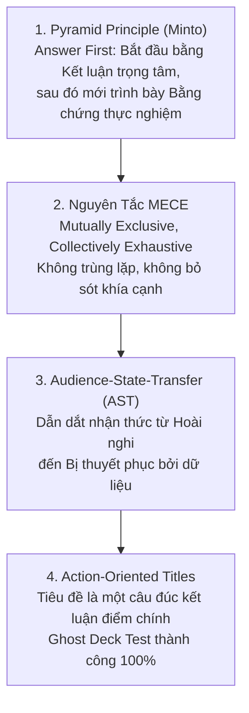

# Cẩm Nang Thiết Kế Slide Thuyết Trình Nghiên Cứu & Bảo Vệ Hội Đồng (Executive Academic Slide Architecture)

Tài liệu này tổng hợp toàn diện các chuẩn mực thiết kế trình chiếu học thuật cấp cao, kế thừa tinh hoa từ các dự án mã nguồn mở hàng đầu: **EasySlides** (`Rimagination/easyslides`), **ppt-master** (`hugohe3/ppt-master`), **academic-pptx-skill** (`Gabberflast/academic-pptx-skill`), **humanize-ppt** (`LearnPrompt/humanize-ppt`) cùng nguyên lý truyền thông tư vấn chiến lược **McKinsey Pyramid Principle** và **MECE Framework**.

---

## 1. Các Nguyên Lý Truyền Thông Học Thuật & Tư Vấn Cốt Lõi

### 1.1. Nguyên Lý Kim Tự Tháp (The Pyramid Principle - Barbara Minto)
* **Lead with the Answer (Kết luận trước - Diễn giải sau):** Đối với các buổi bảo vệ trước Hội đồng hoặc báo cáo chuyên gia, không giấu kết quả đến cuối slide. Ngay từ Slide 2 - 3, hãy tuyên bố rõ phát hiện trọng tâm: *"XGBoost Classifier đạt ROC-AUC = 0.9930, tối ưu hóa lợi nhuận ròng +$400,000 USD/năm tại ngưỡng t = 0.42"*.
* **Tư duy Top-down:** Luận điểm chính ở đỉnh $\longrightarrow$ Các nhóm luận cứ hỗ trợ $\longrightarrow$ Dữ liệu thống kê và biểu đồ chi tiết.

### 1.2. Nguyên Tắc MECE (Mutually Exclusive, Collectively Exhaustive)
Khi phân loại đối tượng hoặc phân chia giải pháp (ví dụ: Phân cụm khách hàng K-Means hoặc Khung giữ chân 4 tầng):
* **Mutually Exclusive:** Các phân khúc không được chồng chéo, giao thoa về mặt định nghĩa.
* **Collectively Exhaustive:** Tổng thể các phân khúc phải bao quát toàn bộ 100% quy mô tập dữ liệu hoặc bài toán kinh tế.

### 1.3. Phương Pháp Kiểm Thử Ghost Deck (The Ghost Deck Test)
* **Quy tắc:** Chỉ đọc chuỗi các **Tiêu đề Action Title** từ Slide 1 đến Slide 20 mà không nhìn vào nội dung bên trong.
* **Tiêu chuẩn đạt:** Nếu người đọc nắm được toàn bộ câu chuyện nghiên cứu (từ Vấn đề $\rightarrow$ Phương pháp $\rightarrow$ Phát hiện EDA $\rightarrow$ Kết quả Mô hình $\rightarrow$ Giải pháp Quản trị $\rightarrow$ Hiệu quả Tài chính), bộ Slide đã đạt chuẩn cấu trúc logic hoàn hảo.

---

## 2. Bản Thiết Kế 20 Slide Chuẩn Mực Cho Buổi Bảo Vệ Cao Học (20-Slide Master Blueprint)

| Slide | Loại Trang | Vai Trò Trong Lập Luận (Role) | Action Title Mẫu (Tiêu Đề Hành Động) | Bố Cục Đề Xuất (Layout) |
| :---: | :--- | :--- | :--- | :--- |
| **01** | Cover | Nhận diện đề tài & tác giả | *Xử lý Dữ liệu & Khai phá Dữ liệu Dự báo Rời bỏ Thẻ Tín dụng* | Hero Banner + Info Block |
| **02** | Executive Abstract | Trả lời trực diện kết quả chính | *XGBoost Dự báo Rời bỏ Đạt ROC-AUC 0.9930, Mang lại ROI 500%* | 4 Metric KPI Cards |
| **03** | Context & Motivation | Tính cấp thiết & bối cảnh kinh tế | *Chi phí Thu hút Khách hàng Mới Cao gấp 5-7 lần Chi phí Giữ chân* | 2 Columns (Bối cảnh vs Thách thức) |
| **04** | Research Question | Mục tiêu cốt lõi của nghiên cứu | *Mô hình Hóa Hành vi Giao dịch & Tối ưu Hóa Ngưỡng Can thiệp* | Callout Question + 4 Mục tiêu |
| **05** | Dataset & Dictionary | Tổng quan dữ liệu & quy mô mẫu | *Bộ Dữ liệu Thực nghiệm Gồm 10,127 Khách hàng & 23 Thuộc tính* | Dataset Summary + Table |
| **06** | Data Cleaning & FE | Tiền xử lý & tạo biến phái sinh | *Loại bỏ Rò rỉ Nhãn & Kiến tạo 5 Biến Phái sinh Phản ánh Hành vi* | 4-Step Process Pipeline |
| **07** | EDA - Target & Demo | Phân tích mất cân bằng lớp & tuổi | *Tỷ lệ Rời bỏ 16.07%, Khách hàng Nữ & Nhóm $120K Rủi ro Cao* | Chart Deep-Dive 60/40 |
| **08** | EDA - Transactions | Tần suất & giá trị chi tiêu | *Vùng Rủi ro Rời bỏ Tập trung Dưới 55 Lần Quẹt Thẻ & $3,000 Chi tiêu* | Chart Deep-Dive 60/40 |
| **09** | EDA - Financial Decay | Hiện tượng tất toán dư nợ | *Dư nợ Quay vòng Sụt giảm về $0 là Tín hiệu Sắp Hủy thẻ Rõ nét* | Chart Deep-Dive 60/40 |
| **10** | EDA - CSKH & Switching | Ngưỡng bất mãn & hệ sinh thái | *Ngưỡng 3 Lần Gọi CSKH Làm Tăng Nguy cơ Rời bỏ Gấp 3 Lần* | 2 Metric Cards + Insight Box |
| **11** | Statistical Testing | Kiểm định giả thuyết thống kê | *Kiểm định t-test Xác nhận Sự Khác biệt Có Ý nghĩa Thống kê (p<0.001)* | Summary t-test Table |
| **12** | Clustering (K-Means) | Phân cụm hành vi không giám sát | *Thuật toán K-Means Nhận diện 4 Phân cụm Hành vi Độc lập (k=4)* | PCA Cluster Map + Table |
| **13** | ML Model Training | Chiến lược huấn luyện 4 mô hình | *Quy trình Huấn luyện 4 Mô hình Học máy với Stratified Sampling* | 4 Model Tech Cards |
| **14** | Model Evaluation | So sánh hiệu năng & ROC-AUC | *XGBoost Vượt trội Toàn diện: ROC-AUC 0.9930 & Recall 91.38%* | ROC Curve (60%) + Winner Card |
| **15** | Feature Importance | Đóng góp của các biến số | *Tần suất Giao dịch & Mức Độ Sụt giảm Q4/Q1 Là Yếu tố Quyết định* | Horizontal Bar Chart + Insights |
| **16** | Threshold Optimization | Tối ưu hóa kinh tế theo chi phí | *Ngưỡng Cắt Xác suất t = 0.42 Tối đa hóa Lợi nhuận Ròng* | Net Profit Curve + Calculation Box |
| **17** | Customer Personas | 3 chân dung khách hàng rời bỏ | *Nhận diện 3 Chân dung: Ngủ đông (55%), Bất mãn (25%), VIP (20%)* | 3 Persona Profile Cards |
| **18** | 4-Tier Framework | Khung chiến lược can thiệp | *Khung Giữ chân 4 Tầng: EWS → CSKH Chủ động → Loyalty → Bán chéo* | 4-Tier Strategic Stack |
| **19** | Financial Simulation | Mô phỏng tài chính & ROI | *Dự án Giữ chân Mang lại Lợi nhuận Ròng +$400K/Năm (ROI = 500%)* | Financial Model Table + KPI Callout |
| **20** | Conclusion & Q&A | Đóng góp, hạn chế & hướng đi | *Tóm tắt Đóng góp Nghiên cứu & Định hướng Mở rộng XAI / Deep Learning* | 3 Summary Columns + Q&A Invite |

---

## 3. Hệ Thống 6 Biến Thể Bố Cục Thẻ (Card Layout Variants) Trong Python-pptx

1. **Variant 1 - Metric Grid (3-4 Cards):** Dành cho Slide KPI tổng kết.
2. **Variant 2 - Chart Deep-Dive (60/40 Split):** Cột trái $60\%$ hình biểu đồ, cột phải $40\%$ thẻ nhận định.
3. **Variant 3 - Horizontal Process Pipeline (4 Steps):** Dành cho quy trình tiền xử lý & Machine Learning.
4. **Variant 4 - Winner Model Comparison:** Dành cho đánh giá so sánh hiệu năng 4 mô hình học máy.
5. **Variant 5 - Persona Profiles (3 Cards):** Dành cho chân dung khách hàng và giải pháp giữ chân.
6. **Variant 6 - Strategic Framework Tier:** Dành cho khung chính sách quản trị và chỉ số KPIs.

---

## 4. Tích Hợp Speaker Notes Chuẩn Mực Cho Mỗi Slide

Mỗi slide khi lập trình bằng `python-pptx` đều phải được gắn `notes_slide.notes_text_frame.text` chứa:
* **Mở đầu chuyển ý:** *"Kính thưa Hội đồng, tiếp theo chúng ta cùng phân tích..."*
* **Số liệu then chốt:** Nhấn mạnh giá trị số liệu nổi bật trên slide.
* **Dự phòng phản biện:** Nêu lý do chọn phương pháp và ưu thế so với các giải pháp thay thế.
