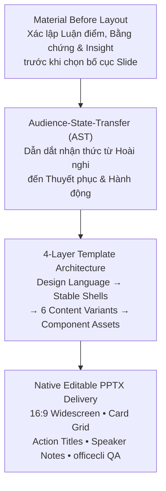

# Academic Postgraduate Slide Writer

Kỹ năng chuyên sâu về **thiết kế slide thuyết trình bảo vệ nghiên cứu / luận văn trình độ sau đại học**, kiểm soát tính chính xác khái niệm (*Epistemic Precision*), lập luận logic (*Toulmin & Swales Models*) và **tự động hóa dựng slide PowerPoint (.pptx) chuẩn OpenXML** kế thừa kiến trúc mã nguồn mở **EasySlides** (`Rimagination/easyslides`), **ppt-master** (`hugohe3/ppt-master`), **academic-pptx-skill** (`Gabberflast/academic-pptx-skill`) và **humanize-ppt** (`LearnPrompt/humanize-ppt`).

> Đây là skill dành riêng cho **slide thuyết trình / bảo vệ hội đồng**. Nếu cần soạn **báo cáo / luận văn dạng văn bản Word**, dùng skill song sinh `academic-docx-writer`.

---

## 1. Tuyên Ngôn Triết Lý & Nguyên Tắc Tối Thượng

> **Precision > Clarity > Logic > Evidence > Concision > Formality**

1. **Không tạo văn bản "trang trọng giả tạo":** Tuyệt đối không thay thế từ ngữ đơn giản bằng từ Hán-Việt phức tạp nếu không làm tăng độ chính xác của khái niệm (*sử dụng* $\rightarrow$ không cần đổi thành *vận dụng*; *làm rõ* $\rightarrow$ không cần đổi thành *minh định*).
2. **Không sáo ngữ & Không "AI smell":** Loại bỏ triệt để các cụm từ sáo rỗng (*"trong bối cảnh hiện nay", "có thể thấy rằng", "đóng vai trò vô cùng quan trọng", "góp phần không nhỏ", "ngày càng trở nên cấp thiết", "mang tính đột phá"...*).
3. **Độ chính xác nhận thức (Epistemic Precision):**
   * **Tương quan $\neq$ Nhân quả:** Không chuyển từ *"có tương quan với"* thành *"gây ra / dẫn đến / tác động đến"* nếu thiết kế nghiên cứu không đủ để xác lập quan hệ nhân quả.
   * **Mức độ khẳng định phải tương xứng với bằng chứng:** Phân biệt rõ *cho thấy, chỉ ra, gợi ý, hàm ý, có thể lý giải, chưa đủ cơ sở để kết luận* vs *chứng minh, cho phép kết luận*.
4. **Cấu trúc Lập luận Toulmin chuẩn mực:**
   $$\text{Luận điểm (Claim)} \longleftarrow \text{Bằng chứng (Data)} + \text{Luận cứ (Warrant)} + \text{Cơ sở (Backing)} + \text{Mức độ (Qualifier)}$$

Chi tiết đầy đủ về Toulmin Model, Swales CARS Model, thang đo mức độ khẳng định, bộ lọc chống sáo ngữ và quy tắc trích dẫn theo loại tài liệu — xem [references/academic_writing_mastery.md](references/academic_writing_mastery.md).

---

## 2. Kiến Trúc Slide Nghiên Cứu Học Thuật (EasySlides & McKinsey Architecture)

### 2.1. Ba Nguyên Lý Truyền Thông Cốt Lõi
1. **Pyramid Principle (Minto) — Answer First:** Không giấu kết quả đến cuối slide. Ngay từ Slide 2-3, tuyên bố rõ phát hiện trọng tâm (ví dụ: *"XGBoost Classifier đạt ROC-AUC = 0.9930, tối ưu hóa lợi nhuận ròng +$400,000 USD/năm tại ngưỡng t = 0.42"*). Tư duy top-down: Luận điểm chính ở đỉnh → nhóm luận cứ hỗ trợ → dữ liệu chi tiết.
2. **MECE (Mutually Exclusive, Collectively Exhaustive):** Khi phân loại (phân cụm K-Means, khung giữ chân 4 tầng...), các phân khúc không được chồng chéo và phải bao quát toàn bộ bài toán.
3. **Ghost Deck Test:** Chỉ đọc chuỗi Action Titles từ Slide 1 đến hết mà không nhìn nội dung bên trong — nếu người đọc vẫn nắm được toàn bộ câu chuyện nghiên cứu (Vấn đề → Phương pháp → Phát hiện → Kết quả → Giải pháp → Hiệu quả), bộ slide đạt chuẩn cấu trúc logic.

### 2.2. Sáu Biến Thể Bố Cục Nội Dung (Content Variants)
1. **Metric & KPI Cards Grid:** Bố cục 3-4 thẻ với số liệu lớn `30-36pt Bold` ở đầu thẻ.
2. **Chart Deep-Dive (60/40 Layout):** $60\%$ khung hình ảnh biểu đồ độ nét cao bên trái, $40\%$ phân tích insight bên phải.
3. **Multi-Step Process Pipeline:** Trình diễn quy trình tiền xử lý, EDA hoặc mô hình hóa theo các bước $01, 02, 03, 04$.
4. **Side-by-Side Model Comparison:** Bảng so sánh 4 mô hình máy học với thẻ Winner được làm nổi bật viền Cam HVNH.
5. **Persona Profiles:** Thẻ chân dung khách hàng với hành vi nhận diện và hành động can thiệp.
6. **Strategic Tier Matrix:** Khung giải pháp giữ chân 4 tầng và chỉ số đo lường hiệu quả (KPIs).

### 2.3. Tiêu Đề Hành Động (Action Titles) & Speaker Notes
* **Action Title:** Mọi slide phải sử dụng tiêu đề hành động đúc kết kết luận chính (ví dụ: *"XGBoost Classifier Dẫn đầu Toàn diện với ROC-AUC 0.9930 & Recall 91.38%"* thay vì tiêu đề chung chung *"Kết quả mô hình"*).
* **Speaker Notes:** Tích hợp sẵn lời thoại thuyết minh $80 - 150$ từ trên từng slide phục vụ thuyết trình $12 - 15$ phút và bảo vệ trước Hội đồng — cấu trúc gồm mở đầu chuyển ý, số liệu then chốt, và dự phòng phản biện.

### 2.4. Bản Thiết Kế 20 Slide Chuẩn Mực Cho Buổi Bảo Vệ Cao Học
Trình tự đầy đủ 20 slide (Cover → Executive Abstract → Context → Research Question → Dataset → Data Cleaning → EDA (4 slide) → Statistical Testing → Clustering → Model Training → Model Evaluation → Feature Importance → Threshold Optimization → Personas → 4-Tier Framework → Financial Simulation → Conclusion & Q&A), cùng vai trò lập luận, Action Title mẫu và bố cục đề xuất cho từng slide — xem bảng đầy đủ tại [references/easyslides_presentation_guide.md](references/easyslides_presentation_guide.md) §2.

---

## 3. Hệ Thống Tài Liệu Tham Khảo & Code Library Kèm Theo

| Tài Liệu / Module | Đường Dẫn Tệp Tin | Nội Dung & Ý Nghĩa Kỹ Thuật |
| :--- | :--- | :--- |
| **Cẩm Nang Viết Học Thuật** | [references/academic_writing_mastery.md](references/academic_writing_mastery.md) | Epistemic Precision, Toulmin Model, Swales CARS Model, Bộ lọc chống sáo ngữ AI, Trích dẫn theo loại tài liệu (`[n]` HVNH / APA 7th) — áp dụng cho văn phong trên slide (Action Titles, Speaker Notes, Insight text). |
| **Cẩm Nang Slide EasySlides** | [references/easyslides_presentation_guide.md](references/easyslides_presentation_guide.md) | McKinsey Pyramid Principle, MECE Framework, AST, Ghost Deck Test, Bản thiết kế 20 Slide Master Blueprint đầy đủ, 6 biến thể bố cục thẻ, chuẩn Speaker Notes. |
| **Thư Viện Code Python-pptx** | [references/presentation_pptx_recipes.py](references/presentation_pptx_recipes.py) | Module lập trình sẵn cho đủ 6 biến thể bố cục Slide 16:9 Widescreen: `create_executive_deck`, `add_blank_slide`, `add_action_header`, `add_card_box`, `add_metric_card` (V1), `add_chart_deep_dive_60_40` (V2), `add_process_pipeline_4` (V3), `add_model_comparison_cards` (V4 — thẻ Winner viền cam), `add_persona_profile_cards` (V5), `add_strategic_tier_matrix` (V6), `add_speaker_notes`, `validate_deck(prs)` (tự kiểm tra kích thước 16:9, số slide, độ dài Speaker Notes — QA gate). Đã kiểm thử chạy thực tế (dựng deck mẫu 6 slide + các ca lỗi), có cảnh báo rõ ràng khi thiếu ảnh hoặc số thẻ/bước lệch thiết kế thay vì lỗi âm thầm. |

## 4. Quy Trình Sử Dụng Đề Xuất

1. Chốt câu chuyện nghiên cứu theo Pyramid Principle: xác định luận điểm trung tâm trước khi mở `python-pptx`.
2. Ánh xạ nội dung vào khung 20-slide (`easyslides_presentation_guide.md` §2) — điều chỉnh số lượng slide EDA/model theo phạm vi đề tài thực tế, giữ nguyên trình tự lập luận Vấn đề → Phương pháp → Kết quả → Giải pháp.
3. Với mỗi slide: viết Action Title trước, sau đó chọn 1 trong 6 Content Variants phù hợp bằng `presentation_pptx_recipes.py`.
4. Gắn `add_speaker_notes` cho từng slide (80-150 từ: chuyển ý, số liệu then chốt, dự phòng phản biện).
5. Gọi `validate_deck(prs, expected_slides=...)` để tự động kiểm tra kích thước 16:9, số slide, và độ dài Speaker Notes trước khi qua bước đọc tay.
6. Chạy Ghost Deck Test: đọc lại toàn bộ Action Titles liên tiếp, đảm bảo mạch lập luận liền mạch không hở — đây là bước con người, `validate_deck()` không kiểm tra được nội dung tiêu đề.
7. Rà văn phong theo bộ lọc chống sáo ngữ (`academic_writing_mastery.md` §3) trước khi xuất bản `.pptx`.
